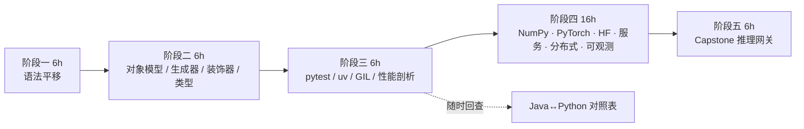

# 从 Java 到 Python AI Infrastructure：40 小时学习路线

> **读者画像**：有扎实 Java 工程经验（Spring / 并发 / JVM 调优都熟），Python 接近零基础，目标是进入 **AI Infrastructure** 方向 —— 推理服务、训练平台、GPU 调度、数据与模型工件管线。
>
> **总时长 40 小时 · 5 个阶段 · 每阶段都有可验收的产出**。时间锚点：2026 年 9 月。

---

## 0. 开始之前，先记住三句话

1. **你不需要"学 Python"，你需要把 Java 的工程直觉平移过来，同时卸掉三个会害你的直觉**：类型靠编译器保证、并发靠线程池、性能靠 JVM 帮你兜底 —— 这三条在 Python 里全部失效，而且失效方式各不相同。
2. **AI Infra 里 90% 的 Python 代码只用到语言的一个子集**：函数、`dataclass`、装饰器、生成器、`asyncio`、类型注解。元类、描述符、`__slots__` 这些现在一律不学，遇到了再查。
3. **真正的难点不在语法，在四个心智模型**：张量（shape/dtype/broadcast）、显存（分配/碎片/OOM）、批处理（吞吐 vs 时延）、GIL（为什么你的多线程不加速）。40 小时里有 16 小时是花在它们身上的，语法只占 6 小时。

一句话版路线：**6 小时把 Java 翻译成 Python → 6 小时补上 Python 特有的机制 → 6 小时把工程素养接回来 → 16 小时啃 AI Infra 技术栈 → 6 小时做一个能压测的推理服务**。

---

## 1. 40 小时怎么切

| 阶段 | 主题 | 时长 | 可验收的产出 |
|---|---|---|---|
| **一** | Java → Python 语法平移 | 6 h | 一个纯 Python 重写的小工具（原来你用 Java 写过的那种） |
| **二** | 对象模型 + Python 特有机制 | 6 h | 一个带类型注解、通过 `mypy` 的数据处理模块 |
| **三** | 工程化：测试 / 打包 / 并发 / 性能 | 6 h | 一个 `pyproject.toml` 管理、有 pytest 用例、能打 Docker 镜像的包 |
| **四** | AI Infrastructure 核心栈 | 16 h | 能跑通：张量操作 → 加载模型 → 起推理服务 → 出指标 |
| **五** | Capstone：LLM 推理网关 | 6 h | FastAPI + vLLM + 流式 + Prometheus + 压测报告 |
| | **合计** | **40 h** | |

**排期建议**：每周 8 小时 × 5 周（工作日晚 1.5 h × 4 + 周末 2 h），或每天 2 h × 20 天。
**不建议压到两周内** —— 阶段四必须留出反复踩显存和批处理坑的时间，那些坑是靠等待和重试学会的，不是靠读文档。



---

## 2. 阶段一（6 小时）：把 Java 翻译成 Python

目标不是"入门编程"，是**在 6 小时内让你写 Python 不再需要查"这个在 Java 里怎么写"**。

### 1.1 环境与工具链（1 h）

2026 年的正确答案很短：**用 `uv`**。它同时替代了 pyenv / pip / virtualenv / poetry，用 Rust 写的，快到不需要等。

```bash
curl -LsSf https://astral.sh/uv/install.sh | sh   # 装 uv
uv python install 3.12                            # 装解释器（AI 栈兼容性最好的版本）
uv init myproj && cd myproj                       # 建项目，生成 pyproject.toml
uv add numpy torch fastapi                        # 加依赖（自动建虚拟环境 + 写 lock）
uv run python -c "import torch; print(torch.__version__)"
```

**Java 对照**：

| Java | Python（2026 推荐） |
|---|---|
| JDK 版本管理（sdkman） | `uv python install` |
| Maven / Gradle | `uv`（`pyproject.toml` + `uv.lock`） |
| `pom.xml` | `pyproject.toml` |
| `~/.m2` 本地仓库 | 虚拟环境 `.venv/`（**每个项目一份**，不共享） |
| Checkstyle + SpotBugs | `ruff check`（linter，一个工具顶十个） |
| google-java-format | `ruff format` |
| 编译期类型检查 | `mypy` 或 `pyright`（**可选、事后、不阻塞运行**） |
| JUnit | `pytest` |

> ⚠️ **版本选择**：AI 栈优先 **Python 3.12**；3.13/3.14 的 free-threaded（无 GIL）构建虽已可用，但 CUDA/编译型轮子的生态支持还不整齐，别拿它当生产基线。

**练习**：用 `uv` 建一个空项目，装上 `ruff` + `pytest`，跑通 `uv run ruff check .`。

### 1.2 语法差异速查（2 h）

不用通读教程，把下面这张表过一遍，然后**用 Python 重写一段你熟悉的 Java 代码**（建议：一个读 CSV、聚合、输出报表的小工具）。

| 主题 | Java | Python | 踩坑提醒 |
|---|---|---|---|
| 语句块 | `{ }` + `;` | **缩进**（4 空格） | 混用 tab/空格直接报错；编辑器设死 4 空格 |
| 声明变量 | `int x = 1;` | `x = 1` | 没有声明关键字，拼错变量名 = 新建变量 |
| 空值 | `null` | `None` | 判空用 `if x is None`，**不要**用 `== None` |
| 相等 | `equals()` vs `==` | `==`（值） vs `is`（同一对象） | `is` ≈ Java 的 `==`；日常几乎只用 `==` |
| 真值 | 只有 `boolean` | 空容器/0/""/None 都是假 | `if not items:` 是地道写法，但小心 `0` 被当假 |
| 字符串 | `String.format` | f-string：`f"{name}: {x:.2f}"` | f-string 是默认选择，性能也最好 |
| 三元 | `c ? a : b` | `a if c else b` | 顺序不同，别读反 |
| 常量 | `final` | 没有，靠 `UPPER_CASE` 约定 | 语言不拦你，靠 review 和 linter |
| switch | `switch` | `match/case`（3.10+） | 结构化模式匹配，比 switch 强 |
| 循环 | `for (int i...)` | `for i in range(n)` / `for x in xs` | 几乎永远用 `for x in xs`，不用下标 |
| 索引遍历 | `for (i)` 取下标 | `for i, x in enumerate(xs)` | 需要下标就用 `enumerate` |
| 并行遍历 | 手写下标 | `for a, b in zip(xs, ys)` | |
| 切片 | `subList` | `xs[1:5]`、`xs[::-1]`、`xs[-1]` | **负索引从尾部数**，Java 没有 |
| 多返回值 | 返回对象/数组 | `return a, b` + `x, y = f()` | 元组解包，非常常用 |
| 异常 | checked + unchecked | **全是 unchecked** | 没有 `throws` 声明，靠文档和类型注解 |
| try-catch | `catch (E e)` | `except E as e:` | 还有 `else:`（无异常时）和 `finally:` |
| 资源关闭 | try-with-resources | `with open(p) as f:` | `with` ≈ AutoCloseable，用法更泛化 |
| 泛型 | `List<String>` | `list[str]`（注解，**运行时不生效**） | 注解只给工具看，不做检查 |
| 接口 | `interface` | `Protocol` / `ABC` / 鸭子类型 | 见 §3.1 |
| 包导入 | `import com.x.Y` | `from x import Y` | 导入的是**模块对象**，会执行模块顶层代码 |
| main | `public static void main` | `if __name__ == "__main__":` | 脚本与库两用的惯例写法 |
| 注释/文档 | `/** javadoc */` | `"""docstring"""` | docstring 是运行时可读的字符串 |

### 1.3 数据结构与"Stream API 的替代品"（1.5 h）

| Java | Python | 说明 |
|---|---|---|
| `ArrayList<T>` | `list` | `[1,2,3]`，可变、可混类型 |
| 不可变序列 | `tuple` | `(1,2)`，可作 dict key |
| `HashMap<K,V>` | `dict` | **保持插入顺序**（3.7+ 语言保证） |
| `HashSet<T>` | `set` | `{1,2}`；`{}` 是空 **dict** 不是空 set |
| `ArrayDeque` | `collections.deque` | 双端队列 |
| `Map.computeIfAbsent` | `collections.defaultdict` | |
| 手写计数 Map | `collections.Counter` | `Counter(words).most_common(10)` |
| `record` / Lombok `@Data` | `@dataclass` | 见 §3.1 |

**Stream API 对照**（这是 Java 人最快的提效点）：

| Java Stream | Python |
|---|---|
| `.map(f)` | `[f(x) for x in xs]` |
| `.filter(p)` | `[x for x in xs if p(x)]` |
| `.map().filter()` | `[f(x) for x in xs if p(x)]`（一行搞定） |
| `.collect(toMap(...))` | `{k(x): v(x) for x in xs}` |
| `.collect(toSet())` | `{f(x) for x in xs}` |
| 惰性无限流 | **生成器表达式** `(f(x) for x in xs)`（圆括号） |
| `.sorted(cmp)` | `sorted(xs, key=lambda x: x.age, reverse=True)` |
| `.anyMatch/.allMatch` | `any(...)` / `all(...)` |
| `.reduce` | `functools.reduce`（但通常有更直白的写法） |
| `.flatMap` | 双重推导 `[y for x in xs for y in x]` |
| `.groupingBy` | `itertools.groupby`（**要先排序**）或 `defaultdict(list)` |

> 💡 关键差别：**方括号推导式立即求值（吃内存），圆括号生成器惰性求值（省内存）**。处理几百万行日志时这个差别就是 OOM 与不 OOM。

### 1.4 函数与作用域（1.5 h）

- **函数是一等公民**：可以赋值、传参、返回、嵌套定义闭包。Java 8 之后你已经熟悉这套思路了。
- **关键字参数**：`connect(host="a", port=1)` —— 调用处自带可读性，AI 库里到处都是（`model.generate(max_tokens=512, temperature=0.7)`）。
- **默认参数**：`def f(x, retries=3)`。⚠️ **头号陷阱**：默认值在函数**定义时**求值一次。`def f(items=[])` 会让所有调用共享同一个 list。正确写法：`def f(items=None): items = items or []`。
- **`*args` / `**kwargs`**：可变参数与关键字透传，等价于 Java 的 varargs + Map，但用得频繁得多（装饰器、配置透传全靠它）。
- **`lambda` 很弱**：只能写单个表达式，没有语句。需要多行就用具名函数（Python 不鼓励把逻辑塞进 lambda）。
- **LEGB 作用域**：Local → Enclosing → Global → Builtin。函数内给外层变量赋值需要 `nonlocal` / `global`，否则会静默新建局部变量。

**阶段一验收**：能不查 Java 对照，独立写出一个 150 行左右的命令行工具（读文件 → 解析 → 聚合 → 格式化输出），`ruff check` 零告警。

---

## 3. 阶段二（6 小时）：对象模型 + Java 没有的那些机制

### 2.1 类与"接口"（1.5 h）

```python
from dataclasses import dataclass, field

@dataclass(slots=True, frozen=True)
class ModelSpec:
    name: str
    dtype: str = "bfloat16"
    tags: list[str] = field(default_factory=list)   # 可变默认值必须用 factory
```

| Java | Python | 说明 |
|---|---|---|
| `record` / Lombok `@Data` | `@dataclass` | 自动生成 `__init__`/`__eq__`/`__repr__`；`frozen=True` ≈ record |
| `private` 字段 | `_name`（约定）/ `__name`（名称改写） | **没有真正的访问控制**，靠约定 |
| 构造器 | `__init__(self, ...)` | `self` 必须显式写；`__new__` 才是真构造，用不上 |
| `this` | `self` | 显式传入，不是关键字 |
| `static` 方法 | `@staticmethod` | |
| 工厂方法 | `@classmethod def from_config(cls, ...)` | Python 只有一个 `__init__`，**重载靠 classmethod** |
| getter/setter | `@property` | 默认直接暴露属性，需要时再用 property 包装（不破坏调用方） |
| `toString()` | `__repr__` / `__str__` | |
| `equals`/`hashCode` | `__eq__`/`__hash__` | dataclass 自动生成 |
| `Comparable` | `__lt__` 或 `sorted(key=...)` | |
| `interface` | `typing.Protocol` | **结构化类型**：不需要 `implements`，长得像就算 |
| `abstract class` | `abc.ABC` + `@abstractmethod` | 需要强制继承时才用 |
| 单继承 + 接口 | 多继承 + MRO（C3 线性化） | 能用组合就别用多继承 |

> 💡 **心智切换**：Java 的"面向接口编程"在 Python 里是**鸭子类型 + Protocol**。你不需要提前定义接口再实现；先写具体类，需要抽象时再补一个 `Protocol` 给类型检查器看。

### 2.2 模块、包与导入（1 h）

- 一个 `.py` 文件 = 一个模块；一个目录（含 `__init__.py`）= 一个包。**导入会执行模块顶层代码**，所以顶层不要放重活。
- 推荐 **src layout**：`src/myproj/__init__.py`，避免"在项目根目录能 import、装包后 import 不到"的经典事故。
- 循环导入是真实问题（Java 靠编译器解决，Python 不行）：拆公共模块，或把 import 挪进函数内部。
- `if __name__ == "__main__":` —— 让文件既能被 import 又能直接跑。

### 2.3 迭代器与生成器（1.5 h）★ 重点

这是 Python 相对 Java 的**真实增益**，也是数据管道的地基。

```python
def read_batches(path, batch_size=64):
    batch = []
    with open(path) as f:
        for line in f:              # 文件本身就是迭代器，不会一次读进内存
            batch.append(parse(line))
            if len(batch) == batch_size:
                yield batch         # 交出一批，函数在这里"暂停"
                batch = []
    if batch:
        yield batch
```

- `yield` 让函数变成**惰性流**。上面这个函数处理 100 GB 文件的内存占用是 O(batch_size)。
- 消费方只是 `for b in read_batches(p):` —— 调用方完全不知道数据是懒加载的。
- 记住 `itertools`：`islice`（取前 N）、`chain`（拼接）、`groupby`（分组，**需先排序**）、`batched`（3.12+ 直接分批）。
- **AI Infra 场景**：数据集流式读取、日志回放、SSE 流式响应、DataLoader 的底层全是这套协议。

### 2.4 装饰器（1 h）

装饰器 ≈ **Java 注解 + 动态代理**，但**在纯 Python 里就能写完**，不需要 APT / AOP 框架。

```python
import functools, time

def timed(fn):
    @functools.wraps(fn)                  # 保留原函数名/docstring，别漏
    def wrapper(*args, **kwargs):
        t0 = time.perf_counter()
        try:
            return fn(*args, **kwargs)
        finally:
            print(f"{fn.__name__} took {time.perf_counter()-t0:.3f}s")
    return wrapper

@timed
def load_model(name): ...
```

你在 AI Infra 里会天天见到它们：`@app.post("/v1/chat")`（FastAPI 路由）、`@torch.no_grad()`（关梯度）、`@ray.remote`（分布式任务）、`@functools.lru_cache`（缓存）、`@pytest.fixture`（测试夹具）。**能读懂 + 能写简单的，就够了**。

### 2.5 类型注解（1 h）

对 Java 人来说这是最舒服的一层 —— 把静态类型的安全感找回来一部分。

```python
from typing import Protocol, Iterable

class Tokenizer(Protocol):
    def encode(self, text: str) -> list[int]: ...

def count_tokens(texts: Iterable[str], tok: Tokenizer) -> dict[str, int]:
    return {t: len(tok.encode(t)) for t in texts}
```

- 现代写法：`list[str]`、`dict[str, int]`、`int | None`（不再用 `List`/`Optional`）。
- **注解在运行时不做检查**，要靠 `mypy` / `pyright` 在 CI 里跑。唯一例外：**pydantic 会真的按注解做运行时校验**（FastAPI 靠它，见 §5.4）。
- 团队规约建议：**公开函数签名必须有注解，内部实现随意**。

**阶段二验收**：把阶段一的工具重构成一个包（src layout + dataclass + Protocol + 生成器流式处理），`mypy --strict` 基本通过。

---

## 4. 阶段三（6 小时）：把工程素养接回来

### 3.1 测试：pytest（1.5 h）

| JUnit | pytest |
|---|---|
| `@Test` | 函数名以 `test_` 开头即可 |
| `assertEquals(a,b)` | 裸 `assert a == b`（失败时自动展开差异） |
| `@BeforeEach` | `@pytest.fixture` |
| `@ParameterizedTest` | `@pytest.mark.parametrize` |
| Mockito | `unittest.mock` / `monkeypatch` fixture |
| `@Disabled` | `@pytest.mark.skip` / `skipif` |

fixture 比 `@BeforeEach` 强的地方：它是**依赖注入** —— 测试函数声明参数名，pytest 按名字注入，还能设 `scope="session"` 让重资源（比如加载一次模型）只建一次。

### 3.2 打包与依赖（1.5 h）

- `pyproject.toml` 声明依赖 → `uv.lock` 锁定精确版本（≈ Maven 的 dependency management + lock）。**lock 文件必须提交**。
- `uv sync` 复现环境；`uv add --dev pytest ruff` 管开发依赖。
- 装包形态：`wheel`（≈ jar，预编译）vs `sdist`（源码包）。AI 依赖几乎都是**带原生扩展的 wheel**（torch 里是 CUDA 二进制），所以 wheel 和你的 Python 版本 / OS / CUDA 版本强绑定 —— 这就是"换台机器装不上"的根因。
- Docker 里的 Python 基线（AI 场景直接从 CUDA 或 vendor 镜像起，不要从 `python:slim` 自己装驱动）：

```dockerfile
FROM nvidia/cuda:12.4.1-runtime-ubuntu22.04
COPY --from=ghcr.io/astral-sh/uv:latest /uv /usr/local/bin/uv
WORKDIR /app
COPY pyproject.toml uv.lock ./
RUN uv sync --frozen --no-dev      # 依赖层单独缓存
COPY src/ src/
CMD ["uv", "run", "python", "-m", "myproj.serve"]
```

### 3.3 并发模型（2 h）★★ 最需要重装大脑的一节

**GIL（全局解释器锁）**：CPython 同一时刻只有一个线程执行 Python 字节码。后果：**多线程无法加速纯 Python 的 CPU 计算**。你在 Java 里"开线程池打满 CPU"的直觉在这里是错的。

| 场景 | 该用什么 | Java 类比 |
|---|---|---|
| IO 密集（HTTP、DB、文件） | `asyncio`（首选）或 `threading` | Netty / Reactor / WebFlux |
| CPU 密集（纯 Python 计算） | `multiprocessing` / `ProcessPoolExecutor` | 多进程，靠序列化传数据 |
| CPU 密集（数值计算） | **NumPy / PyTorch**（底层 C/CUDA **会释放 GIL**） | 把热点下沉到原生代码 |
| 高吞吐 Web 服务 | `asyncio` + 多 worker 进程（uvicorn `--workers`） | 多实例 + 负载均衡 |

```python
import asyncio, httpx

async def fetch_all(urls: list[str]) -> list[str]:
    async with httpx.AsyncClient() as client:
        tasks = [client.get(u) for u in urls]
        resps = await asyncio.gather(*tasks)     # 并发发起，不是并行计算
    return [r.text for r in resps]
```

- `async def` 定义协程，`await` 让出事件循环，`asyncio.gather` 并发等待 —— 心智模型与 `CompletableFuture` / Reactor 很像，但**是单线程事件循环**。
- ⚠️ **最常见事故**：在 `async` 函数里调用阻塞库（`requests`、同步 DB 驱动、`time.sleep`），整个事件循环被卡死。要么换 async 客户端（`httpx`/`asyncpg`），要么 `await asyncio.to_thread(blocking_fn, ...)`。
- 关于 free-threaded Python（PEP 703，3.13 实验 / 3.14 起正式支持）：方向正确，但 2026 年 AI 生态的 CUDA 轮子支持仍不整齐 —— **了解即可，别作为架构前提**。

### 3.4 性能与调试（1 h）

| 需求 | Java | Python |
|---|---|---|
| 采样剖析（线上可用） | async-profiler | **`py-spy`**（不改代码、可 attach 到运行中进程） |
| 函数级剖析 | JFR | `cProfile` + `snakeviz` |
| 行级耗时 | — | `line_profiler` |
| 内存 | MAT / heap dump | `tracemalloc`、`memray` |
| 断点调试 | IDE debugger | `breakpoint()`（内置，直接进 pdb） |

核心心法：**Python 慢 30-100 倍是正常的，解决方案不是优化 Python 循环，而是把热点交给 NumPy / PyTorch / Polars / Rust 扩展**。判断标准很简单 —— 如果你在写"对几百万个元素做 for 循环"，那就是写错了。

**阶段三验收**：项目有 `pyproject.toml` + lock + ≥10 个 pytest 用例 + Dockerfile；能说清楚"什么时候该用 asyncio、什么时候该用多进程"。

---

## 5. 阶段四（16 小时）：AI Infrastructure 核心栈

这是重头戏。**你的定位是 infra 工程师，不是算法工程师** —— 不需要会推导反向传播，需要会让模型跑得稳、快、省。

### 4.1 NumPy 与张量思维（2 h）

一切 AI 的地基。张量 = 多维数组 + dtype + shape + 内存布局。

```python
import numpy as np
x = np.random.randn(32, 128).astype(np.float32)   # (batch, dim)
w = np.random.randn(128, 512).astype(np.float32)
y = x @ w                                          # (32, 512) 矩阵乘
print(y.shape, y.dtype, y.nbytes / 1024, "KB")
```

必须掌握的五件事：
1. **shape 与维度语义** —— 读错 shape 是所有 bug 的源头。养成习惯：每个张量在注释里写 `# (batch, seq, hidden)`。
2. **dtype 与显存** —— `float32`=4 字节、`bfloat16`=2 字节、`fp8`=1 字节。**参数量 × 字节数 = 权重显存下界**（7B 模型 bf16 ≈ 14 GB），这个口算能力你天天要用。
3. **broadcasting（广播）** —— 形状不同的张量如何自动对齐；不懂广播就会写出静默错误的代码。
4. **向量化替代循环** —— 同样的计算，向量化通常快 10-100 倍。
5. **view vs copy / contiguous** —— 切片和 `reshape` 常常只是视图，改视图会改原数据；`transpose` 后往往需要 `.contiguous()`。

### 4.2 PyTorch（infra 视角）（3 h）

**不学炼丹，学运行时**：

- **张量与设备**：`t.to("cuda")`、`t.dtype`、`t.device`；CPU↔GPU 拷贝是显式且昂贵的。
- **autograd 概念层**：知道计算图、`requires_grad`、`loss.backward()` 大致在做什么；推理侧一律 `with torch.inference_mode():` —— 省显存也省时间。
- **`nn.Module` 与 `state_dict`**：模型 = 结构（代码）+ 权重（state_dict）。**checkpoint 只是一个张量字典**，理解这点后模型加载/转换/分片就都不神秘了。
- **CUDA 语义 ★**：GPU 调用是**异步**的 —— 计时必须 `torch.cuda.synchronize()`，否则你测出来的是"提交耗时"不是"执行耗时"。了解 stream、`pin_memory`、H2D/D2H 拷贝开销。
- **显存管理 ★**：`torch.cuda.memory_allocated()` vs `memory_reserved()`（PyTorch 有自己的缓存分配器，`nvidia-smi` 显示的是 reserved）；OOM 的常见原因（batch 过大、KV cache、碎片、忘了 `inference_mode`、日志里留了张量引用）。
- **加速手段的名字**：`torch.compile`、混合精度（AMP/bf16）、FlashAttention、CUDA Graphs —— 至少知道每个解决什么问题。
- **`torch.profiler`**：看 kernel 级耗时，判断瓶颈在算力还是访存还是数据加载。

> 🎯 本节练习：加载一个小模型（如 0.5B），测出**单次前向的 P50 延迟**（记得 synchronize），再测 batch=1/8/32 的**吞吐曲线**，画出来。这张图会让你对"吞吐 vs 时延"的取舍有身体记忆。

### 4.3 模型与数据工件层（2 h）

- **HuggingFace 三件套**：`transformers`（模型代码）、`tokenizers`（分词）、`huggingface_hub`（下载与缓存，`HF_HOME` 指向大盘）。
- **权重格式**：`safetensors`（现在的标准，零拷贝 mmap、**安全**）vs `.bin`/pickle（**能执行任意代码，是真实的供应链攻击面** —— infra 侧应当禁止加载不可信 pickle）。
- **量化概念**：bf16 → fp8 / int8 / int4（AWQ、GPTQ、GGUF）。你要能回答"降精度省多少显存、掉多少质量、在哪种硬件上才有加速"。
- **数据侧**：Arrow / Parquet 列存（`datasets`、`polars`、`duckdb`）。**Java 人的优势**：这套列存 + 谓词下推的思路和你熟悉的大数据栈是一脉相承的，`polars` 的 lazy API 读起来像 Spark DataFrame。

### 4.4 推理服务（3 h）★★ 最贴近你 Java 经验的一节

**FastAPI ≈ Spring Boot + Bean Validation，但更轻**：

```python
from fastapi import FastAPI
from fastapi.responses import StreamingResponse
from pydantic import BaseModel, Field

class ChatRequest(BaseModel):                     # ≈ DTO + @Valid，运行时真校验
    prompt: str = Field(min_length=1, max_length=8192)
    max_tokens: int = 256
    stream: bool = False

app = FastAPI()

@app.post("/v1/chat")                             # ≈ @PostMapping
async def chat(req: ChatRequest):
    if req.stream:
        return StreamingResponse(token_stream(req), media_type="text/event-stream")
    return {"text": await generate(req)}
```

| Spring | Python |
|---|---|
| `@RestController` / `@PostMapping` | `@app.post` |
| DTO + `@Valid` | pydantic `BaseModel`（**运行时强校验**，v2 内核是 Rust） |
| Tomcat / Netty | `uvicorn`（ASGI）；多进程用 `--workers` |
| Springdoc / Swagger | **自动生成**，访问 `/docs` |
| `@ControllerAdvice` | 异常处理器 / 中间件 |
| Spring DI | FastAPI `Depends()` |

**然后是真正的 AI Infra 部分 —— LLM 推理引擎**：

- **为什么不能自己拿 `transformers` 裸跑服务**：没有 continuous batching、没有 paged KV cache，GPU 利用率个位数。
- **vLLM**：PagedAttention（把 KV cache 当虚拟内存分页管理，消灭碎片）+ continuous batching（请求级动态组批，不等整批结束）。提供 **OpenAI 兼容 API**，起服务基本一行命令。SGLang 是同赛道的另一个主流选择。
- **必须内化的指标口径**：**TTFT**（首 token 时延）、**TPOT/ITL**（每 token 间隔）、端到端时延、吞吐（tokens/s）、并发数、KV cache 命中率。prefill 阶段是**算力瓶颈**，decode 阶段是**访存瓶颈** —— 这一句解释了几乎所有 LLM 服务的性能现象。
- **取舍直觉**：增大批 → 吞吐↑、单请求时延↑；这与你在 Java 服务里调线程池/连接池的权衡同构，只是代价曲线陡峭得多。

### 4.5 分布式与编排（2 h）

- **Ray**：`@ray.remote` 把函数/类变成集群任务/actor；Ray Serve 做多模型编排。心智模型接近"分布式的 Executor + Actor"。
- **多卡/多机训练的名词**：DDP（数据并行）、张量并行 / 流水并行、`torchrun` 启动器、NCCL 集合通信（all-reduce / all-gather）。**infra 侧要能定位"卡在 all-reduce"这类问题**，不必自己写训练循环。
- **Kubernetes + GPU**：NVIDIA device plugin、`nvidia.com/gpu` 资源请求、节点亲和与污点、镜像巨大导致的冷启动、`Pod` 里跑 vLLM 的实际配置（共享内存 `/dev/shm`、健康检查要区分"进程活着"和"模型加载完"）。KubeRay / Kubeflow 了解轮廓即可。

### 4.6 数据与工作流（2 h）

- **Polars / DuckDB**：本地就能处理几十 GB 的列存引擎，比 pandas 快且内存友好。**infra 场景优先它们，不要从 pandas 深挖起步**。
- **编排器**：Airflow（最普及）/ Prefect / Dagster —— **选一个了解 DAG、重试、回填、幂等**这几个概念即可，它们与你熟悉的调度系统同构。
- **向量检索**：faiss / pgvector 的基本概念（索引类型、召回 vs 延迟的取舍），RAG 场景绕不开。

### 4.7 可观测性与可靠性（2 h）

| 需求 | Java | Python |
|---|---|---|
| 日志 | slf4j + logback | `logging`（标准库）或 `structlog`（结构化） |
| 指标 | Micrometer | `prometheus-client` |
| 链路追踪 | OpenTelemetry Java Agent | `opentelemetry-python`（FastAPI 有自动埋点） |
| 压测 | JMeter / Gatling | `locust`、`k6`，LLM 专用可用 vLLM 自带的 benchmark 脚本 |

**AI 服务该埋的指标**（与普通 Web 服务不同的部分）：GPU 利用率与显存占用、**排队时延**（请求在批调度器里等了多久）、running/waiting 请求数、KV cache 使用率、TTFT/TPOT 分位数、每请求 token 数与**每千 token 成本**。

**阶段四验收**：能独立起一个 OpenAI 兼容的推理服务，跑一次压测，并用一页纸解释"并发从 1 加到 64 时 TTFT 和吞吐分别怎么变、为什么"。

---

## 6. 阶段五（6 小时）：Capstone —— LLM 推理网关

一个能写进简历、也能直接当工作样例的项目。**分三个 milestone，每个 2 小时**。

### M1（2 h）：能跑通的服务

- FastAPI 网关 + pydantic 请求/响应模型 + `/healthz`（区分 liveness 与 "模型已就绪"）。
- 后端接 vLLM（或本地小模型），实现 `/v1/chat/completions`，支持 **SSE 流式输出**。
- `uv` 管依赖，`ruff` + `mypy` 干净，关键路径有 pytest 用例（用 fake 后端，别在单测里加载真模型）。

### M2（2 h）：像个生产服务

- **准入控制**：并发信号量 + 队列上限 + 超时；超载返回 429 而不是把 GPU 拖垮（≈ 你在 Java 里做的限流/舱壁）。
- **超时与取消**：客户端断连时**真正取消**下游生成（省 GPU，最容易被忽略的一点）。
- 结构化日志（带 request_id）+ Prometheus `/metrics`：TTFT、端到端时延、队列深度、in-flight 请求数、token 计数。
- Dockerfile（CUDA 基础镜像 + `uv sync --frozen`）。

### M3（2 h）：量化与成文

- 用 `locust` 或 benchmark 脚本，跑 **并发 1 / 4 / 16 / 64** 四档，记录 TTFT P50/P95、吞吐 tokens/s、GPU 利用率。
- 画出**吞吐-时延曲线**，找出膝点（knee point），给出"这台卡上的推荐并发上限"。
- 写一页 `README`：架构图（mermaid）、指标定义、压测结论、已知限制。

> 这个项目同时证明三件事：你会写 Python、你懂 LLM 服务的性能模型、你把 Java 时代的生产意识（限流、超时、可观测）带了过来。**第三条是你相对纯算法背景候选人的最大优势**。

---

## 7. Java 老手最容易踩的十个坑

1. **可变默认参数**：`def f(x=[])` 所有调用共享同一个 list。用 `None` 哨兵。
2. **以为类型注解会检查**：不会。不跑 `mypy` 等于没写。
3. **`is` 与 `==` 混用**：`is` 比较身份。只对 `None`/`True`/`False` 用 `is`。
4. **在 async 函数里做阻塞调用**：一个 `requests.get` 卡死整个事件循环。
5. **指望多线程加速 CPU 计算**：GIL 在。用多进程，或把计算下沉到 NumPy/Torch。
6. **浅拷贝当深拷贝**：`list(b)` 只拷一层；嵌套结构要 `copy.deepcopy`。
7. **循环里做标量运算**：几百万次 Python 循环 = 性能灾难。向量化。
8. **在 GPU 上不 synchronize 就计时**：测出来的数字是假的。
9. **全局可变状态 + 多 worker**：uvicorn `--workers 4` 是**四个进程**，进程内的缓存/计数器不共享 —— 状态要放 Redis 或外部存储。
10. **不锁依赖版本**：AI 生态的 torch/CUDA/transformers 版本组合极其脆弱，`uv.lock` 必须提交，镜像必须固定基础镜像 tag。

---

## 8. 这 40 小时里**不要**学的东西

明确排除，省下来的时间才够学阶段四：

- ❌ **Django / Flask 老教程** —— AI 服务栈是 FastAPI，学它。
- ❌ **conda / Anaconda 环境地狱** —— 2026 年用 `uv`，除非公司强制。
- ❌ **pandas 深挖** —— 知道基本用法即可，infra 侧优先 Polars / DuckDB / Arrow。
- ❌ **元类、描述符、`__slots__` 微优化** —— 读到再查，不专门学。
- ❌ **从零实现反向传播 / 手写 Transformer** —— 有意思，但不是 infra 岗的考点，会占掉你 10 小时。
- ❌ **爬虫、自动化办公、数据可视化** —— 与目标无关。
- ❌ **Python 2 相关的一切**。

---

## 9. 资源清单（按用途，不贪多）

| 用途 | 首选资源 |
|---|---|
| 语法速查（Java 背景） | 官方 Tutorial 只读 3/4/5/8/9 章 + 本文的对照表 |
| 地道写法 | *Effective Python*（Brett Slatkin，第 3 版）—— 条目式，随翻随用 |
| 类型注解 | mypy 官方 cheat sheet |
| 工具链 | `uv` 官方文档（很短）、`ruff` 规则说明 |
| 异步 | FastAPI 官方教程的 async 章节（最实用的入门角度） |
| NumPy | 官方 "NumPy: the absolute basics" + broadcasting 章 |
| PyTorch | 官方 "Learn the Basics" + **CUDA semantics** 与 **memory management** 两篇文档（infra 必读） |
| LLM 推理 | vLLM 官方文档（PagedAttention / continuous batching / 性能调优）+ 一篇 TTFT-TPOT 指标解析 |
| 服务化 | FastAPI 官方教程（从头到 Bigger Applications） |
| K8s + GPU | NVIDIA device plugin 文档 + 一份 vLLM on K8s 的部署示例 |

> 📌 原则：**每个主题只读一份主资源，剩下时间全部用来敲代码**。40 小时里至少 24 小时应该是手在键盘上。

---

## 10. 结业自检清单

能全部答"是"，这 40 小时就没白花：

- ☐ 能不查 Java 对照写出地道的 Python（推导式、生成器、dataclass、with、f-string）
- ☐ 能解释类型注解为什么不检查、以及 pydantic 为什么例外
- ☐ 能说清 GIL 的影响，并在 asyncio / 多进程 / 向量化之间正确选型
- ☐ 能用 `uv` 从零建项目、锁依赖、打出能跑的 CUDA 镜像
- ☐ 能口算 "7B 模型 bf16 权重要多少显存"，并说出 KV cache 为什么还要额外一大块
- ☐ 能读懂一段 PyTorch 推理代码，指出 shape 错误和显存浪费点
- ☐ 能起一个 OpenAI 兼容服务，支持流式，并解释 continuous batching 解决了什么
- ☐ 能定义并采集 TTFT / TPOT / 吞吐 / 队列深度，画出吞吐-时延曲线并指出膝点
- ☐ 能把 Java 时代的限流、超时、取消、可观测实践迁移到这个服务上

---

## 11. 40 小时之后（延伸方向，供下一轮规划）

学完这条线，下一步按岗位分叉：

- **推理性能方向**：CUDA 基础、算子融合、投机解码、PD 分离（prefill/decode 拆分部署）、多机推理。
- **训练平台方向**：DDP/FSDP、checkpoint 分片与容错、作业调度（Volcano/Slurm）、数据加载吞吐优化。
- **平台与成本方向**：多租户 GPU 池化、MIG / 时分复用、弹性伸缩、每千 token 成本核算与容量规划。
- **Agent/应用基础设施**：工具调用协议、上下文管理、缓存与路由、评测流水线。

选哪一支取决于你的团队缺口；但无论哪一支，上面 40 小时打的地基（张量 / 显存 / 批处理 / 服务化 / 可观测）都是复用的。
