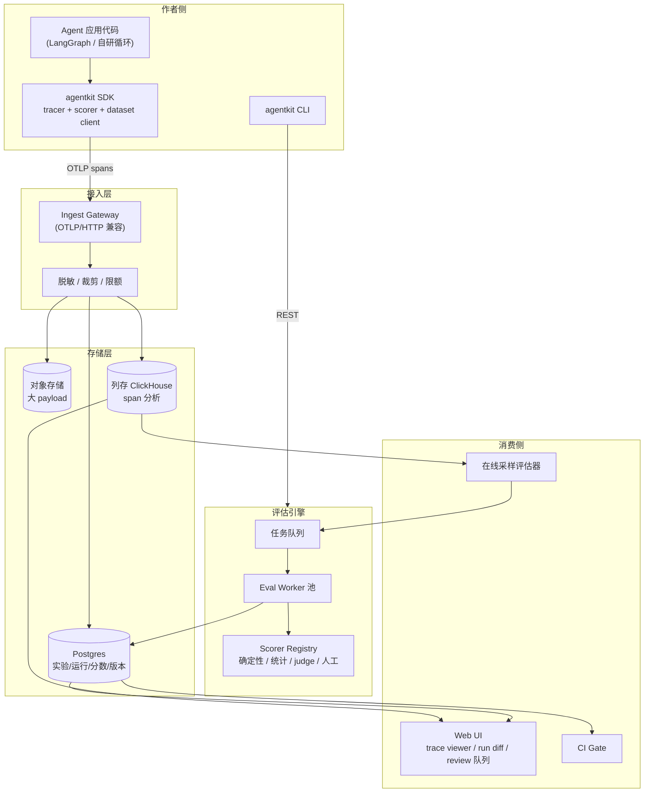
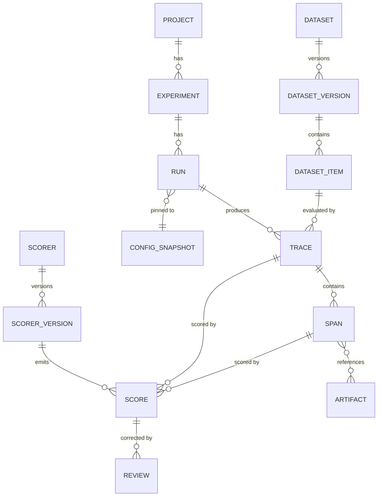
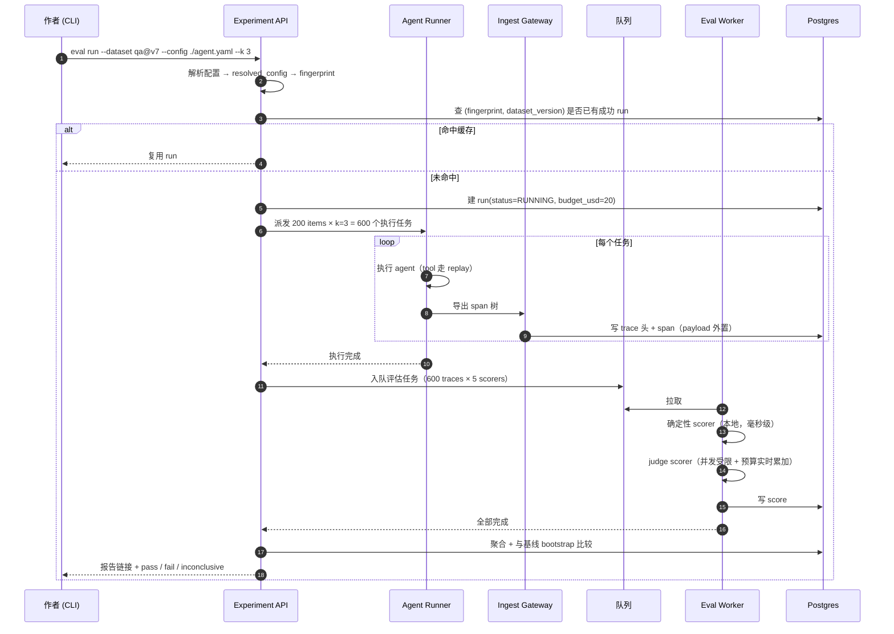

# LLM Agent 实验平台设计说明书：把一句简历 bullet 拆成可落地的系统

> **这一页解决什么问题**：简历上那句
> "Built LLM-agent tooling for experiment tracking and evaluation, speeding up experiment iteration"
> 听起来体面，但它到底代表哪些知识？如果面试官顺着这句话往下挖三层，需要答得出什么？
>
> 本文分两部分：**前半部分（第 1–2 章）把这句话拆成知识地图**，后半部分（第 3–13 章）是一份**真正能拿去评审的设计说明书**——目标与非目标、数据模型、12 条关键设计决策（ADR）、接口草案、容量估算、里程碑、失败模式。第 14 章反过来把 spec 折回成面试答案。
>
> 时间锚点：2026 年 9 月。配套阅读：[从 Java 到 Python AI Infrastructure：40 小时学习路线](/p/python-ai-infra-40h.html)（任务 #422），本文第 15 章给出两者的逐节映射。

---

## 0. 三句话先说清楚

1. **这句 bullet 的主语是"工具"，不是"agent"**。写它的人不是做了一个聪明的 agent，而是做了一套让**别人**做 agent 的人跑得更快的基础设施。用户是同事，不是终端用户——这个区别决定了系统的所有设计取向：SDK 要好嵌入、默认值要正确、失败要静默降级、数据要可比较。
2. **整套东西的技术难点不在"记录"，在"可比较"和"可信任"**。把一次 agent 运行存下来是一天的工作；让两次运行之间的差异**可归因**（是 prompt 改了还是模型漂移了还是数据集变了），让一个分数**值得据以做决策**（judge 有没有位置偏差？差 2 分是噪声还是真回归？）——这是六个月的工作。
3. **"speeding up experiment iteration" 是一个可量化断言，必须能说出口径**。加速的不是模型推理，是**人的循环**：从"我有个想法"到"我拿到一个带置信度的结论"。第 9 章把这段循环拆成七个环节，逐节指出平台在哪里省了时间、省了多少、以及**怎么诚实地度量它**。

---

## 1. 把这句话拆开：每个词背后的知识域

| bullet 里的词 | 它实际指什么 | 背后的知识域 | 面试官会追问什么 |
|---|---|---|---|
| **LLM-agent** | 被观测的对象是一棵**执行树**（规划→工具调用→观察→再规划），不是一次 request/response | agent 循环、ReAct / plan-execute、tool schema、上下文与记忆管理、多轮状态 | "你的数据模型怎么表示一次 agent 运行？为什么不是一条日志？" |
| **tooling** | 你交付的是 SDK + CLI + UI + CI 插件四个 surface，不是一个服务 | 库设计、隐式上下文传播、向后兼容、零配置默认值、埋点侵入性 | "别人凭什么用你的库？接入要改几行代码？崩了会不会拖垮他们的主链路？" |
| **experiment tracking** | 把"一次实验"定义成可复现、可寻址、可 diff 的对象 | 实验/运行/数据集的版本化，内容寻址指纹，配置解析，工件存储 | "两次 run 分数不同，你怎么证明是 prompt 的功劳？" |
| **evaluation** | 三类评估器（确定性 / 统计 / LLM-judge）× 三个层级（turn / trajectory / task）× 两个场景（离线 / 在线） | rubric 设计、LLM-as-judge 的偏差与校准、trajectory 指标、统计显著性、人工标注回流 | "你的 judge 可信吗？怎么证明？它自己漂了怎么办？" |
| **speeding up iteration** | 一个 DORA 风格的过程指标：想法 → 结论的 lead time | 迭代循环建模、缓存与重放、并行度、CI 门禁、成本治理 | "加速多少？基线是怎么测的？这个数字是你编的还是平台埋点算的？" |

> **一句话总结**：这条 bullet 的知识内核是 **"给不确定的系统建立可信的度量"**。传统后端工程师的直觉（记日志、看指标、写断言）在这里全部**部分失效**，而失效的方式各不相同——这正是下一章要讲的。

---

## 2. 为什么 agent 实验和传统 ML / 传统后端都不一样

这张表是整份 spec 的需求来源。**每一行都会导出后面的一条设计约束**，右列给出对应的 ADR 编号。

| 维度 | 传统 ML 实验 | LLM Agent 实验 | 导出的约束 |
|---|---|---|---|
| 自变量 | 超参、特征、网络结构 | prompt 文本、模型与采样参数、tool schema、检索配置、agent 图拓扑、记忆策略、**供应商模型版本** | 配置必须**完整解析后**再指纹化（ADR-05） |
| 因变量 | 一个标量 loss / 一组标准指标 | 没有 loss；质量要靠 rubric、judge 或人给出，且**多维不可合并** | 分数是一等公民实体，不是 run 上的一列（ADR-06） |
| 一次运行的形状 | 标量 + 曲线 | 一棵 span 树，**树的结构本身就是被评估对象** | trace 为主对象，span 树必须无损保存（ADR-01） |
| 可复现性 | 固定 seed 基本可复现 | temperature=0 也**不保证**逐 token 一致；供应商随时换 checkpoint | 必须有 record/replay，且要显式跟踪模型指纹（ADR-10） |
| 成本结构 | GPU 小时，前期可估 | token 成本 + 工具**副作用**（真发了邮件、真下了单） | 工具层必须可 mock / 可沙箱（ADR-10）、必须有预算闸（ADR-11） |
| 数据集 | 大、静态、划分固定 | 小（50–500 条）、**活的**，要持续从生产 trace 回流新 case | dataset 要版本化且支持增量追加（ADR-05） |
| 回归的形状 | 指标掉了很明显 | 改一句 prompt 可能只让 3% 的 case 炸，均值纹丝不动 | 门禁按**维度 + 分层**判定，并做显著性检验（ADR-09） |
| 评估器 | 是代码，确定的 | **评估器本身是个模型**，会漂移、有偏差、也需要被评估 | judge 必须版本化 + 人类校准（ADR-07） |
| 延迟/吞吐 | 离线为主 | 生产是在线的，且评估要同时在离线和在线跑 | 评估器一次定义、两处运行（ADR-08） |
| 观测数据量 | 小 | 一条 trace 的 payload 动辄 100 KB（长 prompt + 工具返回） | 元数据与 payload 分离存储（ADR-04） |

> **Java 工程师最容易带错的三个直觉**（承接 #422 的"卸掉三个直觉"）：
> 1. **"写个断言就行"** —— 输出是自然语言，断言只能覆盖最外层的 schema 和硬约束，覆盖不了"答得好不好"。
> 2. **"日志埋点是配角"** —— 在这里埋点数据就是产品本体，trace 是主数据而非可丢弃的运维副产物。
> 3. **"指标掉了会告警"** —— 质量回归是**长尾形状**的，靠均值告警必然漏报；必须按切片看。

---

## 3. 目标、非目标与用户

### 3.1 用户与他们的三个 JTBD

平台只有一类**主**用户：**在公司内部开发 agent 的工程师 / 应用科学家**（下称"作者"）。次级用户是 **reviewer**（给 case 打人工标签的人，可能是 PM 或领域专家）和 **on-call**（关心线上质量与成本的人）。

| JTBD | 作者原话 | 今天怎么做 | 痛在哪 |
|---|---|---|---|
| J1 诊断 | "这个 case 为什么答错了？" | 本地加 `print`，或者翻一堆散落的日志 | 看不到完整轨迹，看不到模型真正收到的 prompt（模板渲染后的） |
| J2 比较 | "我改了 prompt，到底变好了没？" | 手工跑 10 个例子，肉眼看 | 样本太少、没有对照、结论不可复制、第二天忘了当时的配置 |
| J3 守门 | "别人改了共享的 system prompt，会不会把我的场景搞坏？" | 靠自觉 | 没有回归网，事故在生产暴露 |

### 3.2 Goals（带验收标准）

| # | 目标 | 验收标准 |
|---|---|---|
| G1 | **三行接入**：现有 agent 代码加不超过 3 行就能产生完整 trace | 在两个存量项目上实测 diff 行数 ≤ 3；无需改动业务函数签名 |
| G2 | **不拖累主链路**：埋点对 p99 延迟的影响 < 1 ms，后端全挂时业务零感知 | 故障注入测试：collector 返回 500 / 超时 / DNS 失败，agent 成功率不变 |
| G3 | **一条命令跑实验**：`agentkit eval run` 在数据集上跑完并产出可分享报告 | 200 条数据集，端到端 < 10 分钟（并发 16） |
| G4 | **可归因的 diff**：任意两个 run 可并排比较，且系统能列出两者**全部**配置差异 | diff 页能显示 prompt 文本级 diff、模型指纹差异、数据集版本差异 |
| G5 | **可信的分数**：每个 LLM judge 上线前都有人类校准报告 | judge 与人类标注的 Cohen's kappa ≥ 0.6 才允许进门禁；低于阈值只能"仅展示" |
| G6 | **CI 守门**：PR 上自动跑子集，按维度阈值判定 | 故意注入一个已知回归的 PR，门禁必须红 |
| G7 | **生产回流**：线上 trace 可一键加入数据集 | 从 trace viewer 到 dataset item 的操作 ≤ 2 次点击，且自动脱敏 |

### 3.3 Non-goals（v1 明确不做）

| # | 不做 | 为什么 |
|---|---|---|
| N1 | 训练 / 微调编排 | 是另一个系统的职责；本平台只消费模型，不生产模型 |
| N2 | 自动 prompt 优化（DSPy / APE 那类） | 需要先有可信的评估信号才谈得上优化。**评估是优化的前置依赖**，顺序不能倒 |
| N3 | 通用 APM / 日志平台 | 复用公司现有的 OTel 管道，只加 GenAI 语义层 |
| N4 | 完整标注平台（多人仲裁、计件、众包） | 只做"轻量 review 队列"够用；真要大规模标注再接专业工具 |
| N5 | 自建向量库 / 检索服务 | 只观测检索，不提供检索 |
| N6 | 多模态评估（图像 / 音频输出） | v1 只覆盖文本与结构化输出；数据模型给多模态留了 payload 抽象但不实现评估器 |

> **写 spec 的经验**：Non-goals 比 Goals 更能体现判断力。N2 那一条（"评估是优化的前置依赖"）是整份 spec 里最容易被质疑也最值得守住的取舍——很多团队反过来做，先上自动优化，结果优化目标本身不可信，越优化越偏。

---

## 4. 系统总览



### 4.1 组件职责

| 组件 | 职责 | 明确**不**负责 |
|---|---|---|
| `agentkit` SDK | 产生 span；提供 `@scorer` 装饰器；拉取数据集；**永不抛异常到业务代码** | 不做重试策略决策、不做业务缓存 |
| Ingest Gateway | 鉴权、限流、脱敏、payload 外置、写三处存储 | 不做评估、不做聚合 |
| Postgres | 实验 / run / trace 头 / 分数 / 各类版本与指纹——**事务性真相源** | 不存大 payload |
| 对象存储 | prompt、completion、工具入出参等大 blob，按内容哈希寻址 | 不被直接查询 |
| ClickHouse | span 明细的分析型查询（分位数、切片、漏斗） | 不是真相源，可从 PG + OBJ 重建 |
| Eval Worker | 执行 scorer；管理并发与预算；把分数写回 PG | 不执行 agent 本身（agent 在作者进程或专用 runner 里跑） |
| CI Gate | 拉取基线 run，按维度比较，输出 pass/fail + 报告链接 | 不定义阈值（阈值在仓库里，作为代码） |

---

## 5. 数据模型（系统的心脏）

### 5.1 实体关系



### 5.2 核心概念的精确定义

| 实体 | 定义 | 关键字段 |
|---|---|---|
| **Experiment** | 一个**问题**，不是一次运行。例："客服 agent 的退款意图识别" | `id, project_id, name, owner, hypothesis` |
| **Run** | 一次 `(config_snapshot × dataset_version × code_version)` 的完整执行 | `id, experiment_id, config_fingerprint, dataset_version_id, git_sha, status, started_at, cost_usd` |
| **Trace** | 对**一条** dataset item 的一次 agent 执行（= 一棵 span 树的根） | `id, run_id, dataset_item_id, status, latency_ms, total_tokens, repeat_index` |
| **Span** | trace 内的一步：LLM 调用 / 工具调用 / 检索 / 子 agent | `id, trace_id, parent_id, kind, name, start, end, attrs, payload_refs` |
| **Score** | 一个评估器对一个 trace 或 span 给出的**单维**判断 | `id, trace_id, span_id?, scorer_version_id, name, value, label, rationale, cost_usd` |
| **Review** | 人对某个 score 的覆写或独立标注（校准与回流的来源） | `id, score_id?, trace_id, reviewer, label, note, created_at` |
| **ConfigSnapshot** | 解析后的**完整**配置（不是用户写的那份） | `fingerprint, resolved_json, prompt_refs, model_spec` |

> **`repeat_index` 这一个字段就值得单独讲**：因为 agent 非确定，同一个 item 在一个 run 里通常要跑 k 次（k=3 或 5）。有了它，"pass@k"、"方差"和"稳定性"才是可计算的；没有它，你所有的分数都只是一次抽样的运气。很多团队的数据模型漏了这一层，导致**噪声被误读成信号**——这是本设计里最便宜、收益最高的一个字段。

### 5.3 span 的 kind 与属性（对齐 OTel GenAI 语义约定）

| kind | 语义 | 关键属性 |
|---|---|---|
| `agent` | 一次 agent 调用（可嵌套子 agent） | `gen_ai.agent.name`, `gen_ai.operation.name` |
| `chat` | 一次模型调用 | `gen_ai.request.model`, `gen_ai.response.model`, `gen_ai.usage.input_tokens`, `gen_ai.usage.output_tokens`, `gen_ai.request.temperature` |
| `tool` | 一次工具执行 | `gen_ai.tool.name`, `gen_ai.tool.call.id`, 入参/返回（payload 外置） |
| `retrieval` | 一次检索 | 查询、top-k、命中文档 id 与分数 |
| `guardrail` | 一次拦截/校验 | 规则名、是否触发 |

**为什么记录 `request.model` 和 `response.model` 两个字段**：你请求的是 `gpt-x-latest` 这种别名，供应商返回的才是真正的 checkpoint。**质量无故变化的第一嫌疑人就是这里**，而只记请求侧的系统永远看不见它。这是个小字段，但它是"可归因"这条主线上最实用的一根钉子。

---

## 6. 关键设计决策（ADR）

每条决策按 **背景 → 选项 → 决定 → 理由 → 代价 → 反悔成本** 写。反悔成本这一栏是刻意加的：它把"现在必须想清楚的"和"以后再说也来得及的"分开，是控制 spec 篇幅和评审时间的关键。

### ADR-01：以 OpenTelemetry GenAI 语义约定为 wire format，而不是自造 schema

- **背景**：需要一套跨语言、跨框架的事件格式来描述 agent 执行。
- **选项**：(a) 自定义 JSON schema；(b) 直接绑定某个厂商 SDK（LangSmith / Langfuse / Weave）；(c) OTel GenAI semconv + 自有扩展命名空间。
- **决定**：**(c)**。span/attribute 用 `gen_ai.*` 官方命名，平台私有语义放在 `acme.eval.*` 前缀下，物理通道复用公司已有的 OTLP/HTTP。
- **理由**：三点。① 上游框架（OpenAI SDK、Anthropic SDK、Bedrock 等）的自动埋点已经在发 `gen_ai.*`，选它等于白捡一大批 instrumentation；② 与厂商解耦——今天自建、明天想把某块换成托管产品，只换导出端；③ 复用公司现成的 collector、采样、限流、鉴权，不重建一套管道。
- **代价**：**GenAI semconv 到 2026 年仍未稳定**——所有 `gen_ai.*` 属性在官方注册表里都还是 Development 状态，且 2026 年 6 月（semconv v1.42.0）整块被拆到独立仓库 `semantic-conventions-genai` 单独演进。字段名会变。
- **应对**：在 SDK 里加一层**极薄的属性映射表**（`semconv_map.py`，一个 dict），把内部规范名映射到当前版本的 wire 名；升级时只改这张表 + 写一条存量数据的 backfill 迁移。不在业务代码里直接硬编码 wire 名。
- **反悔成本**：**中**。换 wire format 要重刷历史数据，但有映射层就只是一次迁移作业，不动应用代码。

### ADR-02：SDK 用 `contextvars` 做隐式上下文传播，不要求业务显式传 `run_id`

- **背景**：要把散落在几十个函数里的调用串成一棵树。
- **选项**：(a) 显式参数传递 `ctx`；(b) 线程局部变量；(c) `contextvars`（asyncio 安全）。
- **决定**：**(c)**，并额外提供显式 `ctx` 逃生口给跨进程 / 跨队列的场景。
- **理由**：目标 G1 是"三行接入"。显式传参意味着改遍所有函数签名，谁都不愿意接入，工具就死了。`contextvars` 在 asyncio 下会随 Task 正确继承——这正是 Java 工程师容易踩的点：Python 的 `threading.local` 在 `asyncio` 里**会串**，因为多个协程共享同一线程。
- **代价**：跨进程边界（Celery / Ray / 子进程）上下文会丢，必须显式注入；`ThreadPoolExecutor` 里需要 `contextvars.copy_context()` 包一层。
- **应对**：为 `concurrent.futures`、Ray remote、Celery task 各提供一个一行的包装器。
- **反悔成本**：**低**。显式 API 一直在，隐式只是糖。

> Java 类比：这就是 `ThreadLocal` + MDC 那一套在 Python 异步世界里的正确对应物。`contextvars` ≈ 支持协程继承的 `ThreadLocal`；忘了这件事是 Java 老手写 Python 追踪代码时最典型的 bug。

### ADR-03：埋点走异步批量导出 + 有界队列 + 满则丢弃，永不阻塞业务

- **背景**：埋点数据量大，后端可能挂。
- **选项**：(a) 同步上报；(b) 异步无界队列；(c) 异步有界队列 + 丢弃 + 丢弃计数器。
- **决定**：**(c)**。队列上限按条数与**字节数**双限；满了丢新数据并递增 `dropped_spans` 计数，同时按分钟节流地打一条 WARN。
- **理由**：这是整份 spec 里最不该妥协的一条——**可观测性系统不能成为故障源**。无界队列在下游变慢时会吃光内存，把观测事故升级成生产事故（比原始故障更难查）。丢数据是可接受的；OOM 不是。
- **代价**：极端情况下采样不完整，聚合指标会偏低。
- **应对**：把 `dropped_spans` 本身作为一个一等指标上报到常规监控；UI 在数据不完整的 run 上打"采样不完整"横幅，禁止它作为门禁基线。
- **反悔成本**：**低**。参数化的队列策略。

### ADR-04：存储三分：Postgres 元数据 + 对象存储 payload + ClickHouse 分析

- **背景**：一条 trace 的 payload 常在 100 KB 量级（长 prompt、整页工具返回），但需要被查询的字段只有几十字节。
- **选项**：(a) 全放 Postgres；(b) 全放列存；(c) 三分。
- **决定**：**(c)**。Postgres 存事务性真相源；payload 按 `sha256` **内容寻址**写对象存储，span 里只留引用；ClickHouse 存 span 明细宽表供分析。
- **理由**：① 一天 10 万条 trace × 100 KB = 10 GB/天，放 Postgres 会让 autovacuum、备份、复制全部变形；② 内容寻址天然去重——同一个 system prompt 在一次 200 条数据集的 run 里出现 200 次，只存一份，实测能省掉 60–80% 的 payload 体积；③ "P95 延迟按工具名切片"这种查询在行存上是灾难，在列存上是秒级。
- **代价**：三处存储要保证最终一致；对象存储挂了 trace 能列出但打不开详情。
- **应对**：写入顺序固定为 **payload 先、元数据后**——元数据存在就保证 payload 存在，反过来允许有孤儿 blob，由 GC 按引用计数清理。UI 对缺失 payload 显示明确的降级态而不是报错。
- **反悔成本**：**高**。这是最贵的一条决策，必须在 M1 前定好。

### ADR-05：实验以"内容寻址指纹"标识，而不是自增 ID 或用户填的名字

- **背景**：G4 要求"任意两个 run 的差异可完整列出"。
- **选项**：(a) 用户自己写 run name；(b) 用 git sha；(c) 对**解析后的完整配置**做规范化 JSON 哈希。
- **决定**：**(c)**。`config_fingerprint = sha256(canonical_json(resolved_config))`，其中 `resolved_config` 包含：渲染前的 prompt 模板内容（不是路径）、模型别名**与**响应侧真实 model id、采样参数、tool schema 的 JSON、检索参数、agent 图拓扑、SDK 版本。
- **理由**：靠人命名的实验三个月后没人认得；git sha 抓不到"改了数据库里的 prompt"或"供应商换了 checkpoint"这类变化。内容寻址还白送两个能力：**自动去重**（同指纹 + 同数据集版本 = 直接复用结果，不重跑）和**精确 diff**（两个 resolved_json 做结构化 diff 就是 UI 上那张差异表）。
- **代价**：规范化是脏活——键排序、浮点格式、不稳定字段（时间戳、临时路径）都要显式剔除，否则指纹每次都变、缓存永远不命中。
- **应对**：规范化规则写成一个单独模块，配一组**黄金测试**（同义配置必须同指纹、任一语义字段变化必须变指纹）。
- **反悔成本**：**中**。改哈希口径会让历史缓存整体失效，但不丢数据。

### ADR-06：`Scorer` 统一抽象，四类评估器共用一个接口

- **背景**：评估器有四类：确定性（JSON schema 合法、必含引用、工具序列匹配）、统计（BLEU/ROUGE/embedding 相似度）、LLM-judge、人工。
- **选项**：(a) 各做各的；(b) 一个接口 `(input, output, trace, reference) -> list[Score]`。
- **决定**：**(b)**。所有评估器都是**纯函数**，输入包含完整 trace，输出是一个**多维** score 列表（而非单值），并且必须声明自己是否幂等、是否有成本、是否需要 reference。
- **理由**：统一接口使三件事一次实现、处处可用：缓存（幂等的就能缓存）、成本核算、离线/在线复用（ADR-08）。"输入里给完整 trace"是关键——trajectory 类指标（工具调用是否走了弯路）没有 trace 根本算不出来。
- **代价**：接口偏宽，写一个简单的正则评估器也要接收整棵树。
- **应对**：提供 `@scorer(needs="output")` 这样的声明，运行时只注入需要的部分，保持轻量评估器的书写体验。
- **反悔成本**：**高**。这是所有用户代码依赖的公共接口，一旦扩散就改不动。**这是 M0 必须定死的两件事之一**（另一件是 ADR-04）。

### ADR-07：LLM-as-judge 必须经过"可信度工程"才允许进门禁

- **背景**：judge 便宜、可扩展，但**有系统性偏差**且会漂移。2026 年的大规模实测结论很扎心：test–retest 可靠性 > 0.95 的生产 judge，位置偏差依然可以 > 0.10；高"一致性"完全不等于高"有效性"。
- **决定**：任何 judge 上线前走一条固定流水线，**六步缺一不可**：

  | 步 | 做什么 | 卡点 |
  |---|---|---|
  | 1 | rubric 拆解：把"回答好不好"拆成 3–6 个**二元或三级**的独立子判断 | 禁止单个 1–10 分的笼统评分 |
  | 2 | 采 100–300 条样本，由 2 名人类独立标注 | 人类之间 kappa < 0.6 说明 **rubric 本身有歧义**，回第 1 步 |
  | 3 | judge 跑同一批，算与人类的 Cohen's kappa | **kappa ≥ 0.6 才允许用于门禁**；0.4–0.6 只能"仅展示"；< 0.4 打回 |
  | 4 | 偏差体检：位置（成对比较两序都跑取平均）、冗长（长答案是否系统性占优）、自偏好（judge 与被测**不得同族**） | 任一偏差超阈值则修 prompt 重来 |
  | 5 | 固定 judge 版本：模型 id + prompt + rubric + 少样本示例一起指纹化 | judge 换版本 = 新 scorer_version，历史分数**不回填、不混用** |
  | 6 | 持续监控：每周抽 30 条人工复核，追踪 kappa 漂移 | 连续两周跌破阈值 → 自动降级为"仅展示" |

- **理由**：门禁如果建立在不可信的分数上，会产生比没有门禁更坏的结果——团队学会绕过它，同时还相信自己有质量保障。第 5 步（judge 版本化且历史不混用）在实践中最容易被忽视：悄悄换了 judge 模型，然后把新分数和旧分数画在同一条趋势线上，得到一个纯属虚构的"质量提升"。
- **代价**：每个 judge 的上线成本从"写个 prompt"变成"1–2 人日"。
- **应对**：把这条流水线做成平台能力（`agentkit judge calibrate`），让成本从人工变成按一个命令走完；否则这条规则会被绕过。
- **反悔成本**：**低**（流程而非架构），但**放松它的代价极高**。

### ADR-08：评估器一次定义、离线在线两处运行

- **背景**：离线在数据集上跑、在线对生产流量采样跑，两边如果各写一套，指标定义必然发散。
- **决定**：同一个 `Scorer` 实现，两个执行上下文。区别只在于**是否有 reference**：离线有标准答案，在线没有——所以只有 `needs_reference=False` 的评估器（无参考指标：忠实度、格式合法性、工具成功率、拒答率）能在线跑，平台在注册时静态检查并拒绝错配。
- **理由**：这是"线上线下一致性"问题的 LLM 版本。指标定义发散会让线上线下的对比彻底失去意义，而这个 bug 极难发现——两边各自看起来都对。
- **代价**：评估器要写得更克制（不能随手依赖只有离线才有的上下文）。
- **反悔成本**：**低**。

### ADR-09：CI 门禁按维度 + 分层 + 显著性判定，绝不用单一聚合分

- **背景**：G6。改一句 prompt 可能只让某个长尾切片炸掉，平均分完全看不出来。
- **决定**：门禁配置是仓库里的 `eval.yaml`（阈值即代码，随 PR 评审）。判定三条并列：
  1. **按维度**：每个 scorer 维度各有阈值，任一维度跌破绝对下限 → 红。
  2. **按切片**：预定义切片（语言、意图类别、输入长度分桶、是否多轮）上分别判定，防长尾回归。
  3. **按显著性**：与基线的差异做 bootstrap 重采样（n=1000）求置信区间；**区间跨 0 就报 "inconclusive" 而不是 pass**，并在 PR 上提示"需要扩样本或多跑几轮 k"。
- **理由**：第 3 条是最容易被省掉也最重要的一条。没有它，50 条数据集上 2 个百分点的波动会被当成结论，团队会在噪声上来回改 prompt——这恰恰是"迭代变慢"的主因之一，因为**假信号比没信号更浪费时间**。
- **代价**：门禁会更频繁地给出"不确定"，用户初期会觉得烦。
- **应对**：UI 直接给出"要把这个差异判到显著，需要多少样本"的建议值（由当前方差反推），把抱怨转成可执行动作。
- **反悔成本**：**低**。

### ADR-10：record / replay —— 工具调用与模型响应可录制回放

- **背景**：agent 实验重跑很贵（token）且有副作用（真的调了外部 API）；而且供应商响应不可复现，导致"到底是我改坏了还是模型漂了"无法区分。
- **决定**：SDK 提供三种模式：`live`（真调）、`record`（真调并把请求指纹→响应存为 cassette）、`replay`（命中 cassette 就返回录制值，未命中按策略 fail 或 fallthrough）。请求指纹 = 规范化后的请求体哈希。
- **理由**：一次决策换来四件事：① 单测和 CI 快速子集可以零成本零副作用地跑；② **把"模型漂移"变成可控变量**——replay 下重跑，如果分数变了，那一定是你的代码变了；③ 评估器自身的回归测试有了稳定输入；④ 外部 API 故障时实验不中断。
- **代价**：cassette 要存储和过期管理；录制数据里可能含敏感信息。
- **应对**：cassette 走同一套内容寻址存储和脱敏管线；默认 TTL 30 天；`replay` 模式在报告上强制打标，禁止把 replay 结果当作真实质量基线对外汇报。
- **反悔成本**：**低**（可后加），但**越早加省越多钱**。建议 M2 落地。

### ADR-11：成本与副作用治理是一等功能，不是事后报表

- **背景**：一次 200 条 × k=3 × 带 judge 的实验很容易烧掉几十美元；judge 成本经常**超过**被测 agent 本身。一个写错的循环可以在夜里烧掉四位数。
- **决定**：
  - 每个 run 在提交时必须有 `budget_usd`（有项目级默认值），worker 侧**实时累加**，超 80% 告警、超 100% 立即中止并保留已完成部分。
  - 成本按 `(run, scorer, model)` 三维归集，UI 默认展示 **judge 成本占比**这个单独指标。
  - 工具调用在离线评估上下文里默认走 `replay` 或 mock；要 `live` 必须在 `eval.yaml` 里显式开 `allow_side_effects: true`。
- **理由**：成本不是财务问题而是**可用性问题**——预算失控一次，团队就再也不敢跑大实验，平台的价值随即归零。"judge 成本占比"单独拎出来，是因为它是最常见的失控源，而且默认是隐形的。
- **反悔成本**：**低**，但事故是不可逆的。

### ADR-12：默认不落盘原文，脱敏在 Ingest 侧做

- **背景**：prompt 与工具返回里天然含 PII / 商业数据。
- **决定**：三级 `payload_policy`：`full`（存原文）/ `redacted`（正则 + NER 打码后存，**默认**）/ `hash_only`（只存哈希与长度，用于确认"内容变了"而不暴露内容）。脱敏在 Gateway 做而不是 SDK 做——SDK 版本参差不齐，安全策略必须在服务端统一执行且可随时收紧。
- **代价**：脱敏会伤害可调试性（J1 诊断变难），也可能误伤（把代码片段当成敏感信息打码）。
- **应对**：按项目配置；高敏项目用 `redacted` + 短 TTL；同时提供"临时全量开关"（限时、记审计日志、需二次审批）。
- **反悔成本**：**高**。已经落盘的原文事后再脱敏成本极大——**这个决策必须在 M1 之前定**。

### 6.1 决策速查

| ADR | 一句话 | 反悔成本 | 必须何时定 |
|---|---|---|---|
| 01 | wire format 用 OTel GenAI semconv + 映射层 | 中 | M1 |
| 02 | `contextvars` 隐式传播 + 显式逃生口 | 低 | M1 |
| 03 | 异步有界队列，满则丢，永不阻塞 | 低 | M1 |
| 04 | PG + 对象存储 + ClickHouse 三分 | **高** | **M0** |
| 05 | 解析后配置的内容寻址指纹 | 中 | M1 |
| 06 | 统一 `Scorer` 接口，多维输出 | **高** | **M0** |
| 07 | judge 必须过校准流水线才进门禁 | 低（放松代价极高） | M2 |
| 08 | 评估器一次定义两处运行 | 低 | M2 |
| 09 | 门禁按维度 + 切片 + 显著性 | 低 | M3 |
| 10 | record / replay | 低 | M2 |
| 11 | 预算闸与成本归集 | 低 | M2 |
| 12 | 默认脱敏，服务端执行 | **高** | **M1** |

---

## 7. 关键流程：一次实验从提交到出报告



**这张图里藏着三个设计点**，评审时最值得展开讲：

1. **第 3–5 步的缓存命中**是 ADR-05 的直接兑现。真实使用中命中率不低——反复跑同一配置（换个人跑、CI 重跑、改了注释就重跑）占了相当比例，命中即零成本。
2. **执行与评估解耦**（第 12 步入队）：agent 执行是 IO 密集且可能很慢，评估是另一种资源画像（judge 调用受供应商限流约束）。放在一个进程里会互相拖累，而且执行失败就丢掉了已产生的 trace。解耦后**评估可以重跑而不必重新执行 agent**——换了 rubric 想重新打分，直接跑第二段，这是省时间的大头。
3. **预算实时累加在 worker 侧**（ADR-11）：不是事后算账，是执行中止闸。

---

## 8. 评估体系设计详解

### 8.1 三个层级的指标

| 层级 | 问什么 | 典型指标 | 评估器类型 | 代价 |
|---|---|---|---|---|
| **Turn（单步）** | 这一步的输出对不对？ | 输出 schema 合法性、忠实度（是否有出处支撑）、拒答是否恰当、工具入参正确性 | 确定性 + judge | 低 |
| **Trajectory（轨迹）** | 过程走得好不好？ | 工具选择正确率、工具集合 F1、顺序匹配（任意序 / 严格序 / 完全匹配）、步数与循环数、是否兜圈子、计划一致性 | 确定性为主 | 极低 |
| **Task（任务）** | 用户的目标达成没有？ | 任务完成率、pass@k、端到端延迟、单任务成本、人工满意度 | judge + 人工 | 高 |

> **设计取向**：**尽量把判断下沉到 trajectory 层**。轨迹指标绝大多数是**确定性**的（工具调用序列是结构化数据，比对就行），因而免费、稳定、无偏差。很多团队的默认反射是"上 judge 打个总分"，结果既贵又不稳，还说不清问题出在哪一步。先把轨迹层能确定判定的全部榨干，judge 只用来判真正需要语义理解的那部分——这一条既省钱又提升信号质量。

### 8.2 `Scorer` 接口（ADR-06 的落地形态）

```python
from dataclasses import dataclass
from typing import Protocol, Sequence

@dataclass(frozen=True, slots=True)
class Score:
    name: str               # 维度名，例如 "faithfulness"
    value: float            # 归一化到 [0, 1]
    label: str | None = None    # 分类型结果，例如 "hallucinated"
    rationale: str | None = None  # judge 的理由，人工复核时要看
    cost_usd: float = 0.0

class Scorer(Protocol):
    name: str
    version: str
    needs_reference: bool      # True 则不允许在线运行（ADR-08）
    idempotent: bool           # True 才可缓存

    def score(self, case: "Case") -> Sequence[Score]: ...
```

```python
# 确定性评估器：一个装饰器就够，平台负责注册、缓存、成本归集
@scorer(name="tool_order", needs="trace", idempotent=True)
def tool_order(case: Case) -> list[Score]:
    actual = [s.attrs["gen_ai.tool.name"] for s in case.trace.spans_of("tool")]
    expected = case.reference["tools"]
    exact = float(actual == expected)
    anyorder = float(set(actual) == set(expected))
    return [
        Score("tool_order_exact", exact),
        Score("tool_set_match", anyorder),
        Score("step_overhead", max(0.0, 1 - (len(actual) - len(expected)) / 5)),
    ]
```

注意三件事：**一个评估器返回多维分数**（而不是逼你写三个评估器）；**`idempotent=True` 让它自动进缓存**；**它拿到的是整棵 trace**，所以轨迹类判断才写得出来。

### 8.3 Judge 评估器的骨架

```python
@scorer(name="faithfulness", needs="output+context", idempotent=True, cost="llm")
class Faithfulness:
    version = "2026-09-a"          # 与 prompt/rubric/模型 id 一起指纹化（ADR-07 第 5 步）
    model = "<judge-model-id>"     # 与被测 agent 不同族（ADR-07 第 4 步）

    RUBRIC = [
        "答案中的每一条事实陈述，是否都能在给定 context 中找到支撑？",
        "是否存在 context 未提及却被断言为事实的内容？",
        "对 context 无法回答的部分，是否明确说明了不确定？",
    ]   # 三个二元子判断，而不是一个 1-10 分（ADR-07 第 1 步）
```

配套的 `agentkit judge calibrate` 命令把 ADR-07 的六步流水线自动化：抽样 → 分发给标注人 → 算人类间 kappa → 跑 judge → 算 judge-人类 kappa → 跑位置/冗长/自偏好三项偏差体检 → 生成一份**校准报告**并决定这个 judge 能否进门禁。

> **偏差体检的具体做法**：位置偏差用成对比较的两个顺序各跑一遍取平均（这是目前公认最有效的去偏手段）；冗长偏差用"同义但长度差 2 倍"的答案对来测；自偏好偏差通过强制 judge 与被测模型不同族来结构性规避。

### 8.4 数据集：小、活、带切片

| 属性 | 设计 |
|---|---|
| 规模 | 50–500 条。**不是越大越好**——大数据集拖慢迭代，而质量信号的瓶颈是标注质量不是样本量 |
| 来源 | ① 手工种子；② 生产 trace 回流（G7）；③ 门禁抓到的回归 case **自动**入库 |
| 版本 | 追加即产生新版本（`qa@v7`），旧版本不可变，保证历史 run 永远可比 |
| 切片 | 每条 item 带 `tags`（语言、意图、难度、是否多轮），门禁按切片分别判定（ADR-09） |
| 难度分层 | 刻意保持 20% 的"已知会失败"的难 case——**全绿的数据集没有信息量**，它只会让你以为自己很好 |

---

## 9. "Speeding up experiment iteration" 到底加速在哪

这是这条 bullet 里最容易被追问、也最容易答砸的部分。答砸的典型是甩一个"提速 3 倍"却说不出口径。正确的答法是：**先定义循环，再逐环节归因，最后说明数字怎么测出来的**。

### 9.1 把循环拆成七个环节

一次"实验"定义为：**从提出一个假设，到拿到一个带置信度的结论**。

| 环节 | 平台之前的典型做法 | 平台之后 | 加速机制 |
|---|---|---|---|
| 1. 提出假设 | 拍脑袋 | 从 trace viewer 的失败聚类里挑 | 从"猜哪里错"变成"看见哪里错" |
| 2. 准备数据 | 每次现攒几个例子 | `--dataset qa@v7` 引用已有版本 | 数据集复用 + 生产回流 |
| 3. 跑一遍 | 手工脚本串行跑 | 一条命令，并发 16，命中缓存则跳过 | 并发 + 内容寻址缓存 + replay |
| 4. 判断好坏 | 肉眼看 10 条输出 | 自动产出多维分数 + 切片 | 评估器自动化 |
| 5. 判断"是不是真的" | 基本靠感觉 | bootstrap 置信区间，不显著就明说 | 显著性检验 |
| 6. 定位原因 | 加 print 重跑 | run diff 直接列出全部配置差异 + 逐 case 对照 | 可归因的配置指纹 |
| 7. 固化 | 口头说一声 | 回归 case 自动入数据集，门禁守住 | CI 门禁 |

> **哪些环节真正省时间**：3、4、5、6。其中 **5 是最被低估的**——它省的不是这一轮的时间，而是**省掉了后续基于噪声结论的整轮返工**。一个团队在假信号上来回改 prompt 两周，是最常见也最昂贵的"迭代慢"。

### 9.2 怎么诚实地度量加速

平台给自己埋点，这是这条 bullet 唯一站得住脚的证据来源：

| 指标 | 定义 | 采集方式 |
|---|---|---|
| **实验 lead time** | `experiment.created_at` → `report.ready_at` 的 p50 / p90 | 平台自身埋点 |
| **每周实验数 / 人** | 去重后的 run 数（同指纹缓存命中不计） | 平台自身埋点 |
| **返工率** | 被后续实验推翻的结论占比（用户在报告上标"结论被推翻"） | 轻量人工回填 |
| **门禁拦截数** | 上线前被 CI 拦下的回归数 | 平台自身埋点 |
| **单次实验成本** | run 的 `cost_usd` 中位数 | 平台自身埋点 |

**正确的表述方式**（面试可以直接用）：

> "平台上线后，我们埋点跟踪的实验 lead time 中位数从 X 降到 Y，每周有效实验数从 A 涨到 B；主要来自三块：内容寻址缓存让重复配置零成本、执行与评估解耦让换 rubric 不必重跑 agent、显著性检验砍掉了基于噪声的返工。这里面 lead time 和实验数是平台自己埋点算的，返工率那部分是人工标记的，样本小，我只把它当方向性参考。"

比"提速 3 倍"强的地方在于：**给了口径、给了机制、并且主动标注了哪部分数据不够硬**。面试官几乎一定会对最后半句加分——它说明你分得清自己测到了什么和没测到什么。

---

## 10. 接口设计草案

### 10.1 Python SDK：G1 的"三行接入"

```python
# 这就是全部改动：import、init、一个装饰器
import agentkit                                   # 1
agentkit.init(project="support-bot")              # 2

@agentkit.agent(name="refund_flow")               # 3
async def handle(user_msg: str) -> str:
    ...  # 业务代码一行不改
```

模型与工具调用由自动埋点捕获（通过 OTel 的 instrumentation，ADR-01），无需手写 span。需要手动细化时再显式开 span：

```python
async with agentkit.span("retrieval", kind="retrieval") as s:
    docs = await store.search(q, k=8)
    s.set("retrieval.top_k", 8)
    s.set_payload("documents", docs)   # 大对象自动外置 + 脱敏（ADR-04 / ADR-12）
```

### 10.2 CLI

```bash
# 跑一次实验（k=3 重复，估算成本后再确认）
agentkit eval run --dataset qa@v7 --config ./agent.yaml --k 3 --budget 20 --dry-run
agentkit eval run --dataset qa@v7 --config ./agent.yaml --k 3 --budget 20

# 比较两个 run：先打印配置差异，再打印分数差异与置信区间
agentkit diff run/812 run/815

# 校准一个 judge（ADR-07 的六步）
agentkit judge calibrate faithfulness --sample 200 --reviewers alice,bob

# 从一条生产 trace 造一个回归 case（G7）
agentkit dataset add qa --from-trace tr_9f3e1c --expect-tools search,refund
```

### 10.3 REST（节选）

| 方法 | 路径 | 说明 |
|---|---|---|
| `POST` | `/v1/runs` | 建 run；请求体含 config 与 dataset 版本；**幂等键 = config_fingerprint + dataset_version** |
| `GET` | `/v1/runs/{id}/report` | 聚合报告（按维度、按切片、含置信区间） |
| `GET` | `/v1/runs/{a}/diff/{b}` | 配置差异 + 分数差异 + 逐 case 变化（变好/变坏/不变三栏） |
| `POST` | `/v1/scores` | 回填人工标注（reviewer 覆写） |
| `POST` | `/v1/datasets/{name}/items` | 追加 item（产生新版本） |
| `POST` | `/v1/otlp/traces` | OTLP 摄取端点 |

### 10.4 CI 配置：阈值即代码（ADR-09）

```yaml
# eval.yaml —— 跟着 PR 一起评审
dataset: qa@v7
k: 3
budget_usd: 8
allow_side_effects: false        # ADR-11：离线默认不允许真调工具

gates:
  - metric: faithfulness         # 维度阈值
    min: 0.90
    baseline: main               # 与主干基线比较
    max_regression: 0.02
  - metric: tool_order_exact
    min: 0.85
  - metric: p95_latency_ms
    max: 4500

slices:                          # 切片上单独判定，防长尾回归
  - tag: lang:ja
    metric: faithfulness
    min: 0.85
  - tag: multi_turn
    metric: task_success
    min: 0.75

significance:
  method: bootstrap
  n: 1000
  on_inconclusive: warn          # 不确定 → 黄灯而非绿灯
```

---

## 11. 容量与成本估算（back-of-envelope）

评审时被问"这东西撑得住吗"，要能当场算。假设中等规模团队：**20 名作者，每天 300 次实验执行（含 CI），生产每天 10 万次 agent 调用，在线采样率 5%**。

| 项 | 估算 | 推导 |
|---|---|---|
| 离线 trace / 天 | 6 万 | 300 run-items × 200 item × k=3 的折算量级 |
| 在线 trace / 天 | 5 千 | 10 万 × 5% |
| span / 天 | ~65 万 | 每 trace 平均 10 个 span |
| 原始 payload / 天 | ~6.5 GB | 每 span 平均 10 KB |
| 去重后落盘 | ~1.5–2.5 GB/天 | 内容寻址去重（ADR-04），system prompt / 工具 schema 高度重复 |
| PG 行增量 / 天 | ~72 万行 | trace 头 + span 头 + score |
| PG 体积 / 年 | ~80–120 GB | 加索引后的量级，单实例可承受 |
| judge 调用 / 天 | ~12 万次 | 6.5 万 trace × 平均 2 个 judge 维度 |
| judge 成本 / 天 | 需单独盯 | **通常超过被测 agent 本身**，故 ADR-11 要求单列 |

**推论三条**：① PG 存元数据完全撑得住，前提是 payload 绝不进 PG（验证 ADR-04）；② 瓶颈不在存储在 **judge 的供应商限流**，所以 worker 必须做并发控制与排队，而不是无脑并行；③ 确定性评估器免费——这进一步支持 8.1 节"把判断下沉到 trajectory 层"的取向。

---

## 12. 里程碑

| 里程碑 | 交付 | 验收 | 覆盖 ADR |
|---|---|---|---|
| **M0（2 周）** 定契约 | `Scorer` 接口、存储分层、数据模型 DDL；一个玩具端到端跑通 | 设计评审通过；DDL 合并 | 04, 06 |
| **M1（4 周）** 看得见 | SDK 埋点 + Gateway + trace viewer + 脱敏 | 两个存量项目接入，diff ≤ 3 行（G1）；故障注入下业务零感知（G2） | 01, 02, 03, 05, 12 |
| **M2（4 周）** 跑得动 | 数据集管理、eval runner、确定性与 judge 评估器、judge 校准流水线、record/replay、预算闸 | 200 条数据集 10 分钟内出报告（G3）；首个 judge 拿到校准报告（G5） | 07, 08, 10, 11 |
| **M3（3 周）** 守得住 | run diff、切片与显著性、CI gate、回归 case 自动入库 | 注入已知回归的 PR 必须红（G6） | 09 |
| **M4（3 周）** 转得起来 | 在线采样评估、生产 trace 一键回流、平台自身的 lead-time 仪表盘 | G7 达成；第 9 章的五个指标有连续四周的真实数据 | 08 |

> **切分的逻辑**：M1 结束就已经**独立有用**（J1 诊断），不依赖后面任何一步。这是"小步可交付"在平台类项目上的具体体现——如果 M1 交付后没人用 trace viewer，说明需求判断错了，此时只烧了 6 周而不是 16 周。

---

## 13. 失败模式与应对

| # | 失败模式 | 症状 | 应对 |
|---|---|---|---|
| F1 | 埋点拖垮业务 | agent p99 飙升 / OOM | 有界队列 + 丢弃（ADR-03）；故障注入进常规回归 |
| F2 | judge 悄悄换版本 | 趋势线上出现"无原因的质量提升" | judge 版本化，历史不混用（ADR-07 第 5 步）；UI 在趋势线上标注版本切换点 |
| F3 | 数据集过拟合 | 线下全绿，线上照炸 | 保留 holdout 切片，不参与日常迭代；持续从生产回流新 case |
| F4 | 指纹不稳定 | 缓存命中率接近 0，成本居高不下 | 规范化黄金测试；把命中率做成平台自身的健康指标 |
| F5 | 评估器成了瓶颈 | 实验排队几小时 | 确定性优先；judge 并发池 + 优先级队列；缓存幂等评估器 |
| F6 | 门禁被绕过 | 大家都加 `skip-eval` 标签 | 看"跳过率"这个指标；跳过必须写理由并周会复盘。**门禁被绕过通常说明门禁不可信（假阳性太多），先修信号而不是加强制** |
| F7 | 脱敏误伤 | 调试时看到的全是 `[REDACTED]` | 分项目策略 + 限时全量开关 + 审计日志（ADR-12） |
| F8 | 供应商模型漂移 | 什么都没改，分数掉了 | 记 `response.model`（5.3 节）；replay 模式重跑做二分归因（ADR-10） |
| F9 | 分数通胀 | 所有维度都 0.95+，失去区分度 | 难度分层数据集；定期重新校准 rubric；关注方差而不只是均值 |
| F10 | 平台自己没人用 | run 数长期低迷 | 这是产品问题不是技术问题。回到 3.1 的三个 JTBD 逐个验证，别靠加功能救 |

---

## 14. 面试会怎么追问这句 bullet（12 问）

| # | 追问 | 答题骨架（指向本文章节） |
|---|---|---|
| 1 | "你的数据模型长什么样？为什么不是日志？" | trace/span 树 + run/experiment/score 分离；agent 的**过程本身是被评估对象**（§5） |
| 2 | "两个 run 分数不同，怎么证明是你的改动导致的？" | 解析后配置的内容寻址指纹 + `response.model` + replay（ADR-05/10，§5.3） |
| 3 | "你的 judge 可信吗？" | 六步校准流水线、kappa ≥ 0.6 才进门禁、三项偏差体检（ADR-07） |
| 4 | "怎么防止评估系统拖垮生产？" | 有界队列 + 丢弃 + 丢弃计数器；故障注入验收（ADR-03、G2） |
| 5 | "数据集多大？怎么来的？" | 50–500 条，生产回流 + 回归 case 自动入库，保留 20% 难 case（§8.4） |
| 6 | "50 条数据上差 2 个点，你信吗？" | 不信。bootstrap 置信区间，跨 0 就报 inconclusive，并给出所需样本量（ADR-09） |
| 7 | "成本怎么控？" | 预算闸 + 实时累加中止 + judge 成本占比单列 + replay（ADR-11/10、§11） |
| 8 | "为什么不直接买 LangSmith / Langfuse / Weave？" | 见下方展开 |
| 9 | "OTel 那套 GenAI 约定稳定了吗？" | 没有。2026 年仍是 Development，且已拆到独立仓库演进——所以要有映射层（ADR-01） |
| 10 | "怎么衡量'加速迭代'？" | 定义循环 → 逐环节归因 → 平台自埋点的 lead time / 实验数 / 返工率，并标明哪部分数据不硬（§9） |
| 11 | "线上和线下指标怎么保证一致？" | 同一个 Scorer 两处运行；无参考指标才允许在线（ADR-08） |
| 12 | "最难的技术点是什么？" | 不是存储也不是并发，是**让分数值得信任**：rubric 拆解、judge 校准、显著性判定这三件事（ADR-07/09） |

**第 8 问值得单独展开**，因为它最能区分"想清楚了"和"没想清楚"。诚实的答法不是贬低商业产品，而是给出**决策框架**：

| 情况 | 该选 | 理由 |
|---|---|---|
| 团队 < 10 人，无合规约束，主要用 LangChain/LangGraph | 直接买（LangSmith 或托管 Langfuse） | 自建的机会成本远高于订阅费 |
| 要求自托管、数据不出域 | Langfuse 自托管（开源、MIT） | 开源生态里最成熟的一档 |
| 公司已重度使用 MLflow / W&B | 用其 GenAI 模块（MLflow tracing / Weave） | 复用已有的权限、存储与用户习惯 |
| 有强定制评估逻辑、与内部数据平台深度耦合、规模大到订阅费超过人力成本 | 自建（本文这套） | 也只自建**差异化的那一层**：wire format 用 OTel、UI 能买就买，**自建的核心应该是评估语义与数据模型**，而不是又写一个 trace viewer |

> 这个回答的价值在于：它表明你知道自建是有成本的，并且**知道自建的边界应该划在哪里**。第四行最后半句（"自建评估语义而不是 trace viewer"）通常是整场面试里最能加分的一句。

---

## 15. 与 #422 学习路线的映射

如果要动手把本文实现一遍，[#422 的 40 小时路线](/p/python-ai-infra-40h.html)正好是前置：

| 本文的部分 | 需要 #422 的哪一段 | 具体用到什么 |
|---|---|---|
| SDK 的装饰器与上下文（§10.1、ADR-02） | 阶段二（对象模型与 Python 特有机制） | 装饰器、`contextvars`、`Protocol`、`dataclass(frozen, slots)` |
| Scorer 接口与注册表（§8.2） | 阶段二 | `Protocol` 结构化子类型（≈ Java 接口但不需显式 implements）、类型注解 |
| 异步导出与并发控制（ADR-03、§11） | 阶段三（GIL 与并发选型） | `asyncio` vs 线程 vs 进程的选型、有界队列、背压 |
| Gateway 与 REST（§10.3） | 阶段四（FastAPI + pydantic） | FastAPI ≈ Spring Boot、pydantic ≈ Bean Validation |
| 容量估算与性能剖析（§11） | 阶段三（py-spy） | 找出埋点开销到底花在哪 |
| 评估引擎的 worker 池（§7） | 阶段四（Ray / K8s） | 任务队列与并发受限的 worker |
| 整体（作为 Capstone 的替代/进阶） | 阶段五 | #422 的 Capstone 是"LLM 推理网关"，本文这套是它的**姊妹项目**：一个偏运行时性能，一个偏实验与评估。做完任一个，这条 bullet 就是真的 |

> **建议顺序**：先做 #422 的推理网关 Capstone（它逼你理解 agent 运行时的形状），再做本文的 M1（trace viewer）。反过来做会缺少"被观测对象"的直觉。

---

## 16. 术语表

| 术语 | 含义 |
|---|---|
| **Trace / Span** | 一次完整执行 / 其中一步；OTel 的基本单位 |
| **Trajectory** | agent 的工具调用与推理步骤序列，即 span 树的执行路径 |
| **LLM-as-judge** | 用一个模型按 rubric 给另一个模型的输出打分 |
| **Rubric** | 评分细则；好的 rubric 是若干个二元子判断，不是一个 1–10 分 |
| **Cohen's kappa** | 扣除随机一致后的标注者一致性系数；本文取 0.6 作为门禁准入线 |
| **位置偏差 / 冗长偏差 / 自偏好偏差** | judge 偏好靠前的答案 / 更长的答案 / 自己同族模型的输出 |
| **pass@k** | 同一 case 跑 k 次，至少成功一次的比例；衡量非确定系统的常用指标 |
| **Bootstrap 置信区间** | 重采样估计指标差异的不确定性，用于判定"是不是真的变好了" |
| **内容寻址** | 用内容哈希作为标识，天然去重且天然可比 |
| **Record / Replay** | 录制模型与工具响应并回放，用于低成本、可复现、无副作用地重跑 |
| **semconv** | OpenTelemetry 语义约定；GenAI 部分到 2026 年仍未稳定 |

---

## 17. 参考资料

- OpenTelemetry — [GenAI observability 与 semconv 现状](https://opentelemetry.io/blog/2026/genai-observability/)、[gen-ai spans 规范](https://github.com/open-telemetry/semantic-conventions/blob/main/docs/gen-ai/gen-ai-spans.md)
- [OpenTelemetry GenAI 语义约定在 2026 年实际落地了什么（含未稳定与拆仓说明）](https://dev.to/azena-ai/opentelemetrys-genai-semantic-conventions-are-not-stable-yet-heres-what-actually-shipped-in-2026-3mke)
- [MLflow：OpenTelemetry GenAI 语义约定](https://mlflow.org/docs/latest/genai/tracing/opentelemetry/genai-semconv/)
- 平台横评 — [Arize：7 个 LLM 评估平台对比（2026）](https://arize.com/resources/llm-and-agent-evaluation-platforms/)、[MarkTechPost：Langfuse / LangSmith / Braintrust / Arize 对比](https://www.marktechpost.com/2026/08/09/top-llm-observability-and-evaluation-platforms-in-2026-langfuse-langsmith-braintrust-arize-and-more-compared/)
- LLM-as-judge — [Reliability without Validity：大规模 judge 可靠性/一致性/偏差评测](https://arxiv.org/pdf/2606.19544)、[Openlayer：LLM-as-judge 评估实践指南](https://www.openlayer.com/blog/llm-as-judge-evaluation-guide)
- Agent 评估指标 — [Langfuse：trajectory、tool call 与任务完成度](https://langfuse.com/resources/engineering/ai-agent-evaluation)、[Confident AI：Agent 评估指标完全指南](https://www.confident-ai.com/blog/llm-agent-evaluation-complete-guide)
- 前置阅读 — [从 Java 到 Python AI Infrastructure：40 小时学习路线](/p/python-ai-infra-40h.html)
