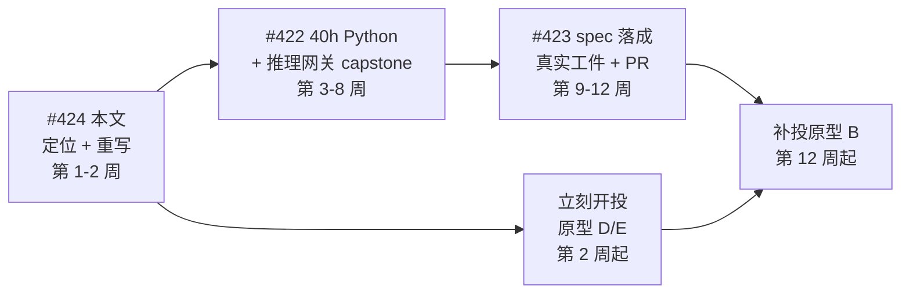

# 这份简历的 PMF 诊断：为什么它卖不进 Staff AI Infrastructure

> **这一页解决什么问题**：你想找一个 **Staff AI Infrastructure Engineer** 的岗位。手上这份简历写得不差 —— 但"不差"和"卖得动"是两件事。
>
> 本文把简历当**产品**看：买家是谁、货架长什么样、买家在 7 秒内会做出什么判断、以及你这个产品在**哪几条上不满足市场的最低购买条件**。第 1–6 章是诊断，第 7–9 章是**重写后的简历全文**和逐条对照，第 10–14 章是补 gap 的执行计划。
>
> 时间锚点：2026 年 9 月 18 日。市场数据取自当月在招的真实 JD（Together AI、LinkedIn、Seekr、NVIDIA、OpenAI 等），链接在第 15 章。
>
> 配套阅读：[从 Java 到 Python AI Infrastructure：40 小时学习路线](/p/python-ai-infra-40h.html)（#422）、[LLM Agent 实验平台设计说明书](/p/llm-agent-eval-platform.html)（#423）、[新加坡高级 / Staff 软件工程师的机会](/docs/staff.html)。这三份不是附录 —— 第 10 章会把它们直接接成你补 gap 的三块拼图。

---

## 0. 先说三句最硬的话

1. **这份简历卖的是"微软数据治理平台工程师"，市场买的是"管算力和模型生命周期的人"。** 两者相邻，但简历**从头到尾没有跨过那道桥**。筛简历的人会把它放进 "data / backend platform" 那一摞，而不是 "AI infra" 那一摞 —— 不是因为你不行，是因为这份文档没给他理由。

2. **有三个点能让人一眼判死，且和你的能力无关**：全文 **0 次 GPU / CUDA / PyTorch / 推理**；**Python 写在技能栏、但每一条实现都写着 "in Java"**；**Shanghai + 2026 年 8 月离职、却没有一个字交代目标地点和工作许可**。第一条决定 ATS 过不过，第二条会在电话筛的前 5 分钟被戳穿，第三条决定 recruiter 要不要回你邮件。

3. **你最值钱的东西被你自己写成了配角。** 你**自己造了一个数据库**（自定义存储布局 + 多租户 schema），你**用消息驱动的状态机做了零停机的异构重建**，你**替微软管了模型/prompt/agent/execution 的血缘**。这三件事，第一件是 staff 级作品，第二件正好是 2026 年 GPU 云控制面岗位 JD 上逐字写着的要求，第三件是当下 AI 平台市场最稀缺的能力之一。三件都只占了一个 bullet，且**一个数字都没有**。

> **一句话诊断**：你的问题不是"能力不够 staff"，是**产品定位错了、且证据没上架**。定位可以今天改，证据里有 70% 是你脑子里现成的数字、今晚就能补上；真正需要花时间的硬缺口只有一个（算力/推理），而它有一条 40 小时的最短路径。

---

## 1. 把简历当产品看：PMF 在这里到底指什么

"Product-Market Fit" 用在简历上不是比喻，是可以逐项检查的：

| 产品要素 | 在简历语境下是什么 | 你现在的状态 |
|---|---|---|
| **产品** | 这份 PDF 声称你能解决的问题 | 「大规模分布式系统 + 数据治理平台」 |
| **市场** | 2026 年在招的 staff AI infra 岗位 | 五个原型（第 2 章），你只覆盖其中 1.5 个 |
| **买家** | ① ATS/AI 筛选器 ② recruiter ③ hiring manager ④ 面试官 | 四道关的通过条件**互不相同**，你这版只为第 ④ 关写 |
| **货架** | LinkedIn / 内推 / 邮件里的前 3 行 | 无 —— 你的 SUMMARY 第一句是 "Senior software engineer with 11+ years..."，和其他 4000 份一样 |
| **定价** | 你要的 level 和 comp | Staff（Senior → Staff 是**跨级**，见 §4.5） |
| **转化漏斗** | 投 100 份 → 几个电话 → 几个 onsite | 现在的版本大概率卡在第一层 |

**四道关的通过条件**（这是大部分人只优化其中一道的原因）：

| 关卡 | 看什么 | 时间 | 失败模式 |
|---|---|---|---|
| ① ATS / AI 筛选 | 关键词覆盖 + 可比较的量化结果 | 秒级 | 缺 token 直接不进池子 |
| ② Recruiter | 头衔、公司、年限、地点、工作许可 | 7 秒 | 看不出是 AI infra 的人 |
| ③ Hiring manager | 有没有做过**我这摊事**的证据 | 60 秒 | 看得出相邻但不对口，转"可惜" |
| ④ 面试官 | 深度、决策、权衡 | 45 分钟 | 你这一关其实很强（#423 证明了） |

> 2026 年的现实：大中型公司的简历在 recruiter 打开之前**已经被 AI 打过分**，而且打分逻辑早已不是关键词匹配 —— 它评估上下文、一致性、以及**可度量的结果**。「带数字的成果更容易被跨候选人比较，因此排名更高」。这条对你特别致命：**你 2015–2019 的 bullet 全是数字，2019–2026 的 bullet 一个数字都没有。**

---

## 2. 市场到底在买什么：Staff AI Infra 的五个原型

我读了 2026 年 9 月在招的一批 staff 级 JD（Together AI、LinkedIn、Seekr、NVIDIA、OpenAI、Databricks）。"AI Infrastructure" 这个词下面其实是**五种不同的岗位**，要求重叠不到 40%。分清楚它们，是你定位的前提。

### 原型 A：算力与集群控制面（GPU cluster / compute control plane）

代表：Together AI《Staff SWE, Inference / Compute Infrastructure》、OpenAI《SWE, GPU Infrastructure - HPC》。

要求原文（Together AI，我逐条摘的）：

- **Provisioning State Machine** —「把一台物理机的完整生命周期建模成软件」：发现、拉起、驱动/CUDA 安装、健康校验、下线，**每一步都是显式的、带版本的状态**
- **Self-Service API** —— 声明式 API，让推理团队一次调用就能申请/扩缩/销毁集群
- **Self-Healing** —— 探测坏节点、安全排空、触发维修或替换、自动补回健康容量
- **Pipeline Reliability** —— 幂等、重试、回滚、**漂移检测（drift detection）**
- 必备：「用 Temporal / Cadence 这类**持久化工作流编排**」、「构建过**建模状态并做收敛（reconcile）的软件控制面**」（K8s controller、自定义 loop、工作流引擎）、「围绕**消息队列**而不是轮询来设计事件驱动系统」（Kafka / NATS / SQS）
- 必备：**product mindset** —— 做过被工程团队消费的内部平台，重视 DevEx
- 加分（注意是 nice-to-have）：裸机 provisioning（PXE/Redfish/IPMI）、**NCCL / CUDA / InfiniBand**、Rust / Go

> **停在这里，把上面这段重读一遍。** 除了最后一行加分项，**其余每一条你都做过**：Purview 的托管服务是 self-service platform API，Istio 是控制面，Azure Storage 上的 MQ 分阶段编排就是 durable workflow + 事件驱动，零停机重建就是幂等 + 重试 + 漂移检测，"fully managed service for other teams to use" 就是 product mindset。
>
> **这是你离 AI infra 最近的一扇门，而你的简历完全没有用这扇门的语言说话。**

### 原型 B：推理服务平台（inference / serving）

代表：Seekr《Staff AI Infrastructure Engineer》、各 GPU 云。

必备：vLLM / SGLang / TensorRT-LLM / Triton / Ray Serve；**continuous batching、KV cache、量化、投机解码**；p50/p99 时延、吞吐、**每 token 成本**；GPU 利用率与分布式推理。

**你的覆盖：0。** 这是全场最热、也是你最缺的一块。

### 原型 C：训练平台（training stack）

必备：PyTorch DDP / FSDP、DeepSpeed、Megatron-LM、checkpoint 与断点续训、数据加载吞吐、Slurm / Ray、多节点 NCCL 调优、InfiniBand / RoCE 组网。

**你的覆盖：0。** 而且这条路最长（需要真实的多机多卡时间），**建议直接放弃**，见 §6。

### 原型 D：AI / ML 平台与开发者生产力

代表：LinkedIn《(Sr.) Staff SWE, AI Infrastructure / AI Platform》、Databricks《Staff SWE, AI Research Infrastructure》。

要求原文（LinkedIn）：

- 「为**宽泛或复杂的需求**拥有技术战略」
- 「设计、实现并优化**大规模分布式 serving 或 training** 的性能」
- 「提升各系统的**可观测性与可理解性**，聚焦于提升开发者生产力」
- 「指导他人工程师、定义技术文化」
- 「**与开源社区紧密合作，参与并影响前沿开源项目**」
- 「作为多个并行关键项目的 **tech lead**」
- 基本要求：5+ 年工业界经验；5+ 年 OOP（Python / C++ / Java / Go / Rust / Scala）；**2+ 年架构师或技术领导岗**；**5+ 年构建深度学习系统**
- 优先：10+ 年 + 5 年技术领导；**开源项目的作者或维护者**；ML 基础设施工具与深度学习框架的专长

> 注意这条：**「5+ 年构建深度学习系统」是 basic qualification，不是加分项。** 你满足不了字面要求 —— 这就是为什么定位必须精确到"平台/控制面/artifact 生命周期"，而不是笼统地投 "AI Infrastructure"。另外 Staff 的通用年限门槛是 **BS+8 / MS+7 / PhD+4**，你 MS + 11.5 年，**年限完全够，缺的是领域**。

### 原型 E：Agent / 评估基础设施

代表：各家 2026 年新设的 agent platform 团队、LLM 可观测性公司（LangSmith / Arize / Braintrust 类）、以及大厂内部的 agent 平台。

必备：agent 执行树的 trace、离线/在线评估、LLM-as-judge 的校准与偏差、prompt 与 dataset 版本化、成本与预算治理、tool 沙箱、RAG infra。招聘方在扫一套很具体的词汇：**DAG、状态追踪、LangGraph、tool binding、多 agent 编排**。

> 2026 年的一条筛选规则说得很直白：「如果你的简历读起来像 2023 年的机器学习研究员，而你投的是 2026 年的 AI 基础设施岗位，你会被过滤掉 —— 你必须把文档改成体现**编排与部署**。」
>
> 你的情况是反过来的另一个版本：**你的简历读起来像 2019 年的数据平台工程师。**

### 五个原型的市场温度（供定位参考）

| 原型 | 岗位量 | 竞争烈度 | 薪酬上限 | 你的可达性 |
|---|---|---|---|---|
| A 算力控制面 | 中 | 中（裸机人才稀缺） | 高 | **可达（控制面那一半）** |
| B 推理服务 | **最高** | 最高 | 最高 | 需 3–6 个月 |
| C 训练平台 | 中 | 极高（研究背景卡位） | 最高 | 不可达，放弃 |
| D AI/ML 平台 | 高 | 中高 | 高 | **最可达** |
| E Agent/评估 | 增长最快 | 中（新领域，标准未定） | 中高 | **可达，且你有先发** |

---

## 3. 逐项打分：你的简历对五个原型的覆盖度

我把每个原型的**必备项**拆开，逐条对照你简历里的**实际文字**（不是我的善意推测）。

| 原型 | 必备项 | 你简历里的证据（原文） | 覆盖 |
|---|---|---|---|
| **A** | 控制面 / 状态收敛 | "message-queue-driven orchestration pipelines"、"zero-downtime … index rebuild"、Istio、AKS | **强** |
| | 持久化工作流编排 | "built message queues (MQ) on Azure Storage to orchestrate the work in staged, asynchronous phases" | **强**（但没用 Temporal 的词） |
| | 事件驱动 / MQ | 同上 | **强** |
| | 平台即产品 / DevEx | "fully managed metadata and lineage service … for other teams to use" | **中**（说了，没量化） |
| | GPU 节点生命周期 / 裸机 | — | **0** |
| | NCCL / CUDA / IB | — | **0** |
| | Go / Rust | — | **0** |
| | | | **≈ 40%** |
| **B** | vLLM / Triton / TRT-LLM | — | **0** |
| | batching / KV cache / 量化 | — | **0** |
| | p99 / 吞吐 / 每 token 成本 | — | **0** |
| | GPU 利用率 | — | **0** |
| | 高并发在线服务 | "High-concurrency services"、"hundreds of thousands of random reads/writes per second" | **中**（但是 HBase，不是模型） |
| | | | **≈ 10%** |
| **C** | DDP / FSDP / Megatron | — | **0** |
| | checkpoint / 断点续训 | — | **0** |
| | 多机多卡 / NCCL 调优 | — | **0** |
| | | | **≈ 0%** |
| **D** | 模型 / artifact registry | "bringing model, agent, prompt, and execution under a unified metadata catalog" | **强** |
| | 血缘 / 可复现性 | "Owned Data Lineage in Microsoft Purview end-to-end"、Atlas + OpenLineage | **很强，且稀缺** |
| | feature store / 在线特征 | "real-time feature retrieval from HBase" | **中**（2016 年的事，没叫它 feature store） |
| | 多租户 | "designed schemas for efficient multi-tenancy" | **强** |
| | K8s / 编排 | Kubernetes、Istio | **强** |
| | 可观测性 / 开发者生产力 | "building monitoring"（2015–2019）；实验追踪 | **中** |
| | 5+ 年深度学习系统 | — | **0** ← 硬门槛 |
| | 开源作者 / 维护者 | 扩展了 Atlas 和 OpenLineage，**但没说上游贡献** | **0 / 未知** |
| | | | **≈ 65%** |
| **E** | agent trace / 执行树 | "built LLM agents covering grounding-data collection, context management" | **中**（没说 trace/span） |
| | 评估 / judge / 校准 | "metric-driven evaluation" | **弱**（4 个字，无细节） |
| | prompt / dataset 版本化 | "prompt, and execution under a unified metadata catalog" | **中** |
| | 实验追踪 | "used for experiment tracking to support downstream teams' A/B experiments" | **中**（无数字） |
| | 成本 / 预算治理 | — | **0** |
| | agentic DevOps | "designed and implemented a Claude Code skill" | **中，且是差异化亮点** |
| | | | **≈ 55%** |

**结论：D（65%）> E（55%）> A（40%）>> B（10%）> C（0%）。**

而你现在投简历的方式（一份通用简历投所有 "AI Infrastructure"），等于**用 D 的货去竞标 B 的标**。落标不是因为货差。

---

## 4. 诊断：十个 gap，按（杀伤力 × 可修复性）排序

每个 gap 我给：**证据**（你的原文）→ **买家怎么读** → **严重度** → **怎么修**。

### 4.1 【致命】全文 0 次算力词汇

**证据**：整份简历里，`GPU`、`CUDA`、`PyTorch`、`inference`、`serving`、`vLLM`、`Triton`、`Ray`、`Slurm`、`accelerator`、`transformer`、`token` —— **出现次数全部为 0**。唯一沾边的是 "model serving"（HBase + LR/SVM，2016 年）。

**买家怎么读**：ATS 打分时，AI infra 岗位的技能向量里权重最高的一簇整体缺失 → 不进池子。人工看时，"AI 工作负载 = GPU 工作负载" 是 2026 年的默认等式，一份 0 GPU 的简历投 AI infra，读者的第一反应是"这人可能不知道自己在投什么"。

**严重度**：对 A/B/C **致命**；对 D/E **重伤**（仍可活，但必须在别处补强）。

**怎么修**：分两层。
- **诚实层（今天就能做）**：把你**已经有的**东西用算力的语言说出来 —— agent 执行的成本、token 计量、评估任务的并行与吞吐、模型服务的调用量。你做 agent 平台，一定碰过 token 成本和并发；那些数字现在一个都没写。
- **补料层（4–8 周）**：#422 的 capstone（FastAPI + vLLM + 流式 + Prometheus + 压测报告）就是为这个缺口设计的。**做完之后你能诚实地写出 p50/p99、每 token 成本、continuous batching 的吞吐曲线** —— 这不是"学习项目"，这是一个带压测数据的工件。放进 PROJECTS 段（§7）。

> **不要做的事**：不要把 vLLM / Triton 直接塞进 Skills 栏充数。这个市场的电话筛第一个问题就是"你的 batching 策略怎么配的、KV cache 打满时怎么办" —— 塞词的代价是当场出局，比缺词更贵。

### 4.2 【致命】最近 7 年，一个数字都没有

**证据**：

- CMB（2015–2019）："**hundreds to tens-of-thousands of TPS**"、"**hundreds of TB**"、"**hundreds of thousands of random reads/writes per second**" —— 漂亮。
- Microsoft（2019–2026，7 条 bullet）：**零个数字**。没有 QPS、没有时延、没有租户数、没有节点数、没有数据量、没有成本、没有团队规模、没有采纳它的团队数。

**买家怎么读**：这是简历里最刺眼的一种形状 —— **数字随时间倒挂**。读者的自然结论是"这人最好的工作是 2018 年做的，之后七年在一家大公司里做维护"。对 staff 级评估，**scope 是唯一的硬通货**，而 scope 只能用数字表达。没有数字 = 没有 scope = 不是 staff。

**严重度**：**致命**，且是全篇 **ROI 最高的一处**。

**怎么修**：见 §9 的清单 —— 那是一张只有你能填的表。规则：每条 bullet 至少一个数字，形式是 `X → Y over Z`（变化 + 时间/规模）或 `N 个 <单位>`（绝对规模）。

> **"数据脱敏怎么办"**：微软的内部数字确实不能逐字外泄。做法是**降精度但保数量级**："一个服务于 ~10^4 量级租户的多租户元数据图"、"p99 从两位数毫秒降到个位数"、"重建 TB 级索引零停机"。**数量级不是机密，而它足够定 scope。** 完全不写才是最贵的选择。

### 4.3 【重伤】Python 是声明的，Java 是证明的 —— 而这个矛盾写在同一页上

**证据**：`Languages: Python, Java`（Python 在前）。但正文里：

- "delivered a fully managed metadata and lineage service **in Java**"
- "implemented online synchronization and index rebuild across heterogeneous data **in Java**"
- 唯一的 Python 证据是 2015–2019 的 "an ML model platform (LR/SVM) **in Python**" —— 七年前，而且是 scikit-learn 时代。

**买家怎么读**：两件事同时发生。①**技术栈错配**：2026 年的 AI infra 是 **Python + Go/Rust**，Java 在这个市场是**减分信号**（读作"企业后端"）。你简历里 Go 和 Rust 都是 0。②**可信度受损**：把 Python 放在第一位、正文却全是 Java，这是一个**会被查的谎**。电话筛里一句 "讲讲你最近写的 Python" 就够了。

而你自己是知道的 —— #422 那份路线图的读者画像写着「**Python 接近零基础**」。

**严重度**：**重伤**。可信度问题比能力缺口更难修，因为它一旦暴露就污染整份简历。

**怎么修**：
1. **立刻**把技能栏改成有分层的写法：`Java (production, 10 yrs) · Python (tooling & AI platform work; see Projects) · Go (learning)`。诚实的分层**不会**扣分，虚高的并列会。
2. **同步开跑 #422**。40 小时里前 18 小时结束时，你就有一个通过 `mypy`、有 pytest、能打 Docker 镜像的 Python 包 —— 那时 "Python (production-grade tooling)" 才站得住。
3. **别碰 Rust**。这个阶段学 Rust 的边际回报低于把 Python 打扎实；Go 只在你确定要打原型 A 时才补（K8s controller 生态是 Go）。

### 4.4 【重伤】最该发光的两条 bullet，是全篇写得最虚的

**证据**（原文照抄）：

> "Built the metadata structures on the data platform, bringing model, agent, prompt, and execution under a unified metadata catalog; built LLM agents covering grounding-data collection, context management, and metric-driven evaluation, used for experiment tracking to support downstream teams' A/B experiments and shorten their iteration cycles."

一句话 60 个词，塞了**两个独立的系统**，没有主语的力量，没有一个技术决策，没有一个数字，结尾 "shorten their iteration cycles" 是一个**不可验证的断言**。

**买家怎么读**：读不出这是一个被 50 个工程师用的平台，还是一个周末写的脚本。**而这恰恰是你简历上唯一一条"AI 原生"的经历** —— 它承担着整份简历的定位职责，却写得最含糊。

对照一下：#423 那份 spec 里，你（或者说这条 bullet 背后的系统）能讲清楚 **trace 是主数据而非运维副产物**、**judge 本身会漂移所以必须版本化 + 人工校准**、**质量回归是长尾形状所以均值告警必然漏报**。**深度是有的，只是没上页面。**

**严重度**：**重伤**。

**怎么修**：拆成两条，每条用 `系统 + 谁在用 + 一个硬决策 + 一个度量` 的公式重写。§7 给了成品。

### 4.5 【中】Staff 是跨级申请，而简历没有为跨级举证

**证据**：Microsoft 2019–2026 七年，抬头始终是 Senior SWE，**无晋升记录**。而 staff JD 要的是：拥有技术战略、跨多个并行项目做 tech lead、做架构评审、建立工程标准、**参与并影响开源项目**。

你其实**有** staff 信号，但都写成了"活动"而不是"结果"：

| 你写的 | 问题 | 应该是 |
|---|---|---|
| "First cross-team adopter of Istio … drove adoption across other teams" | 几个团队？改变了什么？ | "推动 N 个团队采纳，把服务间 X 从 A 改善到 B" |
| "Tech lead of a self-built … graph database" | 带几个人？多久？ | "带 N 人 M 个月，做了哪 2 个关键取舍" |
| "Mentored junior engineers" | 谁都这么写 | 带出了谁、他们后来交付了什么 |
| 扩展 Apache Atlas + OpenLineage | **上游贡献了吗？** | 如果有 PR，这是全篇最值钱的一行 |

**关于开源那一条，我要单独说**：你在 Apache Atlas 和 OpenLineage 上工作了数年，**扩展了它们的血缘模型**。LinkedIn / Databricks 这一档的 staff JD 把"开源作者或维护者"列为优先项。如果你曾提过 PR、提过 issue、写过设计提案 —— **立刻把链接放上简历**，它同时解决"开源信号"和"可验证证据"两个问题。如果七年来一次都没有 —— 这是一个用七年时间造出来的 gap，现在补的方式是**从 #422 capstone 里挑一个真实的小 bug 给 vLLM 或 OpenLineage 提 PR**，四周内可得。

**严重度**：**中**（不致命，但决定你是拿 staff offer 还是被降级到 senior）。

**预期管理**：即使改好，**很多公司仍会把你按 senior 面、按 staff 降级发 offer**。这不是失败 —— 从 Senior@Microsoft 转 AI infra 领域，先进门再升级是常见路径。但你要事先决定**能不能接受降级**，否则谈判时会被动。

### 4.6 【中】叙事没有脊椎

**证据**：从上到下读一遍：HBase 大数据 → 支付宝基金页面 → 数据治理 → 图数据库 → Istio → agent 工具。读完说不出"这个人是搞 X 的"。

SUMMARY 自己也在分裂：「On the infrastructure side: …. On the analytics-enablement side: ….」—— **主动告诉读者你是两半的**。Staff 级录用是基于一个论点（thesis）做出的，不是基于一份清单。

**严重度**：**中**，但它是所有其他 gap 的放大器。

**怎么修**：选一条脊椎，让每一条 bullet 都为它举证。我给的脊椎是：

> **"我做的是 artifact 的控制面 —— 让系统始终知道是哪个模型、哪个 prompt、哪份数据、哪次运行产出了这个结果，并在多租户压力下保持这件事为真。"**

这句话能同时罩住：图数据库（存它）、血缘（算它）、零停机重建（保它的一致性）、多租户 schema（隔离它）、agent 元数据与评估（把它扩展到 AI 工件）、feature retrieval（把它送到在线路径）。**七年的工作第一次串成一条线**，而且这条线正好指向原型 D + E。

### 4.7 【中】地点、时机、工作许可：三个字都没写

**证据**：`Shanghai, China`；`Sep 2019 – Aug 2026`（今天是 2026 年 9 月 18 日 —— 你上个月刚离开）。简历上**没有**目标地点、没有工作许可状态、没有是否可 relocate。

**买家怎么读**：新加坡或美国的 recruiter 看到 "Shanghai, China" + 无任何说明，默认"需要签证 + 跨时区 + 可能有出口管制顾虑"，在岗位有 300 个本地申请者时，**这封邮件不会被回**。这是一个**纯文案问题造成的真实损失**。

**严重度**：**中**，但**修复成本接近 0**。

**怎么修**：抬头下面加一行，明确到具体：

```
Shanghai, China · Open to relocation: Singapore / EU / US (visa sponsorship required) · Remote (UTC+8, overlap to 04:00 UTC)
```

关于新加坡（详见 [docs/staff.html](/docs/staff.html)）：「软件工程师」在**紧缺职业清单（SOL）**上，任何高薪高级岗都能拿满 COMPASS 薪资分；**月薪 S$22,500 以上时 COMPASS 与强制本地招聘广告完全豁免**；EP 外籍人士**不缴 CPF**，有效税率在 S$200K 时约 11%。也就是说：**对你这个层级，新加坡的签证门槛是真实的但不难跨** —— 但前提是 recruiter 愿意读你的简历。那一行字就是入场券。

关于离职时间：8 月刚离开，现在是**一个月的空档**，还不是问题。但这个数字**每个月都在变贵**。你的节奏应该是：**这个月改完简历开始投，同时跑 #422**，而不是"学完再投"。

### 4.8 【轻】支付宝那五个月在稀释你

**证据**：

> Alipay (Ant Group) — Senior SWE · Mar 2019 – Aug 2019 · "Learned the Alipay product workflow and delivered an intelligent-document feature in the app to improve the conversion rate of fund products."

五个月、非基础设施、bullet 的动词是 "**Learned**"。这是全篇唯一一条把"学习"当成果写的句子。

**买家怎么读**：短期跳槽 + 与目标岗位无关 + 弱动词 = 纯稀释。它占的版面本该给图数据库。

**怎么修**：压成一行，无 bullet：

```
Ant Group (Alipay) — Senior Software Engineer · Shanghai · Mar–Aug 2019
Consumer-scale fintech feature work; left to join Microsoft's data platform org.
```

顺带把"为什么只待五个月"提前解释掉，不给面试官留问题。

### 4.9 【轻】ATS 词表：缺的、多余的、以及在给你减分的

| 类别 | 词 |
|---|---|
| **必须补上（诚实可得）** | control plane, reconciliation, idempotent, drift detection, state machine, durable workflow, event-driven, multi-tenant, SLO, observability, OpenTelemetry, model registry, artifact lineage, evaluation harness, LLM-as-judge, trace / span, prompt versioning, dataset versioning, cost governance, token accounting, Kafka, Argo, Terraform / IaC, GitOps |
| **补料后可写（#422 之后）** | GPU, inference serving, vLLM, continuous batching, KV cache, p99 latency, throughput, PyTorch, Ray, cost per token, Prometheus / Grafana |
| **正在给你减分，考虑降权** | LR / SVM（说"2016 年"）、Thrift（同上）、ADF（Azure 专有、窄）、"data governance"（读作合规而非平台） |
| **格式问题（staff 级会被注意到）** | `ADF,  Flink`（双空格）、`Thrift data services,`（尾逗号）、"Built **a** ML platform"（应为 an）、bullet 动词时态不统一（"Scaled … : growing …" vs "Owned …: handling …"） |

> 格式这一档看着小，但在 staff 级评审里它是**注意力信号**。一份自己都没校对干净的简历，很难让人相信作者会做严谨的架构评审。

### 4.10 【轻】"Flight" 是微软黑话，外面没人看得懂

**证据**："owning the **flight** (rollout configuration) management within it end to end"。你加了括号解释，说明你已经意识到了 —— 但括号里的 "rollout configuration" 还是没说清这件事的**难度和规模**。

**买家怎么读**："管配置的"。而实际上，在微软量级的生产系统里做 rollout / feature flight 的控制面**是一件很硬的事**：渐进发布、分环、回滚、配置漂移、清理历史债。**这正好又是原型 A 的语言。**

**怎么修**：用通用词重写为 progressive rollout / feature-flag control plane，并把"用 Claude Code skill 清理线上历史 flight 配置"这件事**单独拎成一条** —— 2026 年"用 agent 改造自己团队的运维"是一个稀缺且吃香的信号，你把它埋在从句里了。

---

## 5. 你被低估的六个资产（写了，但没卖出去）

诊断到这里都在说缺什么。下面说**你有、但这份简历没有兑现的东西** —— 修简历的收益主要来自这一节。

### 5.1 你造过一个数据库

> "customized storage data layouts for high-fan-out scenarios, designed schemas for efficient multi-tenancy"

**大多数 staff 候选人是数据库的用户，你是作者。** "高扇出场景的存储布局"意味着你处理过超级节点的邻接表设计 —— 这是图存储里最经典的硬问题之一。这一条应该在简历的**前五行**，而不是第三个 bullet。

顺便：它还回答了一个 AI infra 面试常考的问题类型 —— "为什么自己造而不是买托管的"。你有一个**真实的 build-vs-buy 决策**可讲，附带成本论证。这是 staff 级的对话素材。

### 5.2 你的编排经验，正好是 GPU 云控制面岗位逐字要的东西

把 §2 原型 A 的 JD 和你的 bullet 并排放：

| Together AI 要的 | 你做过的 |
|---|---|
| 「建模状态并做收敛的软件控制面」 | Purview 托管服务 + Istio 上线 |
| 「持久化工作流编排（Temporal/Cadence 类）」 | Azure Storage MQ 上的分阶段异步编排 |
| 「围绕消息队列而非轮询设计事件驱动系统」 | 同上 |
| 「幂等、重试、回滚、漂移检测」 | 零停机异构重同步与索引重建 |
| 「声明式 self-service API，别的团队一次调用搞定」 | "fully managed … service for other teams to use" |
| 「product mindset：做过被工程团队消费的内部平台」 | 整个 Purview 血缘就是 |

**六条命中六条。** 差的只是 GPU 那一半 —— 而那一半在这类 JD 里是 **nice-to-have**。

**这意味着**：原型 A 里"控制面为主、算力为辅"的岗位（GPU 云的 provisioning / scheduling / control plane 团队，而不是 kernel 团队）是你**被严重低估的一条投递线**。你现在大概率没在投它们，因为你自己也把自己归类成"数据的人"。

### 5.3 你管过 AI artifact 的血缘 —— 这件事现在很稀缺

2026 年整个 AI 平台市场正在补的课，恰好是你干了七年的事：模型从哪来、prompt 改了哪一版、评估分数对应哪份数据、agent 的这次运行调了哪些工具 —— **provenance 与可复现性**。你不但做过，还是在 Apache Atlas / OpenLineage 这种**行业标准**上做的。

**但你把它写成了 "data governance"** —— 这个词在招聘市场里读作"合规、审计、GDPR"，是一个**离 AI infra 更远**的标签。同一件事换个说法：

- ❌ "Owned Data Lineage in Microsoft Purview"（合规味）
- ✅ "Owned the provenance layer — the system of record for which dataset, job and version produced any given artifact — and extended it to models, prompts, agents and evaluation runs"（平台味）

**同样的工作，差一个量级的定位。**

### 5.4 你 2016 年就做了 feature store，只是那时还没这个词

> "an ML model platform (LR/SVM) in Python with **real-time feature retrieval from HBase**, connecting big-data infrastructure directly to production model serving"

低延迟在线特征查询 + 模型服务 = **feature store**。直接用这个词（并注明是在该品类成型之前自建的）。这一条把你 2016 年的经历**拉进了现代 ML 平台的词表**，是一次零成本的资产重估。

### 5.5 你已经有两份公开的、有深度的技术文档

#422（40 小时路线图）和 #423（Agent 实验平台设计说明书）是**公开可读的工件**。#423 尤其重要 —— 它包含 12 条 ADR、judge 校准方案、CI 门禁的显著性检验，**读起来就是一个 staff 级工程师的产出**。

这解决了两个问题：① **"开源/社区信号" 的部分替代**；②**写作与技术领导力的直接证据**（staff JD 里"拥有技术战略""定义工程标准"这类要求，最难用 bullet 证明，但一份公开 spec 一秒就证明了）。

**放在简历上**，`WRITING` 一节两行，带链接。

### 5.6 数学与信号处理底子 + 5 项专利

SJTU 图像处理所、IEEE VCIP 论文、5 项专利（视频编码、相似性网络融合）。在"你没做过 ML"这个反对意见面前，这一段的作用是：**证明你不怕数学，学 ML 层的学习曲线是短的。** 现在它躺在最后一节当装饰，应该在 SUMMARY 里有半句话呼应。

---

## 6. 定位结论：打哪个、不打哪个

### 主攻（70% 的投递量）：AI / ML 平台 + Agent 基础设施（原型 D + E）

**一句话定位**：

> *"I build the control plane for ML artifacts — models, prompts, datasets, agent runs — and the evaluation systems that make their results trustworthy at multi-tenant scale."*

**为什么是它**：覆盖度 65% / 55%，且你的稀缺点（血缘 + 自建图存储 + 多租户）在这里**是核心能力而不是加分项**。竞争者多为 ML 出身、缺乏真正的分布式系统功底 —— **你的相对优势最大。**

**目标公司类型**：数据/AI 平台公司（元数据与血缘是其产品核心的那一类）、LLM 可观测性与评估公司、大厂的 AI 平台 / model registry / agent platform 团队、企业软件公司新建的 AI 平台组。

### 副攻（25%）：算力控制面里"控制面"那一半（原型 A）

**为什么**：§5.2 的六条命中六条。GPU 云和 AI 基础设施公司**极缺**懂 reconcile loop、幂等编排和多租户的人 —— 这类人通常在支付、云平台、数据库领域，而不在 ML 圈。

**投递方式**：**改一版简历**，把 MQ 编排、Istio、零停机重建提到最前面，用 state machine / reconciliation / drift detection 的词重写。

### 机会主义（5%）：推理平台（原型 B）

**只在 #422 capstone 做完、手上有压测报告之后投。** 在那之前投 = 浪费一次曝光。

### 明确放弃：训练平台（原型 C）

需要的是多机多卡的真实里程，不是四十小时能补的。**放弃它不是认输，是把弹药集中。**

### 一条战术建议：两份简历，不是一份

- **Resume-D**（主）：脊椎 = artifact 控制面 + 评估。图数据库、血缘、agent 元数据在前。
- **Resume-A**（副）：脊椎 = 分布式控制面与编排。MQ 状态机、Istio、K8s、多租户在前，血缘降为一条。

两份共用同一批事实，只换顺序和词汇。**不要做三份以上** —— 维护成本会让你两份都写不好。

---

## 7. 重写：v2 简历全文

> **说明**：`[[N]]` 是**你必须填的真实数字**，我不替你编。§9 给了怎么把它们捞出来。**带 `[[ ]]` 的版本一个字都不要投出去** —— 那些方括号本身就是这次重写最重要的产出：它们标出了你简历里**本来就是空的**位置。

```text
XIANLONG LU
AI Platform / Infrastructure Engineer · Shanghai, China
Open to relocation: Singapore / EU / US (visa sponsorship required) · Remote (UTC+8, overlap to 04:00 UTC)
luxianlongmicrosoft@gmail.com · <linkedin> · <github>

SUMMARY
I build control planes for machine-learning artifacts — the layer that knows which model,
which prompt, which dataset and which run produced a given result, and keeps that true under
multi-tenant production load. 11 years in distributed systems; the last 7 at Microsoft, where
I was tech lead of a self-built graph database, owned the provenance layer of Microsoft Purview
end to end, and most recently extended it to models, prompts, agents and evaluation runs on the
company's AI platform. I write storage internals and reconciliation loops, not just services on
top of them. MS from SJTU (image processing); 5 patents.

SELECTED HIGHLIGHTS
• Tech lead of a self-built, multi-tenant graph database on Kubernetes — custom adjacency layouts
  for high-fan-out vertices, [[N]] tenants on one physical cluster, [[N]] QPS at p99 [[N]] ms,
  [[N]]% lower cost than the managed alternative it replaced
• Owned the provenance layer of Microsoft Purview end to end — extended Apache Atlas's lineage
  model for direct dataset-to-dataset edges and added OpenLineage ingestion; shipped as a fully
  managed service consumed by [[N]] partner teams
• Extended that provenance layer to AI artifacts — models, prompts, agents, tool definitions and
  executions in one catalog, so an evaluation score is addressable back to the exact prompt
  revision, model build and dataset version that produced it
• Rebuilt [[N]] TB / [[N]]B entities across heterogeneous stores with zero downtime — modeled as a
  resumable, idempotent state machine over queue-driven stages with drift detection
• First in the org to take Istio to production on AKS; adopted by [[N]] teams, [[metric]] improved
  from [[A]] to [[B]]
• Built the agent evaluation harness — span-tree tracing, deterministic + statistical + LLM-judge
  scoring with human calibration — cutting the idea-to-decision loop from [[X]] to [[Y]]

CORE SKILLS
Languages            Java (production, 10 yrs) · Python (platform tooling & AI infra; see Projects) · SQL · Go (learning)
Control Plane        State-machine modelling, reconciliation loops, idempotency, drift detection,
                     durable/queue-driven workflow orchestration, zero-downtime migration
Platform & Infra     Kubernetes (AKS), Istio service mesh, multi-tenancy, service orchestration,
                     Azure PaaS, monitoring & SLOs
Storage & Data       Graph storage internals (adjacency layouts, high fan-out), HBase/Hadoop,
                     Spark, Flink, index rebuild, schema design
AI Platform          Artifact & model catalog, lineage/provenance for models·prompts·agents·runs,
                     experiment tracking, offline + online evaluation, LLM-as-judge calibration,
                     online feature retrieval for model serving, agentic DevOps tooling
Standards & OSS      Apache Atlas, OpenLineage [[+ links to your upstream PRs/issues if any]]

PROFESSIONAL EXPERIENCE

Microsoft — Senior Software Engineer                          Shanghai · Sep 2019 – Aug 2026
Cloud-native data & AI platform on Kubernetes: metadata/provenance services, a self-built graph
database, and most recently the artifact and evaluation layer of the AI platform.

• AI artifact catalog. Designed the metadata model that brought models, agents, prompts, tool
  definitions and executions under one catalog on the existing provenance graph — so any
  evaluation result is traceable to the exact prompt revision, model build and dataset version.
  [[N]] artifacts / [[N]] runs per day across [[N]] teams.
• Agent evaluation tooling. Built the SDK and harness that records an agent run as a span tree and
  scores it both offline and online — deterministic checks, statistical metrics, and LLM-as-judge
  with human calibration and per-dimension gating. Used for downstream A/B experiments; idea →
  statistically-backed decision went from [[X]] to [[Y]].
• Agentic DevOps. Built [[name]], an AI-assisted operations tool for production systems, and owned
  its progressive-rollout (feature-flight) control plane end to end. Designed and shipped a Claude
  Code skill that inventories rollout configuration, and used it to retire [[N]] stale
  configurations from the live production system.
• Self-built graph database — tech lead, team of [[N]]. Built the metadata graph store in-house on
  open-source foundations instead of buying managed graph: designed adjacency layouts for
  high-fan-out vertices (provenance hubs with [[N]]+ edges) and a schema isolating [[N]] tenants
  within one physical cluster; ran it on AKS at [[N]] QPS / p99 [[N]] ms for [[N]]% of the cost of
  the alternative. Owned the build-vs-buy case, the roadmap, and work breakdown for [[N]] engineers.
• Provenance platform (Microsoft Purview). Owned data lineage end to end: analysed where Apache
  Atlas's native lineage model fell short, extended it to support direct dataset-to-dataset edges,
  and added OpenLineage ingestion. Delivered in Java as a fully managed service consumed by [[N]]
  partner teams at [[N]] QPS, [[N]]% of lineage queries under [[N]] ms.
• Zero-downtime reconciliation. Designed the re-synchronisation architecture between the source of
  truth and the search index: a resumable, idempotent state machine over Azure Storage queues with
  checkpointed stages and drift detection. Rebuilt [[N]] TB / [[N]] entities across heterogeneous
  stores with no service interruption and no read-path regression.
• Service mesh governance. First in the org to take Istio to production on AKS for microservice
  governance; standardised traffic management and routing policy, cut [[metric]] from [[A]] to
  [[B]], and drove adoption by [[N]] other teams.
• Technical leadership. Turned ambiguous problems into scoped work items for [[N]] junior
  engineers; ran design and code reviews; owned key technical decisions across [[N]] concurrent
  workstreams.

Ant Group (Alipay) — Senior Software Engineer                 Shanghai · Mar – Aug 2019
Consumer-scale fintech feature work (intelligent documents, fund-product conversion); left to join
Microsoft's data platform org.

China Merchants Bank — Software Engineer                      Shanghai · Mar 2015 – Mar 2019
Real-time HBase/Hadoop platform and an online ML serving stack under high-concurrency production load.
• Scaled the real-time HBase platform from hundreds to tens of thousands of TPS over hundreds of TB,
  sustaining hundreds of thousands of random reads/writes per second through cache and storage tuning.
• Owned cluster operations: build-out, region balancing and data distribution as load grew [[N]]x.
• Delivered the platform's serving surface: high-throughput Thrift data services plus monitoring, so
  downstream applications could query the big-data layer at [[N]] ms.
• Built an online feature store before the category had a name — real-time feature retrieval from
  HBase feeding a Python LR/SVM model-serving platform at [[N]] QPS.

PROJECTS & WRITING
• LLM inference gateway (2026) — FastAPI + vLLM, streaming, continuous batching, Prometheus
  metrics; [[N]] req/s at p99 [[N]] ms on [[GPU]], [[N]]% throughput gain from batching-policy tuning.
  Load-test report and code: [[link]]
• "LLM Agent Experiment Platform — a reviewable design spec" (2026) — data model, 12 ADRs,
  LLM-as-judge calibration, CI quality gates, capacity model. /p/llm-agent-eval-platform.html
• "From Java to Python AI Infrastructure: a 40-hour path" (2026) — /p/python-ai-infra-40h.html
• Open source: [[Apache Atlas / OpenLineage / vLLM PRs — link them if they exist]]

EDUCATION
Shanghai Jiao Tong University — M.S., Electronic & Communication Engineering,
Image Processing Institute (2012–2015) · B.S., Information Engineering (2008–2012)

HONORS
IEEE VCIP paper, "Online Video Object Classification Using Fast Similarity Network Fusion" ·
5 patents (video coding, similarity network fusion, monitoring) · National Scholarship (MoE China) ·
Chinese Physics Olympiad National Second Prize (2006, 2007)
```

---

## 8. 改了什么，为什么

| # | 原版 | 新版 | 理由 |
|---|---|---|---|
| 1 | "Senior software engineer with 11+ years building large-scale distributed systems…" | "I build control planes for machine-learning artifacts — the layer that knows which model, which prompt…" | 第一句必须是**定位**，不是履历。原版第一句和四千份简历一样 |
| 2 | 「infra 面 / analytics 面」两段式 | 单一脊椎 | §4.6：staff 录用基于一个论点 |
| 3 | 抬头只有 "Shanghai, China" | 加 relocation / 签证 / 时区行 | §4.7：零成本，直接决定回不回邮件 |
| 4 | "Owned Data Lineage in Microsoft Purview" | "Owned the **provenance layer** … extended it to models, prompts, agents and evaluation runs" | §5.3：`lineage/governance` → 合规味；`provenance for AI artifacts` → 平台味 |
| 5 | 图数据库排第 3 条 | 提到 HIGHLIGHTS 第 1 条 | §5.1：你造过数据库，这是最强的 staff 工件 |
| 6 | "message-queue-driven orchestration pipelines" | "resumable, **idempotent state machine** … with **drift detection**" | §5.2：同一件事，换成 GPU 云控制面 JD 的原词 |
| 7 | agent + 元数据挤在一条 60 词 bullet | 拆成「AI artifact catalog」「Agent evaluation tooling」「Agentic DevOps」三条 | §4.4：唯一的 AI 原生经历，必须占三倍版面 |
| 8 | "metric-driven evaluation" | "span tree … deterministic + statistical + LLM-as-judge with human calibration and per-dimension gating" | 把 #423 里的真实深度搬上页面 |
| 9 | `Languages: Python, Java` | `Java (production, 10 yrs) · Python (platform tooling; see Projects) · Go (learning)` | §4.3：**分层诚实**不扣分，虚高并列会被当场戳穿 |
| 10 | Alipay 一条 bullet 以 "Learned" 开头 | 压成一行 + 顺带解释离职原因 | §4.8：去稀释 |
| 11 | "real-time feature retrieval from HBase" | "**an online feature store before the category had a name**" | §5.4：零成本的资产重估 |
| 12 | 无 PROJECTS / WRITING | 新增，含推理网关 + 两篇公开文档 | §4.1 + §5.5：**唯一诚实地把 GPU/vLLM/p99 写上简历的路径** |
| 13 | "flight (rollout configuration)" | "progressive-rollout (feature-flight) control plane" | §4.10：去黑话，且蹭上控制面语言 |
| 14 | Microsoft 段 0 个数字 | 17 处 `[[N]]` 占位 | §4.2：最高 ROI 的一处 |
| 15 | 技能栏平铺 | 六个带标签的分组 | 让 hiring manager 60 秒内定位到他要的那组 |

---

## 9. 只有你能填的清单：去把数字捞出来

**今晚就做这件事。** 目标不是精确，是**数量级 + 变化**。对每一项，回答"多少"和"从多少变到多少"。

### 图数据库
- [ ] 存了多少顶点 / 多少边？（数量级即可）
- [ ] 多少租户共用一个物理集群？最大租户和最小租户差几个量级？
- [ ] 峰值 QPS？读写比？p99 时延？
- [ ] 最大扇出的那个顶点有多少条边？（这是高扇出布局的**存在理由**，一个数字就能证明问题是真的）
- [ ] 相比被它替换掉的方案，省了多少钱 / 多少机器？
- [ ] 带了几个人？做了多久？

### 血缘 / Purview
- [ ] 多少个 partner 团队消费这个服务？（哪怕是 3 个，写出来也远好过不写）
- [ ] 每天摄入多少血缘事件？图里多少条边？
- [ ] 血缘查询的 p95 / p99？
- [ ] 支持 OpenLineage 之后，接入一个新数据源的时间从多久变到多久？
- [ ] 可用性 SLO 是多少？达成了吗？

### 零停机重建
- [ ] 重建了多少 TB / 多少实体？
- [ ] 花了多长时间？分几个阶段？
- [ ] 读路径的时延在重建期间涨了多少？（如果是 0，**那是全篇最有说服力的数字之一**）
- [ ] 失败重试率？断点续传救回过几次？

### Istio
- [ ] 上线时覆盖多少个服务 / 多少个 pod？
- [ ] 后来多少个团队采纳？
- [ ] 改善了什么指标？（跨服务错误率、重试成功率、灰度耗时、mTLS 覆盖率任选其一）

### AI 元数据 / agent 工具
- [ ] catalog 里有多少 artifact？每天多少次 run？
- [ ] 多少个下游团队在用？多少个工程师？
- [ ] 评估跑一次多少条 case？多少个维度？judge 的人工校准集多大？
- [ ] **"shorten iteration cycles" 到底是从多久到多久？**（有埋点就用埋点；没有就用"典型一次实验从提出到结论"的前后对比，**并在简历上注明口径**）
- [ ] agent 的 token 成本量级？评估任务的并发度？

### Agentic DevOps / flight
- [ ] 清理了多少条历史 flight 配置？占总量的多少？
- [ ] 手工做要多久，用 skill 之后多久？

### 一条写法规则

> `<动词> <系统>，<谁在用> —— <一个硬的技术决策> —— <一个度量>。`

反例（现版本）："Built LLM agents covering grounding-data collection, context management, and metric-driven evaluation."
正例："Built the evaluation harness used by 4 product teams — scores a run as a span tree with a version-pinned LLM judge calibrated against a 300-case human set — cutting idea-to-decision from 2 weeks to 3 days."

---

## 10. 90 天计划：把三个任务接成一条线

你手上已经有两块拼图了，缺的是把它们接起来。



| 周 | 做什么 | 产出 | 补上哪个 gap |
|---|---|---|---|
| **1** | 填完 §9 的数字清单；按 §7 出 Resume-D | 可投的简历 | 4.2 / 4.4 / 4.6 / 4.7 |
| **2** | 出 Resume-A（换序换词）；LinkedIn 头衔与简介同步改成定位句；开始投 | 每周 10–15 份定向投递 | 4.6 / 4.9 |
| **3–6** | #422 阶段一至三（18 h）：Python 语法平移 → 对象模型 → 工程化 | 一个过 `mypy`、有 pytest、能打镜像的 Python 包 | **4.3** |
| **7–8** | #422 阶段四 + 五（22 h）：张量/显存/批处理/GIL → FastAPI + vLLM 推理网关 + 压测 | **带 p99 和吞吐曲线的压测报告** | **4.1** |
| **9** | 把网关的数字写进 PROJECTS；简历 v3；补投原型 B | GPU/vLLM/p99 第一次诚实地上简历 | 4.1 |
| **10–11** | 给 vLLM / OpenLineage / Atlas 提一个真实的小 PR（文档、bug、小特性都算） | 一个可链接的开源足迹 | **4.5** |
| **12** | 把 #423 的 spec 收成一篇更硬的公开文章或一个最小可跑实现 | 技术领导力与写作的证据 | 4.5 / 5.5 |

**关键排序原则**：**先投再学，不要学完再投。**
- 简历改好是**第 1 周**的事，不是第 9 周。市场反馈（回复率、被问什么）本身就是最有价值的信息，而且它会告诉你 #422 该重点补哪一段。
- 空档期的成本是**按月计**的。等你学完 40 小时再开投，简历上的空档就从 1 个月变成 3 个月，那个变化的伤害大于 40 小时带来的收益。

---

## 11. 面试探针测试：现在这版扛不扛得住

对每条 headline，面试官会顺着往下挖三层。下表是"**现版本**"的存活情况。

| 你的声明 | 追问 1 | 追问 2 | 追问 3 | 现版本 |
|---|---|---|---|---|
| 自建图数据库 | 为什么不用 Neptune / Cosmos Gremlin？成本账怎么算的？ | 高扇出的邻接布局具体怎么设计的？超级节点怎么办？ | 多租户是物理隔离还是逻辑隔离？吵闹邻居怎么处理？ | **能扛**（真做过），但简历没给面试官提问的钩子 |
| 零停机重建 | 双写还是影子索引？怎么判断切换时机？ | 幂等键是什么？重复消费怎么办？ | 中途失败从哪恢复？漂移是怎么检测出来的？ | **能扛** |
| Istio 首个采纳者 | 解决了什么原来解决不了的问题？ | sidecar 的时延开销多少？怎么衡量的？ | 别的团队为什么跟？你做了什么让他们跟？ | **勉强** —— "drove adoption" 无量化，第 3 问会卡住 |
| LLM agent 工具 | 一次 agent run 在你的数据模型里长什么样？为什么不是一条日志？ | judge 可信吗？怎么证明？它漂了怎么办？ | "加速迭代"加速了多少？基线怎么测的？ | **现版本扛不住**（简历没给任何抓手），但**你本人扛得住**（#423 三问全有答案）→ 这正是 §4.4 的浪费 |
| 统一元数据 catalog | 两次 run 分数不同，你怎么证明是 prompt 的功劳？ | 配置指纹怎么算的？供应商换 checkpoint 怎么发现？ | 谁在用？不用会怎样？ | 同上 |
| Python | 讲讲你最近写的 Python | GIL 对你的服务有什么影响？ | async 和线程池你怎么选？ | **扛不住** —— §4.3 的雷 |
| 推理 / GPU | 你的 batching 策略？ | KV cache 打满怎么办？ | p99 和吞吐怎么取舍？ | **扛不住** —— #422 capstone 之后才能答 |

> **读法**：七条里有四条"你本人能答、简历没让人问"。这是**纯粹的包装损失**，也是为什么我说这次改写的主要收益来自 §5 而不是 §4。

---

## 12. 我假设了什么 —— 请你确认

这份诊断里有几处是**推断**，不是你告诉我的事实。如果推断错了，对应的结论要改：

| # | 我的假设 | 如果不成立 | 影响 |
|---|---|---|---|
| 1 | 你 2026 年 8 月已经离开微软，目前在找工作 | 若是在职骑驴找马 | §4.7 的紧迫性下降，§10 可以把"先投"改成"先学"，但我**仍然建议先投** |
| 2 | 你想去海外（新加坡 / 美国 / 欧洲） | 若只考虑中国境内 | 原型 D/E 的目标公司换成字节、阿里、月之暗面、智谱等的基础设施团队；§4.7 整节作废；薪酬预期要重估 |
| 3 | 你在 Apache Atlas / OpenLineage 上**没有**上游贡献 | 若有 PR | §4.5 的严重度从"中"降到"无"，且链接应进 HIGHLIGHTS 前三行 —— **这是最值得你去核实的一条** |
| 4 | 你目标是 Staff，且不接受降级为 Senior | 若接受降级 | 投递面可以放宽到原型 B 的 senior 岗，转化率会显著上升 |
| 5 | 微软的具体数字你能以数量级形式外泄 | 若完全不能 | 改用相对表述（"Nx"、"两个数量级"、"从两位数毫秒到个位数"），**但绝不能什么都不写** |
| 6 | 你真实的 Python 水平接近 #422 描述的"接近零基础" | 若其实还行 | §4.3 从"重伤"降为"轻"，#422 可压缩到 15 小时，直接从阶段三开始 |
| 7 | "Built LLM agents…" 那条背后是一个**被别的团队使用**的平台，不是个人工具 | 若只是自用脚本 | §5.3 和 §6 的定位要下调，主攻改为原型 A（控制面），因为那边的证据更硬 |

**第 3 条和第 7 条最关键** —— 它们分别决定"开源信号"和"主攻方向"。麻烦你回头确认，我再据此出 v3。

---

## 13. 一页行动清单

**今晚（2 小时）**
- [ ] 填 §9 的数字清单，能填多少填多少；填不出的标记"要去查"
- [ ] 回答 §12 的 7 个假设

**本周**
- [ ] 按 §7 出 Resume-D（带真实数字，删掉所有 `[[ ]]`）
- [ ] 抬头加 relocation / 签证 / 时区那一行
- [ ] 技能栏改成分层诚实写法
- [ ] Alipay 压成一行
- [ ] 通篇校对：双空格、尾逗号、"a ML"、动词时态

**第 2 周**
- [ ] 出 Resume-A（换序 + 控制面词汇）
- [ ] LinkedIn 头衔改成定位句，简介重写
- [ ] **开始投**：原型 D/E 为主，原型 A 为辅，每周 10–15 份定向
- [ ] 核实 Atlas / OpenLineage 是否有可链接的上游痕迹

**第 3–8 周**
- [ ] 跑 #422 的 40 小时，产出推理网关 + 压测报告

**第 9–12 周**
- [ ] 简历 v3（PROJECTS 里填上真实的 p99 和吞吐）
- [ ] 提一个开源 PR
- [ ] 补投原型 B

---

## 14. 最后一句

你不缺能力，缺的是**让别人在 7 秒内看出你有能力**的那一页纸。

这份简历目前最大的问题，是它**忠实地记录了你做过什么，却没有主张你是谁**。记录是给你自己看的，主张是给市场看的 —— PMF 的全部含义就在这个差别里。

七年微软经历里最硬的三件事（造了一个数据库、用状态机做了零停机重建、管了 AI artifact 的血缘），在当前版本里各占一个 bullet、共零个数字。**把这三件事讲清楚、加上数字、用市场的词说出来** —— 这件事今晚能做完，而它带来的转化率变化，会超过接下来三个月的任何技术学习。

先改，再投，边投边学。顺序反了，代价按月计。

---

## 15. 引用来源

- [Staff Software Engineer, Inference / Compute Infrastructure Engineering — Together AI](https://job-boards.greenhouse.io/togetherai/jobs/5214645007)
- [Sr. Staff Software Engineer, AI Infrastructure — LinkedIn](https://freehire.me/jobs/sr-staff-software-engineer-ai-infrastructure-linkedin-hekeswlr)
- [Staff Software Engineer - AI Platform — LinkedIn](https://freehire.me/jobs/staff-software-engineer-ai-platform-linkedin-d4q25ibg)
- [Staff AI Infrastructure Engineer — Seekr](https://freehire.me/jobs/staff-ai-infrastructure-engineer-seekr-2ahcyj3a)
- [Staff System Engineer – AI Infrastructure — Cloudera](https://freehire.me/jobs/staff-system-engineer-ai-infrastructure-cloudera-c6zjaxe4)
- [GPU Infrastructure Engineer — TalentsToday](https://freehire.me/jobs/gpu-infrastructure-engineer-talentstoday-dtmoxwrt)
- [Software Engineer, GPU Infrastructure - HPC — OpenAI](https://openai.com/careers/software-engineer-gpu-infrastructure-hpc-san-francisco/)
- [Performance Engineer, GPU — Anthropic](https://job-boards.greenhouse.io/anthropic/jobs/4926227008)
- [AI Infrastructure Engineer Job Description, Salary & Career Outlook — JobDescription.org](https://jobdescription.org/jobs/artificial-intelligence/ai-infrastructure-engineer)
- [The Resume Blueprint for 2026 AI Infrastructure Roles — The Resume Whisperer](https://blog.kudoswall.com/agentic-forward-deployed-ai-resume/)
- [2026 Resume Trends: How to Get Past AI Screening — SSi People](https://www.ssipeople.com/2026-resume-trends-how-to-get-past-ai-screening-before-a-human-ever-sees-your-application/)
- [In 2026, AI Is Merging With Platform Engineering — The New Stack](https://thenewstack.io/in-2026-ai-is-merging-with-platform-engineering-are-you-ready/)
- [Remote AI Engineer Jobs in 2026: LLM, MLOps and Infrastructure Roles](https://remotestack.in/blog/remote-ai-engineer-jobs-2026)
- 站内：[从 Java 到 Python AI Infrastructure：40 小时学习路线](/p/python-ai-infra-40h.html)（#422）· [LLM Agent 实验平台设计说明书](/p/llm-agent-eval-platform.html)（#423）· [新加坡高级 / Staff 软件工程师的机会](/docs/staff.html)
