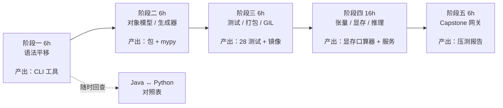

{"slug":"python-ai-infra-stages",
 "title":"从 Java 到 Python AI Infrastructure：40 小时实操版（五阶段 · 全部代码可运行）",
 "summary":"把 40 小时学习路线拆成五张实操网页，每页都有可运行的示例、真实输出和带参考答案的练习。全部代码在 Python 3.12 上实测，含一个 1101 行的推理网关 Capstone 与真实压测曲线。",
 "eyebrow":"总览 · Overview",
 "h1":"从 Java 到 Python AI Infrastructure",
 "sub":"40 小时 · 5 个阶段 · 每个阶段一张网页。不是讲义，是实验手册 —— 每段代码都跑过，每个输出都是真的，每道练习都有参考答案。",
 "facts":["<b>40 小时</b> · 5 阶段","练习 <b>24 个</b>（23 个带答案）","代码 <b>全部实测</b>","大部分<b>不需要 GPU</b>"],
 "footer":"看板任务 #425「Python学习」· 这五页是<a href=\"/p/python-ai-infra-40h.html\">《从 Java 到 Python AI Infrastructure：40 小时学习路线》(#422)</a> 的实操展开版。原路线给的是「学什么、为什么、按什么顺序」；这五页给的是「照着敲什么」。"}
---FM---

:::goal 这套页面是什么
[#422 那份路线](/p/python-ai-infra-40h.html) 回答的是**学什么、为什么、按什么顺序**。

这五张页面回答的是**照着敲什么** —— 每个阶段一页，每页包含：

- **可运行的示例**（每个代码块右上角有复制按钮），配**真实跑出来的输出**
- **可复现的坑**：不是"注意 XX"，而是"跑这段，看它错给你看"
- **24 道练习**，其中 23 道带参考答案 —— 答案全部实际跑过验证
- **结业自检清单**（可勾选）

读者画像：有扎实 Java 工程经验（Spring / 并发 / JVM 调优都熟），Python 接近零基础，目标是 **AI Infrastructure**。
:::

---

## 1. 五个阶段

<a class="card" href="/p/py-stage1-java-to-python.html">
  
阶段一 · 6 小时

  
把 Java 翻译成 Python

  
语法对照表 · 10 段可运行对照 · 6 个坑的复现 · Stream API 逐条映射 · 产出一个 167 行的 CLI 工具

</a>
<a class="card" href="/p/py-stage2-python-model.html">
  
阶段二 · 6 小时

  
对象模型 + Java 没有的那些机制

  
dataclass 的边界 · Protocol vs ABC · 生成器流水线 · 装饰器 · 把脚本重构成 6 模块的包，mypy --strict 通过

</a>
<a class="card" href="/p/py-stage3-engineering.html">
  
阶段三 · 6 小时

  
把工程素养接回来

  
pytest 夹具与性质测试 · uv 锁依赖与 CUDA 镜像 · <b>GIL 自校准基准</b> · asyncio 取消与限流 · cProfile / py-spy

</a>
<a class="card" href="/p/py-stage4-ai-infra.html">
  
阶段四 · 16 小时 · 重头戏

  
AI Infrastructure 核心栈

  
张量思维 · <b>显存口算器</b> · safetensors 与 pickle 攻击面 · 不需要 GPU 的推理服务 · Ray / K8s GPU · Prometheus 埋点

</a>
<a class="card" href="/p/py-stage5-capstone.html">
  
阶段五 · 6 小时

  
Capstone：LLM 推理网关

  
1101 行完整源码 · 准入控制 · 取消传播 · 24 个测试全过 · <b>真实压测曲线与膝点分析</b> · 面试怎么讲

</a>

| 阶段 | 时长 | 核心难点 | 可验收的产出 | 需要 GPU |
|---|---|---|---|---|
| [阶段一](/p/py-stage1-java-to-python.html) | 6 h | 卸掉三个 Java 直觉 | 167 行 CLI 工具，ruff 零告警 | 否 |
| [阶段二](/p/py-stage2-python-model.html) | 6 h | 生成器 · 结构化类型 | 6 模块的包，`mypy --strict` 通过 | 否 |
| [阶段三](/p/py-stage3-engineering.html) | 6 h | **GIL** | 28 个测试 + 可打镜像的包 | 否 |
| [阶段四](/p/py-stage4-ai-infra.html) | 16 h | **显存 · 批处理** | 显存口算器 + 推理服务 | 大部分不需要 |
| [阶段五](/p/py-stage5-capstone.html) | 6 h | 准入 · 取消 · 容量 | 网关 + 压测报告 | 否（假后端） |

**排期建议**：每周 8 小时 × 5 周，或每天 2 小时 × 20 天。**不建议压到两周内** —— 阶段四需要反复踩显存和批处理的坑，那些坑是靠等待和重试学会的。

---

## 2. 开始之前，三句话

1. **你不需要"学 Python"，你需要把 Java 的工程直觉平移过来，同时卸掉三个会害你的直觉**：类型靠编译器保证、并发靠线程池、性能靠 JVM 兜底 —— 这三条在 Python 里全部失效，而且失效方式各不相同。

2. **AI Infra 里 90% 的 Python 代码只用到语言的一个子集**：函数、`dataclass`、装饰器、生成器、`asyncio`、类型注解。元类、描述符、`__slots__` 微优化一律不学，遇到了再查。

3. **真正的难点不在语法，在四个心智模型**：张量（shape / dtype / broadcast）、显存（分配 / 碎片 / OOM）、批处理（吞吐 vs 时延）、GIL（为什么你的多线程不加速）。40 小时里有 16 小时花在它们身上，语法只占 6 小时。

---

## 3. 这五页里最值得先看的六段

即使你不打算按顺序走完，下面六段也值得单独挑出来读 —— 它们是**实测出来的、能改变判断的东西**：

| # | 在哪 | 是什么 | 为什么值钱 |
|---|---|---|---|
| 1 | [阶段三 §3](/p/py-stage3-engineering.html#sec-3-gil-最需要重装大脑的一节) | **GIL 自校准基准** | 在你自己的机器上量出：线程池对 CPU 任务的加速比 ≈ 1.00；以及容器里 `os.cpu_count()` 为什么会骗你 |
| 2 | [阶段四 §3](/p/py-stage4-ai-infra.html#sec-3-显存口算器-不需要-gpu) | **显存口算器** | 用数据推翻"int4 量化能让并发翻 4 倍"；给出真正该拧的旋钮 |
| 3 | [阶段四 §4](/p/py-stage4-ai-infra.html#sec-4-模型工件层-safetensors-与-pickle-的攻击面) | **105 字节的 pickle 攻击** | 无害地演示"加载权重 = 执行代码"，以及三条防线 |
| 4 | [阶段五 §4](/p/py-stage5-capstone.html#sec-4-m3-2-小时-压测与量化) | **真实吞吐-时延曲线** | 并发 8→64：吞吐涨 0%，TTFT 涨 2592%。排队论最直白的样子 |
| 5 | [阶段二 §3](/p/py-stage2-python-model.html#sec-3-生成器-python-相对-java-的真实增益) | **生成器的 16 万倍内存差** | 77.4 MiB vs 0.48 KiB，一对括号的区别 |
| 6 | [阶段一 §4](/p/py-stage1-java-to-python.html#sec-4-函数-参数与作用域-六个坑的复现) | **六个坑的可复现版本** | 不是"注意可变默认参数"，是跑给你看它怎么错 |

---

## 4. 这 40 小时里**不要**学的东西

明确排除，省下来的时间才够学阶段四：

| 不学 | 为什么 |
|---|---|
| ❌ Django / Flask 老教程 | AI 服务栈是 FastAPI |
| ❌ conda / Anaconda 环境地狱 | 2026 年用 `uv`，除非公司强制 |
| ❌ pandas 深挖 | infra 侧优先 Polars / DuckDB / Arrow |
| ❌ 元类、描述符、`__slots__` 微优化 | 读到再查，不专门学 |
| ❌ 从零实现反向传播 / 手写 Transformer | 有意思，但不是 infra 岗的考点，会占掉 10 小时 |
| ❌ 爬虫、自动化办公、数据可视化 | 与目标无关 |
| ❌ Python 2 相关的一切 | — |

---

## 5. 资源清单（每个主题只给一份）

| 用途 | 首选资源 |
|---|---|
| 语法速查（Java 背景） | 官方 Tutorial 只读 3/4/5/8/9 章 + [阶段一](/p/py-stage1-java-to-python.html)的对照表 |
| 地道写法 | *Effective Python*（Brett Slatkin，第 3 版）—— 条目式，随翻随用 |
| 类型注解 | mypy 官方 cheat sheet |
| 工具链 | `uv` 官方文档（很短）、`ruff` 规则说明 |
| 异步 | FastAPI 官方教程的 async 章节 |
| NumPy | 官方 "NumPy: the absolute basics" + broadcasting 章 |
| PyTorch | 官方 "Learn the Basics" + **CUDA semantics** 与 **memory management** 两篇（infra 必读） |
| LLM 推理 | vLLM 官方文档（PagedAttention / continuous batching / 性能调优） |
| K8s + GPU | NVIDIA device plugin 文档 + 一份 vLLM on K8s 部署示例 |

> 📌 原则：**每个主题只读一份主资源，剩下时间全部用来敲代码。** 40 小时里至少 24 小时应该是手在键盘上 —— 这也是这五页存在的理由。

---

## 6. 总的结业自检

走完五个阶段，下面每一条都应该能答"是"：

- [ ] 能不查 Java 对照写出地道的 Python（推导式、生成器、dataclass、`with`、f-string）
- [ ] 能解释类型注解为什么不检查、以及 pydantic 为什么例外
- [ ] 能说清 GIL 的影响，并在 asyncio / 多进程 / 向量化之间正确选型
- [ ] 知道容器里 `os.cpu_count()` 会骗人，能说出怎么读 cgroup 配额
- [ ] 能用 `uv` 从零建项目、锁依赖、打出能跑的 CUDA 镜像
- [ ] 能口算 "7B 模型 bf16 权重要多少显存"，并说出 KV cache 为什么还要额外一大块
- [ ] 能解释为什么 int4 量化对 8B 模型几乎不增加并发，对 32B 模型却增加 4 倍
- [ ] 能读懂一段 PyTorch 推理代码，指出 shape 错误和显存浪费点
- [ ] 能起一个 OpenAI 兼容服务，支持流式，并解释 continuous batching 解决了什么
- [ ] 能定义并采集 TTFT / TPOT / 排队时延 / 吞吐，画出吞吐-时延曲线并指出膝点
- [ ] 能把 Java 时代的限流、超时、取消、可观测实践迁移到这个服务上
- [ ] 能用"讲判断"而不是"列框架"的方式讲完 Capstone 项目

:::note 最后一条是重点
前 11 条是技能，第 12 条是**如何把技能变成 offer**。

[阶段五 §5](/p/py-stage5-capstone.html#sec-5-这个项目怎么讲) 给了一张"别说 / 说这个"的对照表。核心判断是：**你相对纯算法背景候选人的最大优势，是把 Java 时代的生产意识带了过来** —— 限流、超时、取消、可观测、优雅降级。

很多 AI 背景的候选人能把模型跑起来，但不会想到"客户端断开要取消下游生成"、"429 必须在第一个字节前返回"、"liveness 和 readiness 不能是同一个接口"。这些恰恰是你做了很多年的事。

**你不需要学它，只需要把它翻译过来。** 这条路线的全部设计，就是围绕这个判断。
:::

---

## 7. 相关文档

| 文档 | 内容 |
|---|---|
| [#422 · 40 小时学习路线](/p/python-ai-infra-40h.html) | 本系列的**原始规划**：学什么、为什么、按什么顺序、以及不要学什么 |
| [#423 · LLM Agent 实验平台设计说明书](/p/llm-agent-eval-platform.html) | 把一句简历 bullet 拆成可评审的 spec：12 条 ADR、评估体系、judge 校准。**做完阶段五的 M3 之后接着做它的 M1** |
