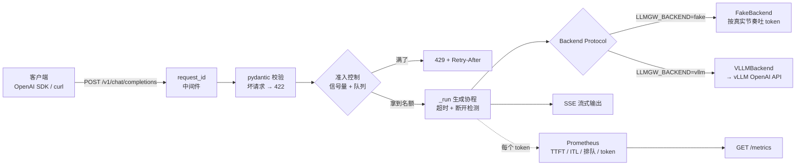
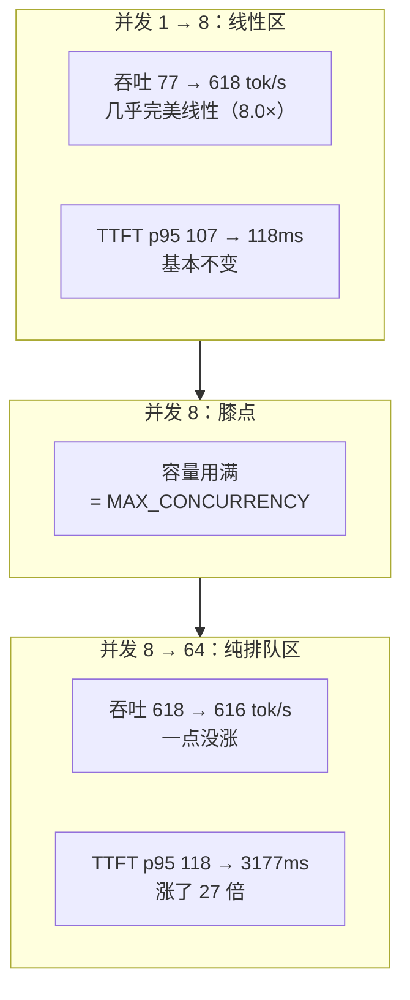

{"slug": "py-stage5-capstone", "title": "阶段五：Capstone —— LLM 推理网关（6 小时，完整源码 + 真实压测）", "summary": "1101 行完整源码（ruff + mypy 双绿，24 个测试全过）：准入控制、SSE 流式、取消传播、Prometheus 埋点、Dockerfile，外加一次真实压测画出吞吐-时延曲线并找到膝点。", "eyebrow": "阶段五 / 5 · Stage 5", "h1": "Capstone：LLM 推理网关", "sub": "一个能写进简历、也能直接当工作样例的项目。它同时证明三件事：你会写 Python、你懂 LLM 服务的性能模型、你把 Java 时代的生产意识带了过来 —— 第三条是你最大的优势。", "facts": ["<b>6 小时</b> · 3 个 milestone", "<b>1101 行</b>完整源码", "<b>24 个测试</b>全过", "含<b>真实压测曲线</b>"], "footer": "看板任务 #425「Python学习」· 本页是<a href=\"/p/python-ai-infra-40h.html\">《40 小时学习路线》(#422)</a> 阶段五的实操展开版。全部源码、测试结果与压测数据均为实测：ruff + mypy --strict 零告警，24 个 pytest 用例全部通过，压测跑在假后端上（不需要 GPU）。"}
---FM---

:::goal 交付物
一个 OpenAI 兼容的 LLM 推理网关，具备：

- **准入控制** —— 超载返回 429 + `Retry-After`，而不是把 GPU 拖垮
- **SSE 流式** —— 且首字节之前就完成准入判断（HTTP 状态码只有一次机会）
- **取消传播** —— 客户端断开时真正停止下游生成，不为没人看的请求烧 GPU
- **可观测** —— TTFT / 排队时延 / ITL / in-flight / token 计数，全部按 LLM 服务的口径埋
- **假后端与真后端可互换** —— 没有 GPU 也能把全部机制跑通、测通、压通
- **压测报告** —— 吞吐-时延曲线 + 膝点分析，直接可以写进容量规划文档
:::

:::note 为什么要有「假后端」
这不是为了偷懒，是**三个工程判断**：

1. **单测里绝不能加载真模型** —— 慢、要 GPU、结果不确定。24 个测试跑完只用 2.15 秒，就是因为后端是假的。
2. **网关自身的开销需要一个时延可控的基准** —— 真模型的抖动会淹没你想测的东西。
3. **让你在笔记本上练完全部服务化机制** —— 而这些机制才是 infra 岗的考点。

换成真 vLLM 只需要改一个环境变量，因为两个后端满足同一个 `Protocol`（阶段二）。
:::

---

## 1. 架构与目录



```text
llmgw/
├── pyproject.toml          # 依赖 + ruff + mypy + pytest 配置
├── Dockerfile              # CUDA 基础镜像，依赖层与代码层分离
├── k8s.yaml                # 部署骨架，四个 GPU 坑都标注了
├── src/llmgw/
│   ├── schemas.py    (68)  # OpenAI 兼容契约，pydantic
│   ├── backends.py  (112)  # Backend Protocol + Fake + vLLM
│   ├── admission.py  (86)  # 信号量 + 队列 + 超时
│   ├── metrics.py    (36)  # Prometheus，按 LLM 口径分桶
│   └── app.py       (319)  # FastAPI 装配：流式 / 取消 / 日志 / 健康检查
├── tests/            (292) # 24 个用例，全部跑在假后端上
└── bench/loadgen.py  (185) # 压测器：扫并发档位，自动找膝点
```

| 模块 | Spring 里的对应物 | 职责 |
|---|---|---|
| `schemas.py` | DTO + Bean Validation | 契约，**运行时真校验** |
| `backends.py` | Service 接口 + 多实现 | 后端抽象，Protocol 而非继承 |
| `admission.py` | Resilience4j 舱壁 / 限流 | 准入控制 |
| `metrics.py` | Micrometer | 指标定义 |
| `app.py` | `@RestController` + 配置类 | 只做装配，逻辑不放这里 |

---

## 2. M1（2 小时）：能跑通的服务

### `schemas.py` —— 契约层

```python
"""OpenAI 兼容的请求/响应契约。

pydantic 是 Python 生态里**唯一**会按类型注解做运行时校验的东西
（≈ Bean Validation，但校验规则就写在类型上）。v2 的内核是 Rust，很快。
"""

from __future__ import annotations

import time
import uuid
from typing import Literal

from pydantic import BaseModel, Field


class Message(BaseModel):
    role: Literal["system", "user", "assistant"]
    content: str = Field(min_length=1, max_length=32_000)


class ChatRequest(BaseModel):
    model: str = Field(min_length=1)
    messages: list[Message] = Field(min_length=1)
    max_tokens: int = Field(default=128, ge=1, le=4096)
    temperature: float = Field(default=0.7, ge=0.0, le=2.0)
    stream: bool = False

    @property
    def prompt(self) -> str:
        return "\n".join(f"{m.role}: {m.content}" for m in self.messages)

    @property
    def prompt_tokens(self) -> int:
        """真实网关要用 tokenizer；这里按字符估算，够做容量与计费的量纲。"""
        return max(1, len(self.prompt) // 4)


class Usage(BaseModel):
    prompt_tokens: int
    completion_tokens: int
    total_tokens: int


class Choice(BaseModel):
    index: int = 0
    message: Message
    finish_reason: Literal["stop", "length", "cancelled"] = "stop"


class ChatResponse(BaseModel):
    id: str = Field(default_factory=lambda: f"chatcmpl-{uuid.uuid4().hex[:12]}")
    object: Literal["chat.completion"] = "chat.completion"
    created: int = Field(default_factory=lambda: int(time.time()))
    model: str
    choices: list[Choice]
    usage: Usage


class ErrorBody(BaseModel):
    """错误也要和 OpenAI 对齐，否则客户端 SDK 不认。"""

    message: str
    type: str
    code: str | None = None


class ErrorResponse(BaseModel):
    error: ErrorBody
```

:::note 为什么 `prompt_tokens` 用 `len // 4` 这种糙估算
真实网关应该用 tokenizer。但这里的目的是**建立量纲** —— 让容量与计费的公式先跑起来，精确化是后面的事。

这是一个可迁移的工程判断：**先把量纲和链路打通，再提精度**。反过来（先追求精确的 token 计数，结果整条链路还没跑起来）是新手最常见的时间浪费。

真接 vLLM 时，它的响应里自带 `usage.prompt_tokens`，直接用就行。
:::

### `backends.py` —— Protocol 让真假可换

```python
"""后端抽象。Protocol 让"假后端"和"真 vLLM"可以互换，**不需要继承**。

为什么要有假后端：
  · 单测里绝不能加载真模型（慢、要 GPU、不确定）
  · 你在没有 GPU 的笔记本上也要能把服务化机制练完
  · 压测网关自身的开销时，需要一个时延可控的基准后端
"""

from __future__ import annotations

import asyncio
import random
from collections.abc import AsyncIterator
from dataclasses import dataclass
from typing import Protocol

from llmgw.schemas import ChatRequest


class Backend(Protocol):
    """实现方不需要 import 这个类。结构对得上就是它的实现。"""

    name: str

    async def ready(self) -> bool: ...

    def stream(self, req: ChatRequest) -> AsyncIterator[str]: ...


@dataclass
class FakeBackend:
    """按真实 LLM 的两段式节奏产出 token。

    prefill（首 token）耗时 ∝ prompt 长度  —— 算力瓶颈
    decode（后续 token）每个固定间隔       —— 访存瓶颈
    这两句解释了几乎所有 LLM 服务的性能现象，所以假后端必须复刻它。
    """

    name: str = "fake-1b"
    ttft_base_s: float = 0.08
    ttft_per_1k_tokens_s: float = 0.12
    itl_s: float = 0.010
    jitter: float = 0.15
    fail_rate: float = 0.0
    _ready: bool = True

    async def ready(self) -> bool:
        return self._ready

    def _noise(self, base: float) -> float:
        return base * random.uniform(1 - self.jitter, 1 + self.jitter)

    async def stream(self, req: ChatRequest) -> AsyncIterator[str]:
        if self.fail_rate and random.random() < self.fail_rate:
            raise RuntimeError("backend exploded")
        ttft = self.ttft_base_s + self.ttft_per_1k_tokens_s * req.prompt_tokens / 1000
        await asyncio.sleep(self._noise(ttft))                 # ← prefill
        alphabet = "这是一个用来练习服务化的假回答，它按真实节奏逐个吐字。"
        for i in range(req.max_tokens):
            await asyncio.sleep(self._noise(self.itl_s))       # ← decode
            yield alphabet[i % len(alphabet)]


@dataclass
class VLLMBackend:
    """真后端：把 HTTP 流式响应翻译成同一个 AsyncIterator[str]。

    起 vLLM：
        vllm serve Qwen/Qwen3-8B --max-model-len 8192 \\
             --gpu-memory-utilization 0.90 --port 8001
    换后端时，网关其余代码**一行都不用改** —— 这就是 Protocol 的价值。
    """

    base_url: str = "http://localhost:8001"
    name: str = "vllm"
    timeout_s: float = 300.0

    async def ready(self) -> bool:
        import httpx

        try:
            async with httpx.AsyncClient(timeout=2.0) as c:
                return (await c.get(f"{self.base_url}/health")).status_code == 200
        except Exception:
            return False

    async def stream(self, req: ChatRequest) -> AsyncIterator[str]:
        import json

        import httpx

        body = {
            "model": self.name,
            "messages": [m.model_dump() for m in req.messages],
            "max_tokens": req.max_tokens,
            "temperature": req.temperature,
            "stream": True,
        }
        async with (
            httpx.AsyncClient(timeout=self.timeout_s) as client,
            client.stream("POST", f"{self.base_url}/v1/chat/completions", json=body) as resp,
        ):
            resp.raise_for_status()
            async for line in resp.aiter_lines():
                if not line.startswith("data: "):
                    continue
                data = line[6:]
                if data == "[DONE]":
                    return
                delta = json.loads(data)["choices"][0]["delta"]
                if content := delta.get("content"):
                    yield content
```

:::warn `FakeBackend` 的两段式节奏不是随便写的
```python
ttft = self.ttft_base_s + self.ttft_per_1k_tokens_s * req.prompt_tokens / 1000
await asyncio.sleep(ttft)                       # ← prefill：耗时 ∝ prompt 长度
for i in range(req.max_tokens):
    await asyncio.sleep(self._noise(self.itl_s))  # ← decode：每 token 固定间隔
```

它刻意复刻了真实 LLM 的物理特性（阶段四 §5）：

- **prefill 耗时和 prompt 长度成正比** —— 所以你能在假后端上观察到"长 prompt 拖慢 TTFT"
- **decode 每 token 间隔固定** —— 所以端到端时延 ≈ TTFT + max_tokens × ITL

**如果假后端只是 `sleep(1)` 然后一次性返回**，你就练不到任何有意义的东西：TTFT 和端到端时延会退化成同一个数，流式的意义消失，压测曲线也不会有膝点。

**假件的价值取决于它保留了哪些真实特性。** 这个判断在写任何测试替身时都适用。
:::

### `app.py` 的 M1 部分 —— 路由与流式

完整文件在下一节（M2 会往里加准入和取消）。M1 阶段你只需要跑通：

```bash
uv run uvicorn llmgw.app:app --port 8000

# 非流式
curl localhost:8000/v1/chat/completions -H 'content-type: application/json' \
  -d '{"model":"fake-1b","messages":[{"role":"user","content":"hi"}],"max_tokens":8}'

# 流式（-N 关掉 curl 的缓冲，否则看不到逐字效果）
curl -N localhost:8000/v1/chat/completions -H 'content-type: application/json' \
  -d '{"model":"fake-1b","messages":[{"role":"user","content":"hi"}],"max_tokens":5,"stream":true}'
```

:::out 流式的真实响应
```text
data: {"id": "chatcmpl-cbe702fa4ec2", "object": "chat.completion.chunk", "created": 1789705789, "model": "fake-1b", "choices": [{"index": 0, "delta": {"role": "assistant", "content": ""}, "finish_reason": null}]}

data: {"id": "chatcmpl-cbe702fa4ec2", "object": "chat.completion.chunk", "created": 1789705789, "model": "fake-1b", "choices": [{"index": 0, "delta": {"content": "这"}, "finish_reason": null}]}
```
:::

:::warn SSE 的三个必须
```python
return StreamingResponse(body(), media_type="text/event-stream", headers={
    "Cache-Control": "no-cache",
    "X-Accel-Buffering": "no",      # ★ 关掉 nginx 缓冲
    "x-request-id": rid,
})
```

1. **`media_type="text/event-stream"`** —— 否则客户端 SDK 不会按流式解析
2. **`X-Accel-Buffering: no`** —— nginx / ALB 默认会**攒够一个缓冲区才转发**。少了这个头，用户看到的是"卡 5 秒，然后唰地全出来"，流式完全白做。这是上线后才会暴露的经典问题，本地测永远正常。
3. **每条消息以 `\n\n` 结尾** —— SSE 协议规定的消息分隔符，少一个换行客户端就会一直等

第 2 条建议**在部署前就写进 checklist** —— 它是"本地好好的，一上线就不对"的高频来源。
:::

---

## 3. M2（2 小时）：像个生产服务

### `admission.py` —— 准入控制

```python
"""准入控制 —— 把你在 Java 里做的限流/舱壁/超时搬过来。

为什么 LLM 服务比普通 Web 服务更需要它：
  · 一个请求会占住 GPU 显存（KV cache）几十秒，不是几毫秒
  · 超载时不是"变慢一点"，而是 **OOM 直接把整个进程带走**
  · 所以必须在**入口**就拒绝，而不是让请求堆到后端去
"""

from __future__ import annotations

import asyncio
from dataclasses import dataclass, field
from types import TracebackType


class Overloaded(Exception):
    """队列满了。对应 HTTP 429 —— 这是一个**正常**的、可重试的答复。"""

    def __init__(self, waiting: int, limit: int) -> None:
        super().__init__(f"queue full: {waiting} waiting, limit {limit}")
        self.waiting, self.limit = waiting, limit


@dataclass
class AdmissionController:
    """信号量控并发 + 计数器控排队长度 + 超时兜底。

    三个参数的物理含义（调参时按这个思路，别瞎试）：
        max_concurrency  同时在 GPU 上跑几个请求 → 由**显存**决定，用 #422 的显存公式算
        max_queue        最多让几个人排队       → 由**可接受的排队时延**决定
        queue_timeout_s  排多久就放弃           → 应小于客户端自己的超时
    """

    max_concurrency: int = 8
    max_queue: int = 32
    queue_timeout_s: float = 10.0

    _sem: asyncio.Semaphore = field(init=False)
    waiting: int = field(default=0, init=False)
    running: int = field(default=0, init=False)
    admitted: int = field(default=0, init=False)
    rejected: int = field(default=0, init=False)

    def __post_init__(self) -> None:
        self._sem = asyncio.Semaphore(self.max_concurrency)

    def snapshot(self) -> dict[str, int]:
        return {"running": self.running, "waiting": self.waiting,
                "admitted": self.admitted, "rejected": self.rejected}

    def slot(self) -> _Slot:
        return _Slot(self)


@dataclass
class _Slot:
    """async with 拿到的"名额"。用上下文管理器保证异常路径也会释放。"""

    ctl: AdmissionController
    queued_s: float = 0.0

    async def __aenter__(self) -> _Slot:
        c = self.ctl
        if c.waiting >= c.max_queue:          # ← 快速失败，不让它进来排
            c.rejected += 1
            raise Overloaded(c.waiting, c.max_queue)
        c.waiting += 1
        loop = asyncio.get_running_loop()
        t0 = loop.time()
        try:
            async with asyncio.timeout(c.queue_timeout_s):
                await c._sem.acquire()
        except TimeoutError:
            c.rejected += 1
            raise Overloaded(c.waiting, c.max_queue) from None
        finally:
            c.waiting -= 1
        self.queued_s = loop.time() - t0      # ★ 排队时延：LLM 服务最该埋的指标
        c.running += 1
        c.admitted += 1
        return self

    async def __aexit__(self, exc_type: type[BaseException] | None,
                        exc: BaseException | None, tb: TracebackType | None) -> None:
        self.ctl.running -= 1
        self.ctl._sem.release()
```

:::note 三个参数怎么定，不要瞎试
| 参数 | 由什么决定 | 怎么算 |
|---|---|---|
| `max_concurrency` | **显存** | 用阶段四的显存公式：`(卡容量×0.9 − 权重) / 每请求KV` |
| `max_queue` | **可接受的排队时延** | `max_queue ≈ 目标排队时延 / 单请求平均耗时 × max_concurrency` |
| `queue_timeout_s` | **客户端的超时** | 必须**小于**客户端超时，否则客户端已经放弃了你还在算 |

举个具体的：Llama-3.1-8B @ A100-80G，8k 上下文 → 显存公式给出 57 个并发。单请求平均 4 秒。若能接受 10 秒排队，则 `max_queue ≈ 10/4 × 57 ≈ 140`。

**这就是"容量规划"的全部** —— 三个数字，每个都有出处，而不是"先设个 100 看看"。
:::

### `metrics.py` —— 按 LLM 口径埋点

```python
"""Prometheus 指标。

普通 Web 服务埋 QPS/时延/错误率就够了；LLM 服务**必须**额外埋四个：
    TTFT        —— 用户感知的"反应快不快"，和端到端时延是两回事
    排队时延     —— 区分"GPU 慢"和"根本排不上队"，定容量时全靠它
    in-flight   —— 当前占着显存的请求数，OOM 前的先行指标
    token 计数   —— 成本核算与容量规划的量纲（每千 token 成本）
"""

from __future__ import annotations

from prometheus_client import CollectorRegistry, Counter, Gauge, Histogram

REGISTRY = CollectorRegistry()

# 分桶按"你要回答的问题"设计，不要用默认桶：
# TTFT 的关注区间是 50ms~5s，端到端是 0.5s~2min，它们的桶必须不同。
TTFT = Histogram("llmgw_ttft_seconds", "首 token 时延", ["model"],
                 buckets=(.05, .1, .2, .3, .5, .75, 1, 1.5, 2, 3, 5, 10),
                 registry=REGISTRY)
E2E = Histogram("llmgw_request_seconds", "端到端时延", ["model", "outcome"],
                buckets=(.1, .25, .5, 1, 2, 4, 8, 15, 30, 60, 120),
                registry=REGISTRY)
QUEUE_WAIT = Histogram("llmgw_queue_seconds", "排队时延", ["model"],
                       buckets=(.001, .01, .05, .1, .25, .5, 1, 2, 5, 10),
                       registry=REGISTRY)
ITL = Histogram("llmgw_inter_token_seconds", "token 间隔 (TPOT)", ["model"],
                buckets=(.002, .005, .01, .02, .05, .1, .25, .5),
                registry=REGISTRY)

REQUESTS = Counter("llmgw_requests_total", "请求数", ["model", "outcome"], registry=REGISTRY)
TOKENS = Counter("llmgw_tokens_total", "token 数", ["model", "kind"], registry=REGISTRY)

IN_FLIGHT = Gauge("llmgw_in_flight", "正在生成的请求数", registry=REGISTRY)
WAITING = Gauge("llmgw_waiting", "排队中的请求数", registry=REGISTRY)
READY = Gauge("llmgw_backend_ready", "后端就绪 (1/0)", registry=REGISTRY)
```

### `app.py` —— 完整装配

```python
"""LLM 推理网关。

这个文件把前面几块装配起来，并处理五件生产服务必须做对的事：
  1. 准入控制：超载返回 429，而不是把 GPU 拖垮
  2. 取消传播：客户端断开 → 真的停止下游生成（省 GPU，最常被忽略）
  3. 结构化日志：每条带 request_id，能和指标对上
  4. 流式：SSE，且首 token 之后不能再改 HTTP 状态码（见下面的注释）
  5. 健康检查：liveness 与 readiness 分开
"""

from __future__ import annotations

import asyncio
import contextlib
import json
import logging
import os
import time
import uuid
from collections.abc import AsyncIterator, Awaitable, Callable
from contextlib import asynccontextmanager
from typing import Any

from fastapi import FastAPI, Request, Response
from fastapi.responses import JSONResponse, PlainTextResponse, StreamingResponse
from prometheus_client import CONTENT_TYPE_LATEST, generate_latest

from llmgw import metrics as M
from llmgw.admission import AdmissionController, Overloaded
from llmgw.backends import Backend, FakeBackend, VLLMBackend
from llmgw.schemas import (
    ChatRequest,
    ChatResponse,
    Choice,
    ErrorBody,
    ErrorResponse,
    Message,
    Usage,
)

log = logging.getLogger("llmgw")


def _configure_logging() -> None:
    """JSON 行日志。容器里唯一正确的日志格式 —— 采集器不用再写正则。"""

    class JsonFormatter(logging.Formatter):
        def format(self, record: logging.LogRecord) -> str:
            payload = {
                "ts": self.formatTime(record, "%Y-%m-%dT%H:%M:%S"),
                "level": record.levelname,
                "msg": record.getMessage(),
            }
            payload.update(getattr(record, "extra_fields", {}))
            return json.dumps(payload, ensure_ascii=False)

    handler = logging.StreamHandler()
    handler.setFormatter(JsonFormatter())
    log.handlers = [handler]
    log.setLevel(os.environ.get("LOG_LEVEL", "INFO"))
    log.propagate = False


def build_backend() -> Backend:
    """一个环境变量切换真假后端。≈ Spring 的 @Profile。"""
    if os.environ.get("LLMGW_BACKEND", "fake") == "vllm":
        return VLLMBackend(base_url=os.environ.get("VLLM_URL", "http://localhost:8001"),
                           name=os.environ.get("MODEL_NAME", "vllm"))
    return FakeBackend(name=os.environ.get("MODEL_NAME", "fake-1b"))


@asynccontextmanager
async def lifespan(app: FastAPI) -> AsyncIterator[None]:
    """启动/关闭钩子 ≈ @PostConstruct / @PreDestroy。"""
    _configure_logging()
    app.state.backend = build_backend()
    app.state.admission = AdmissionController(
        max_concurrency=int(os.environ.get("MAX_CONCURRENCY", "8")),
        max_queue=int(os.environ.get("MAX_QUEUE", "32")),
        queue_timeout_s=float(os.environ.get("QUEUE_TIMEOUT_S", "10")),
    )
    app.state.request_timeout_s = float(os.environ.get("REQUEST_TIMEOUT_S", "120"))
    app.state.ready = await app.state.backend.ready()
    M.READY.set(int(app.state.ready))
    log.info("gateway up", extra={"extra_fields": {
        "backend": app.state.backend.name, "ready": app.state.ready,
        "max_concurrency": app.state.admission.max_concurrency}})
    yield
    log.info("gateway down")


app = FastAPI(title="llmgw", version="1.0.0", lifespan=lifespan)


def _err(status: int, msg: str, typ: str, code: str) -> JSONResponse:
    body = ErrorResponse(error=ErrorBody(message=msg, type=typ, code=code))
    return JSONResponse(status_code=status, content=body.model_dump())


@app.middleware("http")
async def request_id_middleware(request: Request, call_next: Any) -> Response:
    """给每个请求一个 id，并回写到响应头 —— 排障时客户端能直接报给你。"""
    rid = request.headers.get("x-request-id") or uuid.uuid4().hex[:12]
    request.state.request_id = rid
    response: Response = await call_next(request)
    response.headers["x-request-id"] = rid
    return response


async def _run(req: ChatRequest, backend: Backend, rid: str,
               disconnected: Callable[[], Awaitable[bool]] | None,
               timeout_s: float) -> AsyncIterator[tuple[str, Any]]:
    """真正干活的协程：产出 (事件类型, 数据)。

    抽成生成器是为了让流式与非流式共用同一条代码路径 ——
    否则两边的指标、取消、超时逻辑迟早会漂移。
    """
    t0 = time.perf_counter()
    first_at: float | None = None
    last_at = t0
    n = 0
    try:
        async with asyncio.timeout(timeout_s):
            async for tok in backend.stream(req):
                now = time.perf_counter()
                if first_at is None:
                    first_at = now
                    M.TTFT.labels(req.model).observe(now - t0)
                    yield ("ttft", now - t0)
                else:
                    M.ITL.labels(req.model).observe(now - last_at)
                last_at = now
                n += 1
                yield ("token", tok)
                # ★ 每吐一个 token 就看一眼客户端还在不在。
                #   不做这一步 = 用户关掉页面后 GPU 还在为他算，白烧钱。
                if disconnected is not None and await disconnected():
                    yield ("cancelled", n)
                    return
    except TimeoutError:
        yield ("timeout", n)
        return
    yield ("done", n)


@app.post("/v1/chat/completions")
async def chat_completions(req: ChatRequest, request: Request) -> Any:
    rid: str = request.state.request_id
    ctl: AdmissionController = app.state.admission
    backend: Backend = app.state.backend
    timeout_s: float = app.state.request_timeout_s
    started = time.perf_counter()

    if not app.state.ready:
        M.REQUESTS.labels(req.model, "unavailable").inc()
        return _err(503, "后端未就绪", "service_unavailable", "not_ready")

    # ── 非流式：先拿名额，全部生成完再一次性返回 ──────────────────
    if not req.stream:
        try:
            slot = ctl.slot()
            async with slot:
                M.QUEUE_WAIT.labels(req.model).observe(slot.queued_s)
                M.IN_FLIGHT.set(ctl.running)
                M.WAITING.set(ctl.waiting)
                text, outcome = "", "done"
                async for kind, data in _run(req, backend, rid, request.is_disconnected,
                                             timeout_s):
                    if kind == "token":
                        text += data
                    elif kind in {"timeout", "cancelled"}:
                        outcome = kind
        except Overloaded as e:
            M.REQUESTS.labels(req.model, "overloaded").inc()
            log.warning("rejected", extra={"extra_fields": {
                "request_id": rid, "waiting": e.waiting}})
            return JSONResponse(
                status_code=429,
                content=ErrorResponse(error=ErrorBody(
                    message="服务繁忙，请稍后重试", type="rate_limit_error",
                    code="queue_full")).model_dump(),
                headers={"Retry-After": "2"},   # ← 告诉客户端**多久后**再来
            )
        finally:
            M.IN_FLIGHT.set(ctl.running)
            M.WAITING.set(ctl.waiting)

        if outcome == "timeout":
            M.REQUESTS.labels(req.model, "timeout").inc()
            return _err(504, "生成超时", "timeout_error", "generation_timeout")

        M.REQUESTS.labels(req.model, "ok").inc()
        M.E2E.labels(req.model, "ok").observe(time.perf_counter() - started)
        M.TOKENS.labels(req.model, "prompt").inc(req.prompt_tokens)
        M.TOKENS.labels(req.model, "completion").inc(len(text))
        log.info("completed", extra={"extra_fields": {
            "request_id": rid, "tokens": len(text), "queued_ms": round(slot.queued_s * 1e3, 1),
            "duration_ms": round((time.perf_counter() - started) * 1e3, 1)}})
        return ChatResponse(
            model=req.model,
            choices=[Choice(message=Message(role="assistant", content=text or " "))],
            usage=Usage(prompt_tokens=req.prompt_tokens, completion_tokens=len(text),
                        total_tokens=req.prompt_tokens + len(text)),
        )

    # ── 流式 ──────────────────────────────────────────────────────
    # ⚠️ 关键约束：一旦开始流式输出，HTTP 状态码就**已经发出去了**，
    #    之后再出错只能在流里发一个 error 事件。所以准入控制必须在
    #    StreamingResponse **之前**做完 —— 429 要在第一个字节前返回。
    try:
        slot = ctl.slot()
        await slot.__aenter__()
    except Overloaded as e:
        M.REQUESTS.labels(req.model, "overloaded").inc()
        log.warning("rejected", extra={"extra_fields": {
            "request_id": rid, "waiting": e.waiting}})
        return JSONResponse(
            status_code=429,
            content=ErrorResponse(error=ErrorBody(
                message="服务繁忙，请稍后重试", type="rate_limit_error",
                code="queue_full")).model_dump(),
            headers={"Retry-After": "2"},
        )

    M.QUEUE_WAIT.labels(req.model).observe(slot.queued_s)
    cid = f"chatcmpl-{uuid.uuid4().hex[:12]}"

    def frame(delta: dict[str, Any], finish: str | None = None) -> str:
        return "data: " + json.dumps({
            "id": cid, "object": "chat.completion.chunk", "created": int(time.time()),
            "model": req.model,
            "choices": [{"index": 0, "delta": delta, "finish_reason": finish}],
        }, ensure_ascii=False) + "\n\n"

    async def body() -> AsyncIterator[str]:
        outcome, n, ttft = "done", 0, None
        try:
            M.IN_FLIGHT.set(ctl.running)
            yield frame({"role": "assistant", "content": ""})
            async for kind, data in _run(req, backend, rid, request.is_disconnected,
                                         timeout_s):
                if kind == "token":
                    n += 1
                    yield frame({"content": data})
                elif kind == "ttft":
                    ttft = data
                elif kind in {"timeout", "cancelled"}:
                    outcome = kind
            if outcome == "timeout":
                yield "data: " + json.dumps({"error": {
                    "message": "生成超时", "type": "timeout_error"}}) + "\n\n"
            yield frame({}, finish="length" if outcome == "timeout" else "stop")
            yield "data: [DONE]\n\n"
        except asyncio.CancelledError:
            outcome = "cancelled"          # 客户端断开，ASGI 服务器会取消这个任务
            raise
        except Exception as exc:           # noqa: BLE001 —— 流里不能抛到外面去
            outcome = "error"
            log.exception("stream failed", extra={"extra_fields": {"request_id": rid}})
            yield "data: " + json.dumps({"error": {
                "message": str(exc), "type": "internal_error"}}) + "\n\n"
        finally:
            # ★ finally 必须释放名额：客户端断开走的是 CancelledError 路径，
            #   漏掉这里 = 并发额度慢慢泄漏光，服务最后只会返回 429。
            await slot.__aexit__(None, None, None)
            M.IN_FLIGHT.set(ctl.running)
            M.WAITING.set(ctl.waiting)
            M.REQUESTS.labels(req.model, outcome).inc()
            M.E2E.labels(req.model, outcome).observe(time.perf_counter() - started)
            M.TOKENS.labels(req.model, "completion").inc(n)
            M.TOKENS.labels(req.model, "prompt").inc(req.prompt_tokens)
            log.info("stream finished", extra={"extra_fields": {
                "request_id": rid, "outcome": outcome, "tokens": n,
                "ttft_ms": round(ttft * 1e3, 1) if ttft else None,
                "queued_ms": round(slot.queued_s * 1e3, 1),
                "duration_ms": round((time.perf_counter() - started) * 1e3, 1)}})

    return StreamingResponse(body(), media_type="text/event-stream", headers={
        "Cache-Control": "no-cache",
        "X-Accel-Buffering": "no",      # 关掉 nginx 缓冲，否则流式会被攒成一坨
        "x-request-id": rid,
    })


@app.get("/healthz", response_class=PlainTextResponse)
async def healthz() -> str:
    """liveness：进程没死。K8s 探测失败会**重启 Pod** —— 所以这里绝不能查后端。"""
    return "ok"


@app.get("/readyz")
async def readyz() -> JSONResponse:
    """readiness：能接流量了吗。失败只是**摘流量**，不重启。

    LLM 服务加载权重要几分钟，这期间 liveness 必须过、readiness 必须不过。
    把两者写成同一个接口，是滚动更新时 502 的头号原因。
    """
    ok = await app.state.backend.ready()
    app.state.ready = ok
    M.READY.set(int(ok))
    ctl: AdmissionController = app.state.admission
    payload = {"ready": ok, "backend": app.state.backend.name, **ctl.snapshot()}
    return JSONResponse(payload, status_code=200 if ok else 503)


@app.get("/metrics")
async def prom_metrics() -> PlainTextResponse:
    ctl: AdmissionController = app.state.admission
    M.IN_FLIGHT.set(ctl.running)
    M.WAITING.set(ctl.waiting)
    return PlainTextResponse(generate_latest(M.REGISTRY).decode(),
                             media_type=CONTENT_TYPE_LATEST)


with contextlib.suppress(ImportError):   # 可选：本地开发时直接 python -m llmgw.app
    if __name__ == "__main__":
        import uvicorn

        uvicorn.run(app, host="0.0.0.0", port=8000)
```

:::warn 这个文件里有三处「不写就会出事」的地方
**① 流式的准入必须在 `return StreamingResponse` 之前**

```python
try:
    slot = ctl.slot()
    await slot.__aenter__()          # ← 在这里拿名额
except Overloaded:
    return JSONResponse(status_code=429, ...)   # 还能改状态码
return StreamingResponse(body())     # 从这里开始，状态码定死了
```

一旦开始流式输出，HTTP 头已经发出去了，之后再"想返回 429"是不可能的。

**② 名额必须在 `finally` 里释放**

```python
finally:
    await slot.__aexit__(None, None, None)
```

客户端断开走的是 `CancelledError` 路径，不是正常返回。漏掉这个 `finally`，每次断开泄漏一个名额 —— 服务跑几小时后**所有请求都返回 429**，日志里一条异常都没有。这是本项目里最难查的一类 bug。

**③ 断开检测要在每个 token 之后**

```python
yield ("token", tok)
if disconnected is not None and await disconnected():
    yield ("cancelled", n)
    return
```

`is_disconnected()` 只在**尝试写入之后**才知道对端没了。放在 yield 之前检查，永远检查不出来。
:::

:::note `_run` 为什么要抽成一个生成器
流式和非流式共用同一条代码路径。

如果写成两份，超时逻辑、断开检测、TTFT 埋点会在两边各写一遍 —— 然后**迟早漂移**：有人给流式加了个新指标，忘了非流式那边；有人修了非流式的超时 bug，流式那边还留着。

抽成 `_run(...) -> AsyncIterator[tuple[str, Any]]` 之后，两个分支只是**消费同一个事件流的两种方式**。这是 Java 里"把公共逻辑提到模板方法"的同一个动机，只是这里用生成器表达更自然。
:::

### 测试：24 个用例，2.15 秒跑完

**`tests/conftest.py`**

```python
import os

import pytest
from fastapi.testclient import TestClient

os.environ.setdefault("LLMGW_BACKEND", "fake")


@pytest.fixture
def client():
    """TestClient 会触发 lifespan —— 所以 app.state 是真的装配好的。"""
    from llmgw.app import app

    with TestClient(app) as c:
        yield c


@pytest.fixture
def body():
    return {"model": "fake-1b",
            "messages": [{"role": "user", "content": "你好，介绍一下 PagedAttention"}],
            "max_tokens": 12}
```

**`tests/test_contract.py`** —— pydantic 真的拦住了坏请求吗

```python
"""契约层：pydantic 是否真的在运行时拦住了坏请求。"""

import pytest

from llmgw.schemas import ChatRequest


def test_defaults():
    r = ChatRequest(model="m", messages=[{"role": "user", "content": "hi"}])
    assert (r.max_tokens, r.temperature, r.stream) == (128, 0.7, False)


@pytest.mark.parametrize(
    "patch",
    [
        {"messages": []},                                   # 空消息
        {"max_tokens": 0}, {"max_tokens": 99999},           # 越界
        {"temperature": -1}, {"temperature": 5},
        {"messages": [{"role": "root", "content": "x"}]},   # 非法 role
        {"messages": [{"role": "user", "content": ""}]},    # 空内容
    ],
)
def test_rejects_bad_input(patch):
    base = {"model": "m", "messages": [{"role": "user", "content": "hi"}]}
    with pytest.raises(ValueError):
        ChatRequest(**{**base, **patch})


def test_api_returns_422_not_500(client, body):
    r = client.post("/v1/chat/completions", json={**body, "max_tokens": -1})
    assert r.status_code == 422
    assert r.json()["detail"][0]["loc"] == ["body", "max_tokens"]
```

**`tests/test_gateway.py`** —— 网关行为

```python
"""网关行为。全部跑在假后端上 —— 单测里永远不加载真模型。"""

import json


def test_non_streaming(client, body):
    r = client.post("/v1/chat/completions", json=body)
    assert r.status_code == 200
    data = r.json()
    assert data["object"] == "chat.completion"
    assert len(data["choices"][0]["message"]["content"]) == body["max_tokens"]
    assert data["usage"]["total_tokens"] > 0
    assert r.headers["x-request-id"]


def test_request_id_is_echoed(client, body):
    r = client.post("/v1/chat/completions", json=body, headers={"x-request-id": "abc123"})
    assert r.headers["x-request-id"] == "abc123"


def test_streaming_shape(client, body):
    with client.stream("POST", "/v1/chat/completions", json={**body, "stream": True}) as s:
        assert s.status_code == 200
        assert s.headers["content-type"].startswith("text/event-stream")
        frames = [ln[6:] for ln in s.iter_lines() if ln.startswith("data: ")]
    assert frames[-1] == "[DONE]"
    parsed = [json.loads(f) for f in frames[:-1]]
    assert parsed[0]["choices"][0]["delta"] == {"role": "assistant", "content": ""}
    assert parsed[-1]["choices"][0]["finish_reason"] == "stop"
    text = "".join(p["choices"][0]["delta"].get("content", "") for p in parsed)
    assert len(text) == body["max_tokens"]


def test_health_and_ready(client):
    assert client.get("/healthz").text == "ok"
    ready = client.get("/readyz")
    assert ready.status_code == 200
    assert ready.json()["ready"] is True
    assert set(ready.json()) >= {"running", "waiting", "admitted", "rejected"}


def test_metrics_exposes_llm_specific_series(client, body):
    """⚠️ Prometheus 的 registry 是**进程全局**的，计数器会跨测试累加。
    所以断言必须看**增量**，不能看绝对值 —— 否则测试的通过与否取决于执行顺序。
    """
    from llmgw import metrics as M

    before = M.REQUESTS.labels(body["model"], "ok")._value.get()
    client.post("/v1/chat/completions", json=body)
    after = M.REQUESTS.labels(body["model"], "ok")._value.get()
    assert after - before == 1

    text = client.get("/metrics").text
    for series in ("llmgw_ttft_seconds", "llmgw_queue_seconds", "llmgw_request_seconds",
                   "llmgw_inter_token_seconds", "llmgw_tokens_total", "llmgw_in_flight",
                   "llmgw_requests_total", "llmgw_backend_ready"):
        assert series in text, series
```

:::warn `test_metrics_exposes_llm_specific_series` 里踩到的坑
我第一版写的是：

```python
assert 'llmgw_requests_total{model="fake-1b",outcome="ok"} 1.0' in text
```

**单独跑通过，和其它测试一起跑就失败。**

因为 Prometheus 的 `CollectorRegistry` 是**进程全局**的，计数器会跨测试累加。前面的测试已经发过请求了，所以这里不是 1.0。

修法是断言**增量**：

```python
before = M.REQUESTS.labels(body["model"], "ok")._value.get()
client.post(...)
after = M.REQUESTS.labels(body["model"], "ok")._value.get()
assert after - before == 1
```

**任何全局可变状态都会让测试变成顺序依赖的。** Prometheus registry、`functools.lru_cache`、模块级单例都属于这一类。对付它们只有两招：断言增量，或者在 fixture 里重置。
:::

**`tests/test_admission.py`** —— 超载时必须快速拒绝

```python
"""准入控制：超载时必须**快速拒绝**，而不是排到天荒地老。"""

import asyncio

import pytest

from llmgw.admission import AdmissionController, Overloaded


async def test_concurrency_is_capped():
    ctl = AdmissionController(max_concurrency=2, max_queue=100)
    peak = 0

    async def job():
        nonlocal peak
        async with ctl.slot():
            peak = max(peak, ctl.running)
            await asyncio.sleep(0.05)

    await asyncio.gather(*(job() for _ in range(8)))
    assert peak == 2
    assert ctl.admitted == 8 and ctl.rejected == 0
    assert ctl.running == 0          # 全部归还


async def test_queue_overflow_rejects_fast():
    ctl = AdmissionController(max_concurrency=1, max_queue=2, queue_timeout_s=5)
    rejected = 0

    async def job():
        nonlocal rejected
        try:
            async with ctl.slot():
                await asyncio.sleep(0.1)
        except Overloaded:
            rejected += 1

    await asyncio.gather(*(job() for _ in range(10)))
    assert rejected > 0                       # 有人被挡在门外
    assert ctl.admitted + rejected == 10      # 但没人凭空消失


async def test_queue_timeout_gives_up():
    ctl = AdmissionController(max_concurrency=1, max_queue=50, queue_timeout_s=0.05)

    async def hog():
        async with ctl.slot():
            await asyncio.sleep(0.4)

    task = asyncio.create_task(hog())
    await asyncio.sleep(0.01)
    with pytest.raises(Overloaded):
        async with ctl.slot():
            pass
    await task


async def test_slot_released_on_exception():
    """异常路径也必须归还名额 —— 漏一次，并发额度就永久少一个。"""
    ctl = AdmissionController(max_concurrency=1)
    with pytest.raises(RuntimeError):
        async with ctl.slot():
            raise RuntimeError("boom")
    async with ctl.slot():               # 还能再拿到，说明没泄漏
        assert ctl.running == 1
    assert ctl.running == 0


def test_gateway_returns_429_with_retry_after(monkeypatch, body):
    """端到端：并发打满时网关应返回 429 + Retry-After。"""
    import os

    os.environ["MAX_CONCURRENCY"] = "1"
    os.environ["MAX_QUEUE"] = "0"          # 不许排队，立刻拒
    from fastapi.testclient import TestClient

    import llmgw.app as app_module

    with TestClient(app_module.app) as c:
        ctl = app_module.app.state.admission
        assert ctl.max_queue == 0
        r = c.post("/v1/chat/completions", json=body)
        # max_queue=0 意味着连第一个请求都会被拒 —— 这正是配置错误的样子，
        # 测试把它固化下来，免得有人把 0 当成"不限制"。
        assert r.status_code == 429
        assert r.headers["Retry-After"] == "2"
        assert r.json()["error"]["code"] == "queue_full"
    os.environ.pop("MAX_CONCURRENCY")
    os.environ.pop("MAX_QUEUE")
```

**`tests/test_cancellation.py`** —— 最省钱也最容易漏的一组

```python
"""取消传播：客户端断开时必须真的停止生成。

这是整个网关里**最省钱、也最容易被漏掉**的一条。
没有这段逻辑，用户关掉页面后 GPU 还会为他算完剩下 2000 个 token。
"""

import asyncio

from llmgw.admission import AdmissionController
from llmgw.app import _run
from llmgw.backends import FakeBackend
from llmgw.schemas import ChatRequest


def make_req(max_tokens: int = 200) -> ChatRequest:
    return ChatRequest(model="fake-1b", max_tokens=max_tokens,
                       messages=[{"role": "user", "content": "写一篇长文"}])


async def test_stops_generating_when_client_disconnects():
    backend = FakeBackend(ttft_base_s=0.01, itl_s=0.001, jitter=0.0)
    gone = False

    async def disconnected() -> bool:
        return gone

    produced, outcome = 0, None
    async for kind, _data in _run(make_req(200), backend, "rid", disconnected, 30.0):
        if kind == "token":
            produced += 1
            if produced == 5:
                gone = True            # 模拟用户关掉了页面
        elif kind in {"cancelled", "done", "timeout"}:
            outcome = kind

    assert outcome == "cancelled"
    assert produced == 5, f"断开后又多生成了 {produced - 5} 个 token —— 这些都是白烧的 GPU"


async def test_runs_to_completion_when_client_stays():
    backend = FakeBackend(ttft_base_s=0.01, itl_s=0.001, jitter=0.0)

    async def connected() -> bool:
        return False

    produced, outcome = 0, None
    async for kind, _data in _run(make_req(20), backend, "rid", connected, 30.0):
        if kind == "token":
            produced += 1
        elif kind in {"cancelled", "done", "timeout"}:
            outcome = kind
    assert (outcome, produced) == ("done", 20)


async def test_timeout_cuts_generation_off():
    backend = FakeBackend(ttft_base_s=0.01, itl_s=0.02, jitter=0.0)
    outcome, produced = None, 0
    async for kind, _data in _run(make_req(1000), backend, "rid", None, 0.15):
        if kind == "token":
            produced += 1
        elif kind in {"cancelled", "done", "timeout"}:
            outcome = kind
    assert outcome == "timeout"
    assert 0 < produced < 1000        # 生成了一部分就被切断


async def test_ttft_is_reported_before_any_token():
    """TTFT 必须是**第一个**事件，否则指标会把排队时间算进去。"""
    backend = FakeBackend(ttft_base_s=0.05, itl_s=0.001, jitter=0.0)
    events = []
    async for kind, _data in _run(make_req(3), backend, "rid", None, 10.0):
        events.append(kind)
    assert events[0] == "ttft"
    assert events.count("token") == 3
    assert events[-1] == "done"


async def test_admission_slot_not_leaked_when_task_cancelled():
    """★ 名额泄漏是最阴险的 bug：服务跑几小时后开始无理由返回 429。"""
    ctl = AdmissionController(max_concurrency=2, max_queue=10)

    async def worker():
        async with ctl.slot():
            await asyncio.sleep(10)

    tasks = [asyncio.create_task(worker()) for _ in range(2)]
    await asyncio.sleep(0.05)
    assert ctl.running == 2
    for t in tasks:
        t.cancel()
    await asyncio.gather(*tasks, return_exceptions=True)
    assert ctl.running == 0, "名额没归还 —— async with 的 __aexit__ 没跑"
```

:::out `uv run pytest`
```text
........................                                                 [100%]
24 passed in 2.15s
```
:::

:::out `uv run ruff check src/ tests/ bench/` 与 `mypy --strict`
```text
All checks passed!
Success: no issues found in 6 source files
```
:::

### 验证准入控制真的管用

40 个并发打到一个 `max_concurrency=2 / max_queue=4 / queue_timeout=1s` 的网关：

:::out 真实结果
```text
并发 40 打到 max_concurrency=2 / max_queue=4 / queue_timeout=1s 的网关：
   HTTP 200: 4 个
   HTTP 429: 36 个
   429 带的 Retry-After: {'2'}

{"ready":true,"backend":"fake-1b","running":0,"waiting":0,"admitted":4,"rejected":36}
```
:::

服务没有崩，也没有把所有人都拖慢；多余的请求被**立刻**告知稍后重试。`admitted + rejected = 40`，一个都没丢。

### 验证取消真的发生了

用 `curl -N ... | head -4` 提前断开，然后看指标：

:::out `/metrics` 片段
```text
llmgw_requests_total{model="fake-1b",outcome="cancelled"} 1.0
llmgw_requests_total{model="fake-1b",outcome="done"} 343.0
```
:::

`outcome="cancelled" 1.0` —— 网关检测到客户端走了并停止了生成。**这条指标就是"我们没有为没人看的请求烧 GPU"的证据**，也是你在 review 时可以指着说"这个我做了"的东西。

### `Dockerfile`

```dockerfile
# ── 为什么从 CUDA 镜像起，而不是 python:slim ──────────────────────────
# 接真 vLLM 时需要 CUDA 运行时和驱动兼容的用户态库。自己往 python:slim 里装
# 是一条不归路。只跑假后端的话可以换成 python:3.12-slim，其余照抄。
FROM nvidia/cuda:12.4.1-runtime-ubuntu22.04 AS base

ENV PYTHONUNBUFFERED=1 \
    PYTHONDONTWRITEBYTECODE=1 \
    UV_COMPILE_BYTECODE=1 \
    UV_LINK_MODE=copy \
    HF_HOME=/models          # ← 权重放挂载卷，**绝不**打进镜像

COPY --from=ghcr.io/astral-sh/uv:0.5 /uv /usr/local/bin/uv
RUN apt-get update && apt-get install -y --no-install-recommends python3.12 curl \
    && rm -rf /var/lib/apt/lists/*

WORKDIR /app

# ★ 依赖层和代码层分开 COPY：改一行代码不会让依赖重新装一遍。
#   这和你在 Java 里先 COPY pom.xml 再 mvn dependency:go-offline 是同一个技巧。
COPY pyproject.toml uv.lock ./
RUN uv sync --frozen --no-dev --no-install-project

COPY src/ src/
RUN uv sync --frozen --no-dev

EXPOSE 8000

# liveness 用 /healthz（只证明进程活着）。
# ⚠️ 不要在这里用 /readyz：模型加载要几分钟，会被判定失败然后无限重启。
HEALTHCHECK --interval=10s --timeout=2s --start-period=5s --retries=3 \
    CMD curl -fsS http://localhost:8000/healthz || exit 1

# 单进程 + 多副本，不要用 --workers：
# 每个 worker 是独立进程，会各自去抢显存，也不共享准入控制的计数器。
# GPU 服务的正确扩展方式是"一卡一进程，前面放负载均衡"。
CMD ["uv", "run", "uvicorn", "llmgw.app:app", "--host", "0.0.0.0", "--port", "8000"]
```

### `pyproject.toml`

```toml
[project]
name = "llmgw"
version = "1.0.0"
description = "LLM 推理网关：准入控制 + 流式 + 取消 + 可观测"
requires-python = ">=3.12"
dependencies = [
    "fastapi>=0.115",
    "uvicorn[standard]>=0.32",
    "pydantic>=2.9",
    "prometheus-client>=0.21",
    "httpx>=0.27",
]

[dependency-groups]
dev = ["pytest>=8", "pytest-asyncio>=0.24", "ruff>=0.7", "mypy>=1.13"]

[build-system]
requires = ["hatchling"]
build-backend = "hatchling.build"

[tool.ruff]
line-length = 100
[tool.ruff.lint]
select = ["E", "F", "I", "UP", "B", "SIM"]
ignore = ["RUF001", "RUF002", "RUF003"]   # 中文注释

[tool.pytest.ini_options]
pythonpath = ["src"]
testpaths = ["tests"]
asyncio_mode = "auto"
addopts = "-q"

[tool.mypy]
python_version = "3.12"
strict = true
```

---

## 4. M3（2 小时）：压测与量化

### `bench/loadgen.py`

```python
#!/usr/bin/env python3
"""压测器：扫并发档位，画吞吐-时延曲线，自动找膝点。

为什么不用 JMeter / locust：LLM 服务的关键指标是 **TTFT** 和 **每 token 间隔**，
通用压测工具默认只给端到端时延 —— 那个数字会把"生成得慢"和"排队排得久"混在一起。

用法：
    uv run python bench/loadgen.py --url http://localhost:8000 --levels 1,2,4,8,16,32
"""
from __future__ import annotations

import argparse
import asyncio
import json
import statistics
import time
from dataclasses import dataclass, field

import httpx

PROMPT = "请解释一下 PagedAttention 是怎么把 KV cache 当虚拟内存来管理的。"


@dataclass(slots=True)
class Sample:
    ttft: float = 0.0
    e2e: float = 0.0
    tokens: int = 0
    status: int = 0
    itls: list[float] = field(default_factory=list)

    @property
    def ok(self) -> bool:
        return self.status == 200 and self.tokens > 0


async def one_request(client: httpx.AsyncClient, url: str, max_tokens: int) -> Sample:
    body = {"model": "fake-1b", "stream": True, "max_tokens": max_tokens,
            "messages": [{"role": "user", "content": PROMPT}]}
    s = Sample()
    t0 = time.perf_counter()
    last = t0
    try:
        async with client.stream("POST", f"{url}/v1/chat/completions", json=body) as r:
            s.status = r.status_code
            if r.status_code != 200:
                await r.aread()
                return s
            async for line in r.aiter_lines():
                if not line.startswith("data: ") or line == "data: [DONE]":
                    continue
                delta = json.loads(line[6:]).get("choices", [{}])[0].get("delta", {})
                if not delta.get("content"):
                    continue
                now = time.perf_counter()
                if s.tokens == 0:
                    s.ttft = now - t0          # ★ 第一个**有内容**的 chunk 才算 TTFT
                else:
                    s.itls.append(now - last)
                last = now
                s.tokens += 1
    except Exception:
        s.status = -1
    s.e2e = time.perf_counter() - t0
    return s


async def run_level(url: str, concurrency: int, requests: int, max_tokens: int) -> dict:
    """固定并发数打满 requests 个请求（closed-loop，和线上真实流量形态一致）。"""
    limits = httpx.Limits(max_connections=concurrency + 10)
    async with httpx.AsyncClient(timeout=120.0, limits=limits) as client:
        await one_request(client, url, 4)                    # 预热，排除首次连接开销
        sem = asyncio.Semaphore(concurrency)

        async def guarded() -> Sample:
            async with sem:
                return await one_request(client, url, max_tokens)

        t0 = time.perf_counter()
        samples = await asyncio.gather(*(guarded() for _ in range(requests)))
        wall = time.perf_counter() - t0

    ok = [s for s in samples if s.ok]
    if not ok:
        return {"concurrency": concurrency, "ok": 0,
                "rejected": sum(1 for s in samples if s.status == 429)}

    def pct(xs: list[float], q: float) -> float:
        xs = sorted(xs)
        return xs[min(len(xs) - 1, int(q * len(xs)))]

    all_itls = [i for s in ok for i in s.itls]
    return {
        "concurrency": concurrency,
        "ok": len(ok),
        "rejected": sum(1 for s in samples if s.status == 429),
        "failed": sum(1 for s in samples if s.status not in (200, 429)),
        "rps": len(ok) / wall,
        "tok_s": sum(s.tokens for s in ok) / wall,
        "ttft_p50": pct([s.ttft for s in ok], 0.50),
        "ttft_p95": pct([s.ttft for s in ok], 0.95),
        "e2e_p50": pct([s.e2e for s in ok], 0.50),
        "e2e_p95": pct([s.e2e for s in ok], 0.95),
        "itl_mean": statistics.mean(all_itls) if all_itls else 0.0,
        "wall": wall,
    }


def find_knee(rows: list[dict]) -> dict | None:
    """膝点 = 再加并发，吞吐涨得还不如时延涨得快的那一档。

    判据：吞吐增速 < 时延增速的一半。这是个工程判据，不是数学定义 ——
    但它能给你一个可以写进容量规划文档的数字。
    """
    best = None
    for prev, cur in zip(rows, rows[1:], strict=False):
        if not prev.get("rps") or not cur.get("rps"):
            continue
        d_tp = cur["tok_s"] / prev["tok_s"] - 1
        d_lat = cur["ttft_p95"] / max(prev["ttft_p95"], 1e-9) - 1
        if d_lat > 0 and d_tp < d_lat / 2:
            best = prev
            break
    return best


def render(rows: list[dict]) -> None:
    head = (f"{'并发':>5}{'成功':>6}{'429':>5}{'RPS':>8}{'tok/s':>9}"
            f"{'TTFT p50':>10}{'TTFT p95':>10}{'E2E p95':>9}{'ITL 均值':>10}")
    print("\n" + head)
    print("-" * len(head))
    for r in rows:
        if not r.get("rps"):
            print(f"{r['concurrency']:>5}{r['ok']:>6}{r.get('rejected',0):>5}"
                  f"{'—':>8}{'—':>9}{'—':>10}{'—':>10}{'—':>9}{'—':>10}")
            continue
        print(f"{r['concurrency']:>5}{r['ok']:>6}{r['rejected']:>5}{r['rps']:>8.1f}"
              f"{r['tok_s']:>9.0f}{r['ttft_p50']*1000:>9.0f}ms{r['ttft_p95']*1000:>9.0f}ms"
              f"{r['e2e_p95']:>8.2f}s{r['itl_mean']*1000:>9.1f}ms")

    knee = find_knee(rows)
    print()
    if knee:
        print(f"▶ 膝点在并发 ≈ {knee['concurrency']}："
              f"吞吐 {knee['tok_s']:.0f} tok/s，TTFT p95 {knee['ttft_p95']*1000:.0f}ms")
        print(f"  建议把入口并发上限设在 {knee['concurrency']} 附近，"
              f"超出的请求返回 429 让客户端重试 ——")
        print("  排队排到 GPU 里去，只会让**所有人**都变慢，吞吐一点没多。")
    else:
        print("▶ 在测试的档位内还没出现膝点：可以继续往上加并发。")

    # 一张纯文本的吞吐-时延曲线，不依赖任何绘图库
    good = [r for r in rows if r.get("rps")]
    if len(good) > 1:
        print("\n吞吐-时延曲线（横轴=TTFT p95，纵轴=吞吐）")
        mx = max(r["tok_s"] for r in good)
        for r in good:
            bar = "█" * max(1, round(40 * r["tok_s"] / mx))
            print(f"  c={r['concurrency']:<4} {bar} {r['tok_s']:>5.0f} tok/s "
                  f"@ {r['ttft_p95']*1000:.0f}ms")


async def main() -> None:
    p = argparse.ArgumentParser()
    p.add_argument("--url", default="http://localhost:8000")
    p.add_argument("--levels", default="1,2,4,8,16,32")
    p.add_argument("--requests", type=int, default=40)
    p.add_argument("--max-tokens", type=int, default=48)
    p.add_argument("--json-out")
    a = p.parse_args()

    rows = []
    for c in [int(x) for x in a.levels.split(",")]:
        r = await run_level(a.url, c, a.requests, a.max_tokens)
        rows.append(r)
        print(f"  并发 {c:>3} 跑完：{r['ok']}/{a.requests} 成功", flush=True)
    render(rows)
    if a.json_out:
        with open(a.json_out, "w") as f:
            json.dump(rows, f, indent=2)
        print(f"\n原始数据 → {a.json_out}")


if __name__ == "__main__":
    asyncio.run(main())
```

:::note 为什么不用 locust / k6
通用压测工具默认只给你端到端时延。但 LLM 服务的关键指标是 **TTFT** 和 **每 token 间隔** —— 端到端时延会把"生成得慢"和"排队排得久"混在一起，而这两者的修复动作完全不同（阶段四练习 5）。

还有一个细节：**TTFT 要算到第一个"有内容"的 chunk**，而不是第一个 chunk。OpenAI 格式的第一个 chunk 是 `{"role": "assistant", "content": ""}`，是个空壳 —— 拿它算 TTFT 会系统性偏低。

```python
if not delta.get("content"):
    continue                       # ← 空壳 chunk 不算
now = time.perf_counter()
if s.tokens == 0:
    s.ttft = now - t0              # 第一个有内容的才算
```
:::

### 真实压测结果

网关配置 `MAX_CONCURRENCY=8`，假后端 TTFT ≈ 80ms、ITL = 10ms，每档 48 个请求 × 48 token：

:::out `uv run python bench/loadgen.py --levels 1,2,4,8,16,32,64 --requests 48 --max-tokens 48`
```text
   并发    成功  429     RPS    tok/s  TTFT p50  TTFT p95  E2E p95    ITL 均值
------------------------------------------------------------------------
    1    48    0     1.6       77       95ms      107ms    0.64s     11.2ms
    2    48    0     3.2      155       95ms      105ms    0.63s     11.1ms
    4    48    0     6.4      309       96ms      106ms    0.64s     11.1ms
    8    48    0    12.9      618       96ms      118ms    0.65s     11.1ms
   16    48    0    12.8      616      709ms      737ms    1.26s     11.1ms
   32    48    0    12.8      616     1909ms     1959ms    2.48s     11.1ms
   64    48    0    12.8      616     1903ms     3177ms    3.70s     11.0ms

▶ 膝点在并发 ≈ 8：吞吐 618 tok/s，TTFT p95 118ms
  建议把入口并发上限设在 8 附近，超出的请求返回 429 让客户端重试 ——
  排队排到 GPU 里去，只会让**所有人**都变慢，吞吐一点没多。

吞吐-时延曲线（横轴=TTFT p95，纵轴=吞吐）
  c=1    █████    77 tok/s @ 107ms
  c=2    ██████████   155 tok/s @ 105ms
  c=4    ████████████████████   309 tok/s @ 106ms
  c=8    ████████████████████████████████████████   618 tok/s @ 118ms
  c=16   ████████████████████████████████████████   616 tok/s @ 737ms
  c=32   ████████████████████████████████████████   616 tok/s @ 1959ms
  c=64   ████████████████████████████████████████   616 tok/s @ 3177ms
```
:::

### 这张表怎么读 —— 这才是 M3 的真正产出



**三个结论，每一个都能直接写进容量规划文档：**

| 区间 | 吞吐 | TTFT p95 | 说明 |
|---|---|---|---|
| 并发 1 → 8 | 77 → 618 tok/s（**8.0×**） | 107 → 118ms（+10%） | 线性区，加并发是纯赚 |
| 并发 8 | **618 tok/s** | **118ms** | **膝点** = 容量上限 |
| 并发 8 → 64 | 618 → 616 tok/s（**+0%**） | 118 → 3177ms（**+2592%**） | 纯排队，只有坏处 |

:::warn 「排队排到后端去，只会让所有人都变慢，吞吐一点没多」
这是排队论（Little's Law）在 LLM 服务上最直白的样子，也是**准入控制存在的全部理由**。

看第三行：并发从 8 加到 64（8 倍的在途请求），吞吐**一个 token 都没多**，但每个用户的首字等待从 0.12 秒涨到 **3.2 秒**。

**没有准入控制会发生什么**：这 64 个请求全部涌进后端 → KV cache 被占满 → vLLM 开始抢占和重算 → 吞吐不但不涨反而**下降** → 时延进一步恶化 → 更多请求堆积。**这就是雪崩。**

**有准入控制会发生什么**：8 个进去，其余立刻收到 429 + `Retry-After: 2`。8 个用户体验完美，其余重试。总吞吐一样，但**没有人经历 3.2 秒的首字等待**，也没有雪崩风险。

同一份资源，两种截然不同的用户体验 —— 差别只在于"多余的请求是排队还是被拒绝"。
:::

:::note 换成真 vLLM，这条曲线会有什么不同
假后端的膝点**正好等于** `MAX_CONCURRENCY`，因为它的每个"请求"互相独立（就是各睡各的）。

真后端的曲线形状**不一样，而且更有意思**：

1. **膝点之前吞吐涨得比线性更快** —— continuous batching 让多个请求共享一次权重读取，decode 是访存瓶颈（阶段四 §5），所以批大一点几乎是白赚
2. **膝点由显存决定，不由你的信号量决定** —— KV cache 满了，vLLM 开始抢占
3. **过了膝点吞吐会真的下降**（不是持平）—— 抢占导致重算，是净损失

所以配置顺序应该是：**先用显存公式算出理论并发上限 → 压测验证膝点在哪 → 把 `MAX_CONCURRENCY` 设在膝点稍下方**。

三步都有出处，没有一步是拍脑袋。
:::

### README 模板

M3 的最后一件事是写一页 README。这是**面试官真正会读的东西**：

```markdown
# llmgw —— LLM 推理网关

OpenAI 兼容的推理网关：准入控制、SSE 流式、取消传播、Prometheus 可观测。
支持 vLLM 后端与内置假后端（无需 GPU 即可完整运行与压测）。

## 快速开始
    uv sync
    uv run uvicorn llmgw.app:app --port 8000        # 假后端
    LLMGW_BACKEND=vllm VLLM_URL=http://localhost:8001 uv run uvicorn llmgw.app:app

## 架构
（放 mermaid 图）

## 配置
| 环境变量 | 默认 | 含义 | 怎么定 |
|---|---|---|---|
| MAX_CONCURRENCY | 8 | 同时在后端跑的请求数 | 由显存决定，见「容量规划」 |
| MAX_QUEUE | 32 | 排队上限 | 由可接受排队时延决定 |
| QUEUE_TIMEOUT_S | 10 | 排队超时 | 必须 < 客户端超时 |
| REQUEST_TIMEOUT_S | 120 | 单请求生成超时 | |

## 指标口径
| 指标 | 定义 | 用来回答什么问题 |
|---|---|---|
| llmgw_ttft_seconds | 首个有内容 chunk 的时延 | 用户感知的"反应快不快" |
| llmgw_queue_seconds | 在准入队列里等的时间 | 是 GPU 慢，还是根本排不上队？ |
| llmgw_inter_token_seconds | token 间隔 | decode 速度 |
| llmgw_in_flight | 在途请求数 | OOM 的先行指标 |
| llmgw_tokens_total | token 计数 | 每千 token 成本 |

## 容量规划
Llama-3.1-8B @ A100-80G，8k 上下文：
- 权重 bf16 = 14.96 GiB
- KV cache = 128 KiB/token → 满长度请求 1.0 GiB
- 可用 = 80×0.9 − 14.96 = 57 GiB → 理论并发 57
- 压测实测膝点：（填你的数字）
- 生产取值：MAX_CONCURRENCY = （膝点稍下方）

## 压测结论
（放上面那张表 + 曲线 + 膝点）

## 已知限制
- token 计数用字符估算，接 vLLM 后应改用其 usage 字段
- 准入控制是单进程的；多副本需要外部限流器（Redis 令牌桶）
- 未实现 prefix caching 感知的路由
```

:::warn 「已知限制」这一节不要省
很多人觉得写缺点会减分。**恰恰相反** —— 它证明三件事：

1. 你知道边界在哪（而不是以为自己做完了）
2. 你能区分"没做"和"做不到"
3. 你有能力评估自己的工作

面试时"这个项目有什么局限"几乎必问。**README 里已经写好的答案，比现场想的可信得多。**
:::

---

## 5. 这个项目怎么讲

面试时讲项目，讲"我用了 FastAPI 和 vLLM"是没有信息量的 —— 谁都能列框架名。讲**判断**才有区分度。

| 别说 | 说这个 |
|---|---|
| "我用 FastAPI 做了个推理服务" | "我把准入控制放在流式响应之前，因为一旦开始流式，HTTP 状态码就改不了了 —— 429 必须在第一个字节前返回" |
| "我加了限流" | "并发上限是用显存公式算的：(80×0.9 − 14.96) / 1.0 = 57，再压测验证膝点，取膝点稍下方" |
| "我加了监控" | "我埋了排队时延，因为它能把'GPU 算得慢'和'根本排不上队'分开 —— 这两者一个要加卡、一个要改配置" |
| "我做了流式" | "客户端断开时我会真正取消下游生成。指标里 `outcome=cancelled` 就是证据 —— 不做这个，用户关掉页面后 GPU 还在为他算完剩下 2000 个 token" |
| "我写了测试" | "我写了两个'性质测试'：一个断言生成器是惰性的，一个断言内存上界。性能契约是可以写成测试的" |

:::note 你相对纯算法背景候选人的三个优势
这个项目同时证明：

1. **你会写 Python** —— ruff + mypy --strict 双绿，24 个测试，src layout
2. **你懂 LLM 服务的性能模型** —— 显存公式、prefill/decode 的瓶颈差异、膝点分析
3. **你把 Java 时代的生产意识带了过来** —— 限流、超时、取消、可观测、优雅降级

**第三条是你最大的优势，也是最容易被低估的一条。** 很多 AI 背景的候选人能把模型跑起来，但不会想到"客户端断开要取消下游"、"429 必须在第一个字节前"、"liveness 和 readiness 不能是同一个接口"。

这些恰恰是你在 Spring 生态里做了很多年的事 —— **你不需要学它，只需要把它翻译过来。** 这条路线 40 小时的全部设计，就是围绕这个判断。
:::

---

## 6. 练习：把它变成你自己的

:::exercise 练习 1 · 接上真 vLLM（1 小时，需要 GPU）
```bash
vllm serve Qwen/Qwen3-8B --max-model-len 8192 \
     --gpu-memory-utilization 0.90 --port 8001

LLMGW_BACKEND=vllm VLLM_URL=http://localhost:8001 MODEL_NAME=Qwen/Qwen3-8B \
  uv run uvicorn llmgw.app:app --port 8000
```

然后重跑压测，回答三个问题：

1. 膝点在哪？和显存公式算出的理论并发一致吗？
2. 过了膝点，吞吐是**持平**还是**下降**？为什么？
3. 把 `--max-model-len` 从 8192 改成 2048，膝点变了多少？
:::

:::solution
**预期观察**（具体数字取决于你的卡）：

1. **膝点通常低于理论值** —— 显存公式算的是"满长度请求"，但实际请求长度不一，vLLM 的调度器还要留出余量。理论 57，实测膝点在 30-45 之间是正常的。**理论值给你数量级，压测给你运营值。**

2. **真后端过了膝点会**下降**，不是持平。** 这是和假后端最大的区别：KV cache 满了之后 vLLM 开始抢占（preempt）—— 把某些请求的 cache 换出，之后再重新计算。重算是**净损失**，所以吞吐会掉。

   看 vLLM 自己的指标 `vllm:num_preemptions_total`，一旦它开始涨，你就越过膝点了。**这比看吞吐曲线更灵敏**，可以直接做告警。

3. **`max_model_len` 从 8192 降到 2048，KV cache 每请求少 4 倍，膝点大致涨 3-4 倍。**

   这印证了阶段四 §3 表 3 的结论：**`max_model_len` 是推理服务最见效的旋钮**。代价是超长请求会被拒绝 —— 正确做法是按输入长度分级路由到不同实例。

**顺手做一件事**：把 vLLM 的 `/metrics` 一起刮进 Prometheus。它暴露的 `vllm:gpu_cache_usage_perc`、`vllm:num_requests_waiting`、`vllm:num_preemptions_total` 和你网关的指标合在一起，才是完整的归因链。
:::

:::exercise 练习 2 · 分布式限流（1.5 小时）
当前的准入控制是**单进程**的。两个副本各自以为自己能跑 8 个，后端实际承受 16 个。

用 Redis 实现一个跨副本的限流器，要求：

1. 满足现有的 `AdmissionController` 契约（**不改 `app.py` 一行**）
2. Redis 挂了要能降级到本地限流，而不是拒绝所有请求
3. 副本崩溃时它占的名额要能自动释放（提示：TTL）
:::

:::solution
第 1 条是本题的重点 —— **能不能不改 `app.py`，取决于你的抽象划对了没有**。

```python
"""Redis 分布式准入。满足和 AdmissionController 一样的结构契约。"""
from __future__ import annotations

import asyncio
import uuid
from dataclasses import dataclass, field

import redis.asyncio as aioredis

from llmgw.admission import AdmissionController, Overloaded

# 原子地"占一个名额"：Lua 保证检查和写入不会被打断
ACQUIRE = """
local n = redis.call('ZCARD', KEYS[1])
if n >= tonumber(ARGV[1]) then return 0 end
redis.call('ZADD', KEYS[1], ARGV[2], ARGV[3])
redis.call('EXPIRE', KEYS[1], ARGV[4])
return 1
"""


@dataclass
class RedisAdmission:
    """结构上和 AdmissionController 一致 —— 所以 app.py 不用改。"""

    redis_url: str
    max_concurrency: int = 8
    max_queue: int = 32
    queue_timeout_s: float = 10.0
    key: str = "llmgw:inflight"
    lease_s: int = 120                      # ★ 条件 3：名额自带 TTL

    _local: AdmissionController = field(init=False)   # ★ 条件 2：降级用
    _redis: aioredis.Redis | None = field(default=None, init=False)

    def __post_init__(self) -> None:
        self._local = AdmissionController(self.max_concurrency, self.max_queue,
                                          self.queue_timeout_s)
        self._redis = aioredis.from_url(self.redis_url, socket_timeout=0.1)

    def snapshot(self) -> dict[str, int]:
        return self._local.snapshot()

    def slot(self):
        return _RedisSlot(self)


@dataclass
class _RedisSlot:
    ctl: RedisAdmission
    token: str = field(default_factory=lambda: uuid.uuid4().hex)
    queued_s: float = 0.0
    _degraded: bool = False

    async def __aenter__(self) -> "_RedisSlot":
        loop = asyncio.get_running_loop()
        t0 = loop.time()
        deadline = t0 + self.ctl.queue_timeout_s
        while loop.time() < deadline:
            try:
                ok = await self.ctl._redis.eval(
                    ACQUIRE, 1, self.ctl.key,
                    self.ctl.max_concurrency, loop.time(), self.token, self.ctl.lease_s)
            except Exception:
                # ★ 条件 2：Redis 不可用 → 降级到本地限流，而不是全拒
                self._degraded = True
                self._inner = self.ctl._local.slot()
                await self._inner.__aenter__()
                self.queued_s = loop.time() - t0
                return self
            if ok:
                self.queued_s = loop.time() - t0
                return self
            await asyncio.sleep(0.02)       # 小睡再抢，避免打爆 Redis
        raise Overloaded(0, self.ctl.max_queue)

    async def __aexit__(self, *exc) -> None:
        if self._degraded:
            await self._inner.__aexit__(*exc)
            return
        try:
            await self.ctl._redis.zrem(self.ctl.key, self.token)
        except Exception:
            pass                            # 没删掉也没事，TTL 会兜底
```

**四个设计要点**：

1. **`app.py` 一行没改**，因为它只依赖"有 `slot()`、有 `snapshot()`、`slot()` 返回的东西能 `async with`"这个**结构**。这就是阶段二 `Protocol` 的价值 —— 抽象划在正确的位置，替换实现是零成本的。

2. **Lua 脚本保证原子性。** 用 `ZCARD` 检查 + `ZADD` 写入两条命令会有竞态：两个副本同时看到 7，都以为能进，实际变成 9。Lua 在 Redis 里是单线程原子执行的。

3. **降级不是"拒绝所有"，是"退回本地"。** 这一条最容易写错 —— 很多人的降级逻辑是 `except: raise Overloaded`，结果 Redis 抖一下，整个服务对所有人返回 429。正确的降级是**退化到一个更保守但仍可用的状态**：本地限流。两个副本各限 8 个，总共 16 个 —— 比理想值高，但远好过全挂。

4. **TTL 兜底崩溃泄漏。** 副本 OOM 被杀时 `__aexit__` 不会执行，名额永远占着。`EXPIRE` 让整个 key 在 120 秒后失效。更精细的做法是用 `ZREMRANGEBYSCORE` 定期清理过期的成员（score 存的是获取时间戳，上面的实现已经为此预留了）。

**顺带一提**：真实项目里我会建议**先别做这个**。单进程限流 + 副本数固定，通常已经够用；分布式限流引入了一个新的故障域（Redis）。**等到你真的有"副本数动态伸缩"的需求时再做** —— 这也是一个值得在面试里讲的判断。
:::

:::exercise 练习 3 · 加一个真正有用的功能（自选，2 小时+）
从下面挑一个做，每个都对应一类真实需求：

| 功能 | 难度 | 你会学到 |
|---|---|---|
| **多后端路由** | ★★ | 按 `model` 字段路由到不同 vLLM 实例，健康检查 + 故障转移 |
| **prefix caching 感知路由** | ★★★ | 把相同前缀的请求路由到同一实例，命中 vLLM 的 prefix cache |
| **优先级队列** | ★★ | 付费用户插队，但要防止低优先级饿死 |
| **结果缓存** | ★★ | `temperature=0` 的请求可以缓存；注意缓存键要含全部采样参数 |
| **token 级计费** | ★ | 按 `tokens_total` 出账，和 `usage` 字段对齐 |
| **请求录制与回放** | ★★ | 录生产流量，用来做压测和回归 —— 这个在实践中最有用 |
:::

:::solution
**如果只做一个，我推荐「请求录制与回放」。** 理由：

- **技术上不难**，但对团队的实际价值最高 —— 压测终于可以用**真实流量分布**而不是你编的 prompt
- **它会逼你面对真实的数据分布**：prompt 长度不是均匀的，是长尾的；输出长度和输入长度**相关**；请求到达是突发的，不是泊松的
- 而这些恰恰**决定了你的压测结论有没有用**。用固定长度的假 prompt 压出来的膝点，和真实流量下的膝点可以差一倍

最小实现：

```python
@app.middleware("http")
async def record(request: Request, call_next):
    if os.environ.get("RECORD") and request.url.path == "/v1/chat/completions":
        body = await request.body()
        # 采样 1%，避免录制本身成为瓶颈；只存长度和时间戳，不存内容（合规）
        if random.random() < 0.01:
            await app.state.rec_q.put({
                "ts": time.time(),
                "prompt_chars": len(body),
                "max_tokens": json.loads(body).get("max_tokens"),
            })
    return await call_next(request)
```

然后让 `loadgen.py` 支持 `--replay recorded.jsonl`：**按录下来的时间间隔和长度分布重放**，而不是固定并发打满。

:::warn 两件必须注意的事
1. **合规**：prompt 内容大概率含用户数据。**只录元数据**（长度、时间戳、参数），不录内容。要录内容就必须先脱敏并走合规审批。
2. **采样率**：录制不能成为新的瓶颈。1% 采样 + 异步队列 + 队列满就丢，和阶段三练习 3 里那个审计日志是同一个模式。
:::
:::

---

## 7. 阶段五结业自检

- [ ] 网关跑得起来，流式和非流式都通
- [ ] `ruff check` + `mypy --strict` + `pytest` 三条命令全绿
- [ ] 能解释为什么准入控制必须在 `StreamingResponse` 之前完成
- [ ] 能解释为什么名额释放必须在 `finally` 里，以及漏掉会怎样
- [ ] 客户端断开时真的停止了生成，且指标里有 `outcome=cancelled` 的证据
- [ ] `/metrics` 里有 TTFT、排队时延、ITL、in-flight、token 计数
- [ ] 跑过一次压测，能指出膝点在哪、并说清膝点之后发生了什么
- [ ] 能用显存公式解释 `MAX_CONCURRENCY` 该设多少，而不是"先设个 100"
- [ ] README 里有架构图、指标口径、容量规划、压测结论、**已知限制**
- [ ] 能用"讲判断"而不是"列框架"的方式讲这个项目

---

## 8. 40 小时之后

这条路线打的地基 —— **张量 / 显存 / 批处理 / 服务化 / 可观测** —— 在下面四个方向都是复用的。选哪一支取决于你团队的缺口：

| 方向 | 接下来学什么 | 这条路线的哪部分最有用 |
|---|---|---|
| **推理性能** | CUDA 基础、算子融合、投机解码、PD 分离、多机推理 | 阶段四的显存与批处理 |
| **训练平台** | DDP/FSDP、checkpoint 分片与容错、作业调度、数据加载吞吐 | 阶段三的并发 + 阶段四的分布式 |
| **平台与成本** | 多租户 GPU 池化、MIG / 时分复用、弹性伸缩、每千 token 成本核算 | 阶段五的压测与容量规划 |
| **Agent 基础设施** | 工具调用协议、上下文管理、缓存与路由、**评测流水线** | 整条路线 + [#423 的评测平台设计](/p/llm-agent-eval-platform.html) |

:::note 一条具体的建议
如果你的目标是 Agent / 应用基础设施方向，**做完本页的 M3 之后，直接去做 [#423 那份评测平台设计](/p/llm-agent-eval-platform.html) 的 M1**。

那份文档的第 15 章已经把它的每一部分映射回了这条 40 小时路线的对应阶段 —— 两者是接得上的：这里的网关产出 trace，那里的平台消费 trace 做评估。

合起来就是一条完整的、能讲清楚的 AI Infra 履历线。
:::
