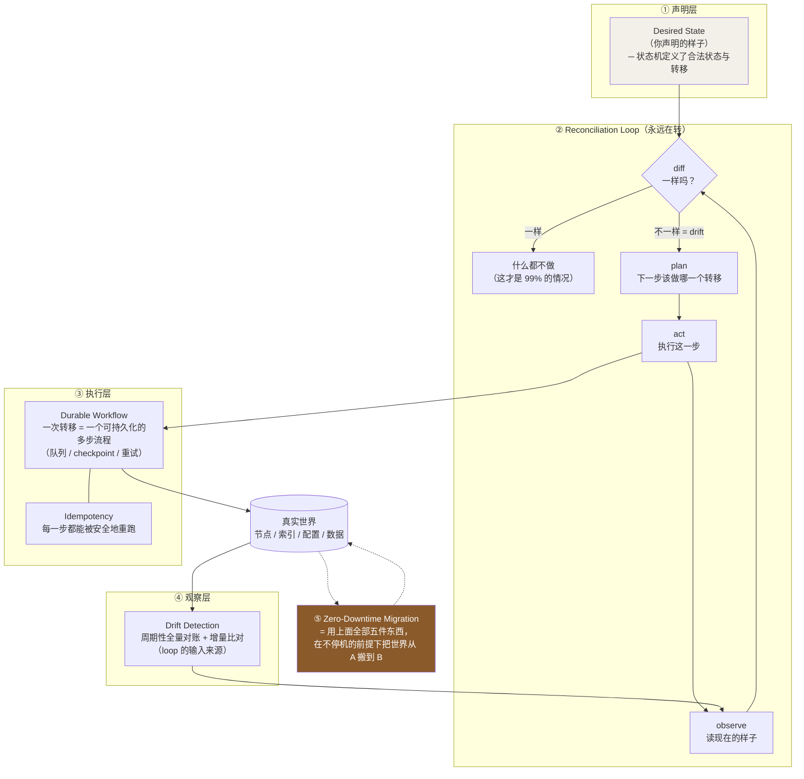
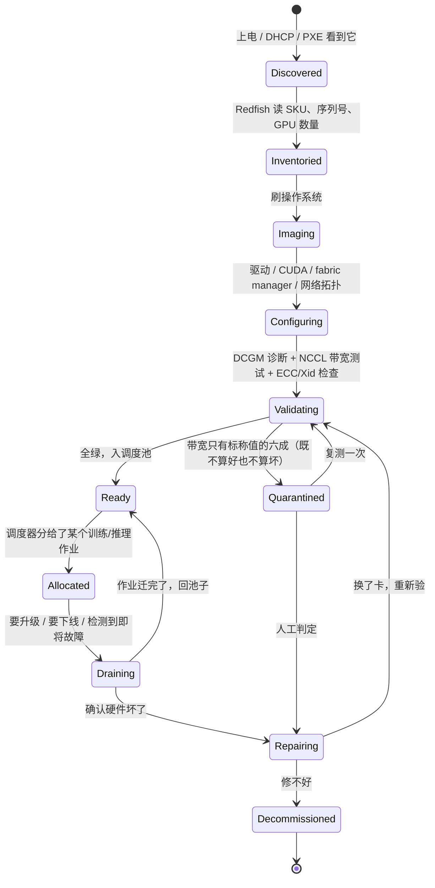
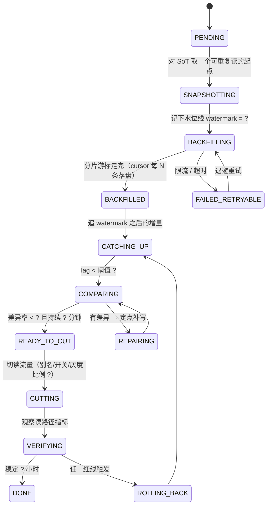
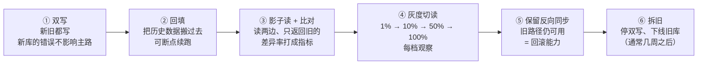

# 控制面那一行到底在说什么：六个词，一台机器

> 这是 [#424 简历 PMF 诊断](/p/resume-pmf-staff-ai-infra.html) 留下的第二条尾巴。诊断书里给你的技能栏写了这么一行：
>
> ```text
> Control Plane   State-machine modelling, reconciliation loops, idempotency, drift detection,
>                 durable/queue-driven workflow orchestration, zero-downtime migration
> ```
>
> 你说："能不能再解释一下这些概念，以及它们和我简历的关系。我有点confused。"
>
> 这一页干三件事：**① 把六个词讲透**（每个词都给定义、反例、失败模式、GPU 云里的样子）；**② 逐词对账你的简历** —— 哪几个是你真做过的、哪几个是我替你说大了、哪几个你做了却没写；**③ 给出兑现清单** —— 写上这一行之后，面试官有权问你什么，你必须能答到第几层。
>
> 时间锚点：2026 年 9 月。配套阅读：[#424 简历 PMF 诊断](/p/resume-pmf-staff-ai-infra.html)、#452「SUMMARY 那半句」、[#423 Agent 实验平台设计说明书](/p/llm-agent-eval-platform.html)。

---

## 0. 先把困惑解开：这不是六项技能

你 confused 是对的，而且原因很具体：**这一行长得像六项并列的技能，但它其实是一台机器的六个切面。**

技能栏的排版骗了你。`Java · Python · SQL` 那一行确实是六个独立的东西，少一个不影响另外五个。控制面这一行不是——**抽掉任何一个，另外五个都不成立**。

这台机器只干一件事：

> **让真实世界持续等于你声明的样子。**

注意"持续"两个字。不是"变成"，是"持续等于"。一次性把世界改成某个样子，那叫**脚本**；世界被别人改坏了、机器自己再把它改回来，那才叫**控制面**。六个词分别回答这台机器的六个子问题：

| 词 | 它回答的问题 | 抽掉它会怎样 |
|---|---|---|
| **State-machine modelling** | "应该长什么样" 和 "现在长什么样" 用什么语言表达？ | 没有词汇描述中间态，进程一重启就不知道自己在哪 |
| **Reconciliation loop** | 谁负责把"现在"推向"应该"？ | 只有脚本，没有自愈；人肉是唯一的修复手段 |
| **Idempotency** | 这个循环凭什么敢反复跑同一件事？ | 重试会造成二次伤害，于是你不敢重试，于是没有自愈 |
| **Drift detection** | 循环凭什么知道该跑了？ | 只能靠"有人报障"来触发，MTTD = 用户的耐心 |
| **Durable / queue-driven orchestration** | 一次状态转移要 40 分钟、跨 6 个系统，怎么办？ | 进程重启 = 从头再来 或者 卡在半路无人知晓 |
| **Zero-downtime migration** | 这套东西最难的一次实战长什么样？ | 上面五项只是理论，没有人相信你真跑通过 |

**所以正确的读法是**：前五个词是零件，第六个词是**成品**。面试官问前五个是在确认你懂原理，问第六个是在确认你**装过整机**。

> **这也是为什么我把 zero-downtime migration 放在这一行的最后而不是最前** —— 我错了，§8.4 会纠正这个排版错误。

### 0.1 你 confused 的真正原因：顺序反了

大多数人的路径是**先学词、后做事**：读 Kubernetes 源码 → 知道了 reconcile → 去找地方用。

你的路径是**先做事、七年后才见到词**：你在微软做了一个"跨异构存储的在线同步与索引重建"，做的时候你脑子里的词是「MQ」「分阶段」「断点续跑」「对账」；2026 年你看 GPU 云的 JD，上面写着 state machine / reconciliation / idempotency / drift detection——**你不认识这些词，但你认识它们指的东西**。

这不是学新技能，是**认领已有的东西**。但认领有代价：

> **技能栏上的每一个词都是一张支票，面试官有权随时兑现。**
> EXPERIENCE 里的 bullet 是存款。**存款覆盖不了的支票，不要开。**

这一页后半部分（§8）就是在帮你查账。

### 0.2 一个比六个定义都重要的前提：请求式 vs 收敛式

在讲六个词之前，先讲它们共同的世界观。这是你过去七年写的大部分代码**没有**的世界观，也是控制面岗位真正在筛的东西。

**请求式（你熟悉的）**：

```text
收到请求 → 校验 → 做动作 → 写库 → 返回 200 → 忘掉这件事
```

事情是**被事件驱动的**。没有事件就没有动作。做完就结束，服务不记得自己做过什么，也不负责结果是否还成立。这叫 **edge-triggered**（边沿触发）——你响应的是"变化"这个瞬间。

**收敛式（控制面的）**：

```text
每隔一会儿（或被任何信号唤醒）：
  读「应该长什么样」(desired)
  读「现在长什么样」(observed)
  if 一样: 什么都不做，返回
  else:   做一步让它更接近，返回
  # 然后再来一遍。永远。
```

事情是**被差值驱动的**。这叫 **level-triggered**（电平触发）——你响应的是"当前状态不对"这个**持续事实**，而不是"刚才发生了什么"这个**瞬间**。

**这个差别的杀伤力在哪：**

| | edge-triggered（请求式） | level-triggered（收敛式） |
|---|---|---|
| 丢了一条消息 | **灾难**。那次变更永远丢失，且没人知道 | 无所谓。下一轮读到的还是差值，照样收敛 |
| 重复收到一条消息 | **灾难**（除非你做了幂等） | 无所谓。第二次读到差值为 0，直接返回 |
| 消息乱序 | **灾难**。后到的旧消息覆盖新状态 | 无所谓。你读的是当前状态，不是历史事件 |
| 有人手工改了线上 | 系统不知道，永远不知道 | 下一轮就发现，并改回去 |
| 系统重启 | 重启期间的事件全丢 | 重启后第一轮全量对一遍，自动补齐 |

> **一句话**：level-triggered 用"反复确认现状"换来了"对丢失、重复、乱序、外部篡改全都免疫"。这是分布式系统里少有的**免费午餐**，代价只是你得不断地读。

**这就是为什么 Kubernetes 的 controller 不是"监听 Pod 创建事件然后创建容器"**，而是"反复比对 Pod spec 和 Pod status，不一样就动一下"。watch 事件在 K8s 里只是**唤醒信号**，不是**数据**——即使所有事件都丢了，controller 也会在 resync 周期到来时自己把世界对齐。

**面试里这条会以这个形式出现**：

> "如果你的消息队列丢了一条消息，你的系统会怎样？"

请求式的人答"我们有重试和 DLQ"。收敛式的人答：**"丢了也没关系，因为消息只是唤醒信号，真正的输入是两边的当前状态；下一轮对账就会发现那条差异。丢消息影响的是延迟，不是正确性。"** ——第二个答案会让面试官立刻改变对你的分层。

**而你已经有这个答案了**，因为你做过对账。你只是没意识到它值钱。

---

## 1. 一张图：六个词怎么拼成一台机器



**读图的三个要点：**

1. **loop 是主角，其余都是它的配件。** state machine 给它词汇，drift detection 给它输入，idempotency 给它"敢重跑"的许可，durable workflow 给它"一步可以很长"的能力。
2. **loop 的正常状态是"什么都不做"。** 一个健康的控制面，99.9% 的循环都走 `一样 → 返回`。如果你的 loop 每次都在动作，说明要么有东西一直在漂，要么你的比对写错了（这是一个真实的经典 bug：比对时把 `null` 和 `""` 当成不同，于是 loop 永远在"修复"）。
3. **zero-downtime migration 是唯一一个"有始有终"的东西。** 其余五个永远在转，它是一次性的、有 deadline 的、会被 VP 盯着的。所以它是面试里最值钱的那个词。

---

## 2. 词一：State-machine modelling（状态机建模）

### 2.1 它要求的不是 `switch`，是"状态可以被写进数据库"

很多人以为"我写了个 enum + switch"就叫状态机建模。不是。判据只有一条：

> **把进程杀掉，只读数据库里那一行，能不能知道接下来该干什么？**

能，就是状态机建模。不能，就是**把状态藏在代码的执行位置里**——藏在"程序跑到第几行"、藏在某个方法的局部变量里、藏在线程栈上。进程一死，这些全没了。

**反例（藏在执行位置里）：**

```java
void rebuildIndex(Tenant t) {
    var snapshot = takeSnapshot(t);      // 8 分钟
    var mapping  = createIndex(t);       // 30 秒
    bulkLoad(snapshot, mapping);         // 4 小时  ← 进程死在这里
    verify(t);                           // 20 分钟
    switchAlias(t);                      // 1 秒
}
```

进程死在 `bulkLoad` 的第 3 小时。重启之后，代码从 `rebuildIndex` 的第一行开始——它**无法知道**快照已经拍过、索引已经建过、已经灌了 3 小时。唯一安全的选择是全部重来。如果这是 200 台机器的重建，你永远做不完。

**正例（状态在库里）：**

```text
rebuild_job(tenant_id, state, cursor, attempt, updated_at, ...)

state ∈ {PENDING, SNAPSHOTTING, SNAPSHOT_READY, LOADING, VERIFYING,
         READY_TO_SWITCH, SWITCHED, FAILED, ROLLED_BACK}
```

重启之后，进程做的第一件事是 `SELECT * FROM rebuild_job WHERE state NOT IN (SWITCHED, ROLLED_BACK)`，然后对每一行问一句"你在哪个状态？那下一步就是 X"。**第 3 小时死掉，从 `LOADING` + `cursor=8,214,000` 继续，损失 0 分钟。**

### 2.2 三条判据（你可以拿去检查任何一个系统）

| # | 判据 | 不满足的症状 |
|---|---|---|
| 1 | **状态是持久的**，不在内存、不在栈上 | 重启后不知道进度，只能重来或者人肉查 |
| 2 | **转移是显式的、集中的** —— 合法转移有一张表，且只有一个地方写状态 | 状态被 7 个地方改写，出现"不可能的状态"（比如 `SWITCHED` 但 `cursor` 还在中间） |
| 3 | **每个状态自带下一步** —— 不需要额外上下文就能决定 action | 需要"再查一下那个表/问一下那个服务"才知道该干嘛，重启后要重建上下文 |

第 2 条是最常被违反的。**加一条"只有一个函数能写 state 字段"的纪律**，比加十个测试有用。

### 2.3 第四条隐藏判据：失败也是状态，不是异常

新手状态机只有 happy path：`A → B → C`。生产状态机的一半状态是给失败用的：

- `FAILED_RETRYABLE`（网络抖动，等会儿再来）vs `FAILED_TERMINAL`（数据本身是坏的，重试一万次也没用）——**混为一谈，就会出现无限重试烧掉集群，或者一次抖动就放弃一台好机器**
- `QUARANTINED`（我不确定，先别碰，等人看）——控制面必须有"我不知道"这个状态，否则它会在不确定时乱动
- `ROLLING_BACK` / `ROLLED_BACK`（回滚本身是一个多步过程，也需要自己的状态）

> **面试信号**：当你画状态机时主动画出 quarantine 和 rollback 分支，面试官会判定你**在生产上被这套东西咬过**。只画 happy path 的人，判定为读过文档。

### 2.4 GPU 云版：一台机器的生命周期

这是 Together AI / OpenAI 那类 JD 里 "Provisioning State Machine" 的实际形状。你要能读懂它——**读懂之后你会发现，你自己那个状态机的难度并不比它低**：



注意几件事，它们全都能在你的领域里找到同构物：

- **`Validating` 是最难的状态**，因为"健康"不是布尔值。一张 GPU 可以能跑但带宽掉一半（NVLink 降级），可以跑得对但 ECC 错误在涨。**你的系统里对应的是"索引重建完了，但是不是真的对？"** —— 同一个难题。
- **`Draining` 的存在就是零停机的前提**。不能瞬间拿走，得先让上面的活儿走完或搬走。
- **`Quarantined`** —— 前面说的"我不知道"状态。
- **整条链路 40–90 分钟**，中间任何一步都可能因为进程重启、控制面发版而中断。→ 这就是为什么下一节必须有 durable workflow。

### 2.5 你的版本：把你做过的事画成状态机

你简历上那条：

> *"Designed the re-synchronisation architecture between the source of truth and the search index: a resumable, idempotent state machine over Azure Storage queues with checkpointed stages and drift detection."*

**这句话是我替你写的，但事情是你做的。** 现在的问题是：你能不能在白板上把它画出来。下面是一个**骨架**，`[[?]]` 是只有你知道、必须由你填的部分：



**你必须能回答的四个问题**（这就是白板题）：

1. **你的 watermark 是什么？** 时间戳？版本号？LSN？变更序列号？——这是最容易被追问、也最能区分"设计者"和"参与者"的一问。用时间戳的话，**时钟回拨和同一毫秒内多条写入怎么办**？
2. **你的分片游标是什么？** 主键区间？租户 ID？分区键？——决定了能不能并行，以及重启后从哪继续。
3. **`COMPARING` 具体比什么？** 全量逐条？抽样？摘要/校验和？——见 §5。
4. **`CUTTING` 是一瞬间还是渐进？** 索引别名切换是原子的（一瞬间），流量比例灰度是渐进的。**两种都对，但你得知道自己用的是哪种，以及为什么。**

> **诚实度判定：** `state machine` 这个词你**可以写**，条件是上面这张图你能在白板上默画出来（不用和我画的一样，要和你当年做的一样）。画不出来 → 这一行是负债。画得出来 → 这是全行最硬的一个词，因为绝大多数候选人的"状态机"止步于订单系统的 `已支付/已发货`。

---

## 3. 词二：Reconciliation loops（收敛循环）

### 3.1 定义：一个只有三行的函数，和它的三条戒律

```python
def reconcile(key) -> Result:
    desired  = read_desired(key)     # 你声明的
    observed = read_observed(key)    # 真实世界的
    if desired == observed:
        return Result(done=True)     # 99% 的情况在这里返回
    take_one_step_towards(desired, observed)
    return Result(requeue_after=backoff())   # 我还没做完，等会儿再叫我
```

Kubernetes 的 controller-runtime 里，这个函数的签名就是 `Reconcile(ctx, req) (Result, error)`——**没有参数告诉你"发生了什么事"，只有一个 key 告诉你"去看看这个东西"**。这个 API 设计本身就是 §0.2 那个世界观的宣言。

**三条戒律：**

| 戒律 | 为什么 | 违反的症状 |
|---|---|---|
| **① 只看状态，不看事件** | 事件会丢、会重、会乱序；状态不会 | 一次丢消息造成永久不一致 |
| **② 一次只走一步，然后返回** | 长时间持有一个 key 会阻塞其它 key；也无法被打断 | 一个卡住的资源拖垮整个 controller |
| **③ 可以被随时杀掉、随时重入** | 发版、OOM、节点漂移是常态 | 重启后状态错乱，或者重复执行造成二次伤害 |

戒律 ③ 就是**幂等**（下一节）。所以我说这六个词抽掉一个另外五个都不成立——**reconciliation loop 的可行性完全建立在幂等之上**。

### 3.2 最容易被误用的一个词

**不是所有的"跑批 + 修数据"都叫 reconciliation loop。** 区别在这里：

| | 一次性对账任务（Job） | 收敛循环（Loop / Controller） |
|---|---|---|
| 生命周期 | 有始有终，跑完就结束 | 常驻，永远不结束 |
| 触发 | 人工 / 定时 | 状态变化 + 定时兜底 |
| 目标 | 把历史差异修掉 | **保持**一致，包括未来产生的差异 |
| 关掉它 | 数据不会重新变坏 | 数据会慢慢重新变坏 |
| 简历措辞 | "reconciliation" / "re-synchronisation"（名词，一次操作） | "reconciliation **loop**"（持续的机制） |

**这条是给你的警告。** 我需要你自己确认一件事：

> **你那个 SoT ↔ 索引的同步，在重建做完之后，是继续常驻运行的吗？**
>
> - **是**（有一个常驻的对账/补偿服务，一直在跑）→ `reconciliation loop` 这个词你名正言顺，甚至应该加一句"运行 N 个月、自动修复 N 次漂移"。
> - **不是**（就是一次性的迁移/重建，做完就下线了）→ **把 `loops` 的复数和"loop"的持续含义弱化**，写成 `state-machine reconciliation between heterogeneous stores`。这不是降级——一次成功的异构零停机重建，比一个跑了三年没出过事的 loop 更难讲、也更值钱。
> - **有定时的增量补偿任务**（比如每天跑一次对账补漏）→ 这就是 loop，只是周期长。可以写，且要说清周期和自愈量。

**为什么这条重要**：面试官问"你的 reconcile 周期是多少、一轮多久、并发多少 key"，如果你其实做的是一次性迁移，你会在第一问就露馅——**而如果你一开始就说"这是一次有始有终的重建，不是常驻 controller"，同一件事反而变成加分**（诚实 + 分类准确）。

### 3.3 loop 的四个工程细节（能聊这四个 = 真做过）

1. **限速与退避**：loop 的天然风险是"发现 10 万个差异 → 同时发起 10 万次修复 → 打死下游"。所以要有**工作队列 + 速率限制 + 指数退避**。K8s 的 workqueue 默认是 5ms 起步、1000s 封顶的指数退避，外加一个全局的令牌桶。
2. **周期性全量 resync**：即使有 watch/事件，也必须有一个"每 N 分钟无条件全量对一遍"的兜底。**这个设计的唯一目的就是"我不信任我的事件流"**——这句话本身就是一个很好的面试回答。
3. **收敛性要可观测**：`reconcile 次数`、`差值 > 0 的 key 数量`、`一轮耗时`、`队列深度`。其中**"差值 > 0 的 key 数量应该趋向 0 且保持"**是控制面唯一真正的健康指标。它不降 = 你在和某个东西打架（常见：另一个控制器在反向修改同一个资源）。
4. **两个控制器抢同一个资源**：这是控制面的经典事故形态（"打架"/flapping）。解法是**所有权边界**（每个字段只有一个 owner）或 K8s 的 server-side apply / field manager。**如果你能主动提到这个问题，你会显得像一个被咬过的人。**

### 3.4 你的版本 + 一个你自己没意识到的例子

| 你做过的事 | 是不是 reconcile | 说明 |
|---|---|---|
| SoT ↔ 搜索索引的再同步 | **是**（核心案例） | desired = SoT，observed = 索引，差值 = 漂移，动作 = 补写/重建 |
| Istio 上生产 | **不是你写的**，但你是它的运维者 | istiod 本身是一个控制面，它把配置收敛到每个 Envoy sidecar。**见 §12.1，这个词要小心用** |
| 清理线上陈旧的 flight（渐进发布）配置 | **是，而且是教科书案例**（你自己没写出来） | 见下 |

**那条被你埋掉的 bullet**：

> *"Designed and shipped a Claude Code skill that inventories rollout configuration, and used it to retire [[N]] stale configurations from the live production system."*

你把它写成了"我用 AI 工具清理了配置"。它的真实身份是：

> **一次配置漂移（configuration drift）的全量盘点与修复。**
> desired state = "当前还需要的 flight 配置集合"；observed state = "线上实际存在的配置集合"；差值 = 陈旧配置；动作 = 下线。

你甚至做了控制面里最难的一件事——**你先做了 inventory（盘点/只报不修），再做 remediation（修复）**。这正是 §5.5 里讲的、所有自动修复系统上线时唯一正确的顺序。**你凭直觉做对了，但在简历上把它写成了一个工具使用故事。**

改写方向（给 Resume-A）：

> *Audited the progressive-rollout control plane for configuration drift — built the inventory tooling, reconciled live flight configuration against what was still in use, and retired [[N]] stale entries ([[N]]% of the total) with no rollout incident.*

同一件事，从"我会用 Claude Code"变成"我治理过一个控制面的配置漂移"。**前者是工具，后者是职能。**

---

## 4. 词三：Idempotency（幂等）

### 4.1 定义，以及一句必须记住的话

> **幂等**：同一个操作执行一次和执行 N 次，对系统状态的影响相同。

为什么控制面离不开它，只有一个原因：

> **在分布式系统里，"我到底做没做成"这个问题是无解的。**

你给下游发了一个请求，然后超时了。这时候有两种可能：① 请求没到，对方没做；② 对方做了，回包丢了。**你无法区分。** 于是你只有两个选择：

- **不重试** → 可能永远丢了这次操作 → 系统不收敛
- **重试** → 可能重复执行 → 必须幂等

控制面选第二条。**所以幂等不是"一个优化"，是收敛式架构的入场券。**

推论：**所有队列都是 at-least-once。** Azure Storage Queue、SQS 标准队列、Kafka——投递语义的下限都是"至少一次"。所谓 "exactly-once" 要么是**处理**的 exactly-once（在同一个事务边界内，比如 Kafka 的事务），要么是**在消费侧做了去重**。只要你的副作用落在外部系统（发请求、装驱动、发邮件、扣款），**端到端的 exactly-once 就不存在**，你只能靠幂等把 at-least-once 磨成 effectively-once。

### 4.2 三种实现，按代价从低到高

| # | 手法 | 怎么做 | 适用 | 陷阱 |
|---|---|---|---|---|
| 1 | **天然幂等（声明式写）** | 把操作写成"设成 X"而不是"改变 X"。`PUT /state = READY` 幂等；`counter += 1` 不幂等 | 状态设置、配置下发、K8s apply | 只要 API 允许，永远优先选这个。**控制面之所以偏爱声明式，一半原因就在这里** |
| 2 | **幂等键 + 去重表** | 调用方生成一个稳定的 key（`tenant+shard+attempt-invariant`），服务端 `INSERT ... ON CONFLICT DO NOTHING`，冲突即"已做过" | 有外部副作用、无法声明式表达 | ① key 必须**稳定**（重试时算出来的 key 必须相同 —— 用 `uuid4()` 当幂等键是最经典的错误）；② 去重表要有 TTL，否则无限增长；③ "写去重表"和"做副作用"不在一个事务里时，仍有窗口 |
| 3 | **版本 / CAS / fencing token** | 每次操作带上你读到的版本号，服务端只在版本匹配时才执行（`UPDATE ... WHERE version = N`） | 有并发写者、需要防止"僵尸写者" | 需要下游支持条件写。**但这是唯一能挡住"进程假死后复活、拿着过期认知写数据"的手法** |

第 3 条值得多说一句，因为它是 staff 级和高级之间的一道线：

> **场景**：你的 worker 拿到了一个任务，处理到一半 GC 停顿了 60 秒。控制面判定它死了，把任务交给了 worker B。B 做完了。然后 A 醒过来，继续写它那半截。
>
> **加锁救不了你**——A 以为自己还持有锁。**唯一的解法是让下游拒绝旧版本的写**：每次任务交接时版本号 +1，A 手里是 v7，下游已经是 v8，于是 A 的写被拒。这个单调递增的数字就叫 **fencing token**。

### 4.3 哪些操作天生不幂等（这些是雷区）

| 操作 | 为什么危险 | 解法 |
|---|---|---|
| `count += 1` / 追加日志 | 重放 = 多加一次 | 改成幂等键去重，或改成"设成绝对值" |
| 发邮件 / 发通知 / 发工单 | 重放 = 用户收到 3 封 | 去重表 + TTL；或者只在状态转移成功后发一次并记录已发 |
| 分配资源（分一张 GPU、占一个 IP） | 重放 = 泄漏一张卡（**GPU 云最贵的 bug**） | 用请求 ID 做分配的幂等键；分配记录带 owner + lease，超时自动回收 |
| 创建资源（建索引、建集群） | 重放 = 两个索引、两个集群、双倍账单 | 命名确定化（名字由输入派生，不是随机），先查后建，或用 `CreateIfNotExists` |
| 重启机器 | 看起来危险，其实**幂等**（重启两次和一次，终态都是"启动完了"） | 反倒是安全的 —— 注意区分"动作幂等"和"终态幂等"，控制面关心的是**终态** |

最后一行是一个很好的面试话术：**幂等的判据不是"这个动作能不能重复"，而是"重复之后终态是否相同"。** 重启两次，终态一样，所以幂等；扣款两次，终态不一样，所以不幂等。

### 4.4 你的版本：你必须能答的那一问

你的重建跑在 **Azure Storage Queue** 上，那就是 at-least-once + **无原生 DLQ**（这点和 Azure Service Bus 不同——Service Bus 有死信队列，Storage Queue 只给你一个 `dequeueCount`，毒消息的隔离要你自己做）+ **不保证严格顺序**。

所以面试官会问，而且一定会问：

> **"你的幂等键是什么？同一条消息被消费两次会发生什么？"**

你的答案骨架（`[[?]]` 由你填真实情况）：

> *"消息里带的是 `(tenant, shard, stage, cursor_range)`，不是'请把这批数据写进去'这种指令。消费者拿到消息后先读自己在库里的进度行——如果这个区间的 checkpoint 已经推过了，直接删消息返回，不重做。写索引这一步本身是按文档 ID 的 upsert，所以同一条数据写两遍结果相同。真正不幂等的只有 [[?]] 这一步，我们用 [[?]] 处理。另外 Storage Queue 没有原生 DLQ，我们靠 `dequeueCount > [[?]]` 把消息挪进一个隔离队列，人工看。"*

**这段话里有五个技术细节**（消息带坐标不带指令 / 先读进度 / upsert 天然幂等 / 识别出唯一不幂等的那一步 / 自建 DLQ）。任何一个说出来，你都从"用过 MQ"变成"设计过 MQ 上的可靠流程"。

### 4.5 一个提醒：`visibility timeout` 是隐藏的第二个雷

Storage Queue 的消息被取走后进入不可见期（默认 30 秒），超时后自动重新可见。于是：

> **如果你处理一条消息要 5 分钟，而 visibility timeout 是 30 秒，那么这条消息会在你还在处理的时候被别人再取走一次。**

这是队列驱动系统里最常见的生产事故，也是"为什么必须幂等"的最日常的理由——**它跟进程崩溃无关，正常运行就会发生**。解法：① 延长不可见期；② 处理中周期性续租（update message 刷新 timeout）；③ 把长任务拆成多条短消息（这正好导向下一节的 durable workflow）。

**如果你当年踩过这个坑，一定要在面试里讲。** 它是"我真跑过生产"的最强指纹之一。

---

## 5. 词四：Drift detection（漂移检测）

### 5.1 三种漂移，别混为一谈

面试官说 "drift" 时可能指三件不同的事。**先问清楚、或者主动说明你讲的是哪一种**，这本身就是一个分辨率信号：

| 类型 | 定义 | 典型例子 | 谁在用这个词 |
|---|---|---|---|
| **配置漂移** | 真实配置 ≠ 声明的配置 | 有人 SSH 上去手改了一个参数；Terraform state 和云上实际资源对不上；K8s 里某个 Deployment 被手动 scale 过；**线上留着 200 条没人用的 flight 配置** | 基础设施 / SRE / GitOps（Terraform `plan`、ArgoCD `OutOfSync`） |
| **数据漂移（一致性漂移）** | 副本/派生数据 ≠ 源数据 | 搜索索引少了 3 万条；缓存和库不一致；物化视图落后 | 数据平台、存储、**你** |
| **模型/数据分布漂移** | 线上输入分布 ≠ 训练时分布 | 特征分布偏移、judge 打分标准变了 | ML / MLOps（**和控制面无关，别串台**） |

> **你的简历里这个词指的是第 ②（也应该指第 ①，见 §3.4）。第 ③ 不要碰** —— 虽然它和你的 AI 平台经历离得近，但一旦混着说，面试官会觉得你在堆词。

### 5.2 怎么检测：四种手法与它们的代价

| 手法 | 做法 | 代价 | 什么时候用 |
|---|---|---|---|
| **全量对账** | 两边都拉出来，逐条比 | O(n)，最贵，对源库有压力 | 兜底，低频（每天/每周），跑在只读副本上 |
| **摘要 / 校验和 / Merkle 树** | 按区间算哈希，只有哈希不同才下钻 | O(n) 算一次，但比对是 O(log n) 定位 | 大数据量、差异稀疏。**Dynamo / Cassandra 的 anti-entropy 修复就是这么做的** |
| **增量水位比对** | 比对两边的最大序号/时间戳，看 lag | 极便宜，O(1) | 实时监控（"索引落后 SoT 多少"），但**只能发现"慢"，发现不了"丢"** |
| **影子读 / 双读比对** | 线上读请求同时打两边，比结果，只返回主路的 | 加一倍读负载，但**采样的是真实分布** | 切换前的正确性验证。**这是零停机迁移里最关键的一步** |

**第三行那个"只能发现慢，发现不了丢"是个好考点**：如果一条数据在源端更新了但同步管道把它悄悄吞了（比如反序列化失败被 catch 了），水位线照样在涨，你的监控全绿，但索引里那条数据永远是旧的。**只有全量/摘要对账能抓到这种。** 这就是为什么再好的实时管道也必须配一个慢速的全量对账。

### 5.3 检测之后：报警还是自动修？

这是漂移检测里真正的设计问题，也是面试第三层的常问点。

> **铁律：任何自动修复系统，上线的第一个版本必须是"只报不修"。**

理由：
1. 你的比对逻辑**一定有 bug**（时区、null vs 空串、浮点、字段顺序、软删除的墓碑）。先跑一周，看它报出来的东西是不是真漂移。**几乎所有第一版都会报出大量假阳性。**
2. **自动修复是有破坏力的写操作。** 一个比对方向写反的 bug，会让"修复"把好数据覆盖成坏数据——用全系统的力量，高速地，全量地。
3. 有了一周的基线，你才知道**正常的漂移率**是多少。没有基线，你无法给自动修复设熔断阈值。

成熟形态的三档：

```text
差异率 < 0.001%   → 自动修复，只记 metric
0.001% ~ 0.1%     → 自动修复 + 告警（有人要看一眼是不是有新 bug）
> 0.1%            → 停止自动修复，只告警   ← 熔断
```

**最后一档是精髓**：差异大到一定程度，说明"漂移"的假设本身可能就是错的（可能是源端出了事故，也可能是你的比对挂了）。这时候自动修复是在**用错误的目标状态覆盖一切**。**"大面积不一致时反而要停手"**——能讲出这一条，是控制面设计者的标志。

### 5.4 指标

- **漂移率**（差异条数 / 总条数），按类型分开统计
- **MTTD**（从漂移产生到被发现的时间）——这是 drift detection 的核心 KPI
- **自愈率**（自动修复成功数 / 检测到的差异数）
- **假阳性率**（被判为漂移、实际正常）——上线第一个月唯一重要的指标

> 你简历里**一个数字都没有**（#424 §4.2）。这里至少可以补一个：**你那次重建，切换前的差异率是多少？** 哪怕是数量级（"从 10⁻³ 降到 10⁻⁶ 之后才切"）。

### 5.5 GPU 云版（让你看懂 JD 在说什么）

同一套东西换个名词：

- **声明**：这个池子里的每台机器都应该是 驱动 550.x + 固件 Y + 拓扑 Z + 打了 `ready` 标签
- **漂移**：某台机器被人工装了 552.x；某台的一张卡 "fell off the bus"（掉总线，`nvidia-smi` 只剩 7 张）；调度器认为有 8 张卡但实际 7 张；节点 label 与真实硬件不符
- **检测**：DCGM 周期性健康检查 + 节点上报的 inventory 与声明比对 + ECC/Xid 错误计数趋势
- **修复**：打 taint、排空作业、重装驱动、报修工单、从池中摘除并自动补容量
- **熔断**：如果**一次检测出 30% 的机器"不健康"**，那大概率是检测本身坏了（比如 DCGM 版本升级后字段变了），而不是半个机房烧了 —— **这时候自动排空会让整个集群停摆**。所以必须有全局比例熔断。

> 最后这条，就是你的"大面积差异时停手"在 GPU 世界里的同构物。**你已经懂这个原理了，你只是没见过 DCGM 这个名字。**

---

## 6. 词五：Durable / queue-driven workflow orchestration（持久化 / 队列驱动的工作流编排）

### 6.1 它解决的那个具体问题

一次状态转移不是一行代码，是一个**跨越多个系统、耗时几十分钟、每一步都可能失败**的流程。装一台 GPU 机器是 40–90 分钟；重建一个大索引是几小时到几天。

**核心问题只有一个**：

> **这个流程执行到一半，跑它的那个进程没了。谁记得它在哪？**

普通的做法是把流程写成一个函数，状态活在调用栈上。进程一死，栈没了，流程也没了——你只知道"有个东西没做完"，不知道做到哪、也不敢重来。

**durable execution（持久化执行）的本质就一句话**：

> **把"执行到第几步"从进程内存里搬到进程外的持久存储里。**

搬到哪里都算：搬到一张 `state + cursor` 表里（你干的）、搬到一个队列的消息里（你干的）、搬到 Temporal 的 event history 里（Temporal 干的）。**机制不同，本质相同。**

### 6.2 "队列驱动而不是轮询"——JD 为什么专门点这一句

Together AI 的 JD 里写着「围绕消息队列而非轮询来设计事件驱动系统」。这句话在筛什么？

| | 轮询（polling） | 队列驱动 |
|---|---|---|
| 怎么找活儿干 | `SELECT * FROM jobs WHERE state='PENDING'` 每 5 秒一次 | 从队列取消息，没消息就阻塞等待 |
| 规模到 10 万任务 | 数据库被扫描打死；加索引也救不了热点 | 队列天然分摊 |
| 多个 worker | 需要 `SELECT ... FOR UPDATE SKIP LOCKED` 之类的抢占技巧，且容易写错 | 队列本身就保证一条消息只给一个消费者（在不可见期内） |
| 延迟 | 取决于轮询间隔（p99 ≈ 间隔） | 毫秒级 |
| 背压 | 没有，worker 会一直扫 | 队列深度就是天然的背压信号，也是天然的扩缩容指标 |

**但注意一个陷阱**：§0.2 说了控制面必须 level-triggered，而队列是 edge-triggered 的（消息 = 事件）。**这两句话矛盾吗？不矛盾——正确的架构是两者叠加**：

> **队列负责"快"，定时全量扫描负责"对"。**
> 消息只是"去看看这个 key"的唤醒信号（**注意：消息里带的是坐标，不是指令**），真正的输入永远是读到的当前状态。消息丢了，最坏的后果是等到下一轮定时全扫才处理，**晚，但不会错**。

这一段如果你能在面试里讲出来，它同时兑现了 §0.2、§3、§6 三个词。**这是这一页里性价比最高的一段话，建议背下来。**

### 6.3 Temporal / Cadence 到底替你做了什么

你没用过 Temporal（JD 点名了它）。所以你需要知道**它提供的是哪些能力**，好把你手写的东西一一对上。Temporal 的核心是"确定性重放"：workflow 代码的每一次外部交互都被记进一份 event history；进程死了之后，新进程把 history 重放一遍，就把局部变量、执行位置全部恢复到崩溃前的样子，然后继续往下跑。**代价是 workflow 代码必须是确定性的**——不能直接用 `now()`、`random()`、`uuid4()`，必须用框架提供的版本，否则重放会得到不同的结果。

| Temporal 的原语 | 它解决什么 | 你手写的对应物 |
|---|---|---|
| Event history + 确定性重放 | 进程死后精确恢复到中断点 | `state` 列 + `cursor` 列（**粒度更粗，但目的相同**） |
| Activity + 自动重试策略 | 单步失败的退避重试、超时 | 队列的 visibility timeout + `dequeueCount` + 你自己的退避 |
| Task queue + worker poll | 任务分发、背压、水平扩展 | Azure Storage Queue |
| Durable timer | "等 30 分钟再继续"而不占进程 | 队列的 `visibilityTimeout` / 延迟可见消息 |
| Signal / Query | 外部往运行中的流程发消息 / 查进度 | 你的状态表（查进度）+ [[?]]（发信号大概率没实现） |
| Workflow versioning | 流程改版时，已在飞的实例怎么办 | **大概率没做**——这是手写方案最痛的地方 |
| Visibility / UI | 看到 10 万个实例各自卡在哪 | 一条 SQL（**其实够用**） |
| Saga / 补偿 | 失败时逆序回滚已完成的步骤 | `ROLLING_BACK` 状态 |

### 6.4 "没用过 Temporal" 该怎么答——这是你的加分题

**错误答法**："我们没用 Temporal，用的是 Azure Storage Queue。"（听起来像"我用的是更差的东西"）

**正确答法**：

> *"我没用过 Temporal，我是手写的那一部分。我们在 Azure Storage Queue 上做了分阶段编排：消息只带坐标不带指令，进度落在状态表里，重启后按状态决定下一步，所以对崩溃和重复投递免疫。
>
> 我知道我手写的是 Temporal 的一个子集——它的 event history 能做到指令级的恢复粒度，我只能做到阶段级；它有内建的重试策略和 durable timer，我是用 visibility timeout 和 dequeueCount 凑的；**它有 workflow versioning，而我没有——所以我们改流程的时候，只能等在飞的实例排干，这是当时最疼的一件事。**
>
> 如果现在重做，编排这层我会直接用 Temporal，把精力放在状态机的设计和对账上——那部分不管用什么引擎都得自己想清楚。"*

**这段话为什么强**：① 承认没用过，不装；② 证明你理解引擎在解决什么问题（而不是"会调 API"）；③ **主动说出自己方案的缺陷（versioning）**——这是最难伪造的可信度信号；④ 最后一句展示了判断力：分得清哪部分是引擎的事、哪部分永远是设计者的事。

> **准备成本**：把 Temporal 官方的 `hello-world` + `saga` 两个 sample 跑一遍，约 3 小时，你就能把上面这段从"我读过"升级成"我试过"。ROI 极高，见 §13。

### 6.5 队列驱动的五个必答细节

能聊这五个，等于证明你在队列上流过血：

1. **Visibility timeout 与续租**（§4.5）——最常见的事故源
2. **毒消息与 DLQ**——Storage Queue **没有**原生 DLQ，靠 `dequeueCount` 自建；Service Bus 有；SQS 有 redrive policy。**知道这个区别，说明你选型时真读过文档**
3. **顺序性**——Storage Queue 不保证 FIFO。所以你的设计**必须不依赖顺序**（这又回到幂等和 level-triggered：只要消息带的是坐标不是指令，乱序就无害）
4. **消息大小上限**——Storage Queue 单条 64 KB（base64 编码后有效载荷约 48 KB）。**所以大 payload 必须放对象存储、消息里只放引用**。这是"消息带坐标不带数据"的另一个理由
5. **背压与扩缩容**——队列深度是最好的扩缩容信号，也是最好的健康指标（深度持续上涨 = 消费能力不足或有毒消息在循环）

---

## 7. 词六：Zero-downtime migration（零停机迁移）

### 7.1 为什么它是前五个词的毕业考试

前五个词都可以靠读书说得像模像样。零停机迁移不行，因为它要求你**做出一连串不可逆的判断**，而每个判断都有一个"你当时怎么定的"可以追问：

- 什么时候可以开始切？（差异率降到多少、持续多久）
- 切多快？（1% → 10% → 50% → 100%，每档观察多久）
- 什么信号出现就回滚？（红线是什么，谁有权按）
- 回滚窗口保留多久？（旧路径什么时候才能真正拆掉）
- 出问题了，回滚本身会不会造成二次伤害？（回滚期间写进新库的数据怎么办）

**这些问题没有标准答案，只有"你当时怎么想的"。** 所以它是面试里最好用的深度探针，也是你简历上最值钱的一条。

### 7.2 标准六步剧本



**每一步的关键点：**

| 步 | 关键判断 | 常见翻车 |
|---|---|---|
| ① 双写 | 新库写失败时**必须不能影响主路**（异步 + 记录失败，不要同步阻塞） | 双写做成同步强一致 → 新库一抖，主业务跟着挂 |
| ② 回填 | 必须可中断、可续跑、可限速；要和双写的水位线**衔接得上**（回填的快照点 ≤ 双写开始时刻，中间重叠靠幂等吸收） | 回填和双写之间有缝 → 永久丢一段数据；或者回填把源库读挂 |
| ③ 影子读 | **比对要按真实流量采样**，不能只比自己造的数据；差异要分类（缺失 / 多余 / 值不同 / 顺序不同） | 只比条数不比内容；或者把"顺序不同"当成错误，淹没在假阳性里 |
| ④ 灰度 | 按什么维度切？（租户 / 用户 / 请求哈希）**必须是粘性的**，否则同一个用户一会儿读新一会儿读旧，看到数据跳变 | 按随机数切 → 读到不一致的两个视图 |
| ⑤ 回滚 | **回滚必须比切换更快、更简单。** 如果回滚需要 30 分钟和一个专家，那你实际上没有回滚能力 | 切过去之后新库开始接受"只有新库有"的写，回滚就丢数据 → 所以⑤期间双写不能停 |
| ⑥ 拆旧 | 拆得太早 = 没有退路；拆得太晚 = 双倍成本 + 两套代码 | 永远拆不掉，变成技术债 |

> **第 ⑤ 步是最多人说不清的一步**，也是我建议你重点准备的一步。"怎么切过去"人人会讲，**"切过去之后我还能不能回来、能回来多久"** 才是 staff 的问题。

### 7.3 它和前五个词的连线

| 步骤 | 用到了哪个词 |
|---|---|
| 整个流程的阶段划分 | **state machine**（§2） |
| 回填可断点续跑 | **state machine + durable workflow**（§2、§6） |
| 回填分片、重试、限速 | **idempotency + 队列驱动**（§4、§6） |
| 影子读比对 | **drift detection**（§5） |
| 比对不一致 → 定点补写 | **reconciliation**（§3） |
| 切换判据与回滚 | 以上全部 + 判断力 |

**六个词在这里第一次全部同时出现。所以我说它是毕业考试。**

### 7.4 你的版本

你做的事（我按你简历的描述复述）：**在源真相与搜索索引之间做在线再同步与索引重建，跨异构存储，无停机。** 这就是上面的剧本，只是你的"新库"是重建后的索引。

**你需要做的功课，就是把你当年的做法逐格填进这张表**：

| 剧本步骤 | 你当年做的 | 状态 |
|---|---|---|
| 双写 | 是双写，还是靠变更流/CDC 单向灌？ | `[[?]]` |
| 回填 | 分片维度是什么？并发多少？限速怎么做的？跑了多久？ | `[[?]]` |
| 比对 | 全量？抽样？摘要？差异率降到多少才敢切？ | `[[?]]` **必答** |
| 切读 | 别名原子切换？还是流量比例灰度？粘性怎么保证？ | `[[?]]` **必答** |
| 回滚 | 保留了多久？演练过吗？**真的回滚过一次吗？** | `[[?]]` **如果真回滚过，这是全篇最好的故事** |
| 拆旧 | 多久之后拆的？ | `[[?]]` |
| 规模 | 多少 TB / 多少实体 / 多少租户 / 持续多少天？ | `[[?]]` **#424 §9 已经在催这个数字了** |

> **"真的回滚过一次吗"** —— 如果答案是"是"，请把它准备成一个 3 分钟的故事（什么信号触发、谁决定、多久回完、事后怎么改的）。**面试官对"回滚过并且活下来了"的兴趣，远大于"一次就切成功了"。** 后者可能只是运气好。

### 7.5 GPU 云版

同一套剧本，换个对象，你可以在面试里用它证明迁移能力是可转移的：

- **驱动 / 固件滚动升级**：不能停机，因为上面跑着的训练作业已经跑了三天。剧本变成：分批（按机架/故障域）→ 排空（等作业自然结束或触发 checkpoint 后迁移）→ 升级 → 验证（DCGM + NCCL 带宽）→ 回池；任何一批的失败率超阈值就**停止整个 rollout**（熔断，和 §5.3 同构）。
- **集群/机房搬迁**：容量必须先加后减（先在新机房建好并验证，再排空旧的），和"先双写再切读"是同一个形状。
- **调度器换代**：老调度器和新调度器同时看同一个节点池 = **两个控制器抢同一个资源**（§3.3 第 4 条）。解法是所有权分区，按节点池划分归属，而不是按时间切换。

---

## 8. 对账：六个词 ↔ 你的简历

这是这一页的核心。**证据强度按 A/B/C 三档**：

- **A = 你设计的**，能撑三层追问，可以写进 HIGHLIGHTS
- **B = 你做过但不是主设计，或者细节需要复习**，可以留在技能栏，面试前要准备
- **C = 你只是使用者 / 只有间接证据**，写上去有风险

| 词 | 你的证据（简历原文 / 事实） | 强度 | 面试能撑几层 | 要补什么 |
|---|---|---|---|---|
| **State-machine modelling** | 零停机重建"建模成可续跑的状态机" | **A**（前提：能默画） | 3 层 | §2.5 那张图，画出来背下来；**补上 quarantine / rollback 分支** |
| **Reconciliation** | SoT ↔ 索引的再同步与对账修复 | **A** | 3 层 | 确认是一次性还是常驻（§3.2），措辞随之调整 |
| **Reconciliation *loops*（复数/常驻）** | 取决于是否常驻 | **A 或 C** | 取决于事实 | **这是全表唯一需要你先回答我、才能定稿的一格** |
| **Idempotency** | Storage Queue at-least-once 下的分阶段编排 | **A**（前提：说得出幂等键） | 3 层 | §4.4 那段答案，把 `[[?]]` 填上 |
| **Drift detection** | ① SoT↔索引对账 ② **陈旧 flight 配置的盘点与下线** | **A**（②目前没写在简历上，白扔了） | 3 层 | 把 ② 改写成漂移治理（§3.4）；补一个差异率数字 |
| **Durable / queue-driven orchestration** | Azure Storage Queue 上的分阶段异步编排 + checkpoint | **A** | 3 层 | §6.4 那段答案；跑一遍 Temporal sample（3h）把 "durable" 这个词坐实 |
| **Zero-downtime migration** | 跨异构存储的在线重建，无中断 | **A ——全行最硬的一条** | 3 层+ | §7.4 那张表的 `[[?]]`，尤其是切换判据、回滚、规模数字 |
| *（隐含）* K8s controller 模式 | 你在 AKS 上运行系统，但**没写过 controller/operator** | **C** | 1 层 | **不要暗示你写过 operator**。要补就真写一个玩具（§13） |
| *（隐含）* Istio = 控制面 | 你是首个把 Istio 推上生产的人 | **C（作为"我做过控制面"的证据）/ A（作为"我运维过控制面"的证据）** | 见 §12.1 | 措辞必须是 operated / adopted，不是 built |

### 8.1 结论一：这一行你**担得起**，而且比你以为的更硬

七个词里**六个是 A**。这不是我给你贴金——**是你七年前就做完了，只是用别的名字**。

唯一需要你确认的是 `loops` 的复数（§3.2）。唯一是 C 的两条（K8s controller、Istio）**本来就不在这一行里**，我列出来是提醒你别顺嘴加上去。

### 8.2 结论二：你有一条 A 级证据**没写在简历上**

**陈旧 flight 配置的盘点与清理 = 配置漂移治理。** 它现在被写成"我做了个 Claude Code skill"。这是这次对账里唯一的**净增量**：一条已经发生过、已经有数字（`[[N]]` 条配置）、却被归错类的经历。见 §3.4 的改写。

### 8.3 结论三：技能栏的铁律

> **技能栏的每个词，都必须能在 EXPERIENCE 里指到一条具体的 bullet。**

对照一下你的六个词：

| 词 | 指向哪条 bullet | 指得到吗 |
|---|---|---|
| State-machine modelling | "Zero-downtime reconciliation..." | ✅ 原文就有 `state machine` |
| Reconciliation loops | 同上 | ✅ 标题就叫 Zero-downtime reconciliation |
| Idempotency | 同上 | ✅ 原文有 `idempotent` |
| Drift detection | 同上 | ✅ 原文有 `drift detection` |
| Durable/queue-driven orchestration | 同上 | ⚠️ 原文写的是 `over Azure Storage queues`，**没有出现 durable/orchestration** |
| Zero-downtime migration | 同上 | ✅ |

**发现问题了吗**：六个词全部指向**同一条 bullet**。

这在技能栏上是一个结构性弱点——读者会怀疑（正确地怀疑）你的控制面经验只有一个项目。**修法不是删词，是把证据摊开到两条 bullet 上**：把 flight 配置漂移那条（§3.4）改写成控制面语言，这一行就有了两个互不重叠的支点：**一个在数据面（索引重建），一个在配置面（渐进发布）**。

> 两个支点和一个支点的差别，不是 2 比 1，是"一个项目"和"一种能力"的差别。

### 8.4 改进后的这一行（我在 §0 承认的排版错误）

**现在的版本**（按抽象度排序，最硬的排最后——错了）：

```text
Control Plane   State-machine modelling, reconciliation loops, idempotency, drift detection,
                durable/queue-driven workflow orchestration, zero-downtime migration
```

**版本 A（Resume-A 控制面简历用；把最硬的提到最前，并暗示证据）**：

```text
Control Plane   Zero-downtime migration & cutover · resumable state-machine reconciliation ·
                idempotent replay under at-least-once delivery · drift detection & repair ·
                durable, queue-driven orchestration (hand-rolled on Azure Storage Queues)
```

三处改动的理由：
1. **`Zero-downtime migration` 提到第一个** —— 技能栏也是从左往右读的，第一个词决定读者对这一组的印象。"状态机建模"人人会写，"零停机迁移"是履历。
2. **`idempotent replay under at-least-once delivery`** —— 把"幂等"这个谁都会写的词，换成一个**只有真做过的人才会这么说**的短语。它自带上下文，等于告诉读者"我知道幂等是用来对付什么的"。
3. **`(hand-rolled on Azure Storage Queues)`** —— 主动坦白"我是手写的，不是用 Temporal"。**这比含糊地写 `durable workflow orchestration` 让人误以为你用过 Temporal 要好得多**：前者在面试里是加分故事（§6.4），后者在面试里是一次露馅。

**版本 B（Resume-D 主简历用；这一行是配角，压到两行以内）**：

```text
Control Plane   Zero-downtime migration · state-machine reconciliation · idempotency ·
                drift detection · queue-driven durable orchestration
```

**版本 C（如果 §3.2 的答案是"就是一次性重建"）**：把 `reconciliation` 保留、`loops` 去掉即可——上面两版我已经预先去掉了复数。

---

## 9. 翻译表：把你的名词换成 GPU 云的名词

这张表的用途是**面试现场**。当对方在讲 GPU 集群时，你要能实时地把他的名词映射回你做过的事，而不是坐在那里想"我没做过这个"。

| 你的世界 | GPU 云的世界 | 同构在哪 |
|---|---|---|
| 元数据实体 / 租户 | 节点 / GPU / 作业 | 都是有生命周期的资源 |
| SoT（图存储） | 库存与期望配置（inventory + desired spec） | 都是"应该长什么样"的唯一真相 |
| 搜索索引 | 调度器看到的节点视图 | 都是派生视图，**都会和 SoT 漂移** |
| 索引重建 | 驱动/固件滚动升级 | 都是"不能停机地把全体换一遍" |
| 对账修复 | DCGM 健康检查 + 自动排空/补容 | 同一个 loop，不同的探针 |
| 租户隔离与吵闹邻居 | 多租户 GPU 配额、抢占、公平调度 | 同一类问题（**你的多租户 schema 经验在这里是直接可用的**） |
| Azure Storage Queue 分阶段编排 | Temporal 上的 provisioning workflow | 同一个模式，不同的引擎 |
| 陈旧 flight 配置 | 节点上的驱动版本漂移、僵尸标签 | 都是配置漂移 |
| 高扇出邻接布局 | （无直接对应） | 这是你的独有资产，用在"我写存储内部实现，不只是用存储" |

### 9.1 "你没做过 GPU 吧？"——90 秒答案

这个问题一定会来。**不要辩解，要重新划界。**

> *"对，GPU 那一半我没有。我做的是控制面那一半：把一类资源的生命周期建成显式状态机，用队列驱动的分阶段编排去执行转移，全程幂等因为投递是 at-least-once，再用对账去发现和修复漂移——最后用这套东西在不停机的前提下把几 TB 的派生数据全量重建了一遍。
>
> 换到你们这儿，资源从'元数据实体'变成'一台八卡机器'，探针从'索引对账'变成 DCGM 和 NCCL 带宽测试，转移的动作从'写索引'变成'装驱动'。**形状是一样的，我要学的是探针和动作这两层，不是架构那一层。**
>
> 我不会假装三周就能懂 NCCL 调优。但如果你们的痛点是'provisioning 流程一发版就有一堆机器卡在半路'、或者'调度器视图和真实硬件对不上'——这两个问题我都解过，只是换了个领域。"*

**这段话的结构值得记住**：① 直接承认缺口，不绕 ② 把自己的经验抽象到架构层 ③ 做一次显式映射 ④ 声明学习成本落在哪两层 ⑤ **用两个具体的痛点收尾**——最后这一步是把对话从"评估他"转成"讨论我们的问题"，这是面试里最有价值的一次转向。

---

## 10. 你必须能画的三张图

白板上画不出来的东西，等于没做过。**面试前，这三张图要能在 5 分钟内徒手画完**：

1. **你的重建状态机**（§2.5）——含失败分支、回滚分支、每个状态的退出条件
2. **你的队列拓扑**——谁往队列里写、几个消费者、visibility timeout 多长、毒消息去哪、进度表长什么样、消息体里带什么（**记住：带坐标不带指令**）
3. **切换时间线**——横轴是时间，标出：双写开始、回填开始/结束、比对差异率曲线、灰度各档、回滚窗口的起止、拆旧

第 3 张是最少人准备、也最能一击定胜负的。它把"我做过一次迁移"变成"我**指挥**过一次迁移"。

---

## 11. 面试探针：12 个问题

按 #424 §11 的格式。**"现状"一列是我对你当前准备度的估计，可能偏保守——但请按它准备。**

| # | 问题 | 它在测什么 | 现状 |
|---|---|---|---|
| 1 | 如果你的队列丢了一条消息，系统会怎样？ | level vs edge triggered（§0.2） | **能答**，但要用"消息是唤醒信号"这个说法 |
| 2 | 你的幂等键是什么？同一条消息消费两次会怎样？ | §4.4 | 要填 `[[?]]` |
| 3 | 进程在第 3 小时崩溃，从哪恢复？怎么知道恢复到哪？ | §2 状态持久化 | **能答** |
| 4 | 你怎么知道索引和源真的一致？ | §5.2 比对手法 | 要准备：全量/抽样/摘要，你用了哪种 |
| 5 | 差异率降到多少你才敢切？为什么是这个数？ | §7.2 判断力 | **必须准备** |
| 6 | 切过去之后发现问题，多久能回来？回滚期间写入怎么办？ | §7.2 第⑤步 | **最容易卡住的一问** |
| 7 | 你的 reconcile 是常驻的还是一次性的？周期多久？ | §3.2 | **先确认事实再答** |
| 8 | 对账发现 30% 的数据不一致，你的系统会做什么？ | §5.3 熔断 | **能答且能加分**（"这时候要停手"） |
| 9 | 为什么不用 Temporal？ | §6.4 | **能答且是加分题**（按那段背） |
| 10 | 两个控制器同时改一个资源会怎样？你怎么防？ | §3.3 所有权边界 | 需要准备 |
| 11 | visibility timeout 比处理时间短会发生什么？ | §4.5 | **踩过就讲，没踩过就讲机制** |
| 12 | 这套东西搬到 GPU 节点生命周期上，你会怎么开始？ | 迁移能力 | §9.1 那段 |

> **12 问里有 7 问你现在就能答，4 问只差把 `[[?]]` 填上，1 问（#6 回滚）需要真正想一想。** 这就是这一行的实际兑现成本：**大约一个晚上。**

---

## 12. 三个别踩的坑

### 12.1 别把 Istio 说成"我做过控制面"

Istio 的架构确实是教科书式的控制面/数据面分离：istiod 是控制面（把路由、mTLS、策略配置收敛到每个 sidecar），Envoy sidecar 是数据面。**但你是它的采纳者和运维者，不是它的作者。**

- ❌ "I built control planes — Istio, ..."（一句话把可信度清零）
- ✅ "First in the org to take Istio to production on AKS" + 面试里说 **"That's where I first saw the control-plane/data-plane split done properly — I operated it, I didn't write it."**

**主动划这条线，收益大于风险。** 一个会区分"我写的"和"我用的"的候选人，说别的话时可信度会自动提高一档。

### 12.2 别把普通的 CRUD + 定时任务说成 reconciliation

判据在 §3.2。如果关掉它数据不会重新变坏，那它是数据修复任务，不是收敛循环。**用错词的代价是：面试官会顺着 reconciliation 的方向问下去，而你答的是另一个东西。**

### 12.3 别把"有重试"说成"幂等"

这是最常见的一个混淆，而且**正好说反了**：

> **重试是问题，幂等是解法。**

有重试而没幂等 = 你在用系统的力量制造重复副作用。面试里如果你说"我们做了幂等"，下一问必然是"幂等键是什么"——**答不出这一问，前一句话就归零**。

---

## 13. 补课清单：把 B 变 A，把 C 变 B

按 ROI 排序。**总计 15 小时，其中前 4 小时回报最大。**

| # | 做什么 | 时间 | 把哪个词从几级变几级 |
|---|---|---|---|
| 1 | **填 §7.4 和 §4.4 的 `[[?]]`**（翻记忆、翻旧文档、问前同事） | 1h | 五个词 A→A，但**从"能写"变成"能答"** |
| 2 | **画出 §10 的三张图，徒手练两遍** | 2h | 同上；这是兑现成本的主体 |
| 3 | 跑 Temporal 官方 `hello-world` + `saga` sample | 3h | `durable orchestration` B→A，§6.4 从"读过"变"试过" |
| 4 | 读 controller-runtime 的 `Reconcile` 签名 + 一个官方 sample operator | 2h | 让你能用 K8s 的词讲你自己的东西（**不是为了声称你写过 operator**） |
| 5 | 写一个 200 行的玩具 reconciler（比如：声明"这个目录下应该有这些文件"，然后 loop 去收敛；含 drift 检测和只报不修模式） | 6h | K8s controller 模式 C→B，**并且产出一个可链接的 GitHub 工件**（#424 §4.5 一直在催的开源信号） |
| 6 | 读一遍 Together AI / CoreWeave / Lambda 之类的控制面 JD，把每条要求对到你自己的哪件事 | 1h | 面试当天的临场映射速度 |

> 第 5 条值得多说一句：**一个 200 行、README 写得好的玩具 reconciler，在简历上的作用大于"Kubernetes"这个词出现十次。** 因为它可点击、可阅读、可被验证——而技能栏的词不能。这和 #424 §5.5 说"两份公开文档替代了部分开源信号"是同一个逻辑。

---

## 14. 速查卡（一分钟版）

| 词 | 一句话定义 | 你的一句话证据 |
|---|---|---|
| **State-machine modelling** | 把资源的生命周期写成**持久化的、显式的**状态与转移，进程死了只看数据库就知道下一步 | 索引重建被建模成可续跑的状态机，第 3 小时崩溃从游标继续 |
| **Reconciliation** | 反复比对"应该"和"现在"，不一样就走一步——**响应状态，不响应事件** | SoT 与搜索索引之间的持续对账与定点补写 |
| **Idempotency** | 执行 N 次和 1 次终态相同；因为分布式下"做没做成"无解，所以必须重试，所以必须幂等 | Storage Queue 是 at-least-once，消息带坐标不带指令，写索引是 upsert |
| **Drift detection** | 发现真实世界偏离了声明；先只报不修，大面积差异时熔断停手 | ① 索引与源的对账 ② 线上陈旧发布配置的盘点与下线 |
| **Durable / queue-driven orchestration** | 把"执行到第几步"搬到进程之外；队列负责快，定时全扫负责对 | 在 Azure Storage Queue 上手写的分阶段编排（Temporal 的一个子集） |
| **Zero-downtime migration** | 双写 → 回填 → 影子比对 → 灰度切读 → 保留回滚 → 拆旧 | 跨异构存储的在线重建，无中断、读路径无退化 |

---

## 15. 要你回我的三件事

这一页有三处我只能给出分支，定不了稿：

1. **§3.2 —— 你那个同步/对账，在重建完成之后还常驻运行吗？** 决定技能栏写 `reconciliation` 还是 `reconciliation loops`，以及要不要补一句"运行 N 个月、自动修复 N 次"。
2. **§7.4 —— 那次切换，你真的回滚过吗？** 如果回滚过，它应该成为你在控制面方向的**主故事**（比"一次成功"更值钱），而且值得单独占一条 bullet。
3. **§3.4 —— flight 配置那条，我的改写是否属实？** 我假设你确实是"先盘点、后清理"，而不是拿到一份别人给的清单去执行。如果是后者，这条从 A 降到 B，措辞要改。

回了这三条，我把这一行的最终定稿和对应的两条 bullet 一起给你。

---

## 16. 最后一句

你 confused 的那一行，不是六个你要去学的新概念。

**是六个你七年前就做完了、但一直没给它起名字的东西。**

起名字这件事本身没有增加你的能力——但它决定了另一个人能不能在七秒钟之内看出你有这个能力。#424 说"你的问题不是能力不够 staff，是产品定位错了"，这一页是同一句话的技术版本：

> **你不是缺控制面经验。你是缺把它叫做控制面经验的那个词汇表。**

词汇表现在给你了。剩下的事只有一件：**把 `[[?]]` 填上，把三张图画出来。** 一个晚上的工作量，换一行能兑现的技能栏。

---

## 17. 延伸阅读

- Kubernetes — [Controllers 概念](https://kubernetes.io/docs/concepts/architecture/controller/)、[API 约定里关于 level-triggered 的论述](https://github.com/kubernetes/community/blob/master/contributors/devel/sig-architecture/api-conventions.md)
- [controller-runtime：`Reconcile` 的契约](https://pkg.go.dev/sigs.k8s.io/controller-runtime/pkg/reconcile)
- [Temporal：什么是 durable execution](https://docs.temporal.io/evaluate/understanding-temporal)、[workflow 的确定性约束](https://docs.temporal.io/workflow-definition#deterministic-constraints)
- Martin Kleppmann — [How to do distributed locking（fencing token 的出处）](https://martin.kleppmann.com/2016/02/08/how-to-do-distributed-locking.html)
- [Azure Storage Queue 与 Service Bus 队列的对比（DLQ、顺序、消息大小）](https://learn.microsoft.com/en-us/azure/service-bus-messaging/service-bus-azure-and-service-bus-queues-compared-contrasted)
- Stripe — [幂等键的工程实践](https://docs.stripe.com/api/idempotent_requests)
- [Terraform：drift 的检测与处理](https://developer.hashicorp.com/terraform/tutorials/state/refresh)
- NVIDIA — [DCGM：GPU 健康检查与诊断](https://docs.nvidia.com/datacenter/dcgm/latest/user-guide/index.html)
- 前置阅读 — [#424 简历 PMF 诊断](/p/resume-pmf-staff-ai-infra.html)、#452「SUMMARY 那半句」、[#423 Agent 实验平台设计说明书](/p/llm-agent-eval-platform.html)
