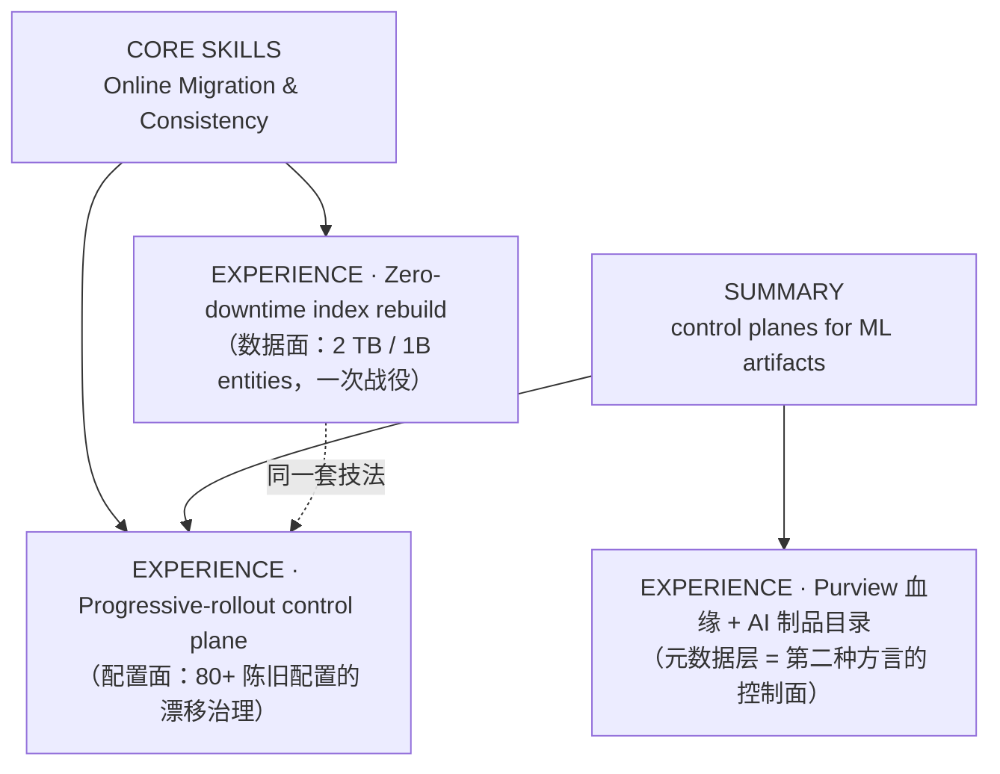

# 那一行不该叫「控制面」：给 CORE SKILLS 换一句话

> 这是 [#453《控制面那一行到底在说什么》](/p/control-plane-six-words.html) 的直接续集。
>
> 你读完 #453 之后说的是：
>
> > "我觉得 control plane 和我简历里的经历是两回事。你直接换一句话，把技能栏那一行替掉。"
>
> **这一页只做一件事：把那一行换掉。** 但换之前必须先说清一件事——你的直觉是对的，可是它对的地方和你以为的不一样。#453 里我给六个词打了六个 A，那个评分没错；你反对的也没错。**你们在争的根本不是同一个东西：我评的是六个零件，你反对的是那块招牌。**
>
> 时间锚点：2026 年 9 月。配套阅读：[#453 六个词](/p/control-plane-six-words.html)、[#424 简历 PMF 诊断](/p/resume-pmf-staff-ai-infra.html)。

---

## 0. 先给结论：换成这一句

把现在的这一行：

```text
Control Plane   State-machine modelling, reconciliation loops, idempotency, drift detection,
                durable/queue-driven workflow orchestration, zero-downtime migration
```

换成这一句：

```text
Online Migration & Consistency
    I move large stateful systems without taking them down — zero-downtime index rebuild
    across heterogeneous stores, modelled as a resumable, checkpointed state machine over
    at-least-once queues with idempotent replay, plus source-of-truth ↔ index drift
    detection and repair.
```

**三处改动，三个理由，一句话版：**

| 改了什么 | 为什么 |
|---|---|
| 标签 `Control Plane` → `Online Migration & Consistency` | 旧标签承诺的是**一台常驻的机器**，你交付的是**一次成功的搬迁**。招牌换成后者，里面的货一件都不用退 |
| 六个名词 → 一句话 | 名词并列会被读成"六项独立技能"（#453 §0 你 confused 的根源就在这里）。一句话只能被读成**一件事**，而你确实只做了一件事——做得很难、很漂亮的一件事 |
| 删掉 `reconciliation loops` 的复数和 `durable workflow orchestration` | 这两个词各自在暗示一件你没做过的事：常驻控制器、Temporal。见 §7 |

**但同时——不要把"控制面"这个词从整份简历里删干净。** 你有一处是真的，而且你自己已经写对了。见 §2.3 和 §8.1。

如果你只看这一页的一屏，看到这里就够了。剩下的是：为什么（§1–§4）、怎么撑住追问（§5）、变体（§6）、连带要改的三处（§8）、和复制即用的整块（§12）。

---

## 1. 你的直觉对在哪：错的不是六个词，是那块招牌

#453 §8 那张表给六个词打了 A。那张表问的问题是：

> **"这个技术动作，你做过吗？"**

- 状态机建模 —— 做过，写进数据库的那种。
- 幂等 —— 做过，at-least-once 队列下的那种。
- 漂移检测 —— 做过两次（SoT↔索引、陈旧 flight 配置）。
- 断点续跑的分阶段编排 —— 做过。
- 零停机迁移 —— 做过，跨异构存储、2 TB / 10 亿实体。

这五个 A 我不撤回。**它们描述的是零件，零件确实在你手里。**

而你读完之后的反应，问的是另一个问题：

> **"把这些零件装起来的那台机器，和我造的那台，是同一台吗？"**

不是。**这就是你的直觉，而且它是对的。**

### 1.1 两台机器的形状差别

| | **控制面（那六个词承诺的机器）** | **你造的那台机器** |
|---|---|---|
| 生命周期 | 永不结束 | 有始有终，切完就下线 |
| 成功的定义 | 差值长期趋于 0 并保持 | **一次**切换无损完成 |
| 时间尺度 | 以"年"计的持续运行 | 以"周/月"计的一次战役 |
| 关掉它会怎样 | 世界慢慢变坏 | 什么也不会发生（它已经跑完了） |
| 最难的部分 | 和不断产生的新漂移赛跑 | **在不停机的前提下把切换那一刀切干净** |
| 简历上的动词 | *operate / keep* | *migrate / cut over / rebuild* |
| 事故形态 | flapping、两个控制器打架、收敛不下去 | 切换瞬间的读写不一致、回滚窗口关太早 |

**看最后两行。** 这两台机器难的地方不在一处、翻车的方式也不一样。一个招"控制面工程师"的人，脑子里装的是上面那一列；他看见你的技能栏，会按上面那一列来问你。**而你的存货全在下面那一列。**

> **更要紧的是：下面那一列不比上面那一列低级。**
>
> 一次跨异构存储的在线重建，是控制面六个词的**毕业考试**（#453 §7.1）。你考过了。你只是没有在考完之后留在学校里当老师。

### 1.2 一句话说清错位

> #453 告诉你："这六个词你都担得起。"——**对，作为词。**
> 你的直觉告诉你："可我不是那个岗位上的人。"——**也对，作为岗位。**
>
> 技能栏的标签不是在陈述词汇量，**它是在申报工种**。

`Control Plane` 这块招牌申报的工种是"守机器的人"。你干的是"搬机器的人"。两种人都被需要，工资也差不多，但**招聘的人问的问题完全不同**，而你若挂错招牌，你会在对方问了三个你不熟的问题之后，被判定为"夸大"——尽管你手里那件事比他问的更难。

**这是这一页存在的全部理由：不是给你降级，是把你摆到你真正强的那一格里去。**

---

## 2. 三道判据：拿你自己的四个项目过一遍

别再靠感觉了。给"是不是控制面"六条判据，把你简历里的四个项目挨个过一遍。

**六条判据**（前四条是能力，后两条是**定义性**的——缺了后两条，前四条再全也不叫控制面）：

1. **声明**：有没有一个被写下来的"期望状态"？（而不是一串命令）
2. **观察**：有没有持续读取"真实状态"的通道？
3. **动作**：有没有权力自己去改真实世界？（而不是只发报警给人）
4. **安全重复**：同一个动作反复执行是不是无害？（幂等）
5. **常驻**：它跑完了吗？——**跑完就结束的，不是控制面**
6. **失活即腐化**：把它关掉，世界会不会慢慢重新变坏？——**不会的，不是控制面**

| 项目 | ①声明 | ②观察 | ③动作 | ④幂等 | ⑤常驻 | ⑥失活即腐化 | 判定 |
|---|---|---|---|---|---|---|---|
| **跨异构存储零停机索引重建** | ✅ SoT 就是期望态 | ✅ 对账 | ✅ 补写/重建 | ✅ | ❌ 切完结束 | ❌ | **不是控制面**，是一次控制面级别的**迁移战役** |
| **AI-Feature-Flight 渐进发布控制面** | ✅ flight 配置就是声明 | ✅ 盘点线上实际配置 | ⚠️ 见 §13 待确认 | ⚠️ | ✅ 系统常驻 | ✅ 不管它就会堆积陈旧配置 | **最接近控制面的一个**，而且你已经这么叫它了 |
| **Purview 血缘 / AI 制品目录** | ✅ 目录即声明 | ➖ | ➖ | ➖ | ✅ | ➖ | 是**控制面里的一层**（元数据层），不是收敛控制器。见 §3 |
| **自建图数据库 / Istio 上生产** | ➖ | ➖ | ➖ | ➖ | ✅ | ✅ | **你是它的运维者，不是它的作者**（#453 §12.1 的雷区） |

### 2.1 第一个发现：你最像控制面的那件事，不是你拿来当证据的那件事

看第二行。**渐进发布（feature flight）那套东西六条判据过了四到五条**，而索引重建只过了四条、且缺的正是定义性的第 5、6 条。

可你的技能栏在拿**第一行**当证据（#453 §8.3：六个词全部指向同一条 bullet，就是索引重建那条），而把第二行写成了"我做了个 Claude Code skill 清理配置"。

> **你把你最强的控制面证据，写成了一个工具使用故事；又把你最强的迁移证据，挂在了控制面的招牌下面。**
>
> **两件事都放错了格子，而且是交叉放错的。**

这一页后面做的事，就是把它们对调回来：技能栏那一行改名叫迁移（§0），控制面这个词交给 flight 那条 bullet 去承担（§8.1）。

### 2.2 第二个发现：⑤和⑥是不能靠措辞绕过去的

这两条判据的特点是**它们只关于事实，不关于你怎么写**。面试官验证它们只需要一个问题：

> "这套东西今天还在跑吗？"

- 答"还在跑，每 N 分钟对一轮" → 控制面成立，追问继续往深处走。
- 答"迁移完就下线了" → **控制面这个词当场作废**，而且你刚刚在对方心里留下了一道"他刚才好像想说大一点"的划痕。

**这道划痕的代价，远大于你用 `Control Plane` 这块招牌可能换来的任何好处。**

### 2.3 所以"控制面"这个词要不要从简历里删掉

**不要。** 你有一处是真的：

> *"...owned its progressive-rollout (feature-flight) **control plane** end to end."*

这句话在你的 EXPERIENCE 里已经写着了，而且**写对了**：`control plane` 在这里是那个系统的名字（渐进发布系统本来就是一个控制面），`owned ... end to end` 是可验证的职责陈述。

区别在于：
- **EXPERIENCE 里的 `control plane`** = 我负责过的那个系统叫这个名字 → **描述事实，安全**。
- **CORE SKILLS 里的 `Control Plane:`** = 请按控制面工程师的标准考我 → **开出支票，有风险**。

同一个词，两种法律效力。留前者，撤后者。

---

## 3. 岔一句：「控制面」这个词有两种方言

这条会解释为什么你的 SUMMARY 那句话可以原地不动。

| | **基础设施方言**（K8s / 网络 / GPU 云） | **数据与 AI 平台方言**（你的行业） |
|---|---|---|
| 控制面指 | 持续把真实状态收敛到期望状态的**控制器** | **不在数据通路上的那一层**：目录、元数据、编排、策略 |
| 数据面指 | 真正转发流量 / 跑负载的东西 | 真正存数据、跑训练和推理的东西 |
| 典型例子 | kube-controller-manager、istiod、调度器 | Hive Metastore、Unity Catalog、MLflow、**你的 Purview 血缘层** |
| 判定标准 | 有没有 reconcile 循环 | 在不在请求的关键路径上 |
| 谁在用 | GPU 云 JD、K8s 岗、SRE | 数据平台、AI 平台、Databricks/Snowflake 系 |

**两边都不算误用，它们就是两个行业的黑话。**

于是：

- 你的 SUMMARY —— *"I build control planes for machine-learning artifacts — the layer that knows which model, which prompt, which dataset and which run produced a given result"* —— 用的是**第二种方言，并且自带了定义**（破折号后面那句就是定义）。**它成立，证据充分（Purview 血缘 + AI 制品目录），不用改。**
- 你原来的 CORE SKILLS 那一行，用的是**第一种方言的全套术语**（reconciliation loop、drift、idempotency）。在第一种方言里，那一行必须靠一台常驻控制器来兑现，而你没有。

> **你不是用错了词。你是在同一份简历的两个地方，用了同一个词的两种方言，而只有一种方言你交得出货。**

这也是为什么这次改动只动技能栏、不动 SUMMARY——**#453 的 §8 打分表没错，错的是它默认了整份简历只有一种方言。**

---

## 4. 那台机器该叫什么：五个候选与取舍

技能栏标签的选择标准只有一条：

> **标签要命名"你能被雇来做的那件事"，而不是"你碰过的那一类系统"。**

按这条标准过一遍候选：

| 候选标签 | 好处 | 问题 | 判 |
|---|---|---|---|
| `Control Plane` | 关键词热、JD 里常见 | 承诺常驻控制器，你没有（§2） | ❌ |
| `Distributed Systems` | 安全、宽 | **太宽 = 没说任何事**。十个人写九个 | ❌ |
| `Reliability / SRE` | 对方能秒懂 | 把你推到运维格子，和你"写存储内核"的定位打架 | ❌ |
| `Stateful Systems Evolution` | 准确、有格调 | 有点学术腔，第一眼读不出具体在干嘛 | ⚠️ 备选 |
| **`Online Migration & Consistency`** | **精确、少见（记得住）、无法被指为夸大、正好是你最硬的那件事** | 比 `Control Plane` 窄——但那是优点 | ✅ **推荐** |

### 4.1 为什么"窄"在这里是优点

技能栏的标签越宽，读者的**验证成本**越低而你的**兑现成本**越高：`Distributed Systems` 可以被任何问题击穿，因为它承诺了一切。`Online Migration & Consistency` 只承诺一件事——**而那件事你能讲四十分钟，还能画出图来**。

> 简历上的强度不来自覆盖面，来自**"这一格里他明显比别人深"**。
> 六个并排的名词给人"广而不知深浅"的印象；一句具体的话给人"他干过这个"的印象。

### 4.2 顺带修掉 #453 §0 里那个 confused 的根源

你当初 confused，是因为那一行**长得像六项并列技能，其实是一台机器的六个切面**。

**既然它本来就是一句话，那就把它写成一句话。** 这次改动顺手把那个排版错误也修了——新版本里没有任何东西长得像并列清单，读者不可能再把它误读成六项。

---

## 5. 推荐主版本：逐句拆开，看它撑不撑得住追问

```text
Online Migration & Consistency
    I move large stateful systems without taking them down — zero-downtime index rebuild
    across heterogeneous stores, modelled as a resumable, checkpointed state machine over
    at-least-once queues with idempotent replay, plus source-of-truth ↔ index drift
    detection and repair.
```

| 短语 | 指向简历哪一条 | 面试官会问什么 | 你答得出吗 |
|---|---|---|---|
| `move large stateful systems without taking them down` | HIGHLIGHTS 第 4 条 + EXPERIENCE "Zero-downtime reconciliation" | "怎么定义的没停机？读路径有没有退化？" | ✅ 你简历里已经写了 *no read-path regression* |
| `zero-downtime index rebuild` | 同上（2 TB / 1B entities / 10^4 租户） | "切换判据是什么？差异率降到多少才敢切？" | ⚠️ #453 §7.4 的 `[[?]]` 还没填 |
| `across heterogeneous stores` | 同上 | "异构具体指哪两种？语义差异怎么弥合的？" | ✅ 但要准备一个具体例子 |
| `resumable, checkpointed state machine` | EXPERIENCE 原文就有 *resumable, idempotent state machine* | "状态有几个？失败态怎么建模？画一下" | ✅ 需默画（#453 §2.5） |
| `at-least-once queues` | 原文 *self-built Azure Storage queues* | "重复投递怎么办？visibility timeout 设多少？超时了会怎样？" | ⚠️ #453 §4.5 的雷，要复习 |
| `idempotent replay` | 原文 *idempotent* | "**幂等键是什么？**" | ⚠️ **这一问答不上，整句作废**（#453 §4.4） |
| `source-of-truth ↔ index drift detection and repair` | 原文 *drift detection* | "怎么发现漂移的？全量比对还是摘要？发现之后自动修还是报警？" | ✅ |

**第一列七个短语，六个能在 EXPERIENCE 里逐字指到**（`heterogeneous stores`、`resumable`、`idempotent`、`state machine`、`drift detection`、`queues` 全是你 bullet 里的原词）。这就是 #453 §8.3 那条铁律要的效果：

> **技能栏的每个词，都必须能在 EXPERIENCE 里指到一条具体的 bullet。**

### 5.1 为什么用第一人称

你的 SUMMARY 已经是第一人称了（*"I build control planes..."*、*"I write storage internals and reconciliation loops, not just services on top of them."*）。技能栏突然变回名词堆，读起来像两个人写的。**一句 `I move large stateful systems without taking them down` 和你的 SUMMARY 是同一个人的声音**，而且这个句式你已经用过一次并且用得很好——*"not just services on top of them"* 那句就是全篇最好的一句。

**如果你所投的公司用严格的 ATS 关键词扫描**，用 §6 的变体 C（纯关键词版）。关键词覆盖不会掉，见 §7.3。

---

## 6. 三个变体：按投递对象挑

### 变体 A —— GPU 云 / 基础设施岗（Resume-A）

对方脑子里是第一种方言，而且他们真的在招"搬机器的人"（驱动滚动升级、机房搬迁、调度器换代，全是迁移形状，#453 §7.5）。这一版把"我搬过"顶到最前，并主动坦白手写队列：

```text
Online Migration & Consistency
    I move large stateful systems while they stay serving — zero-downtime cutover and index
    rebuild across heterogeneous stores; resumable, checkpointed state machines on
    at-least-once queues with idempotent replay (hand-rolled on Azure Storage Queues);
    drift detection and repair between source of truth and derived stores; progressive-rollout
    (feature-flight) configuration governance.
```

> `(hand-rolled on Azure Storage Queues)` 这个括号是**故意留的**。它把"我没用过 Temporal"从一个会被拆穿的隐瞒，变成一个你主动递出去的加分故事（#453 §6.4）。

### 变体 B —— AI 平台 / 数据平台岗（Resume-D 主简历）

对方用第二种方言，关心的是"派生状态和源头会不会对不上"——这正好是血缘/目录最怕的事：

```text
Correctness Under Change
    I keep derived state true to its source while both keep moving — zero-downtime index
    rebuild across heterogeneous stores, resumable idempotent state machines over queues,
    and drift detection/repair between the catalog's source of truth and everything derived
    from it (search index, lineage graph, evaluation records).
```

> 这一版的隐含卖点：**一个 AI 制品目录的可信度，全部押在"派生状态等于源头"上**。一个评测分数指回错的 prompt 版本，比目录宕机更可怕。这句话说的就是这个，且是你亲手做过的。

### 变体 C —— 关键词扫描版（ATS 严格、或版面只剩两行）

```text
Online Migration & Consistency
    Zero-downtime migration & cutover · index rebuild across heterogeneous stores · resumable
    checkpointed state machines · idempotent replay under at-least-once delivery · drift
    detection & repair · queue-driven staged pipelines
```

### 变体 D —— 如果 §13 第 1 问的答案是"它至今还在跑"

只有这种情况下，你才把 `reconciliation` 升级回常驻语义，而且必须带上运行时长：

```text
Online Migration & Consistency
    I move large stateful systems without taking them down, and keep them honest afterwards —
    zero-downtime index rebuild across heterogeneous stores, then a standing reconciliation
    loop that has kept source of truth and index in agreement for [[N]] months, repairing
    [[N]] drifts without downtime.
```

> **没有那两个数字就不要用变体 D。** 空口说 `reconciliation loop` 正是 #453 §3.2 警告的那一格。

### 选哪个

| 投递对象 | 用 |
|---|---|
| GPU 云、K8s 平台、基础设施、SRE-adjacent | **变体 A** |
| AI 平台、数据平台、Databricks/Snowflake 系、目录与血缘 | **变体 B** |
| 大厂官网投递 / 明确说要走 ATS / 版面紧张 | **变体 C** |
| 你确认了那套东西还在跑，且有数字 | **变体 D**（否则退回 A/B） |
| 猎头要一份通用的 | **§0 主版本** |

---

## 7. 删掉的词，和删它们的理由

| 删掉的 | 为什么删 | 什么条件下可以加回来 |
|---|---|---|
| **标签 `Control Plane`** | 它申报的是"守机器的工种"，你的货是"搬机器"（§1.1）。且判据⑤⑥过不了（§2） | 在 EXPERIENCE 的 flight 那条里保留（§8.1）；技能栏要加回来，需要先有一个常驻的东西（§11） |
| **`reconciliation loops`（复数 / loop 的持续含义）** | 复数在承诺常驻控制器。第一个追问就是"周期多少、一轮多久"，你会在那里露馅（#453 §3.2） | §13 第 1 问答"还在跑" → 用变体 D |
| **`durable workflow orchestration`** | `durable` 在 2026 年基本等于 Temporal/Cadence 的专名。不加括号地写它，读者默认你用过 | 加 `(hand-rolled on Azure Storage Queues)` 括号后可用——**这正是变体 A 的做法**；或跑完 #453 §13 的 3 小时 Temporal sample 再说 |
| **`State-machine modelling` 作为独立条目** | 它不是一项技能，是上面那句话的**实现方式**。单独列出来，读起来像"我会画状态图" | 不需要加回来——新版里它以 `modelled as a resumable, checkpointed state machine` 的形式在，位置更准 |
| **六个名词的并列排版** | 它是你当初 confused 的直接来源（#453 §0），读者也会同样误读 | 只在变体 C（ATS）里为了机器扫描而保留 |

### 7.1 没删、但换了说法的

| 原词 | 新说法 | 为什么 |
|---|---|---|
| `idempotency` | `idempotent replay under at-least-once delivery` | 光写 `idempotency` 谁都会写；带上"用来对付什么"的那半句，只有真做过的人才说得出来 |
| `drift detection` | `source-of-truth ↔ index drift detection and repair` | 加 `repair` 才完整：只检测不修的系统，价值是报警器；检测+修复才是工程 |
| `zero-downtime migration` | `zero-downtime index rebuild across heterogeneous stores` | 从一个类别名，变成一件具体的事。**具体的事不可能被怀疑成套话** |

### 7.2 一条不变的原则

> **技能栏上的每一个词都是一张支票，面试官有权随时兑现。EXPERIENCE 里的 bullet 是存款。**
> ——#453 §0.1

这次改动没有减少你的存款，**只是把两张会被拒付的支票撕掉了**（`loops` 的复数、`durable` 的暗示），并把剩下的支票金额写得更精确。

### 7.3 删掉 `Control Plane` 会不会掉关键词

会掉一点，但补得回来，而且**你不必为此在技能栏上撒谎**：

| 位置 | 改后还有没有 `control plane` |
|---|---|
| SUMMARY 第一句 | ✅ *"I build control planes for machine-learning artifacts"*（不改，§3） |
| EXPERIENCE · Agentic DevOps | ✅ *"owned its progressive-rollout (feature-flight) control plane end to end"*（§8.1 还会加强） |
| CORE SKILLS | ❌ 故意的 |

**全文命中 2 次，且两次都在可验证的上下文里。** 对关键词扫描来说，2 次出现在 SUMMARY + EXPERIENCE，比 1 次出现在技能栏权重更高——绝大多数 ATS 对 SUMMARY 和 EXPERIENCE 的加权都高于技能清单。

---

## 8. 连带要改的三处（技能栏之外）

只有三处，改动都很小。**不改这三处，新的那一行会和旧的上下文打架。**

### 8.1 EXPERIENCE · Agentic DevOps —— 让它接住"控制面"这个词

这是 #453 §3.4 已经指出的那条被埋掉的证据，现在它的作用更大了：**技能栏交出了 `Control Plane` 这块招牌之后，这条 bullet 是全篇唯一还在扛这个词的地方。**

现在：

> *Built AI-Feature-Flight agent, an AI-assisted operations tool for production systems, and owned its progressive-rollout (feature-flight) control plane end to end. Designed and shipped a Claude Code skill that inventories rollout configuration, and used it to retire 80+ stale configurations from the live production system, cutting engineer effort from 2 days to 3 hours for each rollout.*

改成：

> *Owned the progressive-rollout (feature-flight) control plane of a production system end to end, and built AI-Feature-Flight, an AI-assisted operations agent on top of it. Governed its configuration drift: built the inventory tooling that reconciles live flight configuration against what is still in use, and retired 80+ stale entries with no rollout incident — cutting per-rollout engineer effort from 2 days to 3 hours.*

改了什么、为什么：

| 改动 | 理由 |
|---|---|
| `control plane` 提到句首，`AI-Feature-Flight` 降为它之上的工具 | 现在的顺序是"工具优先、职责其次"，读起来像一个 AI 工具故事。**你拥有的是那个控制面，agent 只是你在它上面加的东西** |
| `inventories rollout configuration` → `Governed its configuration drift ... reconciles live configuration against what is still in use` | 同一件事，从"我会用 Claude Code"变成"我治理过控制面的配置漂移"。**前者是工具，后者是职能** |
| 加 `with no rollout incident` | 在生产系统上批量下线 80+ 配置，"没出事"本身就是成绩，不写白不写 |
| 保留 80+ 和 2 天→3 小时 | 这两个数字是这条 bullet 最硬的部分，一个字都不要动 |

### 8.2 EXPERIENCE · "Zero-downtime reconciliation" 这个小标题要改名

**同一个陷阱，你在 bullet 的标题上又踩了一次。**

那条 bullet 现在叫 **Zero-downtime reconciliation**。在第一种方言里，`reconciliation` 作为标题会让读者预期一个常驻的对账服务——然后正文说的是一次性重建，读者会有半秒钟的错位感。

改成：**Zero-downtime index rebuild.**（或 `Online rebuild & cutover`）

正文里 `re-synchronisation architecture`、`drift detection` 这些词全部保留——它们在正文里是**过程描述**，安全；只有当它做**标题**时才会被读成**系统类型**。

> 顺便：这条 bullet 是你全篇最硬的一条，标题却是全篇最容易被误读的一个。**换三个词，收益不成比例地大。**

### 8.3 SUMMARY —— 不用改，但要知道它为什么不用改

*"I build control planes for machine-learning artifacts — the layer that knows which model, which prompt, which dataset and which run produced a given result, and keeps that true under multi-tenant production load."*

**一个字都不用动**，理由在 §3：这句用的是数据/AI 平台方言，而且**破折号后面自带定义**——你没有让读者自己去猜 `control plane` 是哪一种，你当场告诉了他。这是全篇处理得最漂亮的一处。

唯一要注意的是同一段末尾那句：

> *"I write storage internals and **reconciliation loops**, not just services on top of them."*

这里又出现了 `reconciliation loops` 的复数。这句话的修辞很好（*not just services on top of them* 是全篇最好的一句），但如果 §13 第 1 问的答案是"迁移完就下线了"，把它换成：

> *"I write storage internals and the migration machinery underneath, not just services on top of them."*

或者更贴合你实际做的：

> *"I write storage internals and the machinery that moves them while they're live, not just services on top of them."*

**如果答案是"还在跑"，原句保留，一个字不改。**

---

## 9. 改完之后：这一行终于站在两条腿上

#453 §8.3 发现的结构性弱点是：**六个词全部指向同一条 bullet**，读者会正确地怀疑你的控制面经验只有一个项目。

改完之后：



- **技能栏那一句**由两条互不重叠的 bullet 支撑：一条在数据面（索引重建），一条在配置面（渐进发布）。
- **SUMMARY 里的 `control planes`** 由另外两条支撑（渐进发布控制面 + 元数据目录层），且都在第二种方言的合法范围内。

> 两个支点和一个支点的差别，不是 2 比 1，**是"一个项目"和"一种能力"的差别**。

---

## 10. 面试：换了招牌之后，三个新追问

### 10.1 "你这个不算控制面吧？"（60 秒答案）

**不要辩护，要重新分类——然后把话题引到你更强的地方。**

> "按 K8s 那个意义上的控制面——持续跑的收敛控制器——我做的那次索引重建不是，它是有始有终的一次迁移，切完就下线了。所以我没有把它写成控制面。
>
> 不过它用的是同一套零件：期望态是 source of truth，观察态是索引，差值就是漂移，动作是补写和重建；因为队列是 at-least-once，每一步都必须幂等，而且要能从 checkpoint 续跑。**区别不在技法，在生命周期。**
>
> 真正常驻的那一个，是我负责的渐进发布控制面——那套东西不关，关了配置就会慢慢烂掉，我做过一次全量的配置漂移盘点和清理。所以这两件事我分开写：一个是迁移，一个是控制面。"

**这个答案做了三件事**：承认分类、证明你懂判据（生命周期）、把对方引向你另一条更合适的证据。**一个能主动说出自己哪条不算的人，说"这条算"的时候可信度是翻倍的。**

### 10.2 "那你写过 controller / operator 吗？"

直答，别绕：

> "没有写过 K8s operator。我在 AKS 上跑过系统、把 Istio 推上生产，但那是运维 istiod，不是我写的控制器。**收敛循环的那套想法我是从迁移这边过来的，不是从 K8s 那边。**"

（#453 §12.1：Istio 这条的动词只能是 *operated / adopted*，绝不能是 *built*。）

**不要在这一问上表演。** 面试官问这句通常是在给你划边界，不是在挖坑；你如实划完，他会接着问你真会的那部分。

### 10.3 "你们为什么不用 Temporal？"

（#453 §6.4，这里只给一句骨架）

> "2019 年我们上的时候，团队里没有 Temporal，而 Azure Storage Queue 是现成的、运维上零新增。代价我很清楚——我们手写了 checkpoint、重试和 visibility timeout 的处理，这三块正是 Temporal 替你做的。如果今天重做，我会直接用它，但也正因为手写过，我知道它替我挡的是哪些具体的坑。"

---

## 11. 如果你想把「控制面」这块招牌真的挣回来

改成 `Online Migration & Consistency` **不是永久判决**，是对今天这份存货的准确标价。想换回来，缺的只有判据⑤⑥——**常驻**和**失活即腐化**。两条路，都不长：

| 路径 | 做什么 | 代价 | 换来什么 |
|---|---|---|---|
| **A（推荐，用你已有的东西）** | 把 flight 配置的盘点从"一次性跑一遍"变成**定时常驻**：每天跑一次，只报不修，输出"陈旧配置数"这一个指标 | 你已经有盘点工具了，剩下的是一个定时器 + 一张图 | 判据⑤⑥当场成立，且 **`drift detection` 有了时间序列**——面试里能说"这个数字长期保持在个位数" |
| **B（从零，但更硬）** | 写一个玩具 operator（CRD + reconcile + 期望态/真实态 + 指数退避），跑在本地 kind 上 | #453 §13 估的 6–8 小时 | 你就能说"我写过 controller"，10.2 那一问从"没有"变成"写过一个小的" |

> **先做 A。** 它的成本接近于零，而且它修的是你**已经拥有但没有被记账**的资产——这比再学一样新东西划算得多。

做完 A 之后，技能栏可以变成两行：

```text
Online Migration & Consistency   I move large stateful systems without taking them down — ...
Control Plane                    Progressive-rollout (feature-flight) control plane: desired-vs-live
                                 configuration reconciliation, standing drift detection, staged rollout
                                 with automatic halt.
```

**那时候这块招牌就是你挣来的，不是借来的。**

---

## 12. 复制即用：改好的整块

### 12.1 CORE SKILLS（主版本）

```text
CORE SKILLS
Languages: Java, Python
Online Migration & Consistency: I move large stateful systems without taking them down —
  zero-downtime index rebuild across heterogeneous stores, modelled as a resumable,
  checkpointed state machine over at-least-once queues with idempotent replay, plus
  source-of-truth ↔ index drift detection and repair.
Storage & Data: Graph storage internals (adjacency layouts, high fan-out), index rebuild,
  schema design
AI Platform: Artifact & model catalog, lineage/provenance for models·prompts·agents·runs,
  experiment tracking, offline + online evaluation, agentic DevOps tooling,
  LLM-as-judge calibration
Platform & Infra: Kubernetes, Istio service mesh, service orchestration, Azure PaaS,
  monitoring & SLOs
Standards & OSS: Apache Atlas, OpenLineage
```

> **注意 `Storage & Data` 那行里的 `index rebuild` 现在和新的第三行重复了。** 从 `Storage & Data` 里删掉它（新行说得更完整），换成 `multi-tenant schema isolation`——那是你自建图库里真正独有的东西，目前全篇没有任何一个技能词指向它。

改完的 `Storage & Data`：

```text
Storage & Data: Graph storage internals (adjacency layouts, high fan-out), multi-tenant
  schema isolation, schema design
```

### 12.2 三处连带改动的 diff

```diff
 SUMMARY
-I write storage internals and reconciliation loops, not just services on top of them.
+I write storage internals and the machinery that moves them while they're live,
+not just services on top of them.
        ↑ 只在 §13 第 1 问答"迁移完就下线了"时才改；答"还在跑"则保留原句

 EXPERIENCE · Microsoft
-Zero-downtime reconciliation. Designed the re-synchronisation architecture ...
+Zero-downtime index rebuild. Designed the re-synchronisation architecture ...
        ↑ 只改标题三个词，正文全部保留

-Agentic DevOps. Built AI-Feature-Flight agent, an AI-assisted operations tool for
-production systems, and owned its progressive-rollout (feature-flight) control plane
-end to end. Designed and shipped a Claude Code skill that inventories rollout
-configuration, and used it to retire 80+ stale configurations from the live production
-system, cutting engineer effort from 2 days to 3 hours for each rollout.
+Agentic DevOps. Owned the progressive-rollout (feature-flight) control plane of a
+production system end to end, and built AI-Feature-Flight, an AI-assisted operations
+agent on top of it. Governed its configuration drift: built the inventory tooling that
+reconciles live flight configuration against what is still in use, and retired 80+ stale
+entries with no rollout incident — cutting per-rollout engineer effort from 2 days to
+3 hours.
```

**总改动量：技能栏 1 行替换 + 1 行微调，EXPERIENCE 1 个标题 + 1 条重写，SUMMARY 1 句（条件性）。** 半小时的事。

---

## 13. 还欠我的四个答案

#453 §15 问的三个，一个都还没回，而它们现在直接决定上面选哪一版：

1. **SoT ↔ 索引的同步，重建做完之后还在跑吗？**
   → 还在跑（且有运行时长/修复次数）用**变体 D**，SUMMARY 那句原封不动；一次性的用**主版本/A/B**，并改 SUMMARY 那半句。
2. **那次切换，你真的回滚过一次吗？**
   → 如果回滚过并且活下来了，它应该是你讲这一行时的主故事（#453 §7.4）。"一次就切成功"可能只是运气好，"回滚过并且活下来"是能力。
3. **flight 配置的清理是你端到端做的（你建的 inventory），还是你执行了别人的清单？**
   → 前者，§8.1 的改写成立；后者要降级措辞，而且 §9 那条第二条腿会变细。

**新增第 4 问**（这次的判据②③逼出来的）：

4. **那 80+ 条陈旧配置，是工具自动下线的，还是工具出清单、你（或人）手工下线的？**
   → **自动下线** = 判据③成立，那就是一个真正的（哪怕只跑了一轮的）控制器，§11 路径 A 只剩一个定时器的距离。
   → **人工下线** = 它是一个 *detect-then-human-repair* 系统。**这依然是好的**（#453 §5.3：所有自动修复系统上线时唯一正确的顺序就是先只报不修），但措辞要用 `reconciles ... and retired`（描述你做的），不能写成 `automatically remediates`。

---

## 14. 最后一句

你这次的直觉值钱，而且值钱的地方很具体：**你没有去争"我算不算控制面工程师"，你去看了"我造的那台机器和它说的那台是不是一台"。**

这恰好就是控制面那套思想的内核——**比对期望与实际，发现差值，然后修的是实际，不是修那份声明。**

> 你改简历的方式，和你当年做那次迁移的方式，是同一种方式。
> **只不过这次漂移的是那一行字，不是索引。**

---

## 15. 延伸阅读

- [#453《控制面那一行到底在说什么：六个词，一台机器》](/p/control-plane-six-words.html) —— 六个词的完整定义、GPU 云同构映射、12 个面试探针、15 小时补课清单
- [#424《简历 PMF 诊断》](/p/resume-pmf-staff-ai-infra.html) —— 那一行最初的来源
- [#423《LLM Agent 实验与评测平台设计说明书》](/p/llm-agent-eval-platform.html)
- [#422《Python + AI Infra 40 小时路线》](/p/python-ai-infra-40h.html)
