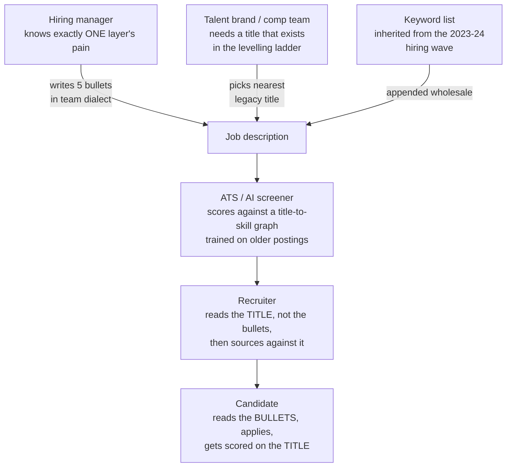
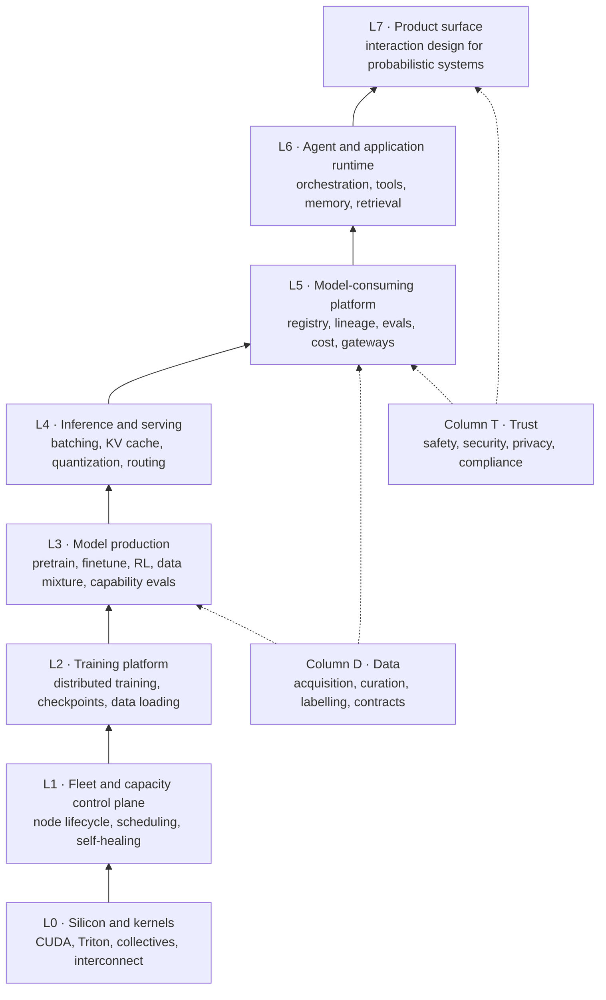
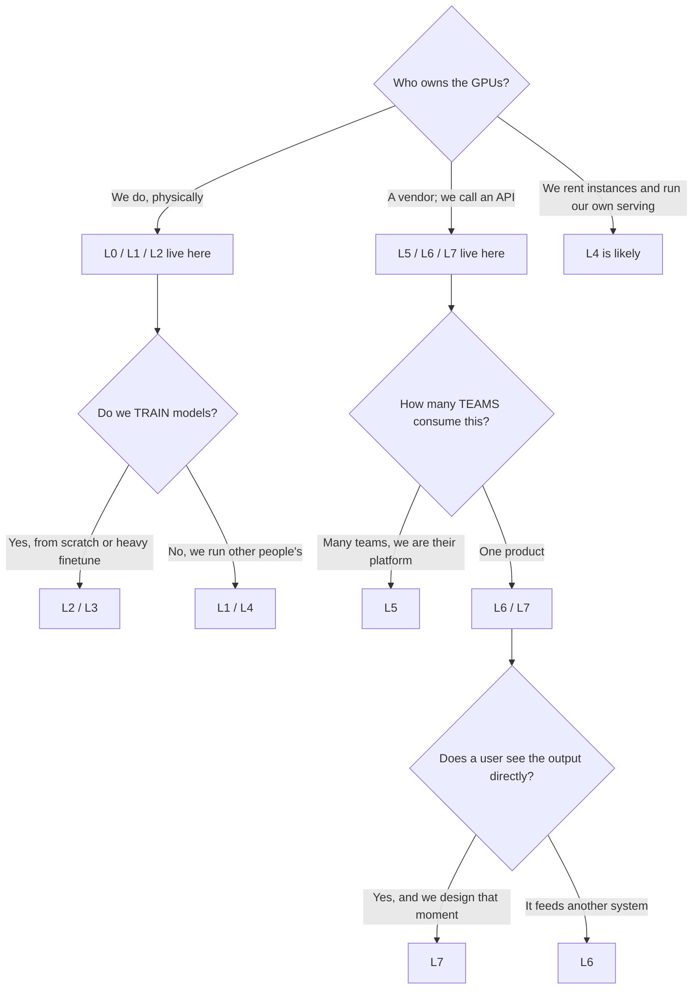
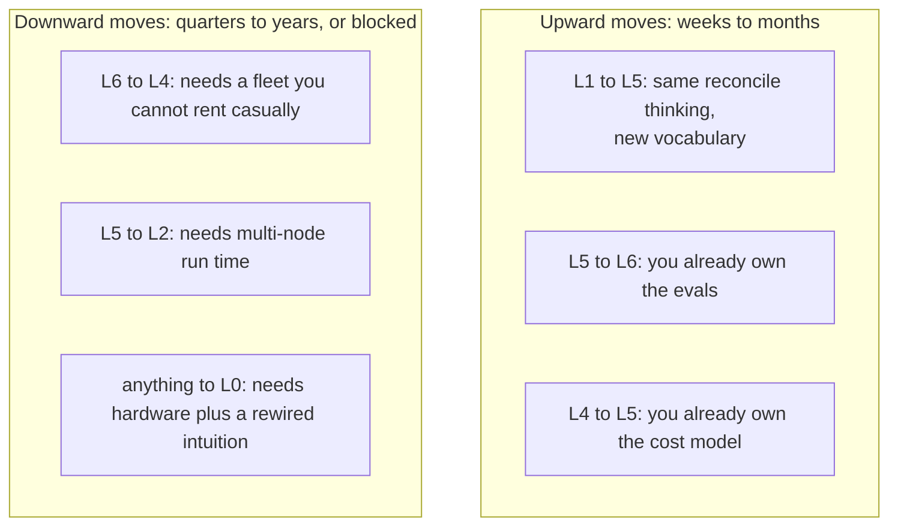
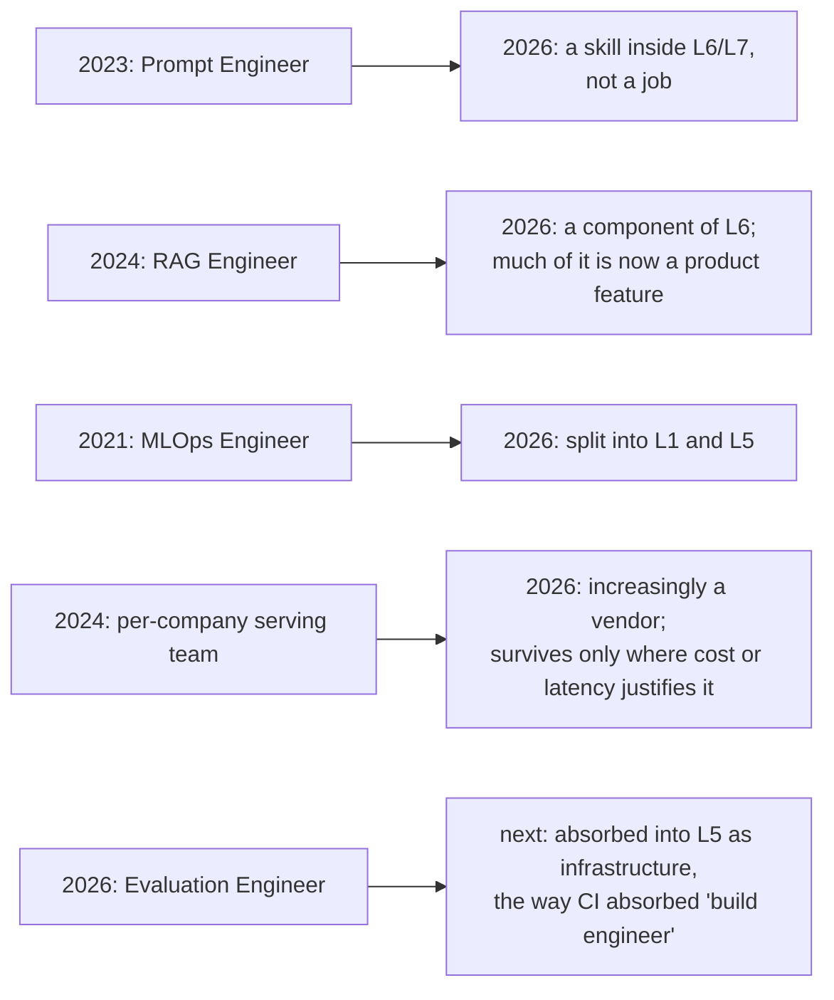

# Under, Of, With, Around: The Seven Layers Hiding Inside the Job Title "AI Engineer"

> **What this page is for.** In 2026 the phrase *AI Engineer* is attached to at least nine
> materially different jobs. They share a vocabulary and almost nothing else: different
> failure modes, different clocks, different interview questions, different hiring bars,
> different pay curves. Candidates apply across all of them with one résumé and lose.
> Recruiters screen across all of them with one keyword list and mis-sort.
>
> This article does three things: (1) explains why the confusion is **structural** rather
> than anyone's fault, (2) lays out the stack as **seven layers plus two cross-cutting
> columns**, with a concrete charter, failure mode and proof artifact for each, and
> (3) gives you decoders — a 60-second test for locating any job description on the stack,
> a translation table between the five naming dialects, and a self-location diagnostic.
>
> Time anchor: September 2026. Market observations are drawn from the job-description
> corpus read for [#424](/p/resume-pmf-staff-ai-infra.html) — Together AI, OpenAI,
> Anthropic, LinkedIn, NVIDIA, Seekr, Databricks, Cloudera — plus the two follow-ups
> [#453](/p/control-plane-six-words.html) and [#454](/p/skills-line-rewrite.html).
> Where I state a market judgment rather than a quoted requirement, I say so.

---

## 0. The answer in one page

**The stack has layers. Job titles do not.**

A layer is defined by *what you own when it breaks*. There are seven of them, from the
silicon up to the product surface, plus two columns (data and trust) that cut across all
seven. Each layer has its own clock — the time unit in which its characteristic failure
happens and must be fixed — and that clock, more than any tool name, is what makes the
layers genuinely different jobs.

A **title**, by contrast, is assigned by the *hiring company's own position in the
industry*, not by the work. The same job — "wire an LLM into a product workflow, with
retrieval, tools, evals and a budget" — is called:

- *Member of Technical Staff* at a frontier lab,
- *AI Engineer* at a Series-B SaaS,
- *Machine Learning Engineer* at a bank,
- *Forward-Deployed Engineer* at an applied-AI vendor,
- *Senior Full-Stack Engineer (AI)* at an agency.

And the reverse: five jobs that are genuinely on five different layers all get posted as
**"AI Infrastructure Engineer."** That is the actual defect. Not that titles are vague —
that titles are **orthogonal to layers**, so a title carries roughly zero bits of
information about which job it is.

**The practical consequences**, which the rest of this article unpacks:

1. You cannot target "AI roles." You can only target a **layer**, and then translate your
   claim into that layer's dialect (§13).
2. Mobility is **asymmetric**: it is easy to move up the stack, hard to move down (§14).
   Most candidates apply downward and get silently filtered.
3. Pay tracks **proximity to the binding constraint** — which in 2026 is accelerator
   capacity, not code (§15). This explains the otherwise strange pay curve.
4. Layers **commoditize upward** over time. Some of today's hottest titles are
   already dissolving into features (§16). Pick a layer by its durability, not its heat.
5. You can credibly claim **your home layer plus one adjacent layer**. Claim two away and
   the phone screen catches you in the first ten minutes (§17).

---

## 1. Why the confusion is structural, not sloppy

It is tempting to conclude that recruiters are careless. They mostly aren't. The
incoherence is manufactured by the pipeline that produces a job posting, and it would
survive replacing every recruiter in the industry tomorrow.

Here is how a 2026 AI job posting actually gets assembled:

Four independent sources of drift, each rational on its own:

| Source | Why it happens | What it does to the posting |
|---|---|---|
| **Levelling ladders are older than the roles** | Comp bands and titles are approved corporate objects; you cannot invent *Agent Runtime Engineer III* without an HR cycle | Genuinely new work gets filed under the nearest pre-existing title, usually *ML Engineer* or *Software Engineer, AI* |
| **Keyword lists are inherited** | The requisition is cloned from last year's, which was cloned from the MLOps wave | Postings carry a tail of skills nobody on the team uses; L6 jobs ask for Kubernetes, L1 jobs ask for PyTorch |
| **The screener has a lag** | Any model scoring résumés learned the title→skill association from a corpus that predates the current split | Titles that meant one thing in 2023 are scored as if they still do |
| **The manager writes in team dialect** | "Reconciliation loop," "span tree," "continuous batching" — each is a house word somewhere | Bullets are precise and layer-specific; the title above them is generic. The two disagree |

> **The single most useful reframe in this article:** in a 2026 AI posting, the **title is
> noise and the bullets are signal.** Read the bullets, locate the layer (§12 gives you a
> 60-second method), and *then* decide whether the title is one you can plausibly wear.
> Candidates do the reverse — they filter by title first — which is why the funnel is so
> lossy on both sides.

There is a second, deeper reason, and it is worth saying plainly because it explains why
this will not settle down soon: **the layers themselves are only a few years old.** In
2019 "ML Engineer" was one job because the stack was one layer thick — you owned the
model and everything around it. The 2023–2026 build-out split that single role along the
seams where the *money and the failures* concentrate. Naming always lags splitting.

---

## 2. The first cut: four prepositions

Before the seven layers, there is a coarser split that resolves maybe 70% of confusion in
one move. Ask what the engineer's relationship to *the model* is. There are only four
answers, and they are prepositions.

| Preposition | The work | Model is... | Typical layers | Canonical question they answer |
|---|---|---|---|---|
| **Under** the model | Make the model *possible and fast* — silicon, fleet, training substrate, serving runtime | a workload with a memory and interconnect profile | L0, L1, L2, L4 | "Why is this job getting 41% MFU instead of 55%?" |
| **Of** the model | Make the model *itself* — architecture, data mixture, fine-tuning, RL, evals of capability | the artifact you are producing | L3 | "Did this data-mixture change actually improve the thing we care about?" |
| **With** the model | Build things that *call* the model — agents, retrieval, tools, workflows, UX | a stochastic API with a price and a latency | L6, L7 | "Why did this agent take nine tool calls to do a three-call job?" |
| **Around** the model | Make everything above *governable* — registries, lineage, evals-as-infrastructure, cost, safety, access | an artifact with a version, an owner, a cost and a blast radius | L5, plus both columns | "Which prompt revision and model build produced this score?" |

This cut matters because the four have almost **disjoint hiring bars**:

- *Under* hires on systems depth and is gated by access to hardware you cannot buy at home.
- *Of* hires on research taste and is gated by publication or model-shipping history.
- *With* hires on product velocity and is gated by almost nothing — which is why it is the
  most crowded and the fastest-moving.
- *Around* hires on distributed-systems maturity and is gated by having operated something
  real at multi-tenant scale — which is why it skews senior and is the least legible to
  recruiters.

Most people who say "I want to be an AI engineer" mean *with*. Most people who say "AI
infrastructure" mean *under*. Most companies that post "AI Platform" mean *around* but
describe it in *under*'s vocabulary. That last mismatch is the single most common
mis-sort in the market.

---

## 3. The stack: seven layers and two columns

The ordering is *dependency*, not prestige. L7 depends on L6 depends on L4, and so on
down. It is not a ladder to climb — a principal engineer at L7 and a principal engineer
at L0 are peers who could not do each other's jobs.

### 3.1 The master table

Read this table by column, not by row. Each column is one *discriminator*: any one of
them separates the layers better than a tool list does.

| | **Owns** | **Fails like** | **Clock** | **Unit of work** | **Proof artifact** |
|---|---|---|---|---|---|
| **L0** | kernels, collectives, the memory hierarchy | 30% slower than it should be, silently | **µs–ms** | a kernel, a fused op, a comms schedule | a benchmark with a roofline and a before/after |
| **L1** | physical and virtual capacity, node lifecycle | a rack of GPUs is *unavailable*, or worse, *quietly sick* | **seconds–hours** | a state transition, a reconcile loop | a provisioning state machine and its drain/repair path |
| **L2** | the training substrate | a 5-day run dies on day 4 and cannot resume | **hours–days** | a run, a checkpoint, a restart | a multi-node run that survived a node failure |
| **L3** | the model itself | the new checkpoint is *worse* and nobody can say why | **days–weeks** | an experiment, an ablation | an eval suite and a model that moved a number |
| **L4** | the serving runtime | p99 triples at 2× traffic; cost per token doubles | **ms** | a request, a batch, a cache | a load-test report with p50/p99 and $/1M tokens |
| **L5** | the layer that makes the above *governable* | nobody can reproduce a result, or the bill is unattributable | **minutes–quarters** | an artifact, a lineage edge, an eval run | a registry/lineage/eval system with real tenants |
| **L6** | the runtime that calls models | the agent loops, over-calls tools, or silently does the wrong thing | **seconds** | a run, a span tree, a tool call | a traced agent with an offline+online eval harness |
| **L7** | what the user sees and trusts | users stop believing the output | **weeks (perception)** | a flow, a fallback, an affordance | a shipped surface with an accepted-suggestion rate |
| **D** | the corpus | garbage in, permanently | **weeks** | a dataset version, a contract | a dataset card and a dedup/decontamination report |
| **T** | the blast radius | a jailbreak, a leak, an audit finding | **incident-driven** | a policy, a control, a red-team finding | a threat model and a mitigation that held |

> **The clock column is the sharpest tool here.** Two engineers who both say "I work on
> inference" but one thinks in microseconds (L0) and the other in milliseconds (L4) are
> not colleagues; they are supplier and customer. Ask anyone, in any AI job, *"what is
> the time unit of the thing you get paged about?"* and you have located them within one
> layer, without a single tool name changing hands.

---

## 4. L0 — Silicon, kernels and interconnect

**Charter.** Make the arithmetic go as fast as the hardware allows.

**What you own.** Fused kernels, attention implementations, quantized matmuls, collective
communication schedules, the memory hierarchy, occasionally the network fabric itself.

**The characteristic failure.** Nothing crashes. The job runs, produces correct results,
and is 30% below what the hardware could do — and only someone at this layer can even
*see* that. L0's defining feature is that its failures are invisible to every layer above.

**Vocabulary.** CUDA, Triton, ROCm, tensor cores, warp specialization, roofline, arithmetic
intensity, MFU/HFU, NCCL, RCCL, all-reduce vs. all-gather, NVLink, InfiniBand, RoCE,
memory-bound vs. compute-bound, register pressure, shared-memory bank conflicts.

**Typical titles.** *Performance Engineer, GPU* · *Kernel Engineer* · *Systems Engineer,
ML Performance* · *Member of Technical Staff (Performance)* · sometimes, confusingly,
*Inference Engineer*.

**Who hires.** Chip vendors, frontier labs, GPU clouds, a handful of inference startups.
Small absolute number of roles.

**The gate.** You cannot practice this layer without the hardware, and you cannot rent
enough of it casually to build a portfolio. This is the most hardware-gated layer in the
stack and therefore the least penetrable from outside — but also the least crowded.

**Proof artifact.** A benchmark: baseline, change, measured speedup, and an explanation in
terms of the roofline. One credible kernel writeup outweighs any amount of résumé prose.

---

## 5. L1 — Fleet and capacity control plane

**Charter.** Keep the physical world continuously equal to the declared state: *this many
healthy nodes, with this driver, in this pool, available to these tenants.*

**What you own.** The lifecycle of a machine modelled as software — discovery, bring-up,
driver and firmware installation, health validation, admission to a pool, drain, repair,
retirement. Plus the self-service API on top of it, and the quota/scheduling policy that
decides who gets the scarce thing.

**The characteristic failure.** Not "it's down." It's *"forty nodes are in the pool,
accepting work, and quietly degraded"* — an ECC error rate climbing, a NIC negotiating at
half rate, a driver that rolled back on reboot. Detecting the gap between declared and
actual — **drift** — is the whole job.

**Vocabulary.** Provisioning state machine, reconciliation, level-triggered vs.
edge-triggered, idempotency, drift detection, self-healing, safe drain, cordon,
durable workflow orchestration (Temporal/Cadence), event-driven over queues rather than
polling, PXE/Redfish/IPMI, DCGM, node problem detector, bin-packing, preemption, quota,
MIG partitioning, zero-downtime rollout.

**Typical titles.** *GPU Infrastructure Engineer* · *Compute Infrastructure Engineer* ·
*Staff SWE, Inference/Compute Infrastructure* · *Cluster Engineer* · *Platform Engineer,
AI Compute*. The Together AI and OpenAI postings in the corpus are canonical examples.

**Who hires.** GPU clouds, neoclouds, hyperscalers, any company that owns rather than
rents its accelerators, and increasingly large enterprises building internal AI capacity.

**The interesting property.** This is the layer where **classical distributed-systems
skill transfers almost perfectly** — Kubernetes controller patterns, reconcile loops,
idempotent retries, queue-driven orchestration. A senior infrastructure engineer from a
non-AI background can be productive here in weeks, which is not true of L0, L2 or L3.
It is, in other words, **the most permeable door into the "under" column**, and it is
consistently under-applied-to relative to L4, because it has less glamour and the JDs
read as ops work.

**Proof artifact.** A state machine you designed with its failure transitions drawn, and a
story about a repair path that ran without a human. See [#453](/p/control-plane-six-words.html)
for what an interviewer will actually probe here.

---

## 6. L2 — Training platform

**Charter.** Make a large distributed training run *start, survive, and resume*.

**What you own.** Launcher and scheduler integration, parallelism strategy plumbing
(data/tensor/pipeline/expert), checkpointing and restart, data loading throughput,
determinism and reproducibility, run observability, the goodput number.

**The characteristic failure.** A run that costs six figures dies on day four, 80%
through, and the checkpoint is either stale or corrupt. Or the run does not die but
*goodput* quietly sits at 60% because of stragglers and restarts.

**Vocabulary.** DDP, FSDP, DeepSpeed/ZeRO, Megatron-style tensor/pipeline parallelism,
activation checkpointing, gradient accumulation, elastic training, checkpoint sharding,
async checkpoint offload, Slurm, Ray, goodput, straggler mitigation, NCCL timeouts,
loss-spike forensics.

**Typical titles.** *Training Infrastructure Engineer* · *ML Systems Engineer* ·
*Research Infrastructure Engineer* · *Member of Technical Staff (Training)*.

**Who hires.** Labs, model-training startups, a few hyperscaler research orgs. Fewest
seats of any layer relative to applicant interest.

**The gate.** Multi-node, multi-GPU time. You cannot simulate the experience of a 512-GPU
run failing in an interesting way. This is why candidates without prior lab or big-tech
access essentially cannot enter here, and why the honest advice in
[#424](/p/resume-pmf-staff-ai-infra.html) was: *if you do not already have that time,
do not target this layer.*

---

## 7. L3 — Model production

**Charter.** Produce a model that is measurably better at something that matters.

**What you own.** Architecture and objective choices, data mixture and curriculum,
fine-tuning and preference optimization, RL environments and reward design, capability
evaluation, ablation discipline.

**The characteristic failure.** The new checkpoint is worse, and the ablation you needed
to explain why was never run. Or: the benchmark improved and the product did not.

**Vocabulary.** Pretraining, SFT, DPO/GRPO and friends, reward modelling, data mixture,
decontamination, scaling laws, ablation, held-out eval, capability elicitation,
distillation, LoRA and its limits.

**Typical titles.** *Research Engineer* · *Research Scientist* · *Member of Technical
Staff* · *ML Engineer* (at companies that only have one AI title) · *Applied Scientist*.

**Who hires.** Labs and a shrinking middle of companies who still train their own models.
Note the structural trend: **as base models improve, fewer organizations do L3 at all**;
they move the work to L5/L6 (adapt and govern rather than train).

**The gate.** Research taste, demonstrated by shipped models or published work. This is the
one layer where the credential — a paper, a model card with your name on it — is doing
real work rather than signalling.

---

## 8. L4 — Inference and serving

**Charter.** Serve tokens at a target latency for the lowest cost per token.

**What you own.** The serving runtime and its configuration, batching policy, KV-cache
management, quantization strategy, speculative decoding, tensor-parallel sharding for
serving, request routing and admission control, autoscaling against GPU utilization, the
$/1M-token number.

**The characteristic failure.** Latency is fine at current traffic and catastrophic at 2×,
because the batching policy was tuned for a load shape that changed. Or: the cost curve
never bends, and the CFO notices.

**Vocabulary.** vLLM, SGLang, TensorRT-LLM, Triton Inference Server, Ray Serve, continuous
(in-flight) batching, paged attention, KV cache and prefix caching, prefill/decode
disaggregation, TTFT vs. TPOT, p50/p99, tokens/sec/GPU, INT8/FP8/AWQ/GPTQ, speculative
decoding, structured output constraints.

**Typical titles.** *Inference Engineer* · *Staff AI Infrastructure Engineer* (very
commonly this layer, despite the generic title) · *LLM Serving Engineer* · *Performance
Engineer* (overlapping L0).

**Who hires.** Everyone who serves models at scale: inference providers, GPU clouds,
labs, and the growing set of product companies that moved off vendor APIs for cost or
latency reasons.

**Market note (judgment, not quoted data).** This is simultaneously the **hottest and
most crowded** layer. It has the clearest vocabulary, the most public tooling, and the
most self-taught applicants — which means the bar is set by people who have genuinely
tuned a production fleet, and the filter question comes fast: *"walk me through how you
chose your batching policy, and what you do when the KV cache saturates."* Keyword-stuffing
this layer is the most expensive mistake in the market, because the tell is immediate.

---

## 9. L5 — The model-consuming platform

**Charter.** Make everything above and below *addressable, reproducible, attributable and
governable* — so that an organization can run many models, many prompts and many teams
without losing track of what produced what, and at what cost.

**What you own.** The artifact catalog and model/prompt/dataset registry; lineage and
provenance; the evaluation system *as infrastructure* (not as a script); experiment
tracking; the LLM gateway and its routing, quota and budget policy; cost attribution;
access control over models and data; the rollout/flighting control plane for AI features.

**The characteristic failure.** Two failures, both slow and both expensive. First:
*"which prompt revision and model build produced this score?"* and nobody can answer, so
a regression cannot be localized. Second: a $400k monthly inference bill that cannot be
attributed to a team, a feature or a customer.

**Vocabulary.** Model/artifact registry, provenance and lineage, dataset and prompt
versioning, reproducibility, experiment tracking, offline and online evaluation,
LLM-as-judge with human calibration, eval gating in CI, multi-tenancy, quota and budget
governance, gateway/router, policy enforcement, drift detection between declared and live
configuration, progressive rollout.

**Typical titles.** *AI Platform Engineer* · *ML Platform Engineer* · *MLOps Engineer*
(legacy name, see §16) · *Staff SWE, AI Platform* · *Developer Productivity, AI*.
LinkedIn's *Staff SWE, AI Platform* posting in the corpus is a clean example.

**Who hires.** Any organization with more than one team using models — which by 2026 is
most large organizations. **This is the largest layer by headcount and the least legible
by title.**

**Why it is chronically mis-sorted.** L5's work is *distributed systems and metadata*, but
the posting is written with AI vocabulary, so it attracts L6 applicants (who can write
agents but have never operated a multi-tenant service) and repels the senior platform
engineers who would be excellent at it (who read "AI Platform" and assume they need
PyTorch). If you are a strong backend/data-platform engineer wondering where you fit,
**this is almost certainly your layer**, and the mis-sort is in your favour.

**Proof artifact.** A registry, lineage graph or eval harness with real tenants and real
numbers — artifacts/day, teams served, QPS, p99, cost attributed. The design spec in
[#423](/p/llm-agent-eval-platform.html) is an example of the shape.

---

## 10. L6 — Agent and application runtime

**Charter.** Turn a stochastic API into a system that reliably completes tasks.

**What you own.** Orchestration and control flow, tool definitions and sandboxing, memory
and context management, retrieval, structured output, retry and fallback policy, the span
tree of a run, per-run cost and latency, guardrails at the call boundary.

**The characteristic failure.** The agent does not crash. It loops; it calls nine tools
where three would do; it confidently returns something wrong; it costs $4 per run when
the unit economics allow $0.40. **Every L6 failure is a quality failure, not an
availability failure**, which is why L6 lives or dies on evaluation.

**Vocabulary.** Agent loop, tool binding, function calling, MCP, context window
management, context compaction, RAG, chunking and reranking, hybrid search, span/trace
tree, LangGraph and similar DAG runtimes, multi-agent orchestration, guardrails,
deterministic checks vs. statistical metrics vs. LLM-as-judge, token budget per task.

**Typical titles.** *AI Engineer* (the modal usage of the bare term) · *Agent Engineer* ·
*Applied AI Engineer* · *Forward-Deployed Engineer* · *Full-Stack Engineer, AI*.

**Who hires.** Nearly everyone. This is the largest and fastest-growing category of
posting, and the one with the lowest formal barrier to entry.

**The honest warning.** Low barrier means the *entry* is crowded and the *senior* end is
thin. What separates a senior L6 engineer from a hobbyist is never the framework — it is
whether they can answer *"how do you know it got better?"* with an eval suite, a
calibration procedure, a cost model and a regression gate. That answer is L5 thinking
applied at L6, which is exactly why these two layers are the most natural adjacency pair
in the whole stack.

---

## 11. L7 — The product surface

**Charter.** Make a probabilistic system trustworthy to a human being.

**What you own.** The interaction model — when to stream, when to show work, when to ask
for confirmation, how to present uncertainty, how to fail gracefully, what the undo story
is, how feedback gets captured and routed back into evaluation.

**The characteristic failure.** Everything is technically working and users stop trusting
the feature. It is the slowest feedback loop in the stack (weeks of perception), and the
only one where the metric is behavioural: acceptance rate, edit distance on suggestions,
repeat usage after a bad output.

**Vocabulary.** Streaming UX, progressive disclosure, human-in-the-loop, confirmation
boundaries, uncertainty display, graceful degradation, feedback capture, acceptance rate,
prompt affordances, error recovery.

**Typical titles.** *AI Product Engineer* · *Product Engineer (AI)* · *Design Engineer* ·
*Full-Stack Engineer* at companies that do not distinguish.

**Underrated point.** L7 is the layer most often dismissed as "just frontend," and it is
where a surprising share of realized AI value is won or lost. A 15% improvement in model
quality and a 15% improvement in how failures are surfaced are worth about the same to the
user; the second is far cheaper to obtain.

---

## 12. The two columns: Data and Trust

These are not layers because they do not sit between other things — they touch everything.

### Column D — Data

Acquisition, licensing, curation, deduplication, decontamination, labelling operations,
synthetic generation, dataset versioning and contracts, PII handling at the corpus level.

Titles: *Data Engineer (AI)* · *Data Curation Engineer* · *Research Data Engineer* ·
*Annotation/Ops Lead*. Historically undervalued, now increasingly recognized as the
highest-leverage input at L3, and the most common root cause of a bad L6 system.

The distinguishing question: *"What is the version of the dataset, and can you reproduce
the model from it?"* If nobody can answer, there is no Column D function, regardless of
how many data engineers are employed.

### Column T — Trust

Safety and alignment engineering, red-teaming, prompt-injection and agent security, tenant
isolation, privacy and retention, model/vendor risk, audit and compliance (EU AI Act and
successors), incident response for model behaviour.

Titles: *AI Safety Engineer* · *AI Security Engineer* · *Responsible AI Engineer* ·
*ML Governance Engineer*. Two very different flavours hide here: **behavioural** (does the
model do harmful things?) and **systems-security** (can an attacker make the *agent* do
harmful things?). The second is a genuine new discipline created by L6 — an agent with
tool access is a remote-code-execution surface with a natural-language parser in front of
it — and demand for it is outrunning supply faster than any other specialty.

---

## 13. The 60-second layer test

Given any job description, ask these five questions **in order**. You will usually be
done in two.

The five questions in plain form, with what each one buys you:

1. **"Who owns the accelerators — you, or a vendor?"** Separates *under* from
   *with/around*. This is the highest-information single question in AI hiring.
2. **"Do you train, fine-tune, or call?"** Separates L2/L3 from everything else.
3. **"What is the time unit of the thing you get paged about?"** Microseconds → L0.
   Milliseconds → L4. Seconds → L6. Minutes to hours → L1. Days → L2/L3. Nothing pages
   you, it degrades over quarters → L5 or L7.
4. **"How many teams consume what you build?"** One → L6/L7. Many → L5. Nobody, it is the
   substrate → L1.
5. **"When the base model gets better, does your work get easier or harder?"** Easier →
   you are at L6/L7 (you inherit improvements). Harder → you are at L1/L4 (bigger models,
   tighter memory, more capacity pressure). Unchanged → L5 (governance need scales with
   usage, not quality).

Question 5 is the one nobody asks, and it is the most predictive of **how durable the role
is** — see §16.

---

## 14. Five dialects: the same job in five accents

The same layer is described in radically different words depending on who is hiring. This
table is the translation key. Rows are layers; columns are employer archetypes.

| Layer | **Frontier lab** | **GPU cloud / neocloud** | **Big-tech platform org** | **Enterprise (bank, pharma, telco)** | **Startup / consultancy** |
|---|---|---|---|---|---|
| **L0** | Member of Technical Staff, Performance | Performance Engineer, GPU | Systems Engineer, ML Perf | — (does not exist) | — |
| **L1** | Cluster / Compute Infrastructure | *Staff SWE, Compute Infrastructure* | SRE, AI Compute | Platform Engineer, GPU capacity | DevOps (means something else) |
| **L2** | Research Infrastructure | Training Platform Engineer | ML Systems Engineer | — (rents it) | — |
| **L3** | Research Engineer / Scientist | Applied Research | Applied Scientist | Data Scientist (often mislabelled) | ML Engineer |
| **L4** | Inference Engineer | *Staff AI Infrastructure Engineer* | Serving Infrastructure Engineer | MLOps Engineer (mislabelled) | Backend Engineer, AI |
| **L5** | Research Platform / Tooling | Control Plane Engineer | *Staff SWE, AI Platform* | ML Governance / MLOps Lead | Platform Engineer |
| **L6** | Member of Technical Staff, Product | Solutions Engineer | Software Engineer, AI | AI Solutions Engineer | **AI Engineer** / Forward-Deployed |
| **L7** | Product Engineer | — | Software Engineer, AI Experiences | Digital Product Engineer | Full-Stack Engineer |
| **Col T** | Alignment / Safety Engineer | Security Engineer | Responsible AI Engineer | Model Risk / Compliance Engineer | Security Engineer |

Three things fall out of this table:

1. **"AI Engineer" unqualified means L6 at a startup and almost nothing anywhere else.**
   If a big-tech posting says *AI Engineer*, read the bullets; the title was chosen by
   the ladder, not the manager.
2. **"AI Infrastructure Engineer" is the most overloaded title in the market** — it maps
   to L1, L2, L4 *and* L5 depending on employer. Four different jobs, one string. The
   corpus behind [#424](/p/resume-pmf-staff-ai-infra.html) contains all four under that
   exact title.
3. **"MLOps Engineer" is a legacy label** covering what is now split between L1 and L5.
   When an enterprise posts it, it usually means L5 with some L4. When a startup posts
   it, it usually means "please make our deploys work."

---

## 15. Gravity: why moving up is easy and moving down is hard

The asymmetry has one clean cause: **lower layers are gated by access to hardware and by
knowledge that only accrues from operating it; upper layers are gated by judgment that
transfers from ordinary software work.**

More precisely, three gates compound as you go down:

| Gate | L6–L7 | L5 | L4 | L1 | L2 | L0 |
|---|---|---|---|---|---|---|
| Can you practice it at home? | yes | mostly | partly | barely | no | no |
| Does non-AI experience transfer? | some | **almost fully** | partly | **almost fully** | little | little |
| Is the failure mode learnable without production? | yes | partly | no | no | no | no |

Note the two **anomalies in the transfer row**: L5 and L1. Both are, underneath the AI
vocabulary, classical distributed-systems jobs — reconcile loops, idempotency,
multi-tenancy, queue-driven orchestration, schema and state design. A strong
infrastructure engineer with zero AI background is genuinely qualified for both and is
usually screened out for lacking GPU keywords. **That is the single largest arbitrage in
the 2026 AI job market**, and it is the reason [#424](/p/resume-pmf-staff-ai-infra.html)
concluded that the reachable targets for a data-platform engineer were L5 first and L1
second — not L4, however loudly L4 is advertised.

**Practical rule.** Target your home layer plus one adjacent layer. Two layers away, the
phone screen kills you — not on vocabulary, which you can learn in a weekend, but on
**failure stories**, which you cannot fabricate. Every layer's real interview is
"tell me about a time this broke," and the shape of a true answer at L4 is nothing like
the shape of a true answer at L6.

---

## 16. Where the money is, and why

Pay in this market does not track difficulty, seniority, or even scarcity on its own. It
tracks **proximity to the binding constraint**. In 2026 the binding constraint is
accelerator capacity — not engineering talent, and not model quality.

That gives a simple predictor: *the closer your work is to making scarce compute produce
more value per hour, the better it is paid.* Which explains the otherwise odd shape of the
curve:

| Layer | Seats | Competition | Comp ceiling | Why |
|---|---|---|---|---|
| **L0** | very few | low (hardware-gated) | very high | Directly multiplies the scarce resource |
| **L1** | moderate | **moderate** | high | Owns whether the scarce resource is usable at all |
| **L2** | few | very high | very high | Gated credential; labs bid against each other |
| **L3** | few | extreme | highest | Winner-take-most on model quality |
| **L4** | many | **highest** | high | Directly owns $/token; also the most self-taught entrants |
| **L5** | **most** | moderate | medium-high | Cost *attribution* rather than cost *reduction* — one step removed |
| **L6** | most | high at entry, **thin at senior** | medium | Value is real but the work is the most substitutable |
| **L7** | many | medium | medium | Mis-valued; see §11 |
| **Col T** | growing fast | **low** | medium-high | Demand created by L6 faster than supply exists |

*(Seats/competition/ceiling are my qualitative read of the 2026 posting corpus, not survey
data. Treat the ordering as the claim, not the levels.)*

**Two actionable readings:**

- **The best risk-adjusted target for an experienced systems engineer is L1 or L5** —
  moderate competition, high transfer of existing skill, and both are structurally
  under-applied-to because their postings read as ops or platform work.
- **The best risk-adjusted target for a strong application engineer is L6 + Column T** —
  agent security is a real discipline that barely has practitioners, and it is reachable
  from L6 rather than from a security background.

---

## 17. The escalator: which roles are dissolving

Layers commoditize **upward**. Work that is a specialty at one moment becomes a feature of
the layer below it, and the specialists either move up or get absorbed.

The pattern is consistent enough to use as a forecasting tool. A role is **dissolving**
when: (a) its core artifact ships as a product feature by a vendor, (b) its distinguishing
knowledge becomes a paragraph in documentation, and (c) the base model improving makes it
*easier* rather than harder. That last is question 5 from §13, and it is the early warning.

A role is **durable** when it sits on top of a constraint that does not go away:

- **L1** — physical capacity is permanently scarce and permanently messy. Durable.
- **L5** — governance load grows with *usage*, not with model quality. Better models
  create *more* artifacts to track, not fewer. Structurally durable.
- **Column T** — adversaries adapt; compliance ratchets. Durable.
- **L6** — durable as a *function*, substitutable as a *person*, unless you own the
  evaluation and cost discipline that makes it engineering rather than assembly.
- **L7** — durable; human trust does not commoditize.

> **The counterintuitive conclusion:** the loudest roles (L4, L6 entry) are the ones most
> exposed to commoditization, and the quietest ones (L1, L5, Column T) are the most
> durable. Heat and durability are close to anti-correlated in this market, because heat
> is generated by how easy a role is to *talk about*, and ease of talking about it is
> exactly what makes it easy to productize.

---

## 18. Positioning: the two-layer rule

Everything above converges on one practical procedure.

**Step 1 — Find your home layer honestly.** Not the layer you want; the layer whose
*failure stories you actually own*. Use the clock test on yourself: what is the time unit
of the thing that has woken you up?

**Step 2 — Pick exactly one adjacent layer to reach for.** Adjacent means one step on the
stack diagram, or one step across into a column. Your résumé then makes a two-layer claim:
home layer with evidence, adjacent layer with *one* credible artifact.

**Step 3 — Translate into the target employer's dialect** using §14. Same evidence,
different words. This is not spin; it is the fact that L5 at LinkedIn and L5 at a bank
genuinely use different house vocabulary for the same machine.

**Step 4 — Say your layer out loud in the first line.** The single highest-value edit
available to most AI-adjacent résumés is replacing a generic summary opener with a
sentence that names the layer and the artifact. Recruiters cannot infer your layer, and
the screener will not try.

**What breaks this:**

- **Claiming a layer whose vocabulary you have but whose failures you don't.** The tell is
  instant and unrecoverable. Better to say "I have not run this, here is the nearest thing
  I have run" — which is a credible senior answer — than to be caught.
- **Claiming two layers away**, hoping the adjacent one carries you. It doesn't; the
  interviewer probes the far claim first, because it is the interesting one.
- **Listing tools instead of failures.** Every layer's skills section looks the same from
  outside. The failure story is what is layer-specific and non-fakeable.

---

## 19. Worked example: locating one real résumé

The three pages preceding this one worked on a single concrete case. It is a good
illustration because it contains the two most common mis-sorts in the market at once.

**The profile.** Eleven years of distributed systems; seven at Microsoft, on data
governance and provenance; tech lead of a self-built multi-tenant graph database; owned
lineage in Microsoft Purview end to end; recently extended the same provenance layer to
models, prompts, agents and evaluation runs; built an agent evaluation harness with span
trees and LLM-as-judge scoring; built a rollout/flighting control plane and an AI-assisted
tool that inventories and retires stale rollout configuration.

**Layer location:**

| Evidence | Layer |
|---|---|
| Artifact catalog, lineage, provenance, multi-tenancy, experiment tracking | **L5, strong** |
| Agent eval harness, span-tree tracing, LLM-judge calibration | **L6, real but recent** |
| Feature-flight rollout control plane, drift detection, zero-downtime rebuild | **L1-shaped, adjacent** |
| Online feature retrieval for model serving (2016) | L5/L4 border, dated |
| GPU, CUDA, batching, KV cache | **nothing** |

So: **home layer L5, adjacent reach L6, second adjacency L1.** Exactly the "moderate
competition, high transfer, structurally under-applied-to" profile from §15 — and exactly
*not* L4, which is what a résumé aimed at the phrase "AI Infrastructure" would be scored
against.

**The two mis-sorts this case demonstrates:**

1. **Aiming at the loud layer.** "Staff AI Infrastructure Engineer" reads as L4 in most
   markets; the evidence here is L5. Same title, three layers apart. The fix is not to
   learn L4 vocabulary — it is to target the postings under that title that are actually
   L5, which §14's table lets you identify from the bullets.
2. **Labelling evidence with the wrong layer's vocabulary.** [#453](/p/control-plane-six-words.html)
   examined six control-plane terms on the skills line and found the underlying skills
   genuinely present; [#454](/p/skills-line-rewrite.html) then found that the *label* was
   claiming an L1 job ("I keep a machine converged, forever") while the *evidence* was an
   L5 migration story ("I moved a large stateful system without downtime, once"). Both
   are respectable. They are different layers, they get different interview questions, and
   the mismatch was costing more than the keywords were earning.

Note what this example is really showing: **the layer model is not just a taxonomy of the
market — it is a consistency check on your own document.** A résumé is coherent when the
title, the summary, the skills line and the bullets all point at the same layer. Most
aren't, and the incoherence is invisible to the author because they know what they meant.

---

## 20. If you are the recruiter

The premise of the question this article answers was that recruiters often are not clear
on the distinction. Fair — but as §1 argues, the pipeline produces that. Three changes
fix most of it, and they are cheap:

1. **Put the clock in the posting.** One sentence: *"You will be paged about p99 latency
   on token generation"* or *"You will own whether 4,000 GPUs are healthy"* or *"You will
   own why an evaluation score cannot be reproduced."* This does more sorting than the
   entire requirements list, and it costs one line.
2. **State who owns the accelerators.** *"We operate our own fleet"* vs. *"we consume
   vendor APIs"* is the highest-information fact about an AI engineering job and it is
   almost never stated.
3. **Screen on failure stories, not tool names.** Ask *"tell me about a time the system
   you owned degraded"* and listen for the **time unit and blast radius** in the answer.
   A candidate who answers in milliseconds and a candidate who answers in quarters are
   both possibly excellent, and only one of them fits the role.

A useful diagnostic for a posting you already have: if you deleted the title and the tool
names, could an engineer still tell which layer it is? If not, the posting is going to
produce a mis-sorted funnel no matter how many applicants it attracts.

---

## 21. A self-location diagnostic

Ten questions. Answer from what you have *done*, not what you have read.

| # | Question | If yes, points to |
|---|---|---|
| 1 | Have you made something measurably faster by changing how memory is accessed? | L0 |
| 2 | Have you written the code that decides when a machine is healthy enough to receive work? | L1 |
| 3 | Have you resumed a distributed job from a checkpoint after a hardware failure? | L2 |
| 4 | Have you run an ablation that changed a decision about a model? | L3 |
| 5 | Have you tuned a batching or caching policy and watched p99 and $/token move? | L4 |
| 6 | Have you built something that many other teams depend on and file bugs against? | L5 |
| 7 | Can you answer "how do you know it got better?" with a suite rather than a vibe? | L5 or L6 (senior) |
| 8 | Have you debugged an agent that did the wrong thing confidently? | L6 |
| 9 | Have you changed how a model's output is *presented* and seen behaviour change? | L7 |
| 10 | Have you found a way to make a system with tool access do something it shouldn't? | Column T |

Your **home layer** is where you have two or more yeses with production stories behind
them. Your **reach layer** is where you have exactly one. Anything with zero is not a
target this year — it is a project plan.

If you got yeses scattered across 1, 5 and 8 with nothing in between, you have a common
and awkward profile: broad exposure, no home. The fix is to pick the one with the best
story and deepen it until it has two more; breadth without a home layer reads as junior
regardless of years served.

---

## 22. Summary: the nine sentences worth keeping

1. **The stack has layers; titles don't.** A title tells you about the employer, not the job.
2. **A layer is defined by what breaks and how fast**, not by which tools are installed.
3. **Four prepositions do most of the sorting**: under, of, with, around the model.
4. **"AI Infrastructure Engineer" covers four different layers**; "AI Engineer" unqualified
   means L6 at a startup; "MLOps" is a legacy label for what is now L1 plus L5.
5. **Read the bullets, not the title** — then use the clock test to place them.
6. **Mobility is asymmetric**: up the stack is weeks, down the stack is quarters or blocked.
7. **L1 and L5 are the arbitrage**: classical distributed-systems jobs wearing AI
   vocabulary, systematically under-applied-to by exactly the people qualified for them.
8. **Heat and durability are anti-correlated**: the easiest roles to talk about are the
   easiest to productize.
9. **Claim your home layer plus one.** Vocabulary is free; failure stories are not.

---

## 23. Sources and further reading

Job-description corpus (read September 2026 for [#424](/p/resume-pmf-staff-ai-infra.html);
layer labels below are mine):

- [Staff Software Engineer, Inference / Compute Infrastructure — Together AI](https://job-boards.greenhouse.io/togetherai/jobs/5214645007) — L1 with L4 adjacency; the provisioning-state-machine language quoted in §5
- [Software Engineer, GPU Infrastructure - HPC — OpenAI](https://openai.com/careers/software-engineer-gpu-infrastructure-hpc-san-francisco/) — L1/L2
- [Performance Engineer, GPU — Anthropic](https://job-boards.greenhouse.io/anthropic/jobs/4926227008) — L0
- [Sr. Staff Software Engineer, AI Infrastructure — LinkedIn](https://freehire.me/jobs/sr-staff-software-engineer-ai-infrastructure-linkedin-hekeswlr) — L5 with L4 language
- [Staff Software Engineer, AI Platform — LinkedIn](https://freehire.me/jobs/staff-software-engineer-ai-platform-linkedin-d4q25ibg) — L5
- [Staff AI Infrastructure Engineer — Seekr](https://freehire.me/jobs/staff-ai-infrastructure-engineer-seekr-2ahcyj3a) — L4
- [Staff System Engineer, AI Infrastructure — Cloudera](https://freehire.me/jobs/staff-system-engineer-ai-infrastructure-cloudera-c6zjaxe4) — L1/L5
- [GPU Infrastructure Engineer — TalentsToday](https://freehire.me/jobs/gpu-infrastructure-engineer-talentstoday-dtmoxwrt) — L1

Note the four distinct layers appearing under variations of one title. That single
observation is the empirical basis for this whole article.

Market-commentary sources:

- [The Resume Blueprint for 2026 AI Infrastructure Roles](https://blog.kudoswall.com/agentic-forward-deployed-ai-resume/)
- [2026 Resume Trends: How to Get Past AI Screening](https://www.ssipeople.com/2026-resume-trends-how-to-get-past-ai-screening-before-a-human-ever-sees-your-application/)
- [In 2026, AI Is Merging With Platform Engineering — The New Stack](https://thenewstack.io/in-2026-ai-is-merging-with-platform-engineering-are-you-ready/)
- [Remote AI Engineer Jobs in 2026: LLM, MLOps and Infrastructure Roles](https://remotestack.in/blog/remote-ai-engineer-jobs-2026)

Companion pages on this board:

- [#424 — Résumé PMF: why it doesn't sell into Staff AI Infrastructure](/p/resume-pmf-staff-ai-infra.html) — the five archetypes that became L1/L4/L2-L3/L5/L6 here
- [#453 — Control Plane in six words, one machine](/p/control-plane-six-words.html) — what an L1 interview actually probes
- [#454 — That line shouldn't be called "Control Plane"](/p/skills-line-rewrite.html) — the L1-label / L5-evidence mismatch, fixed
- [#423 — LLM agent experiment platform: a reviewable design spec](/p/llm-agent-eval-platform.html) — an L5/L6 proof artifact in the shape §9 describes
- [#422 — From Java to Python AI Infrastructure in 40 hours](/p/python-ai-infra-40h.html) — the cheapest credible step toward L4
