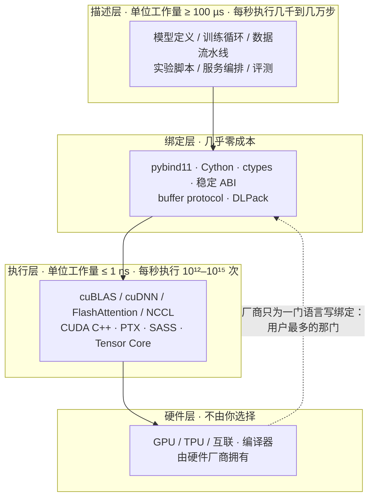
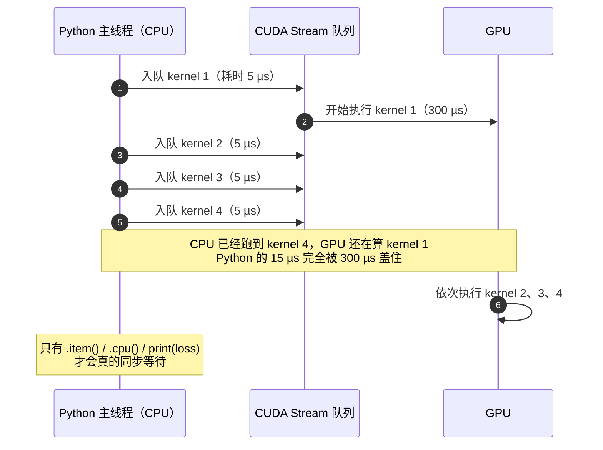
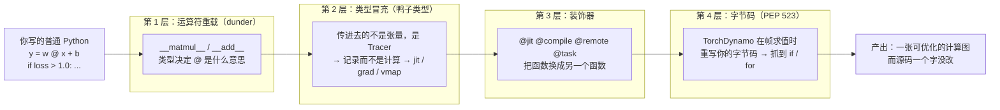
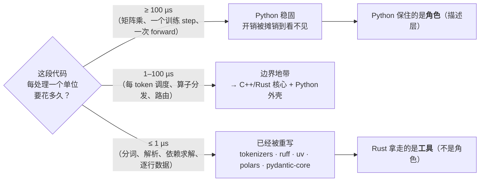

{
  "slug": "why-python-matters-ai-stack",
  "title": "把生态拿掉之后：Python 在 AI 栈里到底承担什么",
  "summary": "\"因为库多\" 是个循环论证。这篇把生态这条答案整个拿掉，问 AI 栈为什么必须是两语言系统，然后逐条验证 Python 顶在上面的六个语言级机制：摊销比、逃生门文化、库可改写语法、零拷贝内存公约、活进程、不用重写的工件。附反事实法庭（JVM/Julia/C++/Mojo 输在哪）、Python 收的六项费、三条可证伪的预测，以及这一切对一个 L5 平台工程师的职业含义。",
  "eyebrow": "Career Design · 任务 #456",
  "h1": "把生态拿掉之后：Python 在 AI 栈里到底承担什么",
  "sub": "你说「除了生态」—— 那正好，因为「因为生态」本来就不是答案，是把问题换了个说法。这篇给出六个语言级的机制、一张收费清单、一个反事实法庭，和三条可以证伪的预测。",
  "facts": [
    "任务 <b>#456</b>",
    "时间锚点 <b>2026 年 9 月</b>",
    "全文 <b>16 节</b>（§0–§15）",
    "承接 <b>#422 / #424 / #453 / #454 / #455</b>"
  ],
  "footer": "为看板任务 #456「Career Design — Why python matter?」而写，是 <a href=\"/p/resume-pmf-staff-ai-infra.html\">#424 简历 PMF 诊断</a> 起头、经 <a href=\"/p/control-plane-six-words.html\">#453 六个词一台机器</a>、<a href=\"/p/skills-line-rewrite.html\">#454 技能行重写</a>、<a href=\"/p/ai-engineer-roles-by-layer.html\">#455 AI Engineer 的七层</a> 之后的第四篇。"
}
---FM---
> **这页回答什么。** 你的原话是：*「我就是好奇 Python 在 AI 技术栈里到底为什么重要，**除了生态**。它真正的意义 / 好处是什么？」*
>
> 这个「除了」加得很对。因为「因为生态好」是个**循环论证**：生态之所以在 Python 上，正是因为 Python 先赢了；用结果解释原因，什么都没解释。一个合格的答案必须能做三件事：**(1)** 指出语言本身的、可以逐条验证的机制；**(2)** 解释为什么生态**落在这里而不是别处**（反事实）；**(3)** 给出可证伪的预测——在什么条件下 Python 会失去这个位置。
>
> 下面六节是机制，第 9 节是 Python 收的费，第 10 节是反事实法庭，第 11 节是预测，第 12 节把结论接回你的职业设计。

---

## 0. 一页版答案

**Python 在 AI 栈里的身份不是「实现语言」，是「描述语言」。**

真正跑的那部分计算——矩阵乘、attention、all-reduce、显存分配——一行都不是 Python 写的。它们是 CUDA C++、是 cuBLAS/cuDNN 里的汇编级 kernel、是 NCCL 里的 RDMA。Python 从头到尾只做一件事：**把「要算什么」描述出来，然后按顺序把它塞给别人去算**。

所以问题不该是「为什么用一门慢语言做 AI」，而该是：**一门专门用来「描述计算、但自己不执行计算」的语言，需要什么本事？** 这个问题一旦问出来，答案只剩四条硬指标，而 Python 六条全中：

| # | 顶层语言必须具备的本事 | Python 的机制 | 在哪节 |
|---|---|---|---|
| 1 | 自己的执行速度**不能**成为瓶颈 | 单次调用的工作量大到把解释器开销摊销掉；并且 CUDA 异步发射让 Python 只需要跑赢「GPU 排空队列」 | §3 |
| 2 | 下潜到 C/CUDA 必须**便宜且体面** | 稳定的 C-API + 一整套文化：在 Python 里「逃出 Python」是第一选择，不是最后手段 | §4 |
| 3 | 库必须能**改写语言本身**，否则 DSL 会长成另一门语言 | dunder 重载、鸭子类型、装饰器、PEP 523 字节码钩子 | §5 |
| 4 | 必须能在互不认识的 C 库之间**传递内存而不复制** | PEP 3118 buffer protocol、`__array_interface__`、DLPack | §6 |
| 5 | 进程状态昂贵时，必须能**不重启地改代码** | 晚绑定 / REPL / notebook / monkey-patch | §7 |
| 6 | 研究者产出的工件必须**不经重写**就能进生产 | 训练和服务是同一份 Python 工件，省掉的是最大的一次翻译 | §8 |

**一句话版**：Python 之所以站在 AI 栈顶，是因为它**足够慢、足够软、足够漏**——慢到没人试图用它写 kernel（于是数值核心统一到了 C/CUDA 一份），软到库可以改写它的语法（于是 autograd / jit / vmap 不需要新语言），漏到两个互不认识的 C 库能通过它交换指针而不复制（于是框架之间可以零拷贝互操作）。

**生态是这六条的结果，不是原因。** 这也是为什么把生态拿掉之后，答案反而更清楚。

> **也要把话说全**：§3 那条其实**不是 Python 的功劳，是这个工作负载的运气**。AI 恰好是「单次调用工作量巨大」的领域，所以顶层语言的速度无关紧要。第 11 节讲的三条预测，全都建立在「这个运气正在什么地方失效」上。

---

## 1. 为什么「因为生态」不算答案

先把这条路封死，否则后面每一节都会被它吸回去。

### 1.1 它是循环的

「Python 有 PyTorch / NumPy / HuggingFace，所以大家用 Python」——但这些库**为什么是用 Python 写的**？因为写它们的人当时已经在用 Python。那**那批人**为什么在用 Python？因为 NumPy。NumPy 为什么在 Python 上？……

这条链子最后会停在 1995–2006 年的一串历史偶然（Numeric、numarray、SciPy 的合并、Travis Oliphant 把两套数组库统一成 NumPy）。历史偶然是真实的，但**它不能解释持续性**：Java 也有历史优势（Hadoop / Spark 时代整个大数据栈是 JVM 的），它输掉了。TensorFlow 有 Google 的全部推力和当时最大的生态，它在编程模型上输给了 PyTorch。**生态可以被推翻——所以生态不是终极解释项。**

### 1.2 合格答案的三个条件

| 条件 | 意思 | 本文在哪满足 |
|---|---|---|
| **机制性** | 指向语言/运行时的**具体特性**，能被一段代码或一个 PEP 验证 | §3–§8，每节都点到具体 PEP 或具体调用路径 |
| **反事实性** | 能解释「为什么不是 X」，而且 X 要挑最强的对手 | §10：JVM、Julia、C++、Lua、JS、Mojo |
| **可证伪性** | 给出「在什么条件下这个结论会失效」，而且这个条件**今天可以观察** | §11：三条带日期的预测 |

第三条最重要。一个不会错的解释等于没解释。本文的核心机制（§3 的摊销比）自带失效条件：**当单次调用的工作量掉到某个数量级以下，Python 立刻变成瓶颈**——而这件事**正在 agent 服务里发生**，这就是为什么 tokenizer、包管理器、linter、调度器内核这几年一个接一个被 Rust 重写。第 11 节会说明，这条线精确地预测了**下一个被重写的是什么**，以及**为什么被重写的是工具而不是角色**。

---

## 2. 换个问题：AI 栈为什么必须是两语言系统

### 2.1 三个约束，决定了栈的形状



三个约束共同决定了这个形状：

**约束一：算力的实现归硬件厂商所有。**
真正决定性能的那几千行（cuBLAS 的 GEMM、cuDNN 的卷积、FlashAttention 的 tiling）不是应用工程师写的，是 NVIDIA 和少数几个 kernel 作者写的，语言是 C++/CUDA，且**不可能换**。这意味着栈底是外语区，顶层语言**必然**是一门要和外语打交道的语言。**这不是选择，是地形。**

**约束二：单次调用的工作量巨大。**
一次 `torch.matmul(4096×4096)` 是 137 GFLOP，在 H100 上跑约 0.3 ms。而 Python 发起这次调用的全部开销（解释器 + dispatcher + CUDA launch）大约 2–8 µs。**比例是 1%。** 一个「顶层慢 100 倍、底层占 99% 时间」的系统，顶层慢不慢根本测不出来。

**约束三：描述者 ≠ 实现者。**
想出模型的人和让它跑在 5000 张卡上的人，不是同一批人、不是同一种技能、往往不在同一个组。这两批人之间必须有一份**共同的工件**。历史上这份工件是「研究员写原型、工程师用 C++/Java 重写」——那次重写是 2010 年代 ML 落地最大的成本中心和最大的 bug 来源（training/serving skew）。

### 2.2 由此推出：顶层语言的四条硬指标

约束一 ⇒ **必须有极便宜的 FFI**，而且要便宜到「下潜」成为常规操作而不是灾难预案。
约束二 ⇒ **自身速度可以很慢**，但「描述一次计算」的**语法必须极短**（因为人要写几万行描述）。
约束三 ⇒ **必须同时被研究者和工程师接受**，且工件要能原样跨越两边。
另加一条派生指标：因为要描述的东西（自动微分、并行化、编译）**年年在变**，所以 ⇒ **库必须能改写语言的语义**，否则每出一个新范式就得发明一门新语言。

**Python 不是「刚好合格」，它在这四条上是压倒性的。** 接下来六节逐条拆。

---

## 3. 机制一：摊销比 —— Python 只需要跑赢「GPU 排空队列」

这是最硬的一条，也是唯一可以用数字说清楚的一条。

### 3.1 先看数字

| 操作 | 实际计算量 | 在 H100 上耗时 | Python 侧发起开销 | 开销占比 |
|---|---|---|---|---|
| `a + b`（两个 Python int） | 1 次加法 | — | ~30–60 ns | **~100%**（灾难） |
| NumPy 对 1000 元素数组求和 | 1000 flop | ~0.5 µs | ~1–2 µs | **~70%**（很糟） |
| `torch.matmul` 512³ | 0.27 GFLOP | ~10 µs | ~5 µs | ~33%（可感知） |
| `torch.matmul` 4096³ | 137 GFLOP | ~300 µs | ~5 µs | **~1.7%**（无关紧要） |
| 一次 7B 模型的 forward | ~14 GFLOP/token × batch | 10–50 ms | ~几百 µs（几十个算子） | **< 1%** |
| 一个训练 step（含反向 + 优化器 + 通信） | — | 100 ms – 2 s | ~1–5 ms | **< 1%** |

**这张表就是答案的骨架。** Python 不是「对 AI 来说够快了」，而是**在这个工作负载的粒度上，语言速度这个变量整个消失了**。它不是赢了比赛，它是根本没上那条赛道。

同一张表也说明了**它在哪里输**：越往上走开销占比越高。所以凡是「单位工作量小、次数多」的活，Python 一定不行——这条线在 §11 会用来做预测。

### 3.2 更精确的版本：异步发射把开销藏起来了

上面的算法其实还低估了 Python。真实情况更狠：**CUDA kernel launch 是异步的**。Python 调 `torch.matmul` 时，它只是往 CUDA stream 里塞了一个任务就立刻返回了，GPU 在后台慢慢算。



结论可以说得非常精确：

> **Python 唯一需要满足的性能条件是：它往队列里塞任务的速度，要快过 GPU 把队列排空的速度。**

只要这个不等式成立，Python 的开销是 **0**（不是「小」，是被完全隐藏）。这就是为什么「用慢语言开 GPU」在实践中完全不是问题——只要 CPU 跑在 GPU 前面，慢多少都一样。

### 3.3 这条线在哪里断（也就是 GPU 空转的那些 bug）

不等式一旦反过来，症状立刻出现，工业界给它起了个名字：**launch-bound / CPU-bound**——`nvidia-smi` 显示利用率 40%，profiler 上全是 GPU 空隙。触发条件：

- **模型小**：每个 kernel 只跑几十 µs，但 Python 侧每个算子还是 5 µs。
- **算子碎**：几百个 element-wise 小算子（典型：没融合的 LayerNorm + 激活 + 残差）。
- **batch 小 / 推理解码阶段**：自回归 decode 每步只算一个 token，GPU 工作量塌缩。
- **循环里有 Python 分支**：而分支条件来自 GPU 上的值 ⇒ 强制同步 ⇒ 流水线排空。

三个补救手段，其实全都是**在绕开 Python**：

| 手段 | 做了什么 | 本质 |
|---|---|---|
| **算子融合**（`torch.compile`、FlashAttention） | 把 N 个小 kernel 合成 1 个大 kernel | 人为把单位工作量调大，回到摊销区 |
| **CUDA Graphs** | 把整串 launch 录制成一个图，之后一次性回放 | 把 Python 从发射路径上**整个删掉** |
| **C++ 侧调度器**（vLLM / TensorRT-LLM 的核心） | 把每 token 的调度逻辑下沉到 C++ | 承认这一段的单位工作量已经掉出摊销区 |

**注意第三条。** 它是本文预测部分的种子：**推理服务的每步工作量比训练小两三个数量级**，所以推理栈是 Python 摊销论最先失效的地方，也确实是今天 C++/Rust 回潮最猛的地方。

### 3.4 诚实记账：这一节不是 Python 的功劳

必须说清楚：**摊销比是工作负载的性质，不是语言的美德。** 换成 Ruby、PHP、甚至 Bash（如果它能调 CUDA），在 4096³ 矩阵乘面前也一样「够快」。

所以 §3 只证明了一件事：**语言速度这个筛子，筛不掉任何人。** 它把 Python 送进了决赛，但赢下决赛靠的是 §4–§8 那五条——那五条才是 Python 独有的。

---

## 4. 机制二：Python 的「慢」是它当选的原因

这一节是全文最反直觉的一条，也是我认为最接近你要的那个「真正的意义」。

### 4.1 两种文化：逃生门是第一选择，还是最后手段

Python 和 JVM 在 FFI 上的差别，**技术差距远小于文化差距**：

| | Python | JVM |
|---|---|---|
| 想让代码变快，第一反应 | **写成 C / Rust 扩展**，或换一个背后是 C 的库 | **写更好的 Java**，让 JIT 去优化 |
| 跨语言调用的地位 | 常规操作，PyPI 上一半的重要包都是 C 扩展 | 历史上是**下策**：JNI 冗长、易崩、破坏 GC 假设、文化上被劝退 |
| 最快的库长什么样 | 一层薄 Python + 一个编译好的核心 | 纯 Java 实现（Netty、Lucene、HotSpot intrinsics） |
| 结果 | 数值核心**只有一份**，大家共享 C/CUDA | 数值核心**被重新实现了 N 次**（Colt、ND4J、EJML……） |

第四行是关键后果。**JVM 之所以没能形成统一的数值核心，恰恰因为 Java 够快**——快到「用 Java 重写一遍」始终是个说得通的选项，于是每个团队都重写了一遍，谁也没做到 cuBLAS 的水平，力量分散。

Python 慢到「用 Python 重写 BLAS」从来不是选项。**唯一的出路是绑定别人的 C 库。** 于是所有人都绑定同一批 C 库，力量聚合。

> **这条因果值得在面试里说出来**：Python 的性能劣势制造了一个**社会规范**——「快的东西不要用 Python 写」——而正是这条规范让整个社区共享同一个 C/CUDA 底座。**它的弱点是它当选的原因。**

### 4.2 反事实推演：如果顶层语言足够快会怎样

假设 2010 年有一门语言，语法像 Python、速度像 C（这正是 Julia 的目标）。推演一下：

1. 它快，所以「在语言内实现张量库」是可行的 ⇒ 至少三个团队会各写一个。
2. 它快，所以「绑定 C」的动力小 ⇒ 绑定层不会被打磨成标准公约。
3. NVIDIA 只会为**用户最多**的语言维护绑定，而它的用户还没起来 ⇒ CUDA 新特性总是晚半年到。
4. 最要命的：**它解决了两语言问题，可下面那门语言根本不归你管。** 「你再也不用离开本语言」这个卖点，在「你必须离开、去 NVIDIA 的编译器里」这个现实面前，是**负资产**。

Julia 在技术上做对了很多事（多重派发、真正的零成本抽象、`CUDA.jl` 相当漂亮），但它优化的是**一个 AI 栈并不具备的自由度**。

### 4.3 两个自然实验（这是本文最强的证据）

理论推演可以讲得很漂亮，但这个领域给了我们两次**真实的对照实验**，而且两次结论一致：**赢的不是更快的那个，是更「就是普通代码」的那个。**

**实验一：Lua Torch → PyTorch（2016–2017）。**
Torch7 用 LuaJIT 写。LuaJIT 是**真快**——比 CPython 快一到两个数量级，是当时最好的动态语言 JIT 之一。同一批核心作者主动把它搬到了 Python 上。**在顶层语言速度上，这是一次主动降级一百倍。** 没人因此损失性能，因为 §3。

**实验二：TensorFlow 1.x 图模式 → PyTorch eager（2017–2019）。**
TF1 做的事情是：在 Python 里嵌一门**自己的语言**——`tf.placeholder`、`tf.cond`、`tf.while_loop`、`Session.run`。你的 `if` 不能用 Python 的 `if`，你的循环不能用 Python 的循环，你的 print 调试不出东西。它换来了可优化的静态图（确实更快、更好部署）。

PyTorch 的 define-by-run 说：**用 Python 自己的 `if`，用 Python 自己的 `for`，用 Python 自己的 `pdb`。** 慢一点，但那是普通代码。

结果众所周知：TF2 掉头做 eager，`tf.function` 退成一个可选装饰器；研究界近乎完全倒向 PyTorch。**当时生态优势、工业推力、性能全在 TF 那边，它还是输了。** 输的那一项，正是「有没有把 Python 当成一门真正的语言用」。

> 这两个实验合起来排除了两种解释：不是因为 Python 快（实验一），也不是因为生态大（实验二——TF 的生态更大）。**剩下的只能是 §5 那条：语言本身可以被当成表达介质来用。**

---

## 5. 机制三：库可以改写语言本身

AI 领域每隔两三年就要求语言支持一个新概念：自动微分（2015）、动态图（2017）、函数变换 `vmap`/`pmap`（2019）、图捕获与编译（2022）、手写 GPU kernel 的 DSL（2023）。**每一个在别的语言里都得改编译器；在 Python 里都只是一个库。** 这是 Python 最被低估的结构性优势。



### 5.1 dunder：`@` 这个运算符是这群人给语言加的

`a @ b` 表示矩阵乘，来自 **PEP 465（Python 3.5，2014）**。提出者不是语言设计者，是科学计算社区——他们受够了 `dot(dot(a, b), c)` 这种写法。

这件小事的含义很大：**Python 的用户改动了 Python 的语法本身。** 类似的还有 PEP 3118（buffer protocol，§6）、PEP 523（帧求值钩子，§5.4）、扩展的切片语义（`a[..., None, 2:5]` 里的 `Ellipsis` 就是为多维数组存在的）。

> 把这句话拿去和 JVM 对比：你能让 Oracle 为深度学习给 Java 加一个中缀运算符吗？**语言能不能被它的用户改造，是一个真实的、可比较的属性。**

### 5.2 鸭子类型 = 追踪器可以冒充张量

这是 JAX 全部魔法的机制，说穿了只有一句：**函数不检查参数类型，所以你可以传一个不是张量、但长得像张量的东西进去。**

```python
def f(x):
    return (x * 2 + 1).sum()        # 2015 年写的，完全没考虑过求导

# 2018 年 JAX 出现了，不需要改上面一行：
jax.grad(f)(3.0)      # 传进去一个 JVPTracer，它的 __mul__ 顺便记下导数
jax.jit(f)(x)         # 传进去一个 DynamicJaxprTracer，它只记录不计算
jax.vmap(f)(batch)    # 传进去一个 BatchTracer，它把第 0 维当批维处理
```

`x * 2` 调的是 `x.__mul__(2)`——**调什么完全取决于 `x` 运行时是什么**。于是一个库可以**发明一种新的「值」**，让所有既有代码在它上面重新解释一遍。这在编程语言理论里叫**抽象解释（abstract interpretation）**，Python 让它变成了十几行的实现技巧。

静态类型语言做不到这点的原因很具体：`f` 的签名在写的时候就得声明一个接口，而 2018 年才发明的 Tracer 不可能在 2015 年被写进那个接口里。**鸭子类型的价值 = 允许未来发明的类型，被过去写的代码接受。**

PyTorch 把这个机制显式开放成了协议：`__torch_function__`、`__torch_dispatch__`；NumPy 那边是 `__array_ufunc__`（NEP 13）和 `__array_function__`（NEP 18）。子类化张量就能重定义整个库的行为，这是量化、稀疏、分布式张量（`DTensor`）、参数高效微调统统在用的路子。

### 5.3 装饰器：语义变换的插座

```python
@jax.jit          # 编译
@torch.compile    # 图捕获 + 生成 Triton kernel
@ray.remote       # 换到另一台机器上执行
@torch.no_grad()  # 关掉整棵求导图
```

装饰器的本质是**语言在语法层面留了一个插座，允许库对「调用一个函数」这件事重新定义**，而且改动量正好是一行。AI 栈里几乎所有「执行策略」都是通过这个插座交付的：编译、并行、分布式、缓存、重试、检查点。

**这一条对你尤其重要**：`@ray.remote` / `@task` 这种写法之所以能成为分布式编排的默认界面，是因为 Python 允许**在不改变函数体的前提下改变函数的执行位置**。你在 #453/#454 里那套「状态机 + 幂等 + 重放」的东西，在 Python 世界里的标准表达形式就是一个装饰器（Temporal、Prefect、Airflow、Ray 全是这个形状）。

### 5.4 PEP 523：库可以 JIT 编译你自己的代码

**PEP 523（Python 3.6，2016）** 给 CPython 加了一个帧求值钩子：允许外部代码接管「执行一个 Python 函数」这件事。它当初是为微软的 Pyjion 提的，六年后被 **TorchDynamo** 用上了——`torch.compile` 的工作方式是：

1. 挂上帧求值钩子，在你的函数**即将执行前**拿到它的字节码；
2. 逐条符号执行字节码，把张量操作抽成图，把 `if` / `for` / `print` 这些留在 Python 里；
3. 遇到无法处理的东西就**打断**（graph break），把图切成几段；
4. 把每段图交给 Inductor 编译成 Triton/C++ kernel，再把字节码改写成「调用编译好的那个」。

这里的语言学含义是：**Python 把自己的执行机制开放给了库。** 所以 `torch.compile` 不需要你换语言、不需要预编译步骤、不需要重写模型——它直接在运行时改写了你的字节码。

### 5.5 极限案例：Triton —— 连「下潜到 GPU」都用 Python 语法写

```python
@triton.jit
def add_kernel(x_ptr, y_ptr, out_ptr, n, BLOCK: tl.constexpr):
    pid = tl.program_id(axis=0)
    offs = pid * BLOCK + tl.arange(0, BLOCK)
    mask = offs < n
    tl.store(out_ptr + offs, tl.load(x_ptr + offs, mask=mask)
                           + tl.load(y_ptr + offs, mask=mask), mask=mask)
```

这**不是 Python**。它是用 Python 的语法、Python 的解析器、Python 的装饰器写的一门 GPU kernel 语言，`@triton.jit` 把函数的 AST 拿去编译成 PTX。

这是 §5 整节的最强注脚：**当这个社区需要一门新语言的时候，他们没有去做一门新语言，他们借了 Python 的语法。** 而这只是因为 Python 的 AST 可以在运行时拿到（`ast` 模块 + `inspect.getsource`），装饰器给了挂载点，`tl.constexpr` 这种类型注解给了传编译期参数的地方。

> 顺带一提，`torch.compile` 生成的 kernel 默认就是 Triton。也就是说，**2026 年一条典型的 PyTorch 执行路径是：Python 源码 → Dynamo 改写字节码 → Inductor 生成 Triton → Triton 编译成 PTX → GPU**。这条路上，Python **同时是**宿主语言、图描述语言和 kernel 语言。没有第二门语言处在这个位置上。

---

## 6. 机制四：它粘的不是代码，是内存

这一条最少被提起，但对做基础设施的人（也就是你）最要紧。

### 6.1 零拷贝是一条语言级公约

**PEP 3118** 定义了 buffer protocol：一个 C 扩展可以把「我这块内存的地址、形状、步长、dtype」以标准结构暴露出来，另一个**完全不认识它**的 C 扩展可以直接读，不复制。配套的还有 `__array_interface__`（CPU）、`__cuda_array_interface__`（GPU 显存）和 **DLPack**（跨框架、跨设备的张量交换标准）。

后果：

```python
t = torch.from_numpy(a)          # 零拷贝：还是那块内存
m = memoryview(a)                # 零拷贝
c = cupy.from_dlpack(t)          # 零拷贝：显存指针直接过户
df = pl.from_arrow(tbl)          # 零拷贝：Polars 和 Arrow 共享缓冲区
```

NumPy 不知道 PyTorch 存在（比它早十几年），CuPy 不知道 vLLM 存在，Arrow 不知道 Polars 存在。**它们能交换数据，是因为 Python 提供了一个中立的会面地点来交换指针。**

> 一句可以直接用的总结：**Python 不是代码的胶水，是内存的胶水。** 它真正的贡献是让一堆互不认识、各自编译的 C 库能共用一块地址空间，还不用商定一个共同的依赖。

### 6.2 反面教材：PySpark 为这条公约付过多少钱

这是一个天然的对照组，而且刚好在你熟悉的领域里。

Spark 的执行引擎在 JVM 里，数据在 JVM 堆上。Python UDF 要处理这些数据时，必须：JVM 对象 → 序列化 → 管道 → Python 进程 → 反序列化 → 算 → 再序列化 → 回 JVM。**逐行 pickle。** 早年 PySpark UDF 比 Scala UDF 慢 10–100 倍，慢的全部是搬运，不是计算。

修法是什么？**引入 Arrow**（`pandas_udf` / 向量化 UDF），让两边共享一段列式内存布局，把逐行序列化换成批量零拷贝。

**这件事的教训正好是 §6 的论点**：跨语言的真正成本从来不在「调用」，在「数据过境」。JVM 的托管堆让零拷贝在结构上很难（对象布局不透明、GC 会搬动内存），所以必须外挂一个 off-heap 的列式格式才能修好。CPython 的对象反而**足够朴素**——一块 malloc 出来的连续内存 + 一点元数据——所以零拷贝是默认，不是特性。

> **再一次，是「弱」带来了优势**：CPython 没有压缩式 GC、没有对象搬移、没有托管堆，于是任何 C 库都可以直接持有裸指针。一门更现代的运行时反而做不到这点。

---

## 7. 机制五：一个活着的进程

### 7.1 晚绑定的价值 = 进程状态的重建成本

这句话可以当公式用：**一门语言「能不重启就改代码」的价值，正比于重建进程状态的代价。**

- 写一个 CLI 工具：状态重建成本 ≈ 0 ⇒ 晚绑定几乎没价值，静态语言完胜。
- 写一个 Web 服务：成本是几秒 ⇒ 有点价值，有热重载就够。
- 做 AI 实验：**加载 70B 权重到显存要几十秒到几分钟；跑到一半的训练 run 要几小时；一个清洗好的 30 GB 数据集在内存里躺着。**

在第三种情况里，「改一行代码要重启」不是不方便，是**方法论上不可行**。你在 notebook 里保持模型常驻、反复改 prompt / 改采样参数 / 打印中间激活——这不是懒，这是这项工作唯一合理的做法。

**显存里的模型权重，是普通计算中最昂贵的进程状态。** 而 Python 恰好是「进程状态昂贵时最划算」的那一类语言。这不是巧合，是选择压力。

### 7.2 ML 是经验科学，不是软件建造

再补一层：写一个订单系统时，你事先知道程序该做什么，写代码是**建造**。训练一个模型时，你**不知道**它该做什么——你要先看看第 3 层的激活值分布长什么样，才知道下一步改什么。这更接近实验科学，而实验科学的工具长成 REPL 的样子（MATLAB、R、Mathematica、Jupyter）不是审美偏好，是**任务形状决定的**。

编译-运行-崩溃的循环，在「每次崩溃前要等 40 分钟数据加载」的场景下，是致命的。

---

## 8. 机制六：一份不用重写的工件

这条不是语言学的，是社会技术的——但它可能是**对钱影响最大**的一条，而且正好落在你的那一层（#455 定位的 L5 平台层）。

### 8.1 省掉的是最大的那一次翻译

2010 年代典型的 ML 落地流程：

```
研究员：Python / R / MATLAB 里做出模型  ──（人工重写）──→  工程师：Java / C++ 里实现推理
```

这次重写的成本：

| 成本项 | 具体表现 |
|---|---|
| 日历时间 | 每个模型 2–8 周，而模型每季度都要更新 |
| Bug 类别 | **training/serving skew**：特征工程在两边写了两遍，差一个 epsilon、差一次 log1p、差一个默认填充值，线上就静默掉点 |
| 组织成本 | 两个团队之间要维护一份精确到数值语义的规格文档 |
| 隐性成本 | 研究员不敢改特征，因为改一次要走一遍重写流程 ⇒ **迭代速度被组织结构锁死** |

Python 让这次重写**整个消失**：训练用的那份 `transform()`，就是线上跑的那份。今天大家甚至觉得这是天经地义的，但它在 2015 年是一个季度级的工程项目。

> **这是一条不出现在 benchmark 里、但出现在财报上的收益。** 也是为什么「Python 慢」这个论点在企业里从来没赢过——你省下的是工程师的月，付出的是 GPU 的毫秒，而这两者的汇率大得离谱。

### 8.2 对你那一层的含义

从 L5（平台/基础设施）往下看，这条的形态会变成一个**具体的工程约束**：

**你接收的工件不是一个二进制，是一个「活的 Python 进程 + 一份没锁死的依赖 + 一份藏在代码里的环境假设」。** 于是平台层的工作内容基本被这一条决定了：

- 环境要可复现（锁文件、镜像、CUDA 版本矩阵）；
- 进程模型要能容纳 GIL（多进程、多副本、worker 池）；
- 冷启动要可控（导入时间、权重加载、镜像体积）；
- 研究员的代码会在你的机群上做各种你没预料到的事（fork、写本地盘、装包、开线程）。

**换句话说：Python 的设计选择，会原封不动地变成你的 SLO 问题。** §9 把账列清楚。

---

## 9. 记账：Python 收的费

一篇只讲好处的文章不可信。以下六项是 Python 在 AI 栈里真实收取的费用，**每一项都直接落在基础设施工程师头上**——也就是说，这六项正好是你该声称自己会处理的东西（§12 展开）。

| # | 费用 | 症状 | 2026 年的缓解手段 |
|---|---|---|---|
| 1 | **打包与 CUDA 版本矩阵** | `torch` 和 `cu124`、驱动、glibc、`nvidia-*` 子包互相咬；同一条 `pip install` 在两台机器上装出不同的东西；悄悄装成 CPU 版 | `uv` + 锁文件 + 私有 index + 镜像固化；把 CUDA 版本当一等配置管理 |
| 2 | **GIL 与进程模型** | 单进程吃不满多核；服务必须多进程 ⇒ 每个进程一份权重 ⇒ 显存 × N；DataLoader `num_workers` 一开，内存翻倍 | 多进程 + 共享显存 / 分页 KV cache；C++ 侧调度；**free-threaded（PEP 703，3.13 实验、3.14 正式支持）正在改写这条** |
| 3 | **导入与冷启动** | `import torch` 就是 1–5 秒；一个 10k 副本的机群，滚动重启的时间全花在 import 上；serverless 推理基本不可行 | 预热池、常驻 worker、`PYTHONPYCACHEPREFIX`、按需 import、把权重加载和进程启动解耦 |
| 4 | **交付物体积** | 一个推理镜像 5–15 GB，其中绝大部分是 CUDA 二进制；拉镜像比跑推理慢 | 分层镜像、镜像预分发、把 CUDA 层和应用层分开缓存 |
| 5 | **边界上没有静态保证** | shape/dtype/device 错误在**运行时**才炸，而且经常是训练到第 12000 步、40 分钟以后才炸——**这项费用是用 GPU 小时付的** | 断言式编程（到处 `assert x.shape == ...`）、`jaxtyping`/`torchtyping`、小规模 smoke run 先跑通、`mypy`/`pyright` 管非张量部分 |
| 6 | **下潜的悬崖** | 一旦 Python 不够用，下一级直接是 C++/CUDA，中间没有台阶；能跨这个台阶的人很贵 | Triton、Numba、Cython、`torch.compile` 补出了中间梯级——但这条悬崖依然真实 |

> **第 5 项值得单独说。** 它是 Python 在 AI 里最大的真实成本，而且被系统性低估：静态类型语言在编译期免费给你的保证，这里要用 GPU 小时来买。一个 8 卡 H100 节点跑 40 分钟炸在 shape 上，成本是实打实的。**AI 栈里所有那些看起来很土的 shape 断言，本质上是在手工重建一个类型系统。**

---

## 10. 反事实法庭：为什么不是它们

对每个候选者，挑它最强的形态来问。

### 10.1 JVM（Java / Scala / Kotlin）—— 最强的对手，因为它本来领先

**它曾经赢着**：2010–2015 年整个大数据栈是 JVM 的（Hadoop、Spark、Kafka、Flink），ML 也在里面（Mahout、MLlib）。它输掉了 AI。

**为什么输：单位计算的位置变了。**

| | 大数据时代（JVM 赢） | 深度学习时代（JVM 输） |
|---|---|---|
| 计算发生在 | JVM 堆上的对象，JIT 编译的纯 Java 代码 | GPU 显存里，NVIDIA 的编译器编的 kernel |
| 你的代码是 | **就是计算本身** | **从来不是计算本身**，只是调度 |
| JIT 的价值 | 巨大 | **零**——它优化不到 kernel 里去 |
| 托管堆的价值 | 巨大 | **负的**——数据必须在 off-heap / device 内存里，GC 只会碍事（§6.2） |
| FFI 质量 | 无所谓 | 决定性；而 JNI 很糟，Panama（FFM）直到 **JDK 22（2024）** 才定稿，晚了整整十年 |

一句话：**JVM 是为「你的代码就是计算」优化的运行时；AI 是「你的代码永远不是计算」的领域。** 它最引以为傲的两件事（JIT + 托管堆）在这个领域一个无用、一个有害。

> 这条对你有直接价值：它解释了**为什么你的 Java 背景在 AI Infra 里既不是废纸也不是通行证**。废的是「JVM 性能直觉」；不废的是分布式系统、并发模型、部署与运维——而 §9 那张表说明，AI 平台层的问题**几乎全是后者**。

### 10.2 Julia —— 技术上最对，战略上最错

为「两语言问题」而生，多重派发漂亮，`CUDA.jl` 质量很高。输在三处：

1. **它解决的问题不是瓶颈。** 没人想用 Julia 重写 cuDNN，那是 NVIDIA 的资产（§4.2）。
2. **硬件厂商只为用户最多的语言写绑定。** 栈底归 NVIDIA 所有，这让「先有用户」变成结构性壁垒，不是可以靠语言质量翻越的。
3. **时机。** 2016–2018 深度学习范式定型时，Julia 还在打磨编译延迟（time-to-first-plot，到 1.9 才靠预编译缓存显著缓解）。窗口关得比它成熟得快。

### 10.3 C++ —— 它没输，它在楼下

C++ **就是**执行层，问题从来不是「C++ 行不行」，而是「上面还要不要一层」。要，理由是 §7（实验节奏）和 §8（研究者与工程师共用一份工件）：让发明模型的人直接写 C++，意味着模板报错、40 分钟增量编译、UB、以及每次改个超参要重新编译。

有意思的是**反向证据**：LibTorch（PyTorch 的 C++ API）一直存在，一直没人用来做研究。**给了逃生门，没人往上走。**

### 10.4 JavaScript / TypeScript —— 赢了另一场比赛

用户比 Python 还多，运行时快得多（V8），但：GPU 访问要经过浏览器沙箱（WebGPU）；没有零拷贝的原生多维数组公约；数值计算传统为零；最关键的是**硬件厂商不为它写绑定**。

不过要注意：**它在 agent / LLM 应用层（#455 的 L6/L7）是真实的赢家**——因为那一层的「计算」发生在别人的 API 后面，本机只需要编排和 IO。**这恰好验证了本文的框架：语言的位置由「计算在哪里发生」决定。** 计算在 GPU 上 ⇒ Python；计算在 HTTP 那头 ⇒ 谁做 IO 舒服谁上。

### 10.5 Mojo / 各种「Python 但快」

正确的诊断（§9 第 6 项，下潜的悬崖是真的），但要跨的门槛是**整个 §5+§6**：要兼容 dunder 的动态语义、要兼容 buffer protocol、要兼容 C 扩展的 ABI，还要说服 NVIDIA 为你写绑定。历史上「兼容层 + 更好的内核」这种打法（想想 Jython、IronPython、PyPy 与 C 扩展的长期拉锯）成功率不高，因为**兼容的正是最难的那部分**。

### 10.6 判决表

| 候选 | 最强处 | 致命处 | 判决 |
|---|---|---|---|
| **JVM** | 工程成熟度、并发、生态先发 | JIT 与托管堆在此领域一个无用一个有害；FFI 晚了十年 | 输在「你的代码不是计算」 |
| **Julia** | 真正解决了两语言问题 | 它解的不是这里的瓶颈；栈底归硬件厂商 | 输在「解错了题」 |
| **C++** | 它就是执行层 | 实验节奏与人群 | 没参赛，它在楼下 |
| **JS/TS** | 用户多、运行时快 | 无 GPU 通路、无内存公约、无厂商绑定 | 赢了 L6/L7，没进 L0–L4 |
| **Lua(JIT)** | 比 CPython 快两个数量级 | §4.3 实验一：作者自己搬走了 | 证明速度不是胜负手 |
| **Mojo** | 诊断正确 | 要兼容的恰恰是最难的部分 | 待观察，赌的是 §9 第 6 项 |

---

## 11. 什么会取代它：三条可以证伪的预测

本文的机制自带失效条件，所以可以做预测。**判据只有一条：单位工作量。**



### 11.1 关键观察：Rust 吃掉的是 Python 的工具，不是 Python 的位置

看这几年被重写的东西：HuggingFace `tokenizers`、`ruff`、`uv`、`polars`、`pydantic-core`、各推理引擎的 C++ 调度核心。它们有一个共同点：**单位工作量在微秒以下**——分一个词、检查一行代码、解一条依赖、处理一行数据。这些东西本来就在摊销线的错误一侧。

但**没有人**在重写「训练脚本」「模型定义」「实验编排」。**因为那一侧的摊销比没变。** 而且注意：这些 Rust 工具**全都通过 Python 交付**（`pip install ruff`、`import tokenizers`）——它们加固了 §4 的论点（逃生门文化），而不是削弱了 Python 的位置。

> 这也给了你一条判断新工具的启发式：**看它每次处理的东西有多大。** 小于 100 µs 的，迟早会有一个 Rust 版本；大于 100 µs 的，留在 Python 里不动。

### 11.2 三条带日期的预测

| # | 预测 | 会在什么地方先发生 | 什么结果算它错 |
|---|---|---|---|
| **P1** | **推理/agent 服务的热路径会大面积离开 Python**（保留 Python 作为配置与扩展界面）。理由：单 token 调度的工作量是微秒级，已经在摊销线下方 | vLLM / SGLang / TensorRT-LLM 的调度器与采样器；agent runtime 的事件循环 | 到 2028 年主流推理引擎的每 token 路径仍主要是 Python，且没有性能压力 |
| **P2** | **训练与研究层不会离开 Python**，即使出现更快的候选 | 新框架发布时会不会有人迁移 | 某个非 Python 框架在两年内拿下 NeurIPS/ICML 论文实现的 15%+ |
| **P3** | **free-threaded Python（PEP 703）会先改变基础设施层的形状，再改变别的**。多进程 worker 池、每进程一份权重、DataLoader 内存翻倍这些设计，全是 GIL 的历史包袱 | 推理服务从多进程回到单进程多线程；DataLoader 不再 fork | 到 2028 年主流服务栈仍默认多进程，且 free-threaded 没有成为生产基线 |

### 11.3 真正会威胁 Python 的，不是更快的语言

按本文框架，威胁只有两种，都不是「出现一门更快的语言」：

1. **单位工作量整体变小。** 如果 AI 的形态从「大批量矩阵乘」转向「海量微小的、带分支的、CPU 侧的决策」（agent 循环正在往这个方向走），摊销论就整体失效。这是 P1 的推广版。
2. **模型代码不再由人写。** §7 和 §8 的价值建立在「人要读、要改、要交接这份代码」上。如果 kernel 和模型主要由编译器或 LLM 生成，「可读的伪代码」这条优势会贬值，语言选择会向「机器好生成、好验证」倾斜（也就是：类型更强的那一侧）。

---

## 12. 这对你的职业设计意味着什么

前三步（#453 词汇、#454 招牌、#455 分层）的结论是：你的**主场是 L5 平台层**，邻接 L1 和 L6，GPU/serving 为零。把本文接上去，能得到三条可以今晚就用的结论。

### 12.1 别去和研究员比 Python

**你不需要成为一个「写 Python 写得好」的人。** L3/L4 的人是 Python 的重度使用者，你在那条赛道上永远落后十年，而且那不是招你的理由。

**你需要的是：把 §9 那张收费表变成你的主场。** 那六项费用——打包与 CUDA 矩阵、GIL 与进程模型、冷启动、镜像体积、缺乏静态保证、下潜悬崖——**全部是平台工程问题，全部不是模型问题**，而且全部和你 Java/Spring 时代做的事同构（依赖治理、进程模型、发布、配置漂移）。

一句话版本，可以直接拿去面试：

> **「我不写模型。我的工作是让别人写的 Python 在机群上可复现、可重启、可回滚地跑起来——而 Python 的每一个设计选择，都会变成平台的一个 SLO 问题。」**

### 12.2 简历上该怎么说（承接 #454）

任务 #454 把那一行换成了 `Online Migration & Consistency`。Python 这块**不该**再开一行技能，而应该**混进已有的行**——因为「会 Python」不是一个可信的差异化声明，「治理 Python 交付物」才是。

具体建议（可选，视你实际做过的事而定）：

```
Python Delivery at Fleet Scale
    Reproducible CUDA/Python environments (lockfiles, wheel/ABI matrix, image
    layering), process-model design around the GIL, and cold-start/import-time
    budgets for long-lived GPU workers.
```

**前提检查**：这一行只有在你**真的做过**其中至少两项时才能写。如果没有——那它就不是简历行，是 #422 那 40 小时里最该补的一段，见下条。

> ⚠️ 这里要非常小心。#453 §8、#454 §8 的整个教训就是「别把没撑住三层追问的词放进技能栏」。上面这一行如果你只有「用过 pip」的经历，面试官问第二个问题（「那你们的 CUDA 版本是怎么钉住的？驱动升级怎么滚？」）就穿了。**宁可不写。**

### 12.3 重新解释 #422 那 40 小时的排布

任务 #422 的路线把 16 小时放在张量 / 显存 / 批处理 / GIL 这四个心智模型上，只给语法 6 小时。当时给的理由是「难点不在语法」。本文给出了**更硬的理由**：

| #422 的安排 | 本文给的理由 |
|---|---|
| 语法只给 6 小时 | 因为 Python 在这里是**描述语言**（§0），你要写的是描述，不是实现——描述用到的语法子集很小 |
| 张量 / shape / dtype 给重头 | 因为 §9 第 5 项：这是**唯一**没有编译器帮你兜底的地方，错了用 GPU 小时付账 |
| 显存 / OOM 给重头 | 因为 §2 的地形：内存不在你的托管堆里，Python 的直觉在这里全部失效 |
| 批处理（吞吐 vs 时延）给重头 | 因为 §3 的摊销比**就是**批处理的数学形式——batch 开大 = 把单位工作量推回摊销区 |
| GIL 给重头 | 因为 §9 第 2 项：它决定了你机群上的**进程模型**，而进程模型是平台层的核心设计 |
| 元类 / 描述符 / `__slots__` 不学 | 但 §5 的 **dunder + 装饰器 + 鸭子类型**要学——不是为了写，是为了**读懂框架在对你的代码做什么**（尤其是 `torch.compile` 打断时的报错） |

**唯一的修订建议**：在阶段四里加 60–90 分钟，专门做一次 `torch.compile` 的 graph break 排查（打开 `TORCH_LOGS=graph_breaks` 跑一个带 Python 分支的模型，看它在哪断、为什么断）。这一个练习同时打通 §3（launch 开销）、§5（字节码改写）和 §9（报错为什么这么难读），性价比极高。

---

## 13. 60 秒版答案 + 一页速查

### 13.1 如果面试官问「为什么 AI 用 Python」

（先拆问题，再给机制，最后给边界——这是 #453 §9 那套答法的同一个模板。）

> 「我觉得这个问题问反了。**Python 在 AI 栈里不是实现语言，是描述语言**——真正跑的 kernel 一行都不是 Python。所以要问的是：一门只描述、不执行的语言需要什么本事。
>
> 有三条。第一，**它的速度必须无关紧要**——一次 4096 的矩阵乘在 GPU 上 300 微秒，Python 发起它是 5 微秒，而且因为 CUDA launch 是异步的，只要 CPU 塞任务比 GPU 排空快，这 5 微秒是**完全隐藏**的。第二，**它必须能被库改写**——`@` 是社区提 PEP 加进语言的，`torch.compile` 是靠 PEP 523 的帧求值钩子在运行时重写你的字节码，JAX 的 `grad`/`vmap` 靠鸭子类型让 tracer 冒充张量。这些在别的语言里都得改编译器。第三，**它得能零拷贝地传内存**——buffer protocol 和 DLPack 让 NumPy、PyTorch、CuPy、Arrow 互不认识也能共享指针。
>
> 有意思的是，**第一条其实是它慢带来的**：因为 Python 慢到没人试图用它写 BLAS，所有人只好去绑定同一批 C 库，数值核心因此统一到了一份。JVM 因为够快，反而把数值库重新实现了 N 次，谁也没做到 cuDNN 的水平。
>
> 边界也很清楚：这套论证在**单位工作量掉到微秒以下时失效**。所以 tokenizer、包管理器、推理引擎的调度器这些东西正在被 Rust 和 C++ 拿走——但拿走的是工具，不是描述层这个角色。」

### 13.2 一页速查

| 问题 | 一句话答案 |
|---|---|
| Python 的角色是什么 | **描述计算，不执行计算**（§0） |
| 为什么慢不要紧 | 单位工作量大 + CUDA 异步发射 ⇒ 开销被完全隐藏（§3.2） |
| 什么时候就要紧了 | 单位工作量 < 100 µs：小模型、碎算子、decode、agent 循环（§3.3） |
| 最反直觉的一条 | **它的弱点是它当选的原因**：慢 ⇒ 没人重写 kernel ⇒ 数值核心只有一份（§4） |
| 最被低估的一条 | **它粘的是内存不是代码**：buffer protocol / DLPack 的零拷贝公约（§6） |
| 最值钱的一条 | 训练和服务是**同一份工件**，省掉了整个重写环节（§8） |
| 为什么 JVM 输了 | JVM 为「你的代码就是计算」优化；AI 里你的代码从来不是计算（§10.1） |
| 为什么 Julia 没赢 | 它解决的两语言问题不是这里的瓶颈；栈底归 NVIDIA（§10.2） |
| 最大的隐形成本 | 边界上没有静态保证——shape 错误用 **GPU 小时**付账（§9 第 5 项） |
| 什么会取代它 | 不是更快的语言，是**单位工作量整体变小**（§11.3） |
| 对你的含义 | 别比写 Python，去做 §9 那张收费表（§12.1） |

---

## 14. 仍然悬着的问题

这个系列到这里已经四篇了，但 **#453 提的三个问题和 #454 新增的第四个，一个都还没回**。它们卡着最终定稿：

1. **SoT ↔ index 的同步在重建之后还在跑吗？** 决定 `reconciliation` 要不要带复数（#453 §15）。
2. **那次切换你真的回滚过吗？** 如果回滚过，它应该是你的主控制面故事——面试官看重「回滚过并活下来」远超过「一次切干净」（#453 §15）。
3. **flight config 清理是你端到端做的（清单也是你建的），还是你执行了别人的清单？** 决定 #453 §3.4 那段重写是 A 还是 B。
4. **那 80+ 条陈旧配置是工具自动下线的，还是工具出清单、人工下线的？** 自动的话，#454 §11 的路径 A 只剩一个定时器的距离（#454 §13）。

另外本篇新增一个，只有你能回答：

5. **#422 那 40 小时，你开始了吗？到哪一阶段了？** §12.3 的修订建议（`torch.compile` graph break 排查）只有在阶段四之后做才有意义；如果还没开始，那 §12.2 的简历行现在**一定不能写**。

---

## 15. 参考坐标

本文引用到的语言级事实，都可以直接查证：

| 事实 | 出处 |
|---|---|
| `@` 矩阵乘运算符 | **PEP 465**（Python 3.5，2014），由科学计算社区提出 |
| buffer protocol（零拷贝内存视图） | **PEP 3118** |
| 帧求值 API（`torch.compile` / TorchDynamo 的基础） | **PEP 523**（Python 3.6，2016），原为 Pyjion 提出 |
| free-threaded CPython（去 GIL） | **PEP 703**（3.13 实验性，3.14 正式支持阶段） |
| NumPy 的可重载协议 | **NEP 13**（`__array_ufunc__`）、**NEP 18**（`__array_function__`） |
| 跨框架张量交换 | **DLPack** / `__cuda_array_interface__` |
| Java 的现代 FFI | **Panama / FFM API**，JDK 22 定稿（2024） |
| Torch 从 LuaJIT 迁到 Python | PyTorch 0.1（2017 年 1 月） |
| TF 从图模式掉头到 eager | TensorFlow 2.0（2019） |

> 性能数字（H100 上 4096³ 矩阵乘约 0.3 ms、算子发起开销 2–8 µs、`import torch` 1–5 s）是**量级估算**，用来支撑「差两个数量级」这个结论，不是基准测试结果。结论对这些数字翻一倍或减半都不敏感；如果它们错了三个数量级，§3 才会倒。
