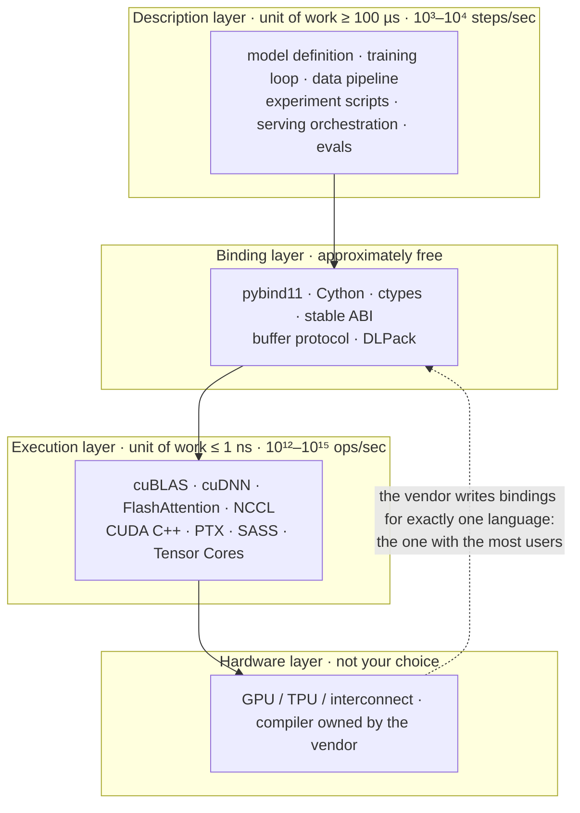
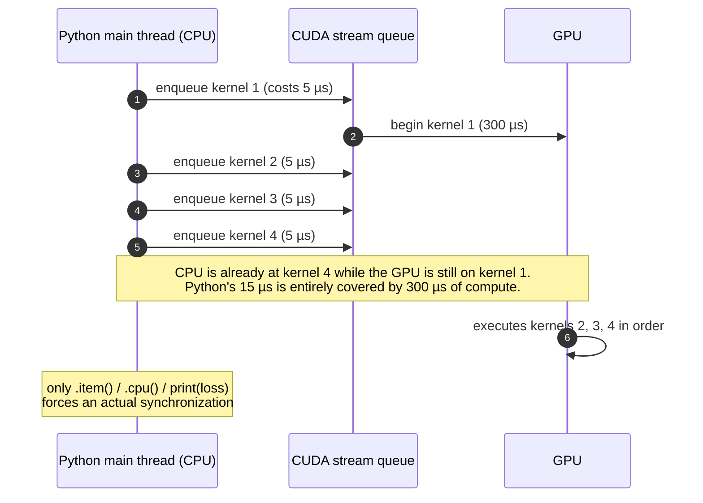
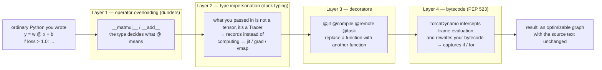
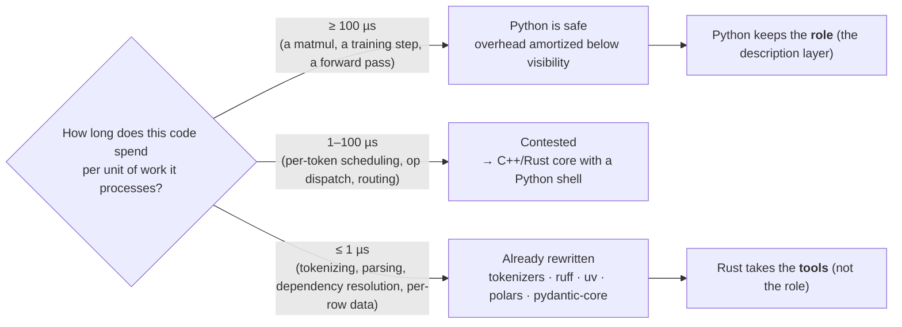

{
  "slug": "python-description-language-ai-stack",
  "title": "The Description Language: What Python Actually Does in the AI Stack",
  "summary": "\"Because of the ecosystem\" is a circular argument. This essay removes that answer entirely and asks the harder question: why must the AI stack be a two-language system, and what does the top language have to be good at? Six language-level mechanisms — the amortization ratio, escape-hatch culture, libraries that rewrite the language, a zero-copy memory convention, the living process, and one artifact that never gets rewritten. Plus the bill Python charges, a counterfactual court (JVM, Julia, C++, JS, Lua, Mojo), and three falsifiable predictions.",
  "eyebrow": "Systems Essay",
  "h1": "The Description Language",
  "sub": "Everyone knows AI runs on Python. Almost every explanation of why is circular. Take the ecosystem off the table and six language-level mechanisms are left — each one checkable against a specific PEP, a specific call path, or a natural experiment the field already ran.",
  "facts": [
    "<b>15 sections</b> (§0–§14)",
    "Written <b>September 2026</b>",
    "Includes a <b>falsifiable</b> prediction set",
    "Order-of-magnitude figures, <b>stated as such</b>"
  ],
  "footer": "A standalone technical essay on language selection in the AI stack. Performance figures are order-of-magnitude estimates used to support claims about ratios, not benchmark results; §14 lists the primary sources for every language-level fact asserted here."
}
---FM---
> **The question this page answers.** *Why does Python matter in the AI stack — apart from the ecosystem?*
>
> That "apart from" is the important part, because "because the ecosystem is there" is a **circular argument**: the ecosystem is in Python precisely because Python already won. Explaining the cause with the effect explains nothing. A real answer has to do three things: **(1)** point at specific, checkable properties of the language and its runtime; **(2)** explain why the ecosystem landed *here rather than somewhere else* — a counterfactual; and **(3)** state what would have to be true for the conclusion to fail, in terms you can observe today.
>
> Sections 3–8 are the mechanisms. §9 is the bill. §10 is the counterfactual court. §11 is the prediction set. §12 is what all of it implies for the people who run this stack rather than write models in it.

---

## 0. The answer in one page

**Python's role in the AI stack is not implementation. It is description.**

None of the computation that actually costs money is written in Python. The matrix multiplies, the attention kernels, the all-reduces, the memory allocator — those are CUDA C++, hand-tuned assembly-adjacent kernels inside cuBLAS and cuDNN, RDMA paths inside NCCL. Python does exactly one thing from beginning to end: **it describes what should be computed, and hands that description to something else, in order.**

So the question is not "why would anyone use a slow language for AI." The question is:

> **What does a language need to be good at, if its job is to describe computation without performing any?**

Ask it that way and the answer collapses into a short list of requirements. Python satisfies all of them, and at least four of them uniquely.

| # | What a description language must do | Python's mechanism | Section |
|---|---|---|---|
| 1 | Its own speed must not be the bottleneck | Per-call work is large enough to amortize interpreter overhead — and because CUDA launches are async, Python only has to outrun the GPU draining its queue | §3 |
| 2 | Dropping down to C/CUDA must be cheap and socially normal | Stable C-API plus a culture where "escape Python" is the first move, not the last resort | §4 |
| 3 | Libraries must be able to rewrite the language itself, or every new paradigm becomes a new language | Operator overloading, duck typing, decorators, PEP 523 frame-evaluation hooks | §5 |
| 4 | Independently compiled C libraries must be able to pass memory without copying | PEP 3118 buffer protocol, `__array_interface__`, `__cuda_array_interface__`, DLPack | §6 |
| 5 | When process state is expensive, code must change without restarting | Late binding, REPL, notebooks, monkey-patching | §7 |
| 6 | The researcher's artifact must reach production without being rewritten | Training and serving are the same Python object, which deletes the single most expensive translation in the pipeline | §8 |

**The compressed version:** Python sits on top of the AI stack because it is **slow enough, soft enough, and leaky enough**. Slow enough that nobody ever seriously proposed writing the kernels in it — so the entire field converged on one shared C/CUDA numerical core instead of building fifteen. Soft enough that libraries can rewrite its semantics — so autograd, JIT, `vmap`, and graph capture arrived as libraries rather than as new languages. Leaky enough that two C libraries which have never heard of each other can exchange a raw pointer through it without copying — so frameworks interoperate at zero cost.

**The ecosystem is the consequence of those six things, not the cause.** Which is exactly why removing it from the argument makes the answer clearer, not weaker.

> **One honest caveat up front.** Mechanism 1 is not a virtue of Python. It is a property of the workload — AI happens to be a domain where a single call does an enormous amount of work, which makes top-level language speed unmeasurable. Every prediction in §11 is built on identifying where that luck is running out.

---

## 1. Why "because of the ecosystem" is not an answer

This path has to be closed first, or every later section gets pulled back into it.

### 1.1 It is circular

*"Python has PyTorch, NumPy, and HuggingFace, so people use Python."* But why were those libraries written in Python? Because the people who wrote them were already using Python. Why were **they** using Python? Because of NumPy. Why was NumPy in Python?

Follow the chain far enough and it terminates in a string of historical accidents between roughly 1995 and 2006 — Numeric, numarray, the SciPy merge, Travis Oliphant unifying two competing array libraries into NumPy. Those accidents are real. But **an accident cannot explain persistence**, and persistence is the thing that needs explaining:

- Java had an equivalent head start. For most of 2010–2015 the entire big-data stack was JVM — Hadoop, Spark, Kafka, Flink — and machine learning lived inside it (Mahout, MLlib). It lost AI anyway.
- TensorFlow had Google's full institutional weight and, in 2017, the larger ecosystem by any measure. It lost the research community to PyTorch on programming-model grounds.

**Ecosystems get overturned. So an ecosystem cannot be the terminal explanation.** Something keeps re-selecting Python when the incumbent advantage points elsewhere, and that something is what this essay is about.

### 1.2 Three tests for an acceptable answer

| Test | What it demands | Where this essay pays it |
|---|---|---|
| **Mechanism** | Points at a concrete property of the language or runtime, verifiable by a snippet or a PEP | §3–§8; each names a specific PEP or call path |
| **Counterfactual** | Explains "why not X" — where X is the *strongest* alternative, not a strawman | §10: JVM, Julia, C++, LuaJIT, JS/TS, Mojo |
| **Falsifiability** | States the conditions under which the conclusion fails, in terms observable today | §11: three dated predictions with explicit disconfirmers |

The third test matters most. An explanation that cannot be wrong is not an explanation. The core mechanism here — the amortization ratio in §3 — carries its own expiry condition: **once per-call work drops below a certain scale, Python becomes the bottleneck immediately.** That is not hypothetical. It is happening right now inside inference servers and agent loops, and it is precisely why tokenizers, package managers, linters, and scheduler cores have been rewritten in Rust one after another. §11 shows that this single line predicts *what gets rewritten next* — and, more interestingly, why what gets taken is always a tool and never the role.

---

## 2. The real question: why the AI stack must be a two-language system

### 2.1 Three constraints fix the shape of the stack



Three constraints, together, force this shape.

**Constraint 1 — the implementation of compute is owned by the hardware vendor.**
The few thousand lines that actually determine performance — the GEMM in cuBLAS, the convolution in cuDNN, the tiling in FlashAttention — are not written by application engineers. They are written by NVIDIA and a small number of kernel authors, in C++/CUDA, and **that is not negotiable**. The bottom of the stack is a foreign-language region. The top language is therefore *necessarily* a language that must talk to foreigners. This is not a preference. It is terrain.

**Constraint 2 — the unit of work per call is enormous.**
A single `torch.matmul` on 4096×4096 matrices is about 137 GFLOP and takes roughly 0.3 ms on an H100. Python's total cost to issue that call — interpreter, dispatcher, CUDA launch — is on the order of 2–8 µs. **That is about one percent.** In a system where the top layer is 100× slower than C and the bottom layer consumes 99% of wall-clock time, the top layer's speed is not merely tolerable; it is unmeasurable.

**Constraint 3 — the describer is not the implementer.**
The person who invents the model and the person who makes it run on five thousand accelerators are different people, with different skills, usually in different organizations. Those two populations need **one shared artifact**. Historically that artifact did not exist: researchers prototyped, engineers rewrote. That rewrite was the largest cost center and the largest bug source in production ML through the 2010s (§8).

### 2.2 Therefore: four hard requirements on the top language

- Constraint 1 ⇒ **the FFI must be extremely cheap** — cheap enough that dropping down is routine engineering, not a contingency plan.
- Constraint 2 ⇒ **the language may be arbitrarily slow**, but the *syntax for describing a computation must be extremely short*, because humans write tens of thousands of lines of description.
- Constraint 3 ⇒ **it must be acceptable to researchers and engineers simultaneously**, and the artifact must cross that boundary unchanged.
- A derived requirement: because *what needs describing* keeps changing — autodiff, dynamic graphs, function transforms, graph capture, kernel DSLs — **libraries must be able to rewrite the language's semantics**, or every new paradigm demands a new language.

Python does not merely pass these four tests. On the last three it is close to unopposed. The next six sections take them one at a time.

---

## 3. Mechanism 1 — the amortization ratio: Python only has to outrun the queue

This is the hardest-edged claim in the essay and the only one that can be settled with numbers.

### 3.1 The numbers

| Operation | Real work | Time on an H100 | Python-side issue cost | Overhead share |
|---|---|---|---|---|
| `a + b` on two Python ints | 1 addition | — | ~30–60 ns | **~100%** (catastrophic) |
| NumPy sum over a 1,000-element array | 1,000 flop | ~0.5 µs | ~1–2 µs | **~70%** (bad) |
| `torch.matmul`, 512³ | 0.27 GFLOP | ~10 µs | ~5 µs | ~33% (noticeable) |
| `torch.matmul`, 4096³ | 137 GFLOP | ~300 µs | ~5 µs | **~1.7%** (irrelevant) |
| One forward pass, 7B model | ~14 GFLOP/token × batch | 10–50 ms | a few hundred µs (tens of ops) | **< 1%** |
| One training step (backward + optimizer + comms) | — | 100 ms – 2 s | ~1–5 ms | **< 1%** |

**This table is the skeleton of the whole answer.** Python is not "fast enough for AI." At this granularity of work, **the variable of language speed disappears from the equation entirely**. Python did not win the race. It was never on that track.

The same table shows where it loses. Read it upward: the smaller the unit of work, the larger the overhead share. Anything that is *small work, many times* is a place Python cannot be. §11 turns this into predictions.

### 3.2 The sharper version: async launch hides the cost completely

The arithmetic above actually understates the case, because **CUDA kernel launches are asynchronous**. When Python calls `torch.matmul`, it enqueues work on a CUDA stream and returns immediately. The GPU works through the queue on its own time.



Which allows a very precise statement:

> **The only performance condition Python must satisfy is that it fills the queue faster than the GPU drains it.**

While that inequality holds, Python's overhead is not small — it is **zero**, in the sense that it is fully hidden behind work that would happen anyway. This is the real reason "driving a GPU from a slow language" is a non-issue in practice: as long as the CPU stays ahead, how far ahead it could have been does not matter.

### 3.3 Where the line breaks — which is to say, why your GPUs are idle

Invert the inequality and the symptoms appear instantly. The industry has a name for the failure mode: **launch-bound**, or CPU-bound. `nvidia-smi` shows 40% utilization; the profiler shows gaps between kernels. It is triggered by:

- **Small models.** Each kernel runs for tens of microseconds while Python still pays ~5 µs per op.
- **Fragmented ops.** Hundreds of tiny element-wise kernels — the classic unfused LayerNorm + activation + residual chain.
- **Small batches, and autoregressive decode.** Each decode step computes one token's worth of work. The GPU's share of the step collapses; Python's does not.
- **Python branching inside the loop**, where the branch condition comes from a GPU value. That forces a synchronization, which drains the pipeline entirely.

The three standard remedies are worth looking at closely, because **all three are ways of getting around Python**:

| Remedy | What it does | What it really is |
|---|---|---|
| **Kernel fusion** (`torch.compile`, FlashAttention) | Merges N small kernels into one large one | Artificially increases the unit of work, pushing you back into the amortized regime |
| **CUDA Graphs** | Records a whole launch sequence once, replays it as a unit | **Deletes Python from the launch path entirely** |
| **C++-side schedulers** (the core of vLLM, TensorRT-LLM) | Moves per-token scheduling logic down into C++ | An admission that this segment's unit of work has fallen out of the amortized regime |

**Note the third one.** It is the seed of §11's predictions: per-step work in inference is two to three orders of magnitude smaller than in training, so inference is exactly where the amortization argument fails first — and it is exactly where C++ and Rust are currently reclaiming ground fastest.

### 3.4 Honest accounting: this section is not a point in Python's favor

It has to be said plainly. **The amortization ratio is a property of the workload, not a merit of the language.** Ruby would do fine. PHP would do fine. Bash would do fine, if it could issue CUDA calls, because in front of a 4096³ matmul everything is fast enough.

So §3 establishes exactly one thing: **the language-speed filter eliminates nobody.** It is what put Python into the final. Winning the final is §4 through §8 — and those five are not generic.

---

## 4. Mechanism 2 — being slow is the reason it was chosen

This is the most counterintuitive claim here, and I think it is the closest thing to a real answer to "what does Python actually contribute."

### 4.1 Two cultures: is the escape hatch the first move or the last resort?

The gap between Python and the JVM on foreign-function interop is **much smaller technically than it is culturally**:

| | Python | JVM |
|---|---|---|
| First instinct when code is too slow | **Write a C/Rust extension**, or switch to a library that is already C underneath | **Write better Java** and let the JIT handle it |
| Status of cross-language calls | Routine. A large fraction of important PyPI packages ship compiled extensions | Historically a last resort: JNI is verbose, crash-prone, breaks GC assumptions, and is culturally discouraged |
| What the fastest library looks like | A thin Python layer over a compiled core | A pure-Java implementation (Netty, Lucene, HotSpot intrinsics) |
| Result | **One** numerical core, shared by everyone | The numerical core was **reimplemented N times** — Colt, ND4J, EJML, and others |

That last row is the consequence that matters. **The JVM failed to converge on a single numerical core precisely because Java is fast enough.** Fast enough that "just rewrite it in Java" was always a defensible option, so every team rewrote it, and no resulting library ever reached cuBLAS quality. Effort dispersed.

Python is slow enough that "rewrite BLAS in Python" was never on the table for anyone, ever. The only available move is to bind someone else's C library. So everyone binds **the same** C libraries. Effort concentrates.

> The causal chain is worth stating as a sentence, because it inverts the usual framing: Python's performance weakness produced a **social norm** — *don't write the fast thing in Python* — and that norm is what gave the entire field a single shared C/CUDA foundation. **Its weakness is the reason it was selected.**

### 4.2 The counterfactual: what if the top language were fast?

Suppose that in 2010 a language existed with Python's syntax and C's speed. (This is precisely what Julia set out to be.) Work the consequences through:

1. It is fast, so implementing a tensor library *in the language* is viable ⇒ at least three teams do exactly that, in parallel, incompatibly.
2. It is fast, so the incentive to bind C is weak ⇒ the binding layer never gets polished into a standard convention (which, per §6, is the thing that actually matters).
3. Hardware vendors write bindings for **the language with the most users**, and its users have not arrived yet ⇒ every new CUDA feature lands six months late, permanently.
4. Most damning: **it solves the two-language problem, but the second language was never yours to begin with.** "You never have to leave this language" is a fine pitch until the reality is "you must leave, into a compiler owned by NVIDIA." Against that reality, the pitch is a liability — it optimizes a degree of freedom the domain does not have.

Julia got a great deal right — multiple dispatch, genuinely zero-cost abstraction, a `CUDA.jl` that is a pleasure to read. It optimized for a freedom the AI stack does not possess.

### 4.3 Two natural experiments — the strongest evidence available

Theoretical reasoning is cheap. This field happens to have run two real controlled experiments, and they agree.

**Experiment 1: Lua Torch → PyTorch (2016–2017).**
Torch7 was built on LuaJIT. LuaJIT is genuinely fast — one to two orders of magnitude faster than CPython, and one of the best dynamic-language JITs ever built. The same core authors chose to move the project to Python. **On top-level language speed, that was a voluntary hundred-fold downgrade.** Nobody lost performance, because of §3.

**Experiment 2: TensorFlow 1.x graph mode → PyTorch eager (2017–2019).**
What TF1 did was embed *its own language* inside Python: `tf.placeholder`, `tf.cond`, `tf.while_loop`, `Session.run`. Your `if` could not be Python's `if`. Your loop could not be Python's loop. Your `print` printed a symbolic handle. In exchange you got a static graph that could be optimized and shipped — and it genuinely was faster and easier to deploy.

PyTorch's define-by-run said: **use Python's own `if`, Python's own `for`, Python's own `pdb`.** Slower, but it is ordinary code.

The outcome is history. TF2 reversed course to eager execution, `tf.function` was demoted to an optional decorator, and the research community moved almost entirely to PyTorch. **Ecosystem size, industrial backing, and raw performance were all on TensorFlow's side, and it lost anyway.** What it lost on was whether Python was being used as a real language.

> Together these two experiments eliminate two explanations. Not because Python is fast — experiment 1 rules that out. Not because the ecosystem was larger — experiment 2 rules that out, since TF's was larger. What is left is the mechanism in §5: the language itself is usable as an expressive medium.

---

## 5. Mechanism 3 — libraries can rewrite the language

Every two or three years, this field demands that the language support a new concept: automatic differentiation (2015), dynamic graphs (2017), function transforms like `vmap` and `pmap` (2019), graph capture and compilation (2022), a DSL for hand-written GPU kernels (2023).

**In most languages each of those requires a compiler change. In Python each of them was a library.** This is Python's most structurally underrated property.



### 5.1 Dunders: the `@` operator was added to the language by its users

`a @ b` for matrix multiplication comes from **PEP 465 (Python 3.5, 2014)**. It was not proposed by language designers. It was proposed by the scientific computing community, who had had enough of writing `dot(dot(a, b), c)`.

The small fact carries a large implication: **Python's users changed Python's syntax.** The same is true of PEP 3118 (the buffer protocol, §6), PEP 523 (frame evaluation, §5.4), and the extended slicing semantics that make `a[..., None, 2:5]` meaningful — `Ellipsis` exists in the language for multidimensional arrays.

> Hold that up against the JVM for contrast. Could you get an infix operator added to Java for deep learning? **Whether a language can be modified by its users is a real, comparable property**, and in this domain it turned out to be decisive.

### 5.2 Duck typing: a tracer can impersonate a tensor

This is the whole of JAX's magic, and it reduces to one sentence: **functions do not check the types of their arguments, so you can pass something that is not a tensor but behaves like one.**

```python
def f(x):
    return (x * 2 + 1).sum()        # written in 2015, with no thought of derivatives

# JAX arrives in 2018. Not one character of the above changes:
jax.grad(f)(3.0)      # receives a JVPTracer; its __mul__ also records a derivative
jax.jit(f)(x)         # receives a DynamicJaxprTracer; it records instead of computing
jax.vmap(f)(batch)    # receives a BatchTracer; it treats axis 0 as a batch dimension
```

`x * 2` dispatches to `x.__mul__(2)` — **what runs is determined entirely by what `x` turns out to be at runtime.** So a library can *invent a new kind of value* and have all existing code reinterpret itself over it. In programming language theory this is **abstract interpretation**; Python reduces it to an implementation trick of a few dozen lines.

The reason statically typed languages cannot do this is concrete rather than philosophical: `f`'s signature has to name an interface at the time `f` is written, and a Tracer invented in 2018 could not have been named in a 2015 signature. **The value of duck typing is that it lets types invented in the future be accepted by code written in the past.**

PyTorch made the mechanism an explicit protocol — `__torch_function__`, `__torch_dispatch__` — and NumPy did the same with `__array_ufunc__` (NEP 13) and `__array_function__` (NEP 18). Subclass the tensor and you redefine the behavior of the entire library. Quantization, sparsity, distributed tensors (`DTensor`), and parameter-efficient fine-tuning all ride on this one road.

### 5.3 Decorators: a socket for semantic transformation

```python
@jax.jit          # compile it
@torch.compile    # capture a graph, generate Triton kernels
@ray.remote       # execute it on a different machine
@torch.no_grad()  # switch off the entire autograd graph
```

A decorator is, structurally, **a socket the language leaves open at the syntax level, allowing a library to redefine what it means to call a function** — at a diff size of exactly one line. Nearly every *execution strategy* in the AI stack is delivered through that socket: compilation, parallelism, distribution, caching, retry, checkpointing.

This is also why `@task` / `@remote` became the default interface for distributed orchestration in this ecosystem. Python permits **changing where a function executes without changing the function body**, so durable workflow engines (Temporal, Prefect, Airflow, Ray) all converge on the same shape. The state machine, the idempotency, the replay — all of it hides behind one line above a `def`.

### 5.4 PEP 523: a library can JIT-compile your own code

**PEP 523 (Python 3.6, 2016)** added a frame-evaluation hook to CPython, letting external code take over the act of executing a Python function. It was proposed for Microsoft's Pyjion. Six years later **TorchDynamo** used it, and that is how `torch.compile` works:

1. Install the frame-evaluation hook and intercept your function's bytecode **immediately before it executes**.
2. Symbolically execute the bytecode instruction by instruction, extracting tensor operations into a graph while leaving `if`, `for`, and `print` in Python.
3. On anything it cannot handle, **break** — split the graph in two and fall back to the interpreter in between (the notorious *graph break*).
4. Hand each graph segment to Inductor, which compiles it to Triton or C++ kernels, then rewrite the bytecode to call the compiled artifact.

The linguistic content of that is remarkable: **Python opened its own execution mechanism to libraries.** `torch.compile` needs no language switch, no ahead-of-time build step, and no model rewrite, because it edits your bytecode at runtime.

### 5.5 The limit case: Triton — even the descent to the GPU is written in Python syntax

```python
@triton.jit
def add_kernel(x_ptr, y_ptr, out_ptr, n, BLOCK: tl.constexpr):
    pid = tl.program_id(axis=0)
    offs = pid * BLOCK + tl.arange(0, BLOCK)
    mask = offs < n
    tl.store(out_ptr + offs, tl.load(x_ptr + offs, mask=mask)
                           + tl.load(y_ptr + offs, mask=mask), mask=mask)
```

This **is not Python**. It is a GPU kernel language that borrows Python's syntax, Python's parser, and Python's decorator hook; `@triton.jit` takes the function's AST and compiles it to PTX.

It is the strongest footnote to this entire section: **when this community needed a new language, it did not build a new language. It borrowed Python's grammar.** And it could do that only because the AST is available at runtime (`ast` plus `inspect.getsource`), decorators provided the mounting point, and annotations like `tl.constexpr` provided somewhere to put compile-time parameters.

> Worth noting: kernels generated by `torch.compile` are Triton by default. So a typical 2026 PyTorch execution path reads: **Python source → Dynamo rewrites bytecode → Inductor emits Triton → Triton compiles to PTX → GPU.** Along that entire path, Python is simultaneously the host language, the graph description language, and the kernel language. No other language occupies that position anywhere.

---

## 6. Mechanism 4 — it glues memory, not code

The least-discussed mechanism, and the one that matters most to anyone operating the stack rather than writing models in it.

### 6.1 Zero copy is a language-level convention

**PEP 3118** defines the buffer protocol: a C extension can expose "here is my memory — address, shape, strides, dtype" through a standard structure, and a **completely unrelated** C extension can read it directly, without copying. Around it sit `__array_interface__` (host memory), `__cuda_array_interface__` (device memory), and **DLPack** (a cross-framework, cross-device tensor exchange standard).

The consequence:

```python
t = torch.from_numpy(a)          # zero copy: same memory
m = memoryview(a)                # zero copy
c = cupy.from_dlpack(t)          # zero copy: the device pointer changes hands
df = pl.from_arrow(tbl)          # zero copy: Polars and Arrow share the buffer
```

NumPy does not know PyTorch exists — it predates it by more than a decade. CuPy does not know vLLM exists. Arrow does not know Polars exists. **They can exchange data because Python provides a neutral meeting place for exchanging pointers**, with no common dependency to agree on.

> The line to remember: **Python is not glue for code. It is glue for memory.** Its real contribution is that a pile of mutually unaware, independently compiled C libraries can share one address space without negotiating a shared build.

### 6.2 The control group: what PySpark paid for not having this

Spark's execution engine lives in the JVM and its data lives on the JVM heap. When a Python UDF needs to touch that data, the path is: JVM object → serialize → pipe → Python process → deserialize → compute → serialize → back to the JVM. **Row by row, through pickle.** Early PySpark UDFs ran 10–100× slower than their Scala equivalents, and essentially all of that was transport, not computation.

The fix was **Arrow** — vectorized `pandas_udf`, a columnar memory layout both sides understand, batch-wise zero copy replacing per-row serialization.

The lesson is exactly §6's thesis: **the real cost of crossing a language boundary is never the call. It is the data crossing.** A managed heap makes zero copy structurally hard — object layout is opaque and the GC relocates memory — so the repair required bolting on an off-heap columnar format. CPython's objects, by contrast, are **primitive enough**: a malloc'd contiguous block plus a little metadata. Zero copy is the default, not a feature.

> **Once again the weakness is the advantage.** CPython has no compacting GC, no object relocation, no managed heap — therefore any C library can simply hold a raw pointer into it and be right about it later. A more modern runtime could not offer that.

---

## 7. Mechanism 5 — a living process

### 7.1 The value of late binding equals the cost of rebuilding process state

This works as a formula: **a language's ability to change code without restarting is worth exactly as much as it costs to rebuild the process's state.**

- A CLI tool: rebuild cost ≈ 0 ⇒ late binding is worth nearly nothing, and static languages win outright.
- A web service: rebuild cost is a few seconds ⇒ worth something; hot reload suffices.
- An AI experiment: **loading 70B weights into device memory takes tens of seconds to minutes; a half-finished training run represents hours; a cleaned 30 GB dataset is sitting in RAM.**

In the third case, "changing one line requires a restart" is not an inconvenience. It is **methodologically disqualifying**. Keeping a model resident in a notebook while you repeatedly adjust the prompt, the sampling parameters, the layer you are printing activations from — that is not laziness, it is the only rational way to do the work.

**Model weights in device memory are among the most expensive process state in ordinary computing.** Python happens to be the kind of language that pays off precisely when process state is expensive. That is not a coincidence; it is selection pressure.

### 7.2 ML is an empirical science, not a construction project

One layer deeper. When you write an order management system, you know in advance what the program should do; writing code is **construction**. When you train a model, you **do not know** what it should do — you have to look at the distribution of activations in layer 3 before you know what to change next. That is closer to experimental science, and the tools of experimental science have always been shaped like REPLs: MATLAB, R, Mathematica, Jupyter. That is not an aesthetic preference; it is the shape of the task.

A compile-run-crash loop is survivable when the loop takes seconds. It is fatal when every crash comes 40 minutes into data loading.

---

## 8. Mechanism 6 — one artifact that never gets rewritten

This mechanism is sociotechnical rather than linguistic, and it is probably the one with the largest effect on money.

### 8.1 It deletes the single most expensive translation

The canonical ML delivery pipeline of the 2010s:

```
Researcher: builds the model in Python / R / MATLAB  ──(manual rewrite)──▶  Engineer: reimplements inference in Java / C++
```

What that rewrite cost:

| Cost | How it showed up |
|---|---|
| Calendar time | 2–8 weeks per model, against models that were updated quarterly |
| Bug class | **Training/serving skew** — feature engineering written twice; one missing `log1p`, one different default fill value, one epsilon apart, and quality silently degrades in production |
| Organizational | Two teams maintaining a specification precise down to numerical semantics |
| Hidden | Researchers stopped changing features, because each change triggered the rewrite pipeline ⇒ **iteration speed locked to the org chart** |

Python deletes that step outright: the `transform()` used in training *is* the `transform()` running in production. This now feels so obvious that it is invisible, but in 2015 closing that gap was a quarter-long engineering project at most companies.

> **This is a benefit that never shows up in a benchmark and always shows up in the budget.** It is also why "Python is slow" has never once won an argument inside a company: what you save is engineer-months, what you spend is GPU-milliseconds, and the exchange rate between those two is absurd.

### 8.2 What the same property looks like from the platform side

Read constraint 3 from below — from the perspective of the people who run the fleet rather than train on it — and it turns into a hard engineering constraint:

**What the platform receives is not a binary. It is a live Python process, a set of dependencies that were never fully pinned, and a set of environment assumptions buried in the code.** That single fact largely determines what platform work in AI consists of:

- environments must be reproducible (lockfiles, images, the CUDA version matrix);
- the process model must accommodate the GIL (multiprocess, replicas, worker pools);
- cold start must be bounded (import time, weight loading, image size);
- and researcher code will do things on your fleet that you did not anticipate — fork, write to local disk, install packages at runtime, spawn threads.

**Every design choice Python made arrives, unchanged, as an SLO problem downstream.** §9 itemizes the bill.

---

## 9. The bill: what Python charges

An essay that only lists benefits is not credible. Below are the six costs Python actually charges in the AI stack. Note the pattern: **every one of them lands on infrastructure, not on modeling.**

| # | Cost | Symptom | State of mitigation, 2026 |
|---|---|---|---|
| 1 | **Packaging and the CUDA version matrix** | `torch`, `cu124`, the driver, glibc, and the `nvidia-*` subpackages all constrain each other; the same `pip install` produces different results on two machines; silently resolves to the CPU build | `uv` plus lockfiles plus a private index plus baked images; treat the CUDA version as first-class configuration |
| 2 | **The GIL and the process model** | One process cannot saturate many cores; serving must be multiprocess ⇒ one copy of the weights per process ⇒ device memory × N; raising DataLoader `num_workers` doubles host memory | Multiprocess plus shared/paged KV cache; C++-side scheduling; **free-threaded CPython (PEP 703 — experimental in 3.13, officially supported from 3.14) is rewriting this row** |
| 3 | **Import time and cold start** | `import torch` alone is 1–5 seconds; on a 10,000-replica fleet, rolling restarts spend their time in imports; serverless inference is barely viable | Warm pools, long-lived workers, `PYTHONPYCACHEPREFIX`, lazy imports, decoupling weight loading from process startup |
| 4 | **Artifact size** | An inference image is 5–15 GB, most of it CUDA binaries; pulling the image is slower than the inference | Layered images, image pre-distribution, caching the CUDA layer separately from the application layer |
| 5 | **No static guarantees at the boundary** | shape/dtype/device errors surface **at runtime** — and routinely at step 12,000, forty minutes in. **This cost is paid in GPU-hours** | Assertion-heavy code, `jaxtyping`/`torchtyping`, small smoke runs before scale-out, `mypy`/`pyright` over the non-tensor parts |
| 6 | **The cliff below** | When Python runs out, the next rung is C++/CUDA with nothing in between; people who can cross that gap are expensive | Triton, Numba, Cython, and `torch.compile` have built intermediate rungs — but the cliff is still real |

> **Row 5 deserves its own paragraph.** It is Python's largest real cost in this domain and it is systematically underestimated, because the guarantee a static type system hands you for free at compile time must here be purchased with GPU-hours. An eight-GPU node running forty minutes before dying on a shape mismatch has a price you can look up. **All those crude-looking shape assertions scattered through AI codebases are a type system being rebuilt by hand, at runtime, badly.**

There is a second-order observation buried in this table that is worth making explicit: **five of these six costs are consequences of Python's strengths.** Cheap C extensions (§4) produce the ABI matrix in row 1. A simple non-relocating object model (§6) is why CPython has a GIL at all (row 2). A live, dynamically loaded process (§7) is why imports are expensive (row 3). Dynamism at the boundary (§5) is why nothing is checked ahead of time (row 5). You do not get to keep the mechanisms and refuse the bill.

---

## 10. The counterfactual court: why not them

For each candidate, take its strongest form and ask the question honestly.

### 10.1 The JVM (Java / Scala / Kotlin) — the strongest challenger, because it was ahead

**It was winning.** From roughly 2010 to 2015 the entire data stack was JVM — Hadoop, Spark, Kafka, Flink — and machine learning lived inside it, in Mahout and MLlib. It lost AI anyway.

**Why: the location of the computation moved.**

| | Big-data era (JVM wins) | Deep-learning era (JVM loses) |
|---|---|---|
| Computation happens | In objects on the JVM heap, in JIT-compiled Java | In device memory, in kernels compiled by the vendor's compiler |
| Your code | **is the computation** | **is never the computation** — it is scheduling |
| Value of the JIT | Enormous | **Zero** — it cannot optimize into a kernel it never sees |
| Value of the managed heap | Enormous | **Negative** — data must live off-heap or on-device, and the GC is purely in the way (§6.2) |
| Quality of FFI | Irrelevant | Decisive — and JNI was bad, while Panama/FFM only finalized in **JDK 22 (2024)**, a decade late |

One sentence: **the JVM is a runtime optimized for "your code is the computation," and AI is a domain where your code is never the computation.** The two things it is proudest of — the JIT and the managed heap — are respectively useless and harmful here.

There is a corollary that is easy to miss and useful in practice: **this is why a distributed-systems background from the JVM world transfers into AI infrastructure almost completely, while JVM performance intuition transfers not at all.** The table in §9 is a list of dependency governance, process model, release, and configuration problems. Those are the same problems, wearing different vocabulary.

### 10.2 Julia — technically the most correct, strategically the most wrong

Purpose-built for the two-language problem, with beautiful multiple dispatch and a genuinely high-quality `CUDA.jl`. It lost on three counts:

1. **The problem it solves is not the bottleneck.** Nobody wanted to rewrite cuDNN in Julia; cuDNN is NVIDIA's asset (§4.2).
2. **Hardware vendors write bindings for the language with the most users.** Since the bottom of the stack belongs to the vendor, "have users first" is a structural barrier, not one that language quality can climb.
3. **Timing.** During 2016–2018, while the deep learning paradigm was setting, Julia was still fighting compilation latency — time-to-first-plot was not substantially fixed until precompilation caching in 1.9. The window shut faster than the language matured.

### 10.3 C++ — it did not lose; it is downstairs

C++ **is** the execution layer. The question was never "is C++ capable," it was "does anything need to sit above it." Something does, for the reasons in §7 (experimental cadence) and §8 (one artifact shared by two populations). Having the people who invent models write C++ means template error messages, forty-minute incremental builds, undefined behavior, and a recompile every time a hyperparameter changes.

The interesting evidence here is **negative**: LibTorch, PyTorch's C++ API, has existed the entire time, and essentially nobody uses it for research. **The escape hatch upward was provided, and nobody took it.**

### 10.4 JavaScript / TypeScript — it won a different race

More users than Python and a dramatically faster runtime in V8. But: GPU access goes through a browser sandbox (WebGPU); there is no native multidimensional array convention and therefore no zero-copy convention; the numerical computing tradition is approximately nonexistent; and decisively, **hardware vendors do not write bindings for it.**

But note where it *is* winning: the agent and LLM application layer, unambiguously. And that is not a counterexample — it confirms the framework. In that layer the "computation" happens behind somebody else's API, so the local process only orchestrates and does I/O. **A language's position is determined by where the computation happens.** Computation on a GPU in your process ⇒ Python. Computation at the far end of an HTTP call ⇒ whichever language makes I/O and orchestration pleasant.

### 10.5 Mojo and the general "Python but fast" class

The diagnosis is right — the cliff in §9 row 6 is real, and an intermediate rung is genuinely missing. But the barrier to entry is the whole of §5 plus §6: you must be compatible with dunder-based dynamic semantics, compatible with the buffer protocol, compatible with the C extension ABI, *and* persuade NVIDIA to write bindings for you. The historical record for "compatibility layer plus better core" is poor — Jython, IronPython, and the long war between PyPy and C extensions — because **the part you must be compatible with is the hard part.**

### 10.6 Verdict table

| Candidate | Strongest point | Fatal point | Verdict |
|---|---|---|---|
| **JVM** | Engineering maturity, concurrency, incumbent ecosystem | JIT useless and managed heap harmful here; FFI a decade late | Lost on "your code is not the computation" |
| **Julia** | Actually solved the two-language problem | Solved a problem that was not the bottleneck; the bottom of the stack is vendor-owned | Lost on "answered the wrong question" |
| **C++** | It *is* the execution layer | Experimental cadence; wrong population | Never entered; it is downstairs |
| **JS/TS** | Huge user base, fast runtime | No GPU path, no memory convention, no vendor bindings | Won the application layer, never entered the systems layer |
| **Lua (JIT)** | Two orders of magnitude faster than CPython | §4.3, experiment 1: its own authors left | Proves speed was not the deciding variable |
| **Mojo** | Correct diagnosis | Must be compatible with exactly the hard part | Open; it is a bet on §9 row 6 |

---

## 11. What could replace it: three falsifiable predictions

Because the mechanisms carry expiry conditions, predictions are possible. **There is only one criterion: the unit of work.**



### 11.1 The key observation: Rust is eating Python's tools, not Python's position

Look at what has actually been rewritten in the last few years: HuggingFace `tokenizers`, `ruff`, `uv`, `polars`, `pydantic-core`, and the C++ scheduling cores inside every serious inference engine. They share one property: **the unit of work is below a microsecond** — split one token, check one line, resolve one dependency, process one row. All of them were always on the wrong side of the amortization line; they were only ever written in Python because it was convenient.

Meanwhile **nobody is rewriting training scripts, model definitions, or experiment orchestration**, because on that side the ratio has not moved at all.

And notice the delivery mechanism: **every one of those Rust tools ships through Python** — `pip install ruff`, `import tokenizers`. They are not a counterexample to §4; they are §4 continuing to operate exactly as described. The escape-hatch culture now has a better escape hatch.

> This also gives a usable heuristic for evaluating any new tool: **ask how much work it does per item.** Below ~100 µs, a Rust version is coming whether anyone has started it or not. Above it, the thing stays in Python and no amount of language advocacy will move it.

### 11.2 Three dated predictions

| # | Prediction | Where it shows up first | What would falsify it |
|---|---|---|---|
| **P1** | **The hot path of inference and agent serving largely leaves Python**, retaining Python as the configuration and extension surface. Rationale: per-token scheduling work is measured in microseconds, already below the line | Schedulers and samplers in vLLM, SGLang, TensorRT-LLM; the event loop of agent runtimes | By 2028, mainstream inference engines still execute the per-token path primarily in Python with no performance pressure to change |
| **P2** | **The training and research layer does not leave Python**, even given a faster credible candidate | Whether anyone migrates when a new framework launches | A non-Python framework reaching 15%+ of NeurIPS/ICML paper implementations within two years |
| **P3** | **Free-threaded Python (PEP 703) changes the shape of infrastructure before it changes anything else.** Multiprocess worker pools, one weight copy per process, DataLoader memory multiplication — these are all GIL-era design scars, and the infrastructure layer is where they hurt | Serving stacks returning from multiprocess to single-process multithreaded; DataLoaders that stop forking | By 2028, mainstream serving stacks still default to multiprocess and free-threaded builds are not a production baseline |

### 11.3 What actually threatens Python is not a faster language

Within this framework there are only two real threats, and neither is "someone ships a faster language."

1. **The unit of work shrinks across the board.** If the shape of AI shifts from large batched matrix multiplication toward enormous numbers of small, branchy, CPU-side decisions — which is the direction agent loops are moving — the amortization argument fails globally rather than locally. This is the generalized form of P1, and it is the only scenario in which Python loses the description layer itself rather than losing tools around it.
2. **Model code stops being written by people.** §7 and §8 derive their value from the premise that humans read, modify, and hand off this code. If kernels and model definitions are primarily generated by compilers or language models, "readable pseudocode" depreciates as an asset, and language selection tilts toward whatever is easiest to *generate and verify* — which is the more strongly typed side of the field.

Both threats have the same structure, and it is worth naming it: Python's position rests on two assumptions — **work per call is large** and **a human is in the loop** — that were never properties of the language at all.

---

## 12. Practical consequences

Three groups can act on this differently.

### 12.1 If you are learning Python in order to work on AI systems

The syntax is not the hard part, and the mechanisms explain why. **Python is the description language, so the subset of syntax you actually need is small.** What is worth real study is what the description layer is describing, and where its guarantees stop:

| Worth heavy investment | Why, mechanistically |
|---|---|
| Tensors, shapes, dtypes, devices | §9 row 5: this is the **only** place with no compiler backstop, and errors are billed in GPU-hours |
| Device memory and OOM behavior | §2's terrain: the memory is not in a heap you manage, so every Python intuition about allocation is wrong |
| Batching — throughput vs. latency | §3's amortization ratio **is** the mathematics of batching. Increasing the batch is pushing the unit of work back into the amortized regime |
| The GIL and the process model | §9 row 2: it determines the process topology of every deployment, which is the central design question at the platform layer |
| Dunders, decorators, duck typing | Not to write them, but to **read what the framework is doing to your code** — especially when `torch.compile` reports a graph break |
| Metaclasses, descriptors, `__slots__` | Genuinely skippable |

If there is a single highest-leverage exercise on that list, it is this: run a model with a Python branch in its forward pass under `TORCH_LOGS=graph_breaks`, and work out exactly where and why the graph breaks. That one exercise touches §3 (launch overhead), §5 (bytecode rewriting), and §9 (why the error messages are so hard to read) simultaneously.

### 12.2 If you operate the stack rather than write models in it

**The bill in §9 is the job description.** Packaging and the CUDA matrix, the GIL and the process model, cold start, image size, the absence of static guarantees, and the cliff below — six items, none of which is a modeling problem, and all of which are recognizable as dependency governance, process design, release engineering, and configuration drift wearing new vocabulary.

The compressed version:

> **The platform's job is to make other people's Python run reproducibly, restartably, and reversibly across a fleet — and every design choice Python ever made turns into one of the platform's SLOs.**

That framing is worth holding onto, because it also tells you what *not* to compete on. Being better at writing Python than a researcher is neither achievable nor the reason anyone needs a platform engineer.

### 12.3 If you are choosing a language for a new component

Ask one question before the aesthetic ones: **where does the computation happen, and how much work is in one unit?**

- Computation in device memory, hundreds of microseconds per call ⇒ the description layer wins; use Python and spend the saved effort on the amortization ratio (fusion, batch size, graph capture).
- Computation in your own process, under a microsecond per item ⇒ you are below the line; write the core in Rust or C++ and **ship it as a Python package**, which is what every successful tool in this category did.
- Computation behind somebody else's API ⇒ language choice is an I/O and orchestration question, and the AI stack's conventions do not apply to you at all.

The mistake this framework is designed to prevent is the common one in both directions: rewriting a training loop in a fast language for no gain, or leaving a per-token scheduler in Python and then buying more GPUs to hide it.

---

## 13. The sixty-second answer, and a one-page summary

### 13.1 Asked "why does AI use Python," compressed

> I think the question is backwards. **Python is not the implementation language of the AI stack; it is the description language** — none of the kernels that actually run are Python. So the real question is what a language needs to be good at if it only describes and never executes.
>
> Three things. First, **its speed has to be irrelevant** — a 4096-cube matmul is about 300 microseconds on an H100 and Python takes about 5 microseconds to issue it, and because CUDA launches are asynchronous, those 5 microseconds are *completely hidden* as long as the CPU fills the queue faster than the GPU drains it. Second, **libraries have to be able to rewrite it** — `@` was added to the language by the scientific community through a PEP, `torch.compile` rewrites your bytecode at runtime through a frame-evaluation hook from PEP 523, and JAX's `grad` and `vmap` work because duck typing lets a tracer impersonate a tensor. In most languages each of those is a compiler change. Third, **it has to pass memory without copying** — the buffer protocol and DLPack let NumPy, PyTorch, CuPy, and Arrow share pointers without knowing about each other.
>
> The interesting part is that the first property is a *consequence of being slow*. Because nobody ever tried to write BLAS in Python, everyone had to bind the same C libraries, and the field ended up with one shared numerical core. The JVM was fast enough that rewriting numerics in Java stayed plausible, so it got reimplemented several times and none of them reached cuDNN.
>
> And the boundary is sharp: the argument fails when the unit of work drops below a microsecond. That is exactly why tokenizers, package managers, and inference schedulers are being taken by Rust and C++ — but what is being taken is tools, not the description layer.

### 13.2 One-page summary

| Question | One-sentence answer |
|---|---|
| What is Python's role? | **Describe the computation; never perform it** (§0) |
| Why doesn't slowness matter? | Large unit of work plus asynchronous launch ⇒ the overhead is fully hidden, not merely small (§3.2) |
| When does it start to matter? | Unit of work below ~100 µs: small models, fragmented ops, decode, agent loops (§3.3) |
| Most counterintuitive mechanism | **Its weakness is why it was selected** — too slow to rewrite kernels in ⇒ one shared numerical core (§4) |
| Most underrated mechanism | **It glues memory, not code** — the zero-copy convention of the buffer protocol and DLPack (§6) |
| Most valuable mechanism | Training and serving are **the same artifact**, deleting the rewrite step entirely (§8) |
| Strongest evidence | Two natural experiments: Lua→Python (speed did not matter) and TF1→PyTorch eager (ecosystem did not matter) (§4.3) |
| Why did the JVM lose? | It is optimized for "your code is the computation," and here your code is never the computation (§10.1) |
| Why didn't Julia win? | It solved a problem that was not the bottleneck, and the bottom of the stack is vendor-owned (§10.2) |
| Largest hidden cost | No static guarantees at the boundary — shape errors are paid for in **GPU-hours** (§9 row 5) |
| What would replace it? | Not a faster language: a **smaller unit of work**, or code that humans no longer read (§11.3) |

---

## 14. Reference coordinates

Every language-level fact asserted above is checkable against a primary source.

| Fact | Source |
|---|---|
| The `@` matrix multiplication operator | **PEP 465** (Python 3.5, 2014), proposed by the scientific computing community |
| Buffer protocol / zero-copy memory views | **PEP 3118** |
| Frame evaluation API (the foundation of TorchDynamo and `torch.compile`) | **PEP 523** (Python 3.6, 2016), originally proposed for Pyjion |
| Free-threaded CPython (GIL removal) | **PEP 703** (experimental in 3.13; officially supported phase in 3.14) |
| NumPy's overridable protocols | **NEP 13** (`__array_ufunc__`) and **NEP 18** (`__array_function__`) |
| Cross-framework tensor exchange | **DLPack**, `__array_interface__`, `__cuda_array_interface__` |
| Modern FFI for Java | **Project Panama / the FFM API**, finalized in JDK 22 (2024) |
| Torch migrating from LuaJIT to Python | PyTorch 0.1 (January 2017) |
| TensorFlow reversing from graph mode to eager | TensorFlow 2.0 (2019) |
| Vectorized UDFs fixing the PySpark boundary | Arrow-backed `pandas_udf`, Spark 2.3 (2018) |

> The performance figures used here — roughly 0.3 ms for a 4096³ matmul on an H100, 2–8 µs to issue an operator, 1–5 s to `import torch` — are **order-of-magnitude estimates**, not benchmark results. They exist to support a claim about ratios spanning two orders of magnitude. Doubling or halving any of them changes nothing in the argument; only an error of three orders of magnitude would bring §3 down, and with it everything that depends on it.
