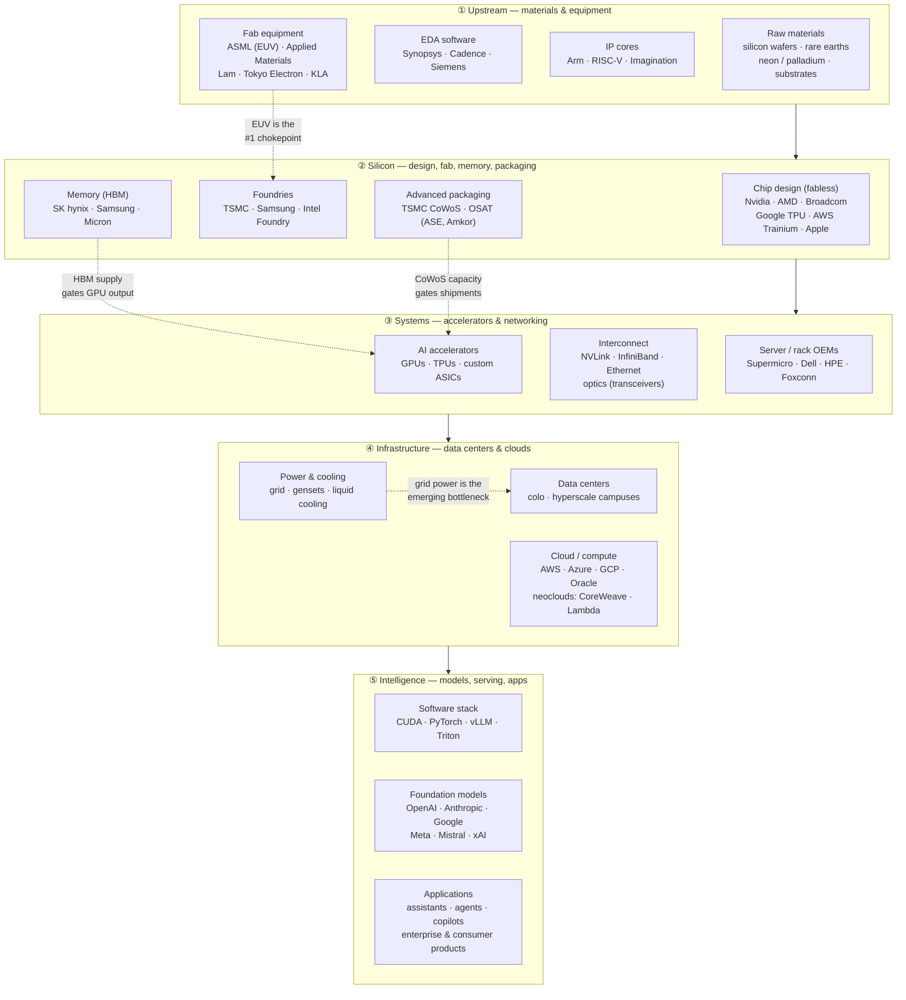
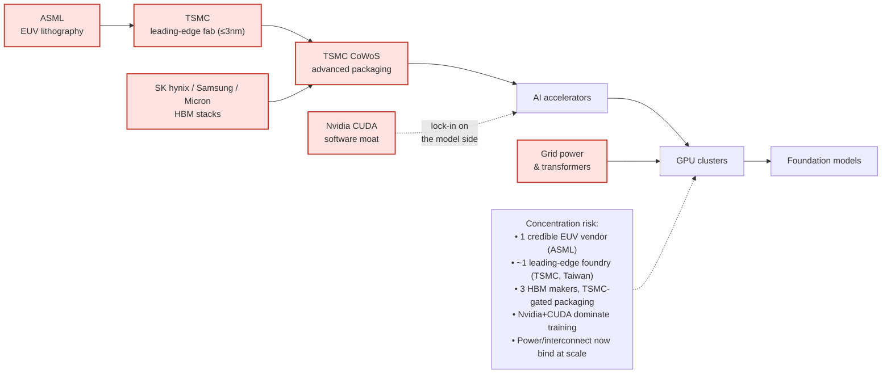
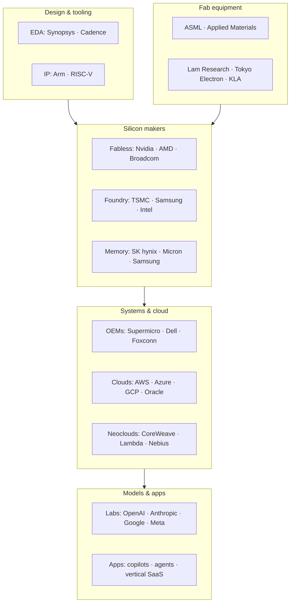

# AI supply chain — topology

A visual map of the global **AI supply chain**: everything that has to line up so a
prompt you type in a browser can be answered by a large model. Rendered with
[Mermaid](https://mermaid.js.org/) — GitHub renders these diagrams inline; in an
editor use a Mermaid preview extension.

The chain is best read **bottom-up**: raw materials and fab equipment sit at the
base, silicon and systems in the middle, and models and applications at the top.
Value (and margin) generally rises as you move up; **fragility** (single points of
failure) concentrates at the very bottom. The named companies are representative
leaders, not an exhaustive list.

- **Upstream** — materials, EDA software, IP, and the machines that make chips.
- **Silicon** — chip designers (fabless), foundries, memory, and packaging.
- **Systems** — accelerators assembled into servers, networked into clusters.
- **Infrastructure** — data centers, power, cooling, and the clouds that rent it.
- **Intelligence** — foundation models, the software stack that serves them, and
  the applications people actually use.

---

## 1. Full-stack topology (upstream → application)

The end-to-end flow. Each layer depends on the one below it; the dashed arrows on
the right call out the scarce inputs that gate the whole stack.

---

## 2. Chokepoints — where the chain is fragile

Most of the stack has multiple suppliers; a handful of nodes are effectively
sole-source or near-monopoly. These are the places a shock (export control, fire,
earthquake, capacity crunch) propagates through the whole industry.

---

## 3. Who plays where — the value chain map

The same players, grouped by the role they occupy. Some giants (Nvidia, Google,
Amazon, Microsoft) are **vertically integrated** and appear implicitly at several
layers — that integration is itself a strategic advantage.

---

## How to read this

- **Money flows up, risk pools down.** Application makers capture the most visible
  value, but a disruption at ASML or TSMC would stall every layer above them.
- **The bottleneck moves.** For years the binding constraint was leading-edge fab
  capacity; through 2024–2025 it shifted to **HBM memory** and **CoWoS packaging**,
  and increasingly to **data-center power** and grid interconnection.
- **Geography is destiny.** Leading-edge fabrication is concentrated in Taiwan and
  South Korea; EUV in the Netherlands. This concentration is why AI has become a
  geopolitical, not just a technical, topic (export controls, "chip acts", reshoring).
- **Software locks in hardware.** Nvidia's CUDA ecosystem is a supply-chain node in
  its own right: it makes the accelerator layer sticky even where alternatives exist.

---

_Created as a reference topology of the AI supply chain to aid understanding
(task #84). It is a conceptual map of the industry, not a description of this
dashboard's own architecture — for that, see [`architecture.md`](architecture.md).
Named companies are representative leaders as of 2025–2026 and may change._
