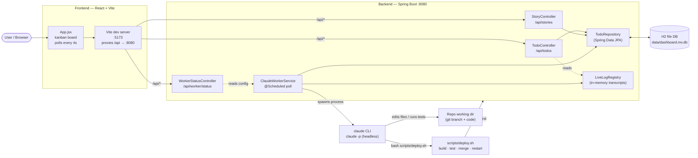
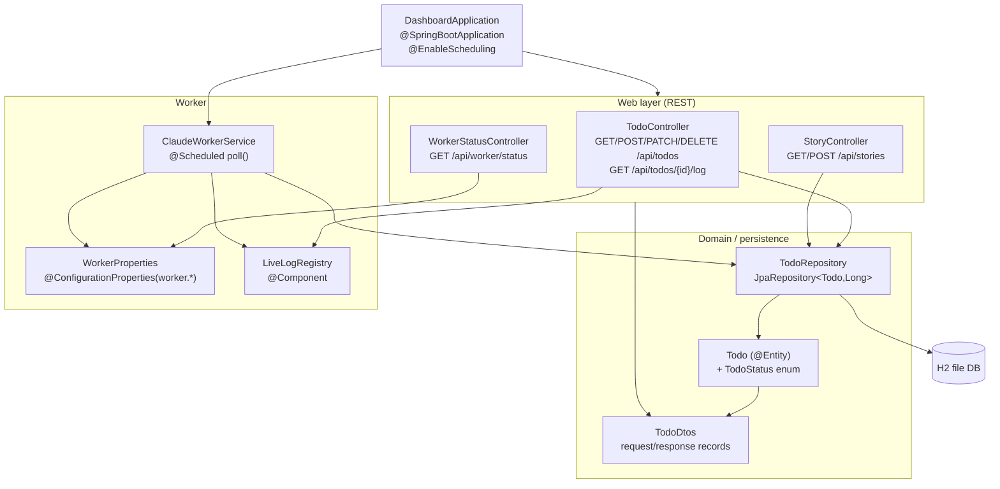
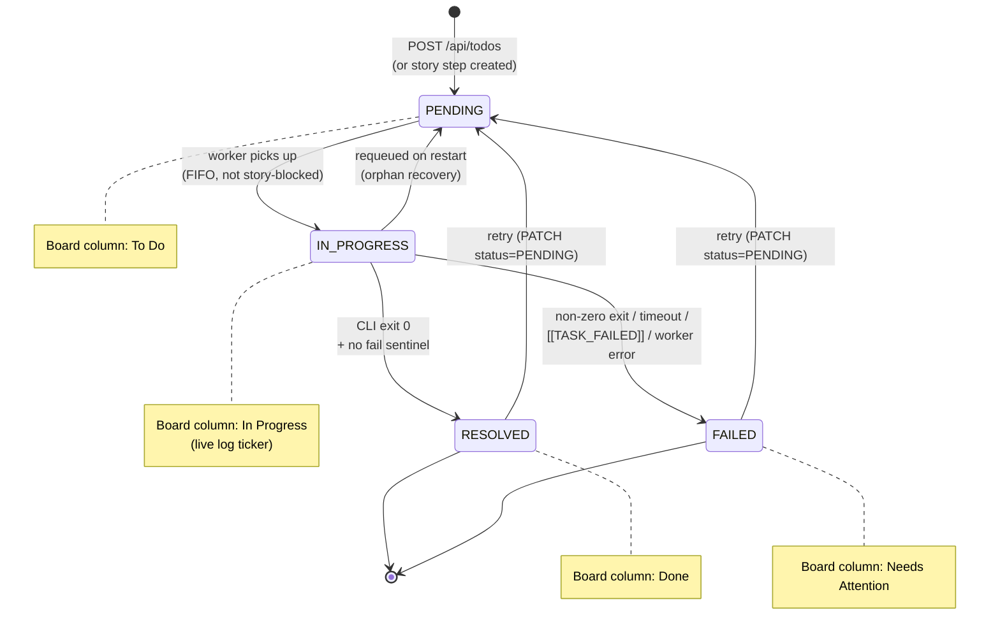
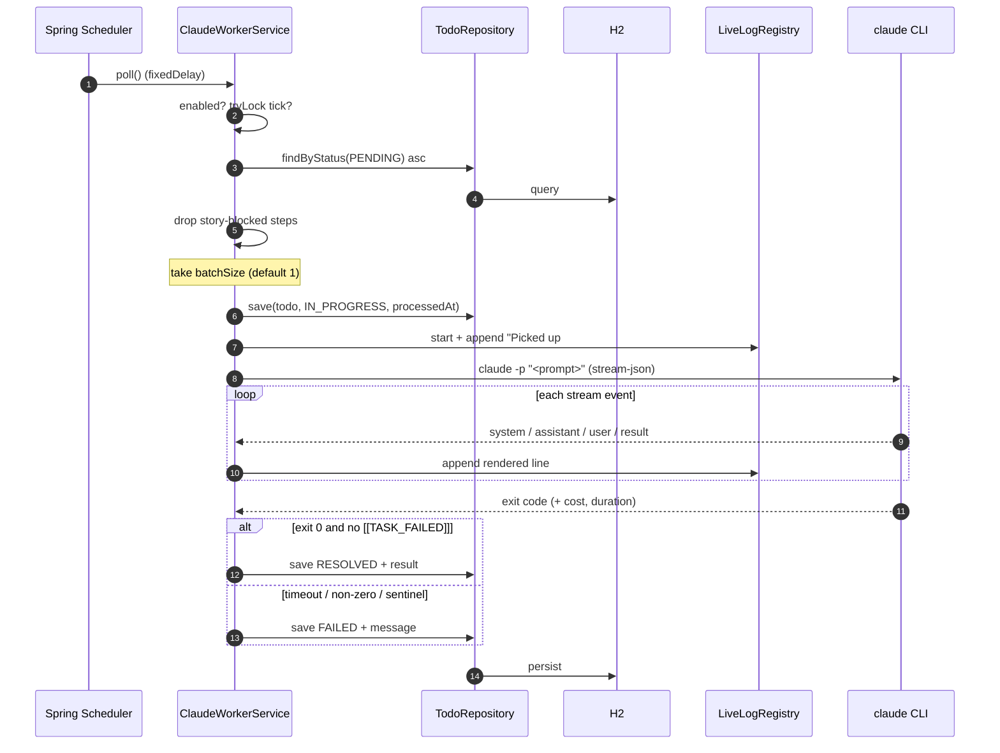
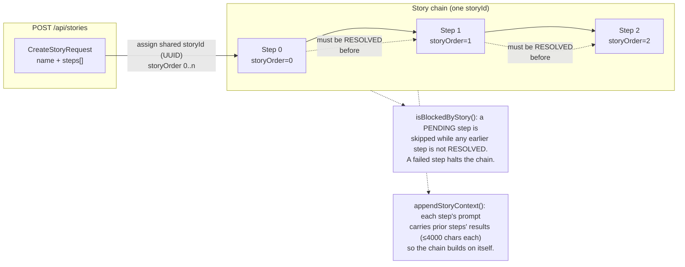
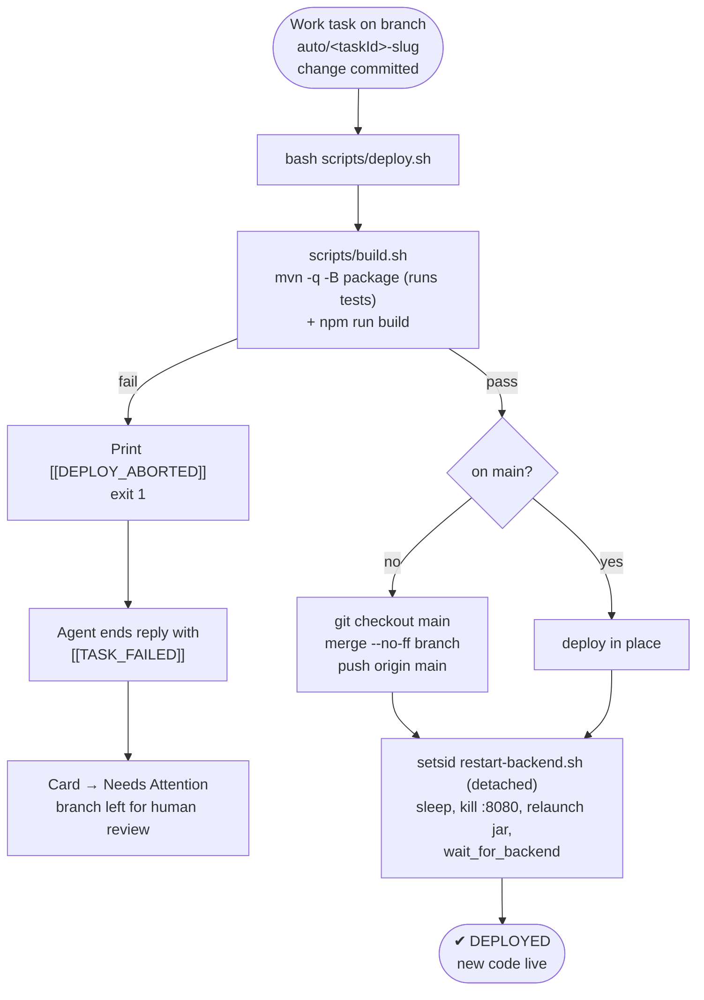

# Dashboard architecture — topology

A visual map of how the Claude Code Dashboard is put together, rendered with
[Mermaid](https://mermaid.js.org/). GitHub renders these diagrams inline; in an
editor use a Mermaid preview extension.

The app is a kanban board where you create **todo items** and a scheduled
**Claude Code session** picks them up, resolves them, and writes the result
back. A todo flows `PENDING → IN_PROGRESS → RESOLVED` (or `FAILED`).

- **Frontend** — React + Vite kanban board (`frontend/`).
- **Backend** — Java 21 + Spring Boot: REST API, H2 file store, a `@Scheduled`
  worker (`backend/`).
- **Worker** — shells out to the `claude` CLI (`-p` / headless) one todo at a
  time and records what the session produced.
- **Deploy** — work tasks commit on a branch and call the guarded
  `scripts/deploy.sh`, which only merges + restarts if the build and tests pass.

---

## 1. System topology (runtime)

How the running pieces talk to each other and where state lives.

---

## 2. Backend components

Spring beans and how they wire together.

---

## 3. Todo lifecycle (state machine)

The status a card carries as it flows left→right across the board columns
**To Do → In Progress → Done → Needs Attention**.

---

## 4. Worker poll cycle

What one `@Scheduled` tick does (default: every 15s in `application.yml`,
overridden to 5s by the run scripts).

---

## 5. Stories — sequential task chains

A **story** is a named, ordered chain of tasks. Each step is a normal todo
tagged with a shared `storyId` and a `storyOrder`; the worker runs them one at
a time and only starts a step once every earlier step is `RESOLVED`.

---

## 6. Guarded deploy flow

How a **work task** ships a change. The test gate means broken code can never
reach the running app.

---

## 7. REST API surface

| Method | Path | Purpose |
| ------ | ---- | ------- |
| `GET` | `/api/todos` | List all todos, newest first |
| `GET` | `/api/todos/{id}` | Get one todo |
| `GET` | `/api/todos/{id}/log` | Live session transcript for a todo |
| `POST` | `/api/todos` | Create a todo (→ `PENDING`) |
| `PATCH` | `/api/todos/{id}` | Update status/result (worker + UI retry) |
| `DELETE` | `/api/todos/{id}` | Delete a todo (and clear its live log) |
| `GET` | `/api/stories` | List stories with ordered steps |
| `POST` | `/api/stories` | Create a story (named ordered chain) |
| `GET` | `/api/worker/status` | Worker config (enabled, interval, batch, timeout) |
| `GET` | `/h2-console` | H2 database web console |

---

_Generated as documentation of the current design (task #81). Source of truth
remains the code under `backend/` and `frontend/`._
