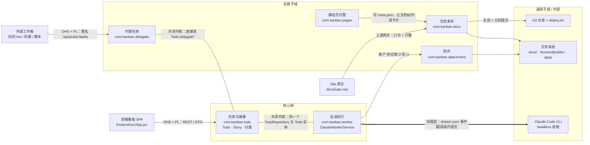
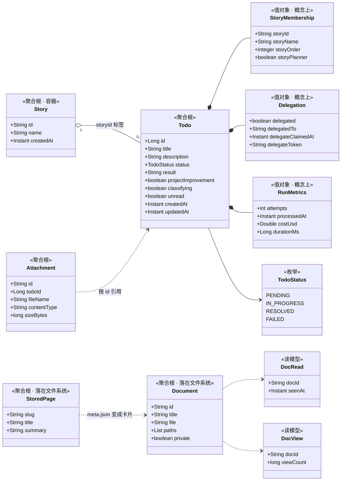
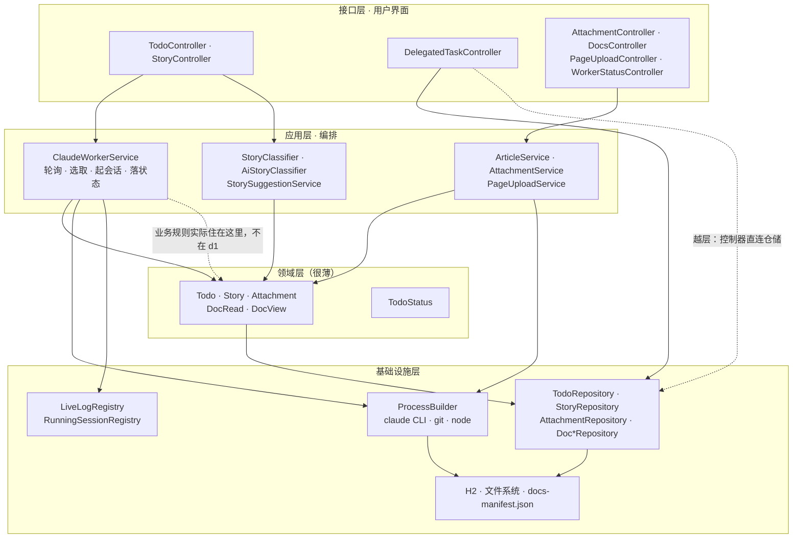

# 三张 DDD 图：这个看板的上下文、模型与分层

三张图分别回答三个问题：**系统被切成了哪几块、每块之间是什么关系**（上下文映射）、
**领域里到底有哪些东西、谁管谁的一致性**（领域模型 / 聚合）、
**规则住在哪一层**（分层与依赖方向）。

图是**照着代码画的，不是照着理想画的**。所以三张图里都标了「代码实际长什么样」和
「DDD 上本该长什么样」的差距 —— 那些差距才是这三张图的价值，图本身只是把它们摆到一起。
所有结论都能在 `backend/src/main/java/com/kanban/**` 里按行号核对。

---

## 图一 · 限界上下文映射（Context Map）

| 上下文 | 包 | 它拥有什么 | 与核心的关系 |
|---|---|---|---|
| 任务与故事 | `todo` | `Todo`、`Story`、快/慢两道归类 | 核心域本身 |
| 会话执行 | `worker` | 轮询、起进程、live log、会话句柄 | 共享内核（同一实体、同一仓储） |
| 代理任务 | `delegate` | 匿名认领 / 回报 | 共享内核 + 对外 OHS |
| 附件 | `attachment` | 文件 + 元数据行 | 客户-供应商（worker 是客户） |
| 文档发布 | `docs` | Markdown 源、生成页、阅读/浏览计数 | 独立，只共享文件系统 |
| 静态页托管 | `pages` | `/p/<slug>.html` + meta 边车 | 文档站的供应商 |

**三点观察。**

1. **全系统只有一处真正的防腐层**：`ClaudeWorkerService.runClaude` (:444) 起 CLI 进程，
   `renderEvent` (:532) 把 `stream-json` 的事件流翻成「一行日志 + 一个结果 + 一份成本」。
   外部模型的形状没有渗进 `Todo` —— 这是这张图上最健康的一条边。
2. **代理任务在图上是一块，在代码里不是。** `DelegatedTaskController` 直接注入
   `TodoRepository`，`claim` (:122) / `report` (:158) 直接读写 `Todo` 的 `delegate*` 字段，
   没有自己的模型也没有翻译层。它是共享内核，只有**对外那一面**（`DelegatedTaskView`
   + 令牌）才是真的开放主机 + 公共语言。想让它独立，得先给它自己的模型。
3. **文档上下文的"数据库"是文件系统加 git，数据库里只有读侧。** `docs-manifest.json`
   持有文档身份，正文在 `docs/*.md`，`DocRead` / `DocView` 只是两张投影表。
   这条边界一旦忘了，就会出现"删掉的文档又回来"（任务 #463）——
   所以 `DocsController.create` (:117) 和 `delete` (:282) 都必须在改完磁盘后
   立刻 `DocsGitCommitter.commitPaths` (:76) 补一次提交。仓储是 git，就得按 git 的规矩落盘。

---

## 图二 · 领域模型与聚合

**Todo 的生命周期**（`TodoStatus` 的四个值，以及谁有权推动它）：

| 迁移 | 谁触发 | 代码位置 |
|---|---|---|
| 无 → `PENDING` | 用户建卡 / 故事加步骤 / 计划器拆解 | `TodoController.create` (:117)、`StoryController.addStep` (:195) |
| `PENDING` → `IN_PROGRESS` | worker 轮询选中（本机）；或外部认领（代理） | `ClaudeWorkerService.process` (:224)、`DelegatedTaskController.claim` (:122) |
| `IN_PROGRESS` → `RESOLVED` | 会话正常结束且没有失败哨兵 | `process` (:224) |
| `IN_PROGRESS` → `FAILED` | 超时 / 非零退出 / `[[TASK_FAILED]]` / 用户停止 / 超过重试上限 | `fail` (:288)、`requeueOrphans` (:95) |
| 任意 → `PENDING` | 用户在板上拖回 To Do；代理任务被交还（同时清掉认领） | `updateStatus` (:166)、`report` (:158) |
| `RESOLVED`/`FAILED` → 新的一张 `PENDING` 卡 | 「重跑」是**复制**，原卡原样保留 | `TodoController.rerun` (:212) |

**四点观察。**

1. **`Story` 不是 `Todo` 的聚合根。** `storyId` 只是贴在每张卡上的标签，
   没有外键、没有集合、加载一个 story 是 `findByStoryIdOrderByStoryOrderAsc` 查出来的。
   但删除是级联的（`StoryController.delete` :224 连卡一起删），
   顺序不变式（一步没 RESOLVED，后面的步不许跑）由 `ClaudeWorkerService.isBlockedByStory` (:208)
   在**运行时**保证。也就是说：**真实的一致性边界存在，但它不在聚合根上，画不进类图。**
2. **`Todo` 上摊平了四组概念值对象**（图里已拆开：故事归属、代理、运行指标，
   外加一组 UI 标志）。22 个字段里有 12 个属于这三组，而一张卡通常只用得到其中一组 ——
   代理任务永远用不到 `attempts`，本机任务永远用不到 `delegateToken`。
   这是典型的"一张宽表承载多个概念"，也是这张图上最该动刀的地方。
3. **`Attachment` 是唯一一个跨聚合引用做对了的地方**：它按 `todoId` 引用，
   不持有 `Todo` 对象（`Attachment.java` 的 `todoId` 允许为 null，
   因为上传发生在任务存在之前）。这正是 DDD 推荐的"聚合之间只按 id 引用"。
4. **`LiveLogRegistry` / `RunningSessionRegistry` 不在图里，是故意的。**
   它们是内存里的进程态（日志环、`Process` 句柄），进程一死就没了 ——
   属于基础设施，不属于领域。把它们画成实体会误导人以为重启后还在。

---

## 图三 · 分层与依赖方向

**领域层是贫血的**：`Todo` 和 `Story` 只有 getter/setter 加两个 `@PrePersist`，
一条业务规则都没有。规则全部住在应用层和接口层：

| 不变式 / 规则 | 实际位置 | 本该在哪 |
|---|---|---|
| 故事的步骤必须按序执行 | `ClaudeWorkerService.isBlockedByStory` (:208) | `Story` 上的方法 |
| 代理任务本机永不执行 | `ClaudeWorkerService.isEligible` (:198) | `Todo.isRunnableHere()` |
| 重跑上限 2 次后转 Needs Attention | `requeueOrphans` (:95) + `WorkerProperties.maxAttempts` | `Todo.canRetry()` |
| 认领后只有持令牌者能回报 | `DelegatedTaskController.requireToken` | `Todo.reportBy(token, …)` |
| 终态才点亮未读徽标 | 在 `TodoController.updateStatus` (:166) 和 `report` (:158) **各写了一遍** | `Todo.transitionTo(status)` |

最后一行是这张图最实在的产出：**同一条规则在两个地方各实现了一次**，
两处的注释都写着"和另一处保持一致"。这正是贫血模型的代价 ——
一致性靠人记，不靠编译器。

**三条最低成本的收敛（按性价比排序，本次没有实施）：**

1. 把状态迁移 + 未读徽标收进 `Todo.transitionTo(TodoStatus)`，消掉那份重复实现。
2. 把 `isEligible` / `isBlockedByStory` 提成 `Story.nextRunnableStep(steps)` ——
   顺序不变式回到它该在的对象上，worker 只负责"问一下，然后跑"。
3. 给代理任务一个自己的模型（哪怕只是 `Todo` 上的一个 `@Embeddable Delegation`），
   让宽表里那 12 个条件字段先分成组。

三条都是纯重构、可分别上线、有测试兜底（`ClaudeWorkerServiceTest`、`TodoApiTest`、
`DelegatedTaskApiTest` 已经覆盖到上面每一条规则的行为面）。

---

## 附：图与代码的对照

| 图 | 主要依据 |
|---|---|
| 上下文映射 | `com.kanban.{todo,worker,delegate,attachment,docs,pages}` 六个包的依赖方向；`frontend/docsGate.mjs` |
| 领域模型 | `Todo.java`、`Story.java`、`TodoStatus.java`、`Attachment.java`、`DocRead.java`、`DocView.java`、`docs-manifest.json` 的条目结构 |
| 分层 | 各 `*Controller` 的注入参数；`ClaudeWorkerService`、`ArticleService`、`AttachmentService`、`PageUploadService` |

本页只画图和读代码，没有改动任何应用代码，也没有部署或重启。
