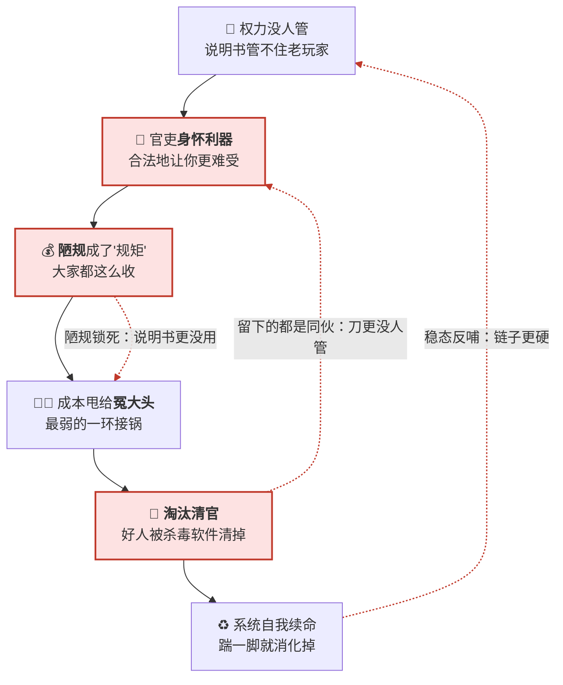

# 潜规则·好玩版：一句话能转发的中国官场生存游戏

> 这是《潜规则》的**好玩版 / 传播版**。姊妹篇是一本正经的学术分析
> [《潜规则：中国历史中的真实游戏》— 分析文档](./qianguize-wusi.md)——想要博弈矩阵、
> 反馈回路、诺斯谱系的，去那边；想要**看得笑出声、转得出去、还真能记住**的，留在这页。
>
> **一个诚实的自白**：要把一本讲「潜规则」的书传出去，我得先**迎合"传播"的潜规则**——
> 标题要炸、要有金句、要能对号入座、要短到能截图。这本身就是个绝妙的黑色笑话：
> **连反对潜规则，都得先向潜规则低头。** 所以这一页，是"用潜规则的玩法，讲潜规则"。
> （放心，结尾会把这层反讽收回来——看清游戏，不是为了入伙，是为了改规则。）

> **来源与时效**：底本仍是吴思《潜规则：中国历史中的真实游戏》(云南人民出版社 2001)。
> 本页是**通俗再创作**，为了好读好传，用了大量现代类比、表情符号和网络语——但每个"梗"
> 背后的机制都对得上原书与姊妹篇的严肃分析，没有为了段子牺牲准确。成文 2026-07-18。

---

## 1. 三十秒看懂：如果古代官场是一款游戏

想象你打开一款叫《大明王朝：生存模拟》的游戏。屏幕上写着**规则说明书**（王法、律例、
圣贤教诲），你照着玩，几分钟就死了。老玩家凑过来低声说一句：

> **"说明书是给外人看的。真正怎么通关，得看**没写出来那套**。"**

那套"没写出来、不能明说、但人人都在用"的通关攻略，吴思给它起了个名字——**潜规则**。
全书就一个扎心的问题：

> ❓ 为什么白纸黑字的规矩，常常不是真正管用的规矩？

这游戏有 **4 个玩家**，一条**从上往下发号施令、从下往上供奉血汗**的链子：

| 角色 | 通俗身份 | 一句话人设 |
| --- | --- | --- |
| 👑 皇帝 | 大老板 / 平台方 | 想要江山稳、税收足，但**看不见基层真相**，只能听汇报 |
| 🎩 官僚 | 中层管理 | 对上邀功、对下捞油水，两头通吃的"翻译官" |
| 🧾 胥吏 | 办事窗口 / 经手人 | 不入品级，却卡着盖章、收钱、打官司的**闸门**——刀最多的一层 |
| 🧑‍🌾 百姓 | 终端用户 / 打工人 | 链子最末端，**所有成本的最终接盘侠**，人称"冤大头" |

记住这条链，下面的"黑话"全挂在它上面。

---

## 2. 六个黑话，六张转发卡

《潜规则》最出圈的，是几个自造词。它们之所以能进日常语，是因为**一戳就懂、一记就忘不掉**。
下面每个配一句**能直接截图转发的话**（👉）和一个**现代对号入座场景**（🎯）。

### 2.1 合法伤害权 —— 这游戏的"发动机"

手里那把能**合法地**让你更难受的刀。同一条规矩，快办是恩、拖办是罚；从宽是情、从严是刑——
**全在规则允许的范围内**。所以持刀人根本不用违法，只要把"松紧的旋钮"攥在手里，就能开价。

> 👉 **"我不用害你，我只要'按规矩办'——但按哪版规矩，我说了算。"**

> 🎯 审批、合规、风控、采购这些岗位的"看心情办事"：能快能慢、能严能松的自由裁量，
> 一旦没人监督，就成了收"辛苦费"的旋钮。

吴思还有句更狠的：**「身怀利器，杀心自起」**——刀带在身上，哪怕你本来是好人，环境也会
一直撺掇你拔一下，因为**不拔白不拔，拔了几乎没代价**。

### 2.2 陋规 —— "大家都这样"的收费站

常例、部费、火耗……这些没写进任何律条、却"代代都这么收"的灰色费用。它顽固，不是因为
某个人贪，而是因为它是**一张早就织好、上下都分钱的网**。

> 👉 **"它不合法，但它'合规矩'——而规矩比法律更难改。"**

> 🎯 部门之间"心照不宣"的好处输送、供应商的"公关费"、"会来事"才能推进的灰色惯例。

### 2.3 淘汰清官机制 —— 系统自带的"杀毒软件"，专杀好人

系统会**主动**把不肯同流的清官边缘化、穿小鞋、构陷出局。因为一个不收钱的人，会**打破
整条链的分账**：底下胥吏没法运转、同僚分成泡汤、上司孝敬断供——于是全体把你标记为"病毒"，
一起清除。

> 👉 **"劣币驱逐良币，不是意外，是这套系统的**杀毒功能**——它杀的是好人。"**

> 🎯 走正规流程、拒绝同流、爱说真话的人被说成"不合群""情商低",慢慢被架空。海瑞式的清官
> 之所以成"奇观"而不是常态，恰恰证明了这套杀毒软件多好用。

### 2.4 老百姓是个冤大头 —— 击鼓传"锅"的最后一棒

成本一层一层往下甩：官僚甩给胥吏，胥吏甩给纳税人，而百姓**下面没有更弱的一层可以再甩了**。
谁最没有议价权，谁就接最后一棒。

> 👉 **"这局的钱，最后总由**最没法拒绝**的那个人买单。"**

> 🎯 层层加码后，代价压到一线员工、小供应商、终端消费者头上——他们既走不掉（没退路），
> 也喊不动（一个人抗争成本极高，忍反而"最划算"）。

### 2.5 第二等公平 —— 花钱买一个"至少别再坑我"

最精妙的一个词。你本该**免费**得到公正（第一等公平），但拿不到；于是你退而求其次——
**花钱买一个"至少不被额外整"的相对公道**。行贿不是为了占便宜，是为了**赎回本就该属于你的公正**。

> 👉 **"我送礼不是想多拿，是求你**别专门针对我**。"**

> 🎯 明明该无偿办的事，还得"打点""找关系"才能正常推进——而且一旦**别人都在送**，你不送
> 就会被精准慢办。于是"人人送礼"成了谁也退不出的稳定局面。

### 2.6 崇祯死弯 —— 越努力，翻车越快

全书最重的一个案例：一个**罕见勤政**的皇帝，越拼命越快把王朝开下悬崖。

机制是个**死循环**：打仗缺钱 → 加税（辽饷·剿饷·练饷"三饷"）→ 钱得经过"身怀利器"的官吏
落地，被**层层加码**（正税加一分，附加加十分）→ 百姓破产、逃亡、造反 → 要更多军费镇压 →
**只能再加税** …… 越拉越紧。

> 👉 **"当中间那层是坏的，老板越使劲，基层越遭殃——**勤政本身成了加速器**。"**

> 🎯 高层善意的"整改/加压"被执行层反向放大成基层灾难：层层加码、一刀切、数字造假。
> 这就是为什么"换个好领导"经常不管用——**坏的是那套传导结构，不是顶上那个人**。

---

## 3. 为什么"聪明人"集体做蠢事？——一句话版博弈论

看到这你可能想问：这么明显的坑，大家都不傻，怎么就没人跳出来？

因为**每个人单独看，都在做对自己最划算的事**：

- 冤大头**忍** → 因为一个人抗争，成本集中在你头上，收益分给所有人 → 忍最划算。
- 求人者**送礼** → 因为别人都送，你不送就被针对 → 送最划算。
- 新官**随俗** → 因为独自清廉会被系统清除 → 随俗最划算。
- 勤政皇帝**加税** → 因为不加就没军费 → 加税最"合理"。

**每一步都是理性的最优反应，加在一起却是一个人人受损、谁也退不出的坏结局。**
这就是《潜规则》最反直觉、也最有分量的一句话：

> 🔥 **坏结果，不需要坏人。**

坏的不是谁的人品，是**那套约束结构**。（想看完整的收益矩阵、纳什均衡、囚徒困境推导？
去[姊妹篇第 6 节](./qianguize-wusi.md#6-深度分析机制与案例)。）

---

## 4. 一张图：这局游戏的"通关地图"

把上面的黑话串成一条链——这就是潜规则**自我续命**的秘密：它有**正反馈**，你踹它一脚
（换个清官、发道禁令），它转头就把这脚消化掉。

> 红色虚线就是"续命回路"：**越运转越稳固**。这解释了为什么**单点整顿几乎总是失败**——
> 你只换了个人，没动那条链。

---

## 5. 潜规则自测：你的公司/小区/群，中了几条？

《潜规则》不只是历史书。它三个核心概念——**合法伤害权、陋规、淘汰清官**——跟朝代无关，
凡是**「有裁量权 + 没人制衡 + 信息不透明」**的组织，都会长出来。给你一份**7 题快测**，
命中越多，潜规则味越浓（👉 这一节最适合截图发工作群，你懂的）：

1. **裁量集中**——关键环节有没有"能合法地让你更糟"的单点权力，而且**没人复核**？
2. **制衡缺失**——受害的人有没有**低成本**的投诉 / 退出 / 曝光渠道？（如果"投诉得经过被投诉的
   那批人"，等于没有。）
3. **信息不透明**——上面能**绕过中间层**看到真相吗？还是只能听层层美化的汇报？
4. **激励错配**——考核奖励的是"对上好看"还是"对下办实事"？
5. **不成文规矩**——有没有那种"大家都懂、但不能写进制度、一说破就翻脸"的做法？（这是潜规则
   最直接的**指纹**。）
6. **谁说真话谁倒霉**——合规的、举报的、走正规流程的，是被保护还是被排挤？
7. **锅往哪甩**——出了事，代价最后落在**最有权的人**还是**最没议价权的人**头上？

命中 4 条以上？恭喜，你身处一个**成熟的潜规则生态**。好消息在下一节。

---

## 6. 结尾：把那层反讽收回来

开头我坦白：为了传播这本反潜规则的书，我先**迎合了传播的潜规则**——炸标题、金句、表情包、
对号入座。这确实是"用魔法打败魔法"。但如果你只记住"看透了、所以我也照着玩"，那就**彻底读反了**。

吴思说"坏结果不需要坏人"，**不是**给同流合污发许可证。它是一份**结构诊断书**：既然坏的是
结构，那么——

> 🛠️ **既然是结构决定的，改造结构就能改变结果。**

怎么改？跟那份自测清单一一对应：**给裁量权装上独立制衡、给受害方留出低成本的申诉与退出、
把信息和考核从执行层手里解耦。** 这也是为什么"换个清官"（只换人）总失败，而**透明、问责、
外部监督**（改结构）才可能真正挪动那个坏均衡。

所以读《潜规则》的正确姿势，一句话能转发：

> ✅ **看清这局游戏，不是为了入伙，是为了改规则。**

---

*想要严肃、完整、带学术谱系与批判边界的版本？→ [《潜规则》分析文档（学术版）](./qianguize-wusi.md)*
