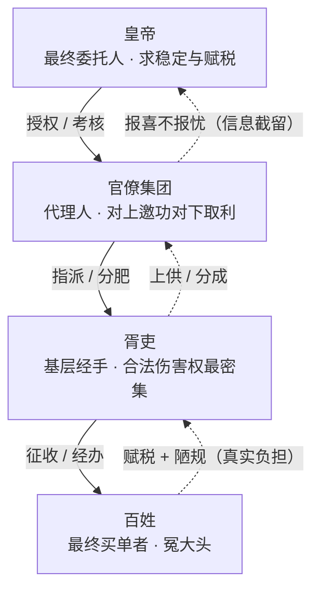
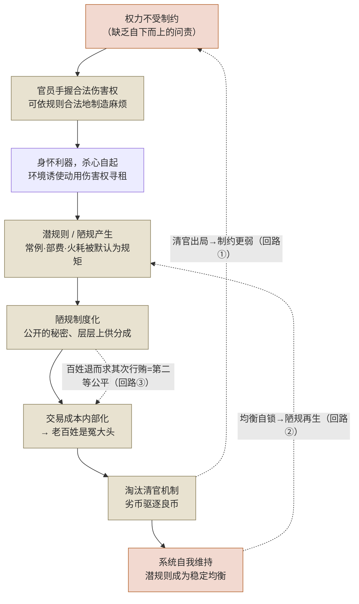
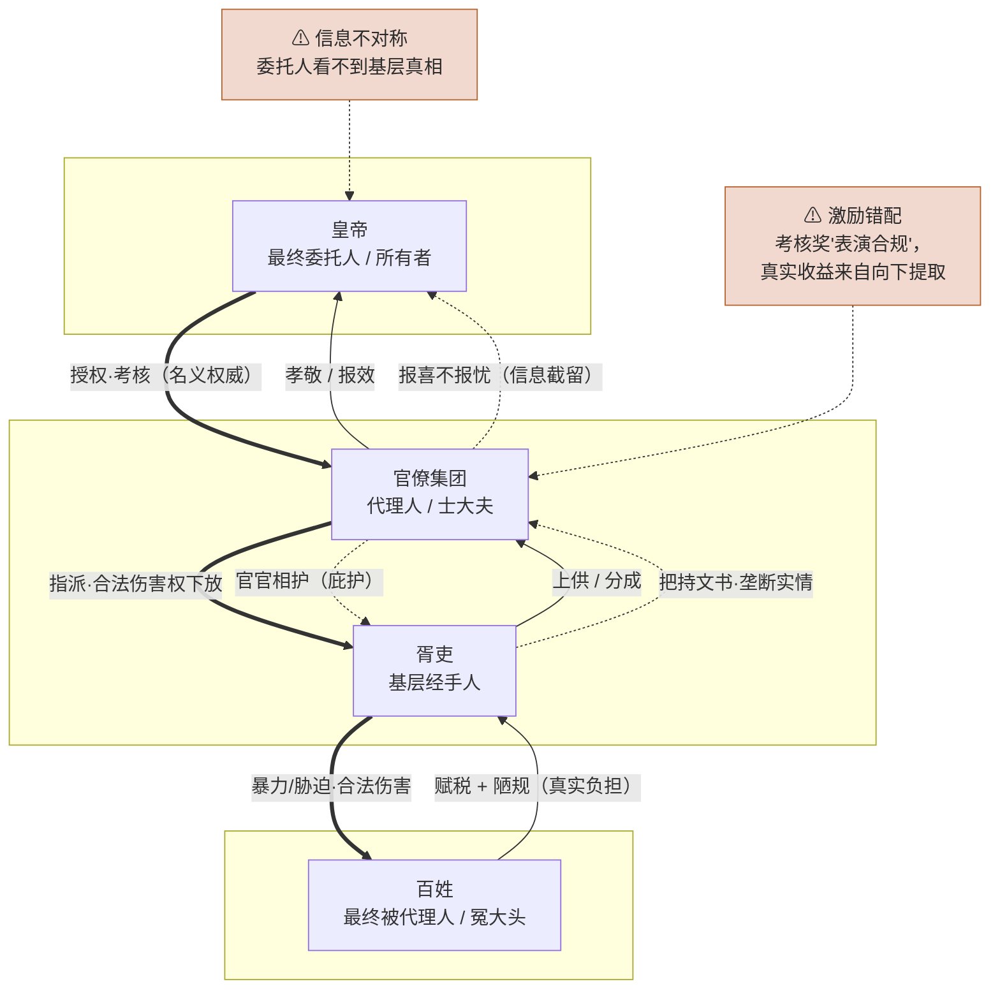
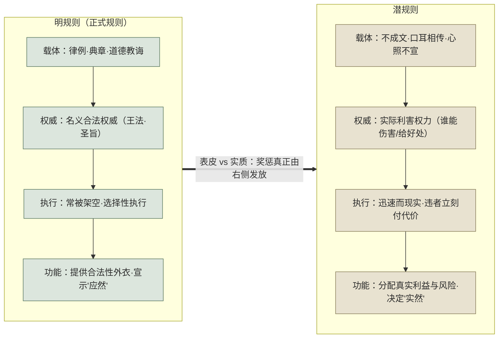

# 潜规则：中国历史中的真实游戏 — 分析文档

对吴思《潜规则：中国历史中的真实游戏》(2001) 的系统性梳理与再分析。本文档是整篇分析的
**主文档**，走标准文档管线渲染为网页。全篇计划分四步搭建：第 1 步搭骨架
与核心概念（引言、核心定义、角色/委托代理链、术语表），**第 2 步（本次）新增「逻辑关系图」
一节**把全书逻辑显性化为三张 Mermaid 图，深度机制分析与批判讨论留给第 3–4 步。

> **来源与时效**：底本为吴思《潜规则：中国历史中的真实游戏》，云南人民出版社 2001 年初版
> （后有多个修订与合集版本，如《潜规则》《血酬定律》并行流传）。本文档为读书分析，
> 引用的历史案例以吴思原书为准；成文于 2026-07-18（第 1 步骨架），第 2 步已补入「逻辑关系图」
> 一节（三张 Mermaid 图），案例考订与批判性讨论留待后续步骤。

---

## 1. 引言：写作背景与问题意识

《潜规则》成书于世纪之交，吴思以记者与历史编辑的身份，长期浸泡在明清史料——尤其是
《明史》、官员笔记、奏折与判牍——之中。他关心的不是正史里写明的典章制度，而是一个更
朴素、也更尖锐的问题：

> 为什么白纸黑字的**正式规则**（王法、律例、圣贤教诲）常常不是真正起作用的规则？在
> 它们背后，是否存在另一套"不成文、不能明说、却被所有人默认遵守"的规则？

吴思把后者命名为**「潜规则」**。这个词由本书首创，此后进入汉语日常语汇。全书的方法论
特征是**从个案反推通则**：他不先立框架再找例证，而是从一桩桩具体的贪贿、陋规、清官
遭遇里，抽象出反复出现的行为模式，再给这些模式起名字（合法伤害权、陋规、血酬……）。

问题意识可概括为三层：

1. **描述层**——真实运转的规则到底是什么？（不是"应该怎样"，而是"实际怎样"）
2. **机制层**——这套潜规则靠什么力量维持自身、并淘汰不合作者？
3. **代价层**——谁为这套系统买单？收益与伤害如何在皇帝、官僚、胥吏、百姓之间分配？

本文档后续各步将分别沿这三层展开。

---

## 2. 核心定义：什么是「潜规则」

**潜规则**，指在正式规则之外、私下里实际支配着人们行为的**不成文规矩**。它不见于律条，
却被参与各方心照不宣地遵守；违反潜规则者，往往比违反明规则者受到更迅速、更现实的惩罚。

与**正式规则 / 明规则**的区别，可以从几个维度对照：

| 维度 | 正式规则（明规则） | 潜规则 |
| --- | --- | --- |
| 载体 | 律例、典章、公开的道德教诲 | 不成文、口耳相传、心照不宣 |
| 可言说性 | 可公开援引、写进文书 | 不能明说，一旦点破即失效或反噬 |
| 权威来源 | 名义上的合法权威（王法、圣旨） | 实际的利害权力（谁能伤害你、谁能给你好处） |
| 执行力 | 常被架空、选择性执行 | 执行迅速而现实，违者立刻付出代价 |
| 功能 | 提供合法性外衣、宣示"应然" | 分配真实的利益与风险、决定"实然" |

吴思的关键洞见是：**潜规则并非明规则的"腐败偏离"，而是一套自成体系、可自我维持的秩序。**
明规则提供合法性的**表皮**，潜规则处理利益的**实质**；两者长期并存，构成"官场的真实游戏"。
正因如此，单纯呼吁"遵守明规则"往往无效——因为真正给参与者发奖惩的是潜规则那一套。

---

## 3. 参与者与角色：皇帝—官僚—胥吏—百姓的委托代理链

潜规则运转在一条**层层委托、层层代理**的权力链条上。名义上，权力自上而下授予、责任
自下而上负责；实际上，每一层都对上"表演合规"、对下"提取利益"，信息与利害在层与层之间
被不断截留、扭曲。

四类核心角色：

- **皇帝（最终委托人 / 所有者）**——名义上拥有天下，追求江山稳固与赋税充盈，却受制于
  信息不对称：他看不到基层真相，只能通过官僚体系间接治理。
- **官僚集团（代理人 / 士大夫）**——受皇帝委托治理地方，一面向上考绩邀功，一面向下
  经营自己的利益网络；是明规则与潜规则的主要"翻译者"。
- **胥吏（基层执行者 / 经手人）**——不入品级却把持文书、征收、诉讼等具体经办环节，
  是"合法伤害权"最密集的一层，陋规多由此而生。
- **百姓（最终被代理人 / 买单者）**——链条最末端，既是赋税与秩序的名义受益者，又是
  各层提取利益的最终承担者，即所谓"冤大头"。

下面先给出一张**链条速览图**，把四类角色的位置与"授权下行、利益上行"的骨架勾出来；
带有四种资源流向（信息 / 暴力 / 钱财 / 庇护）的**完整委托代理图**，以及全书的核心机制链，
见第 4 节「逻辑关系图」。

---

## 4. 逻辑关系图

本节把《潜规则》全书逻辑**显性化**为三张图：(1) **核心机制链**——潜规则如何产生、如何把
成本转嫁给百姓、又如何自我维持；(2) **角色关系 / 委托代理图**——四类角色之间信息、暴力、
钱财、庇护四种资源的流向，并标出信息不对称与激励错配的关键节点；(3) **明规则 vs 潜规则
对照**子图。图中节点尽量对应第 5 节术语表里的"发明词"，全部保持中文。

### 4.1 核心机制链（含反馈回路）

从"权力不受制约"这一初始条件出发，潜规则如何一步步生成、制度化，并通过淘汰清官把自己
锁死为稳定均衡。虚线为**反馈回路**：机制的产物反过来强化了它自身的前提。

> **反馈回路解读**：回路①——淘汰清官反过来削弱对权力的约束，使初始条件 A 更牢固；
> 回路②——系统一旦自锁，就持续再生新的陋规；回路③——百姓在得不到真公平时被迫按潜规则
> 行贿（"第二等公平"），这笔支出又坐实了"冤大头"的成本转嫁。三条回路叠加，令潜规则
> 成为**难以从内部打破**的自我维持结构。

### 4.2 角色关系 / 委托代理图（四种资源流向）

同一条委托代理链上，四类角色之间真正流动的是四种资源：**信息**（谁掌握真相）、**暴力**
（谁能合法伤害）、**钱财**（赋税与陋规往哪走）、**庇护**（谁替谁遮掩）。名义上的授权
自上而下，真实的利益却自下而上；错位就发生在流向不对称的地方。

> **关键失灵点**：⚠信息不对称——皇帝只能通过官僚间接获知基层，而官僚与胥吏恰好垄断
> 了信息，"报喜不报忧"使委托人无从核实；⚠激励错配——考核体系奖励的是"对上表演合规"，
> 而代理人的真实收益来自"对下提取利益"，于是明规则被架空、潜规则填补空位。两点叠加，
> 委托代理链在结构上偏向**利益上行、伤害下行**。

### 4.3 明规则 vs 潜规则（对照子图）

同一场"官场游戏"里，两套规则并行：明规则管**合法性的表皮**，潜规则管**利益的实质**。
下图把两者的载体、权威来源、执行力与功能并列对照——正因奖惩真正由右侧那套发放，单纯
呼吁"遵守明规则"才常常无效。

> 对照要点：两套规则不是"正常 vs 腐败"，而是**长期共存、各司其职**的两层秩序。明规则
> 负责合法性，潜规则负责真实分配；改革若只加固左侧而不触动右侧的利害结构，往往被潜规则
> 迅速吸收消解。

---

## 5. 核心概念术语表

全书反复出现的几个"发明词"，是理解潜规则机制的钥匙（第 4 节逻辑图中的节点即引用这些词）。
下表每个先给**一句话定义**，后续步骤会对每一条展开机制分析与案例。

| 术语 | 一句话定义 |
| --- | --- |
| **合法伤害权** | 官吏手中可依据某条规则"合法地"给他人制造麻烦或损害的权力——正因合法，才最好用来敲诈与寻租。 |
| **陋规** | 长期沿袭、公开的秘密式的非正式收费与馈送（如常例、部费、火耗），虽无律条依据却被默认为"规矩"。 |
| **淘汰清官机制** | 系统会系统性地排挤、边缘化乃至毁掉不肯同流的清廉官员，因为他们威胁到整条食利链的稳定。 |
| **身怀利器** | 手握合法伤害权的人"身上带着刀"，即便本无恶意，环境也会诱使其动用权力换取好处——"身怀利器，杀心自起"。 |
| **老百姓是冤大头** | 层层提取的成本最终转嫁到最无议价能力的百姓身上，他们为整套潜规则系统买最后的单。 |
| **第二等公平** | 在无法得到（明规则许诺的）真正公平时，人们退而求其次、按潜规则行贿以换取"至少不被额外坑害"的相对公道。 |

> 术语表在后续步骤中可能增补（如"血酬 / 血酬定律""潜流""正式规则的失灵"等相邻概念），
> 并与逻辑图交叉引用。

---

## 后续步骤（本文档规划）

- **第 2 步（已完成）**：新增第 4 节「逻辑关系图」——核心机制链（含反馈回路）、四资源流向的
  委托代理图、明规则 vs 潜规则对照，共三张 Mermaid 图。
- **第 3 步**：对术语表逐条展开**机制分析 + 明清案例**（合法伤害权、陋规、淘汰清官等）。
- **第 4 步**：批判性讨论与当代映射——潜规则框架的解释力、边界与争议。
