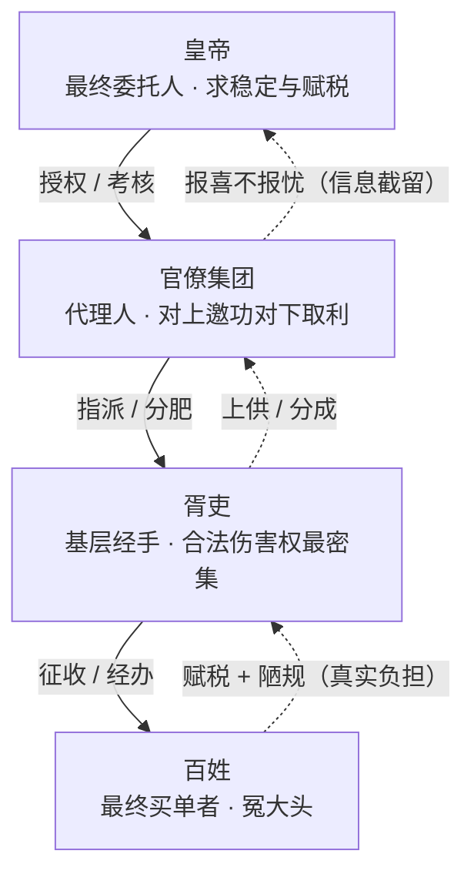
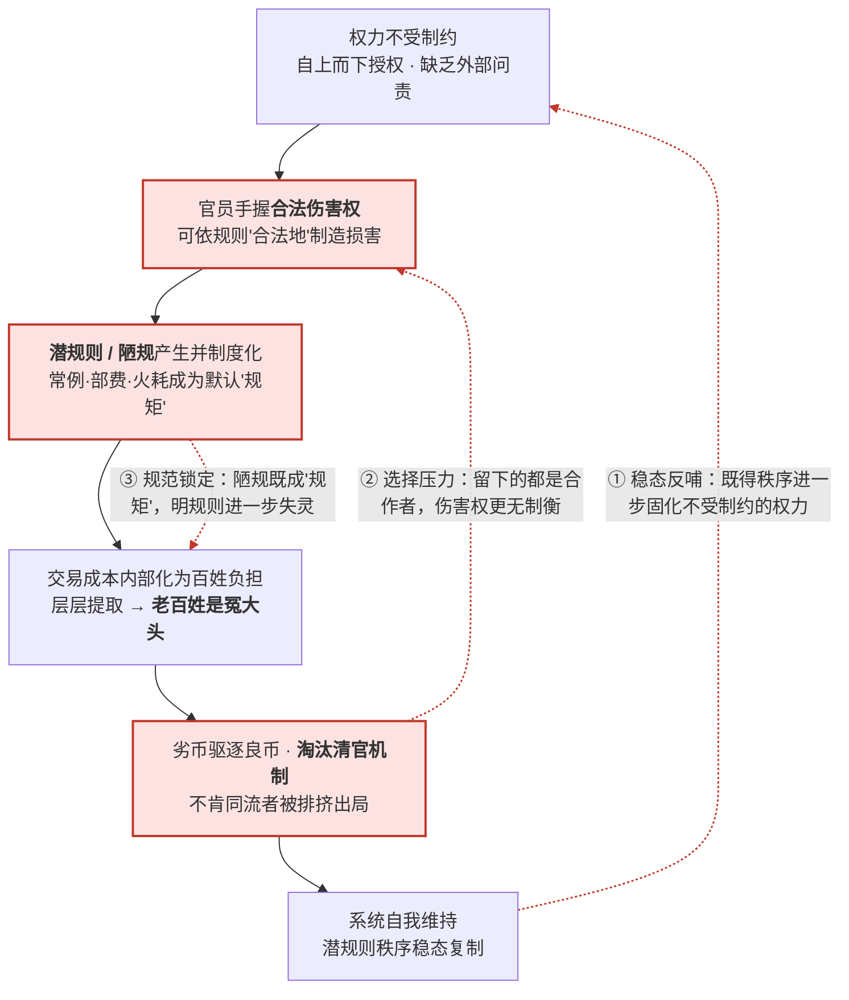
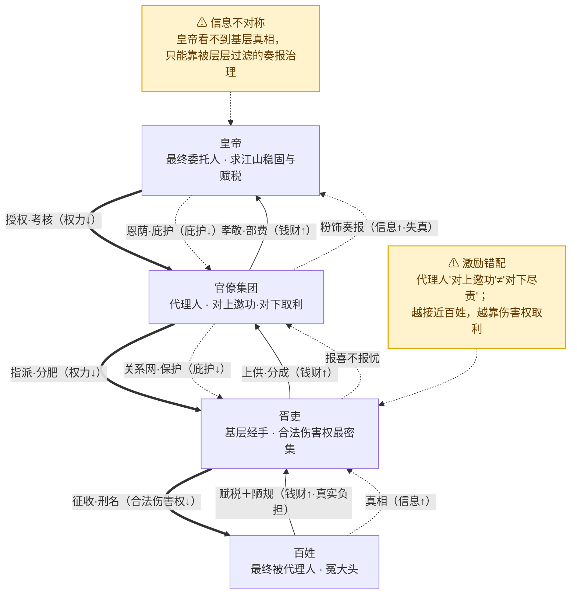
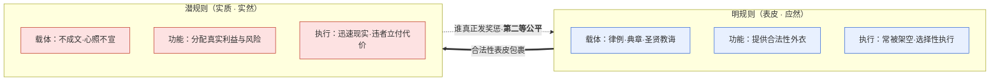

# 潜规则：中国历史中的真实游戏 — 分析文档

对吴思《潜规则：中国历史中的真实游戏》(2001) 的系统性梳理与再分析。本文档是整篇分析的
**主文档**，走标准文档管线渲染为网页。全篇计划分四步搭建：**本步 (第 1 步)** 只搭骨架
与核心概念——引言、核心定义、角色/委托代理链、术语表——**逻辑图与深度分析留给后续步骤**。

> **来源与时效**：底本为吴思《潜规则：中国历史中的真实游戏》，云南人民出版社 2001 年初版
> （后有多个修订与合集版本，如《潜规则》《血酬定律》并行流传）。本文档为读书分析，
> 引用的历史案例以吴思原书为准；成文于 2026-07-18，属第 1 步骨架稿，后续步骤会补充逻辑图、
> 案例考订与批判性讨论。

---

## 1. 引言：写作背景与问题意识

《潜规则》成书于世纪之交，吴思以记者与历史编辑的身份，长期浸泡在明清史料——尤其是
《明史》、官员笔记、奏折与判牍——之中。他关心的不是正史里写明的典章制度，而是一个更
朴素、也更尖锐的问题：

> 为什么白纸黑字的**正式规则**（王法、律例、圣贤教诲）常常不是真正起作用的规则？在
> 它们背后，是否存在另一套“不成文、不能明说、却被所有人默认遵守”的规则？

吴思把后者命名为**「潜规则」**。这个词由本书首创，此后进入汉语日常语汇。全书的方法论
特征是**从个案反推通则**：他不先立框架再找例证，而是从一桩桩具体的贪贿、陋规、清官
遭遇里，抽象出反复出现的行为模式，再给这些模式起名字（合法伤害权、陋规、血酬……）。

问题意识可概括为三层：

1. **描述层**——真实运转的规则到底是什么？（不是“应该怎样”，而是“实际怎样”）
2. **机制层**——这套潜规则靠什么力量维持自身、并淘汰不合作者？
3. **代价层**——谁为这套系统买单？收益与伤害如何在皇帝、官僚、胥吏、百姓之间分配？

本文档后续各步将分别沿这三层展开。

---

## 2. 核心定义：什么是「潜规则」

**潜规则**，指在正式规则之外、私下里实际支配着人们行为的**不成文规矩**。它不见于律条，
却被参与各方心照不宣地遵守；违反潜规则者，往往比违反明规则者受到更迅速、更现实的惩罚。

与**正式规则 / 明规则**的区别，可以从几个维度对照：

| 维度 | 正式规则（明规则） | 潜规则 |
| --- | --- | --- |
| 载体 | 律例、典章、公开的道德教诲 | 不成文、口耳相传、心照不宣 |
| 可言说性 | 可公开援引、写进文书 | 不能明说，一旦点破即失效或反噬 |
| 权威来源 | 名义上的合法权威（王法、圣旨） | 实际的利害权力（谁能伤害你、谁能给你好处） |
| 执行力 | 常被架空、选择性执行 | 执行迅速而现实，违者立刻付出代价 |
| 功能 | 提供合法性外衣、宣示“应然” | 分配真实的利益与风险、决定“实然” |

吴思的关键洞见是：**潜规则并非明规则的“腐败偏离”，而是一套自成体系、可自我维持的秩序。**
明规则提供合法性的**表皮**，潜规则处理利益的**实质**；两者长期并存，构成“官场的真实游戏”。
正因如此，单纯呼吁“遵守明规则”往往无效——因为真正给参与者发奖惩的是潜规则那一套。

---

## 3. 参与者与角色：皇帝—官僚—胥吏—百姓的委托代理链

潜规则运转在一条**层层委托、层层代理**的权力链条上。名义上，权力自上而下授予、责任
自下而上负责；实际上，每一层都对上“表演合规”、对下“提取利益”，信息与利害在层与层之间
被不断截留、扭曲。

四类核心角色：

- **皇帝（最终委托人 / 所有者）**——名义上拥有天下，追求江山稳固与赋税充盈，却受制于
  信息不对称：他看不到基层真相，只能通过官僚体系间接治理。
- **官僚集团（代理人 / 士大夫）**——受皇帝委托治理地方，一面向上考绩邀功，一面向下
  经营自己的利益网络；是明规则与潜规则的主要“翻译者”。
- **胥吏（基层执行者 / 经手人）**——不入品级却把持文书、征收、诉讼等具体经办环节，
  是“合法伤害权”最密集的一层，陋规多由此而生。
- **百姓（最终被代理人 / 买单者）**——链条最末端，既是赋税与秩序的名义受益者，又是
  各层提取利益的最终承担者，即所谓“冤大头”。

下面先给一张**简化示意图**建立直觉；完整的四种流向（信息 / 暴力 / 钱财 / 庇护）与
信息不对称、激励错配的标注版逻辑图，见下文 **[第 5 节「逻辑关系图」](#5-逻辑关系图把全书逻辑显性化)**。

> 说明：上图为**简化示意**，只画了权力下行、利益上行、信息截留三条主线。第 5 节会把
> 它扩展为标注四种流向与两处结构性缺陷（信息不对称、激励错配）的完整逻辑图。

---

## 4. 核心概念术语表

全书反复出现的几个“发明词”，是理解潜规则机制的钥匙。下表每个先给**一句话定义**，
后续步骤会对每一条展开机制分析与案例。

| 术语 | 一句话定义 |
| --- | --- |
| **合法伤害权** | 官吏手中可依据某条规则“合法地”给他人制造麻烦或损害的权力——正因合法，才最好用来敲诈与寻租。 |
| **陋规** | 长期沿袭、公开的秘密式的非正式收费与馈送（如常例、部费、火耗），虽无律条依据却被默认为“规矩”。 |
| **淘汰清官机制** | 系统会系统性地排挤、边缘化乃至毁掉不肯同流的清廉官员，因为他们威胁到整条食利链的稳定。 |
| **身怀利器** | 手握合法伤害权的人“身上带着刀”，即便本无恶意，环境也会诱使其动用权力换取好处——“身怀利器，杀心自起”。 |
| **老百姓是冤大头** | 层层提取的成本最终转嫁到最无议价能力的百姓身上，他们为整套潜规则系统买最后的单。 |
| **第二等公平** | 在无法得到（明规则许诺的）真正公平时，人们退而求其次、按潜规则行贿以换取“至少不被额外坑害”的相对公道。 |

> 术语表在后续步骤中可能增补（如“血酬 / 血酬定律”“潜流”“正式规则的失灵”等相邻概念），
> 并与逻辑图交叉引用。

---

## 5. 逻辑关系图：把全书逻辑显性化

本节用三张 Mermaid 图把《潜规则》的核心逻辑显性化：**（一）核心机制链**——潜规则如何
产生、制度化并自我维持；**（二）角色关系 / 委托代理图**——信息、暴力、钱财、庇护四种流向
及其结构性缺陷；**（三）明规则 vs 潜规则对照**——表皮与实质如何长期并存。图中节点尽量
对应第 4 节术语表中的概念，全部使用中文。

### 5.1 核心机制链：从权力失约到系统自维持

这是全书的**因果主链**。链条本身是单向推进的，但真正让它经久不衰的是三条**反馈回路**
（图中红色虚线）：稳态反哺权力、选择压力清洗队伍、陋规锁定使明规则进一步失灵。正因为
存在这些正反馈，单点整顿（换一个清官、发一道禁令）往往被系统迅速消化。

> 读法：黑色实箭头是**因果推进**，红色虚线是**反馈回路**。回路 ①②③ 叠加，使系统对
> 局部干预具有强韧性——这正是吴思所谓“潜规则是一套可自我维持的秩序”的图解。

### 5.2 角色关系 / 委托代理图：四种流向与结构性缺陷

沿 `皇帝—官僚集团—胥吏—百姓` 这条委托代理链，实际流动着四样东西，方向各不相同：

- **权力 / 暴力（下行）**——授权、指派、征收与刑名，越往下越接近**合法伤害权**的锋刃。
- **钱财（上行）**——赋税与**陋规**从百姓层层上供、分成、孝敬，真实负担压在最底层。
- **信息（上行但失真）**——真相自下而上传递时被逐层截留、粉饰，形成**信息不对称**。
- **庇护（下行）**——恩荫、关系网与保护自上而下分配，是维系合作、换取忠诚的黏合剂。

> 读法：**粗实线 = 权力/暴力下行，细实线 = 钱财上行，点线 = 信息与庇护**。两处黄色告警
> 标出系统的结构性病灶：`gap1` 信息不对称让皇帝无法核实代理人；`gap2` 激励错配让代理人的
> 私利与百姓福祉背道而驰。潜规则正是在这两个缺口里长出来的——它是委托代理失灵的**产物**，
> 也是其**放大器**。

### 5.3 明规则 vs 潜规则：表皮与实质的并存

最后一张对照子图，回应第 2 节的核心定义：两套规则并非“正统 vs 腐败”，而是**分工共生**——
明规则提供合法性表皮，潜规则处理利益实质，彼此长期咬合。

> 读法：粗箭头（明→潜）表示明规则为潜规则提供**合法性伪装**；回指的点线（潜→明）表示
> 真正的奖惩由潜规则发出，当事人只能退求**第二等公平**。二者互为里表，这正是“单纯呼吁
> 遵守明规则往往无效”的根源。

---

## 6. 深度分析：机制与案例

本节把第 5 节的逻辑图“落回地面”。前面几节给的是**结构**（谁对谁、什么流向哪一层），
这一节要回答的是**动力学**：在每一个具体故事里，潜规则是怎么从零长出来、又为什么**理性人
明知不好却停不下来**。分析的统一方法是——先点明**涉及角色**（对应第 5.2 图的节点），
再拆**博弈结构**（收益矩阵 / 均衡 / 谁能单方面退出），最后指出它落在第 5.1 主链的**哪一环**。
贯穿全节的一个判断是：潜规则不是坏人的道德失足，而是**给定约束下每个人的最优反应叠加出来的
坏均衡**——这也是它比“反腐倡廉”式解释更冷峻的地方。

> **来源与时效**：以下案例与命名（合法伤害权、身怀利器、新官堕落、第二等公平、崇祯死弯）
> 均出自吴思《潜规则》《血酬定律》相关篇目；三饷（辽饷·剿饷·练饷）、火耗、海瑞、张居正等
> 属通行明清史常识。本节为**机制再分析**而非情节复述，博弈论词汇（囚徒困境 / 纳什均衡 /
> 寻租 / 集体行动困境）是分析工具，非吴思原文用语。成文 2026-07-18。

### 6.1 合法伤害权与「身怀利器」——寻租的权力基础

> **涉及角色**：胥吏 / 官僚（持权者）× 百姓或下级（被处置者）。落在第 5.1 主链的 **B 环**
> （官员手握合法伤害权），是整条链的**发动机**。

吴思的关键发现是：官场食利的真正抓手不是“给好处的权力”，而是“**合法地制造损害**的权力”。
一名书吏可以照章办事，也可以照章**刁难**——同一条规则，快办是恩、拖办是罚，从宽是情、从严
是刑，而这一切**都在规则允许的裁量区间之内**。于是持权者无须违法，只要把裁量的“刻度”握在
手里，就能向对方索价。吴思据此提出「**身怀利器，杀心自起**」：即便本无恶意，一旦身上带着
这把“合法的刀”，环境也会持续诱使人拔刀——因为不拔白不拔，而拔了几乎没有代价。

**博弈结构：这是一个敲竹杠（hold-up）+ 寻租模型。**
- 百姓对某项审批 / 通关 / 结案有**刚性需求**，且**没有替代供给**（衙门是独家垄断）。持权者
  因此握有**双边垄断下的定价权**：他索取的“辛苦费”上限，就是对方为**避免被合法伤害**愿付的
  全部金额。
- 关键在于成本与收益的**不对称**：对持权者，动用伤害权的边际成本≈0（合法、可推诿为“按规矩”），
  边际收益是实打实的陋规；对被处置者，反抗的成本极高（越级、诉讼都要再经过另一批“身怀利器”的人）。
  于是“**索取**”是持权者的**占优策略**，“**给付**”是被处置者的最优反应。
- 因为收益来自**扭曲规则的裁量**而非创造价值，它是标准的**寻租**（rent-seeking）：全社会为
  这套敲诈额外付出交易成本，却没有任何新财富被生产出来——纯粹的**净损耗**。

这一环是第 5.1 主链能启动的前提：**没有不受制约的权力（A），就不会有随处可用的合法伤害权（B）**；
而 B 一旦存在，后面的陋规制度化（C）、成本转嫁（D）几乎是逻辑必然。

### 6.2 陋规与「新官到任」——清官如何被系统同化

> **涉及角色**：新任官员（初始清廉）× 既有官僚–胥吏共同体（既得利益网）。落在 **B→C 的
> 制度化环节**，并直接触发第 5.1 的反馈回路 **②（选择压力）**。

陋规（常例、部费、火耗等）之所以顽固，是因为它不是个人贪念，而是一张**已经结好的网**：
上下同分、人人有份、代代相传。吴思观察到一个近乎规律的现象——**新官堕落**：一个满怀理想的
新官到任，起初想按明规则办事，却发现自己被结构性地逼到墙角。

**博弈结构：这是一个由群体强制执行的协调均衡 + 多人囚徒困境。**
- **拒绝分肥的代价是被孤立乃至被毁掉**。陋规是全链条的黏合剂：你不收火耗，下面的胥吏没法
  运转、同僚的分成被打破、上司的孝敬断供——于是整个共同体会把你识别为**威胁**，用弹劾、
  构陷、架空等手段把你排挤出去。这正是「**淘汰清官机制**」，对应回路 ②：系统主动筛除
  不合作者，**留下的都是合作者**，于是伤害权更无制衡。
- 对新官个人而言，收益矩阵是：**独自清廉** → 高道德、但被同化或出局，几乎无法改变系统；
  **随俗** → 分享租金、仕途安稳。给定“别人都在收”，**随俗是最优反应**——这是一个人人
  都被锁死在坏策略上的**纳什均衡**。
- 更深一层是**多人囚徒困境**：如果所有官员都清廉，整体（乃至他们自己长远）会更好；但只要
  存在收益诱惑，**单方面清廉者反而受损**（承担成本、得不到合作），于是没有人敢先跳出去。
  海瑞式清官之所以成为“奇观”而非常态，恰恰证明了均衡的稳固——他是**用极端个人代价对抗
  系统选择压力的反例**，而系统最终仍能把他边缘化。

### 6.3 「老百姓是个冤大头」——成本转嫁的终点与集体行动困境

> **涉及角色**：皇帝 / 官僚 / 胥吏（各层提取者）× 百姓（最末端承担者）。落在第 5.1 的
> **D 环**（成本内部化为百姓负担），并触发回路 **③（规范锁定）**。

沿着委托代理链，每一层都在向上表演合规、向下提取利益（第 5.2 图的“钱财↑”与“权力↓”）。
问题是：**成本必须有人最终吸收**。官僚可以把摊派转给胥吏分担，胥吏可以把火耗转嫁给纳税人，
而百姓**下面没有更弱的一层可以再转**——他们是这条链的**剩余索取者的反面：剩余承担者**。
吴思用“冤大头”三字点破：谁最没有议价能力，谁就为整套系统买最后的单。

**博弈结构：这是一个“退出无门 + 集体行动困境”的双重锁死。**
- **没有退出选项（exit）**。编户齐民、户籍与土地把百姓固定在原地；“用脚投票”离开一个
  辖区，往往只是进入另一批身怀利器者的领地。缺了 Hirschman 意义上的 exit，讨价还价的
  筹码几乎为零。
- **没有发声能力（voice）**，源于**集体行动困境**（奥尔森）：一次摊派的成本**分散**到千万
  百姓头上，人均不过些许；而抗争的成本（被合法伤害、被治罪）**集中**且高昂。于是对每个
  百姓，“忍”都是理性的——**没有人有激励率先出头**，尽管所有人加总起来损失巨大。分散的多数
  斗不过组织化的少数，正是这一环的深层逻辑。
- 这构成回路 ③：百姓的沉默使陋规**被默认为“规矩”**，明规则进一步失灵，下一轮提取的门槛
  更低——成本转嫁因此**自我锁定**。

### 6.4 「第二等公平」——次优均衡为何稳定

> **涉及角色**：求办事者（行贿方）× 持权者（受贿方），以及所有旁观并跟进的同类。落在
> **C 环**（潜规则被默认为规矩）的**需求侧**——它解释了百姓一方为何主动配合潜规则。

如果说 6.1–6.3 讲的是持权者为何索取、系统为何淘汰清官，「第二等公平」回答的是另一半：
**被敲诈者为什么不但不反抗，反而主动送礼**。吴思的洞见是——当明规则许诺的**第一等公平**
（真正的秉公办理）实际拿不到时，人们会退而求其次：**花钱买一个“至少不被额外坑害”的相对
公道**。行贿不是为了占便宜，而是为了**赎买本应无偿获得的公正**。

**博弈结构：这是一个人人行贿的纳什均衡，且是帕累托劣于“无人行贿”的次优点。**
- 给定**别人都在送礼**，你若不送，就会被**针对性地**慢办、刁难——即被合法伤害权“点名”。
  于是“送礼”是你的**最优反应**；一旦所有人都这么想，均衡就是**普遍行贿**。
- 它与囚徒困境同构：**集体最优**是“大家都不送、按明规则办”（第一等公平），但该状态**不是
  均衡**——任何单方面坚持不送的人反而吃亏，任何单方面索贿的持权者反而得利。系统因此被推向
  **人人送礼**的次优稳态，且**没有内生力量**能把它拉回第一等公平。
- “第二等公平”之所以是精妙命名，在于它揭示了潜规则的**自愿性外观**：受害者**主动参与**，
  使系统看起来“你情我愿”、几乎道德中性——这正是它极难被“反腐”话语撼动的原因：它不是
  个别坏人的越轨，而是**所有理性人共同维护的一个坏均衡**。

### 6.5 「崇祯死弯」——委托代理失灵下，勤政为何加速崩溃

> **涉及角色**：皇帝（崇祯，最高委托人）× 官僚–胥吏（传导层）× 百姓（承压层）。这是第 5.1
> **整条主链 + 三条回路**在王朝末期的**总爆发**，尤以回路 ①③ 的正反馈为甚。

「崇祯死弯」是全书最有分量的宏观案例：一个**罕见勤政**的皇帝，越努力却越快把王朝推下悬崖。
吴思用它证明——当委托代理链本身失灵时，**最高委托人的善意与努力会被传导层反向放大成灾难**。

**机制：一个负反馈本应存在、却被替换成正反馈的死循环。**
- 外患（辽东战事）逼出财政缺口 → 朝廷加征**辽饷、剿饷、练饷**（“三饷”）。这本是应急，
  但钱要经过**官僚–胥吏**这条**身怀利器**的链条才能落地。
- 传导层借加征之机**层层加码**（正税一分、附加十分），成本经第 5.2 的“钱财↑”通道，最终
  砸在**冤大头**百姓头上（D 环）。
- 百姓破产 → 抛荒、逃亡、投入流民与民变 → 需要**更多军费**去镇压 → 只能**再加征**。这就
  接上了**回路 ①（稳态/困境反哺权力，迫使皇帝继续加压）与回路 ③（陋规锁定，加派成为新常态）**，
  形成一个**越拉越紧的死弯**：每一次“解决问题”的动作都在**扩大问题**。

**博弈结构：委托人努力的“符号反转”+ 负和螺旋。**
- 正常的委托代理里，委托人加大监督/投入应改善结果；但此处**传导层的激励与委托人背道而驰**
  （第 5.2 的 `gap2` 激励错配）：皇帝要“救国库”，代理人却把加征**当成新的寻租机会**。于是
  委托人施加的每一分压力，经过代理层都被**翻译成对百姓的更重盘剥**——**努力的符号被系统反转**。
- 叠加 `gap1` 信息不对称：崇祯**看不到**加派在基层被放大成什么样，奏报报喜不报忧（第 5.2
  的“信息↑·失真”），他只能凭失真的信息继续下令，等于**蒙眼踩油门**。
- 结果是一个**负和螺旋**：财富在传导中被大量损耗（寻租净损失），蛋糕越做越小，人人（连皇帝）
  最终都是输家。“死弯”的悲剧性正在于——**它不需要一个昏君**；一个勤政之君置于失灵的代理
  结构中，其勤政本身就是加速器。这是对“换个好皇帝/好官就能解决”这类单点论的最有力反驳。

### 6.6 小结：五个案例的共同结构

把五个案例并置，会看到同一副骨架反复出现——这正是把它们统一映射回第 5 节逻辑图的意义：

| 案例 | 核心角色 | 潜规则如何形成 | 博弈结构 | 为何理性人集体走向坏结果 | 对应主链环节 |
| --- | --- | --- | --- | --- | --- |
| 合法伤害权 / 身怀利器 | 胥吏·官僚 × 百姓 | 裁量权 → 可合法制造损害 → 索价 | 敲竹杠 / 寻租 | 索取是占优策略，反抗成本过高 | B（发动机） |
| 陋规 / 新官到任 | 新官 × 官僚共同体 | 分肥网强制入伙，拒者被淘汰 | 协调均衡 + 多人囚徒困境 | 单方面清廉受损，随俗是最优反应 | B→C，回路② |
| 老百姓是冤大头 | 各层提取者 × 百姓 | 成本层层下转至最弱一环 | 退出无门 + 集体行动困境 | 抗争成本集中、收益分散，忍是理性 | D，回路③ |
| 第二等公平 | 行贿方 × 持权者 | 买不到第一等公平，退而赎买公正 | 人人行贿的纳什均衡 | 不送就被针对，集体最优非均衡 | C（需求侧） |
| 崇祯死弯 | 皇帝 × 传导层 × 百姓 | 加征经失灵代理层被放大 | 努力符号反转 + 负和螺旋 | 激励错配 + 信息失真，勤政反成加速器 | 全链 + 回路①③ |

统一的教训有三条：其一，潜规则的**基础单元是“合法伤害权”**——一切索取都从“我能合法地
让你更糟”开始。其二，它**靠正反馈自我维持**——淘汰清官、锁定陋规、反哺权力，使系统对
单点整顿免疫（这解释了为何“换个清官”总是失败）。其三，也是最反直觉的一条：**坏结果不需要
坏人**——给定约束，冤大头忍、求人者送礼、新官随俗、勤政之君加征，**每一步都是理性的最优
反应**，而这些最优反应叠加出的，恰恰是一个人人受损、却谁也无法单方面退出的坏均衡。这就是
吴思所谓“真实的游戏”——**结构性的，而非道德性的**。

---

## 后续步骤（本文档规划）

- **第 2 步**（已完成）：绘制**核心机制链**、**委托代理四流向图**与**明/潜规则对照图**，
  见第 5 节。
- **第 3 步**（本步已完成）：对关键论证与故事逐一展开**机制 + 案例的深度分析**（合法伤害权 /
  身怀利器、新官到任、老百姓是冤大头、第二等公平、崇祯死弯），并把每个案例映射回第 5 节
  逻辑图的节点，见第 6 节。
- **第 4 步**：批判性讨论与当代映射——潜规则框架的解释力、边界与争议。
