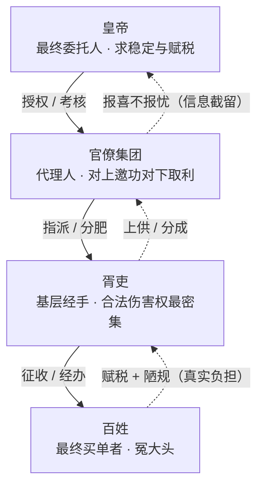
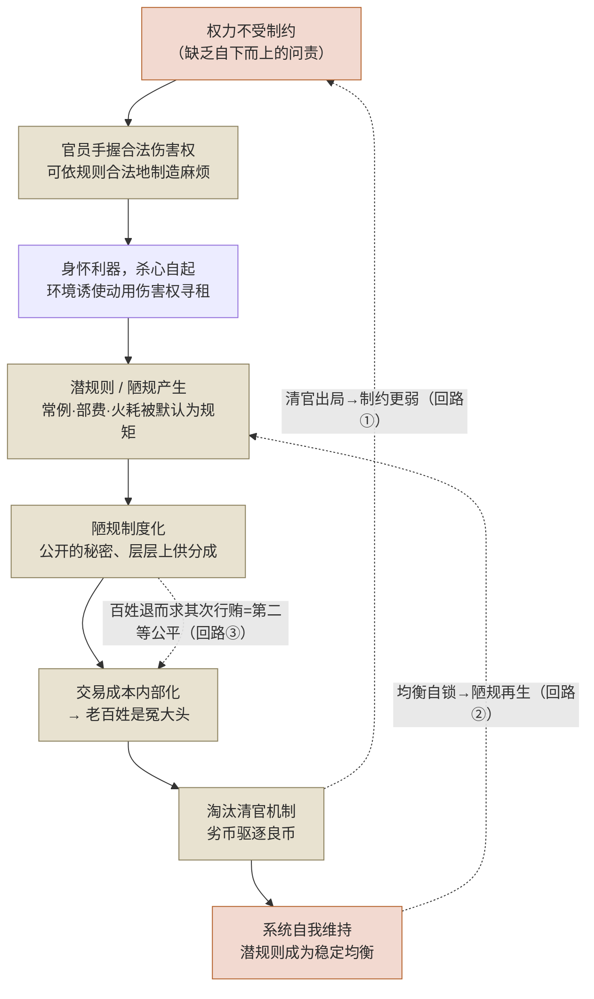
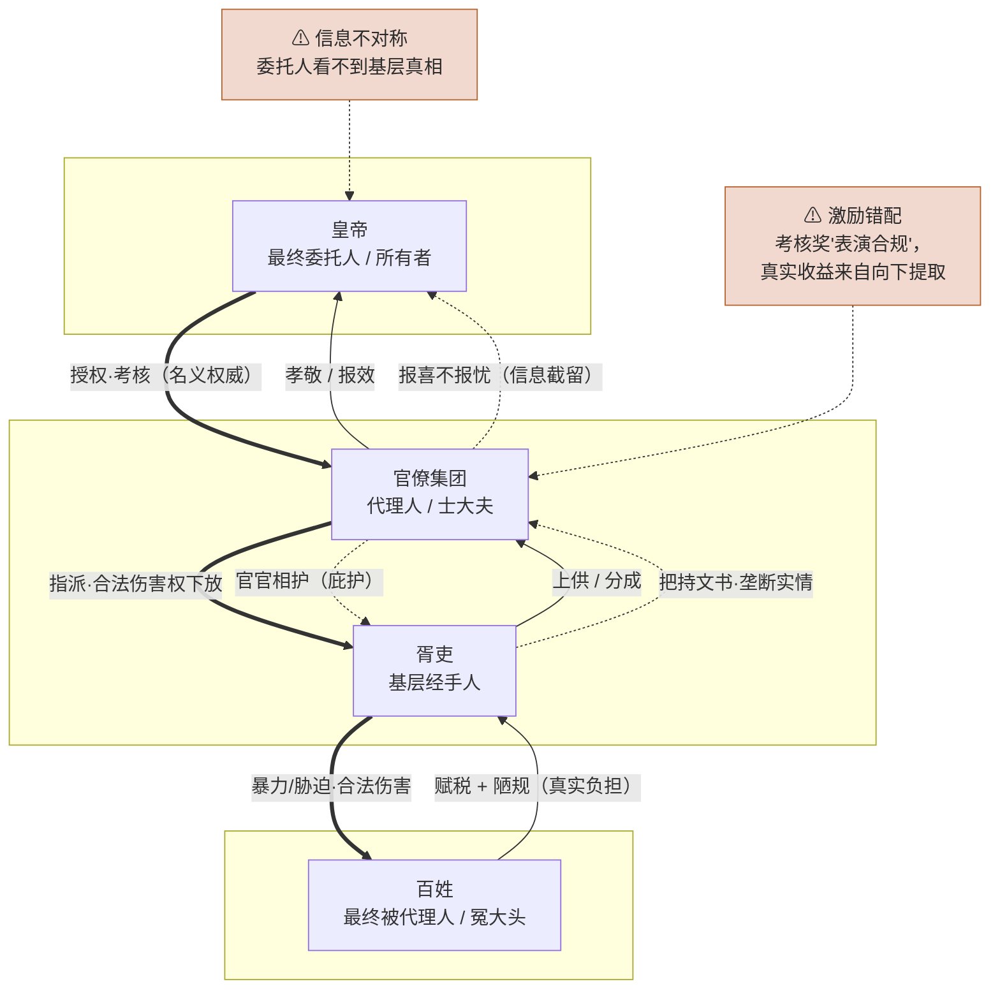
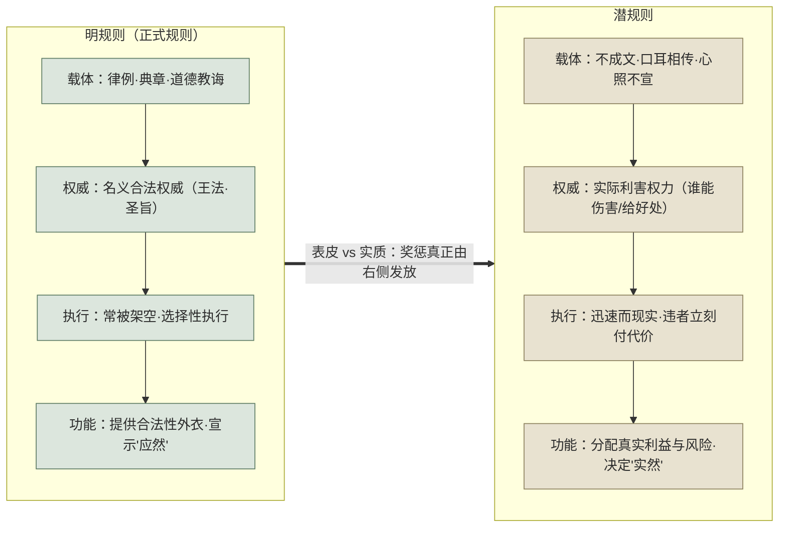
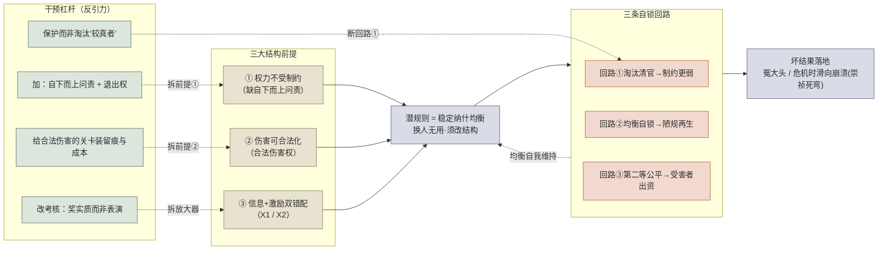

# 潜规则：中国历史中的真实游戏 — 分析文档

对吴思《潜规则：中国历史中的真实游戏》(2001) 的系统性梳理与再分析。本文档是整篇分析的
**主文档**，走标准文档管线渲染为网页。全篇分四步搭建：第 1 步搭骨架
与核心概念（引言、核心定义、角色/委托代理链、术语表），第 2 步新增「逻辑关系图」
一节把全书逻辑显性化为三张 Mermaid 图，第 3 步新增「深度分析：机制与案例」
一节逐一拆解全书关键论证并映射回逻辑节点，**第 4 步（本次·收尾）新增「综合评价：
理论内核、边界与现代映射」一节**，把全书上升为一个可评价、可迁移、可证伪的理论框架并回顾全篇结论。

> **来源与时效**：底本为吴思《潜规则：中国历史中的真实游戏》，云南人民出版社 2001 年初版
> （后有多个修订与合集版本，如《潜规则》《血酬定律》并行流传）。本文档为读书分析，
> 引用的历史案例以吴思原书为准；成文于 2026-07-18（第 1 步骨架），第 2 步补入「逻辑关系图」，
> 第 3 步补入「深度分析：机制与案例」（五个篇目/主题的博弈结构拆解），第 4 步补入
> 「综合评价：理论内核、边界与现代映射」（理论对话、批判、当代迁移清单）；至此全篇完成。
> 第 7 节涉及的相邻理论（血酬定律、委托代理、寻租、诺斯制度变迁）为对照性引述，观点归各原作者。

---

## 1. 引言：写作背景与问题意识

《潜规则》成书于世纪之交，吴思以记者与历史编辑的身份，长期浸泡在明清史料——尤其是
《明史》、官员笔记、奏折与判牍——之中。他关心的不是正史里写明的典章制度，而是一个更
朴素、也更尖锐的问题：

> 为什么白纸黑字的**正式规则**（王法、律例、圣贤教诲）常常不是真正起作用的规则？在
> 它们背后，是否存在另一套"不成文、不能明说、却被所有人默认遵守"的规则？

吴思把后者命名为**「潜规则」**。这个词由本书首创，此后进入汉语日常语汇。全书的方法论
特征是**从个案反推通则**：他不先立框架再找例证，而是从一桩桩具体的贪贿、陋规、清官
遭遇里，抽象出反复出现的行为模式，再给这些模式起名字（合法伤害权、陋规、血酬……）。

问题意识可概括为三层：

1. **描述层**——真实运转的规则到底是什么？（不是"应该怎样"，而是"实际怎样"）
2. **机制层**——这套潜规则靠什么力量维持自身、并淘汰不合作者？
3. **代价层**——谁为这套系统买单？收益与伤害如何在皇帝、官僚、胥吏、百姓之间分配？

本文档后续各步将分别沿这三层展开。

---

## 2. 核心定义：什么是「潜规则」

**潜规则**，指在正式规则之外、私下里实际支配着人们行为的**不成文规矩**。它不见于律条，
却被参与各方心照不宣地遵守；违反潜规则者，往往比违反明规则者受到更迅速、更现实的惩罚。

与**正式规则 / 明规则**的区别，可以从几个维度对照：

| 维度 | 正式规则（明规则） | 潜规则 |
| --- | --- | --- |
| 载体 | 律例、典章、公开的道德教诲 | 不成文、口耳相传、心照不宣 |
| 可言说性 | 可公开援引、写进文书 | 不能明说，一旦点破即失效或反噬 |
| 权威来源 | 名义上的合法权威（王法、圣旨） | 实际的利害权力（谁能伤害你、谁能给你好处） |
| 执行力 | 常被架空、选择性执行 | 执行迅速而现实，违者立刻付出代价 |
| 功能 | 提供合法性外衣、宣示"应然" | 分配真实的利益与风险、决定"实然" |

吴思的关键洞见是：**潜规则并非明规则的"腐败偏离"，而是一套自成体系、可自我维持的秩序。**
明规则提供合法性的**表皮**，潜规则处理利益的**实质**；两者长期并存，构成"官场的真实游戏"。
正因如此，单纯呼吁"遵守明规则"往往无效——因为真正给参与者发奖惩的是潜规则那一套。

---

## 3. 参与者与角色：皇帝—官僚—胥吏—百姓的委托代理链

潜规则运转在一条**层层委托、层层代理**的权力链条上。名义上，权力自上而下授予、责任
自下而上负责；实际上，每一层都对上"表演合规"、对下"提取利益"，信息与利害在层与层之间
被不断截留、扭曲。

四类核心角色：

- **皇帝（最终委托人 / 所有者）**——名义上拥有天下，追求江山稳固与赋税充盈，却受制于
  信息不对称：他看不到基层真相，只能通过官僚体系间接治理。
- **官僚集团（代理人 / 士大夫）**——受皇帝委托治理地方，一面向上考绩邀功，一面向下
  经营自己的利益网络；是明规则与潜规则的主要"翻译者"。
- **胥吏（基层执行者 / 经手人）**——不入品级却把持文书、征收、诉讼等具体经办环节，
  是"合法伤害权"最密集的一层，陋规多由此而生。
- **百姓（最终被代理人 / 买单者）**——链条最末端，既是赋税与秩序的名义受益者，又是
  各层提取利益的最终承担者，即所谓"冤大头"。

下面先给出一张**链条速览图**，把四类角色的位置与"授权下行、利益上行"的骨架勾出来；
带有四种资源流向（信息 / 暴力 / 钱财 / 庇护）的**完整委托代理图**，以及全书的核心机制链，
见第 4 节「逻辑关系图」。

---

## 4. 逻辑关系图

本节把《潜规则》全书逻辑**显性化**为三张图：(1) **核心机制链**——潜规则如何产生、如何把
成本转嫁给百姓、又如何自我维持；(2) **角色关系 / 委托代理图**——四类角色之间信息、暴力、
钱财、庇护四种资源的流向，并标出信息不对称与激励错配的关键节点；(3) **明规则 vs 潜规则
对照**子图。图中节点尽量对应第 5 节术语表里的"发明词"，全部保持中文。

### 4.1 核心机制链（含反馈回路）

从"权力不受制约"这一初始条件出发，潜规则如何一步步生成、制度化，并通过淘汰清官把自己
锁死为稳定均衡。虚线为**反馈回路**：机制的产物反过来强化了它自身的前提。

> **反馈回路解读**：回路①——淘汰清官反过来削弱对权力的约束，使初始条件 A 更牢固；
> 回路②——系统一旦自锁，就持续再生新的陋规；回路③——百姓在得不到真公平时被迫按潜规则
> 行贿（"第二等公平"），这笔支出又坐实了"冤大头"的成本转嫁。三条回路叠加，令潜规则
> 成为**难以从内部打破**的自我维持结构。

### 4.2 角色关系 / 委托代理图（四种资源流向）

同一条委托代理链上，四类角色之间真正流动的是四种资源：**信息**（谁掌握真相）、**暴力**
（谁能合法伤害）、**钱财**（赋税与陋规往哪走）、**庇护**（谁替谁遮掩）。名义上的授权
自上而下，真实的利益却自下而上；错位就发生在流向不对称的地方。

> **关键失灵点**：⚠信息不对称——皇帝只能通过官僚间接获知基层，而官僚与胥吏恰好垄断
> 了信息，"报喜不报忧"使委托人无从核实；⚠激励错配——考核体系奖励的是"对上表演合规"，
> 而代理人的真实收益来自"对下提取利益"，于是明规则被架空、潜规则填补空位。两点叠加，
> 委托代理链在结构上偏向**利益上行、伤害下行**。

### 4.3 明规则 vs 潜规则（对照子图）

同一场"官场游戏"里，两套规则并行：明规则管**合法性的表皮**，潜规则管**利益的实质**。
下图把两者的载体、权威来源、执行力与功能并列对照——正因奖惩真正由右侧那套发放，单纯
呼吁"遵守明规则"才常常无效。

> 对照要点：两套规则不是"正常 vs 腐败"，而是**长期共存、各司其职**的两层秩序。明规则
> 负责合法性，潜规则负责真实分配；改革若只加固左侧而不触动右侧的利害结构，往往被潜规则
> 迅速吸收消解。

---

## 5. 核心概念术语表

全书反复出现的几个"发明词"，是理解潜规则机制的钥匙（第 4 节逻辑图中的节点即引用这些词）。
下表每个先给**一句话定义**，后续步骤会对每一条展开机制分析与案例。

| 术语 | 一句话定义 |
| --- | --- |
| **合法伤害权** | 官吏手中可依据某条规则"合法地"给他人制造麻烦或损害的权力——正因合法，才最好用来敲诈与寻租。 |
| **陋规** | 长期沿袭、公开的秘密式的非正式收费与馈送（如常例、部费、火耗），虽无律条依据却被默认为"规矩"。 |
| **淘汰清官机制** | 系统会系统性地排挤、边缘化乃至毁掉不肯同流的清廉官员，因为他们威胁到整条食利链的稳定。 |
| **身怀利器** | 手握合法伤害权的人"身上带着刀"，即便本无恶意，环境也会诱使其动用权力换取好处——"身怀利器，杀心自起"。 |
| **老百姓是冤大头** | 层层提取的成本最终转嫁到最无议价能力的百姓身上，他们为整套潜规则系统买最后的单。 |
| **第二等公平** | 在无法得到（明规则许诺的）真正公平时，人们退而求其次、按潜规则行贿以换取"至少不被额外坑害"的相对公道。 |

> 术语表在后续步骤中可能增补（如"血酬 / 血酬定律""潜流""正式规则的失灵"等相邻概念），
> 并与逻辑图交叉引用。

---

## 6. 深度分析：机制与案例

前五节给出定义、角色与逻辑骨架；本节把骨架**填入血肉**——逐一拆解全书五个最关键的
篇目/主题，并对每一个追问同样四个问题：**(a) 涉及哪些角色**、**(b) 潜规则如何在此处生成**、
**(c) 背后是什么博弈结构**（囚徒困境 / 纳什均衡 / 寻租 / 重复博弈）、**(d) 为什么一群
理性个体会集体走向坏结果**。凡引用第 4 节逻辑图的节点，用 `A–H`（机制链）与 `X1/X2`
（失灵点）标注，便于回看。核心主张：潜规则的坏结果**不是坏人做坏事，而是好坏人处在同一
激励结构中都被迫做同一件事**——这正是它区别于"道德滑坡叙事"的地方。

### 6.1 老百姓是个冤大头：成本转嫁的终点与"残余索取者"的倒置

**角色**：全链条，但焦点在链条两端——各级官吏（提取方）与百姓（承担方）。
**潜规则如何生成**：每一层代理人都握有一点合法伤害权（→节点 `B`），都能在经手赋税、
诉讼、差役时"顺手"加一道自己的抽成（陋规，→`D`/`E`）。这些抽成层层向上叠加，而**每一层
都只对自己那一道加征负责、无人对总额负责**——于是成本像滚雪球一样滚到链条最末端。

**博弈结构**：这是一个典型的**多层委托代理下的"共用地悲剧"（commons tragedy）叠加成本
外部化**。关键在于**残余索取者（residual claimant）的角色发生了倒置**：在健康的产权结构里，
承担最终风险与剩余的人应当拥有最大的控制权与议价权；而在潜规则系统里，控制权在上（官吏
可自由加征），剩余损失却沉淀在最无控制权、最无退出选项、最无法串联反抗的百姓身上。百姓
既不能"用脚投票"（迁徙受限、土地锁定），也不能"用手投票"（无制度化的申诉与问责渠道，
→`X1` 信息不对称让上层也乐得不知），于是成为系统的**默认残余承担者**。

**为什么理性个体集体走向坏结果**：对任一具体官吏而言，"不加征"是严格劣势策略——他放弃的
收益会被上级的分成压力和同僚的"随大流"吞掉，而放弃换不来任何百姓的可见回报（百姓无从
奖励清廉）。于是即便某人道德上不愿，**局部最优（我这一层多抽一点）与全局最劣（百姓被抽干、
最终揭竿）在结构上被焊死**。冤大头不是被某个贪官坑了，而是被"人人都在局部理性地加征"这台
无主的机器碾过——对应机制链上 `E → F` 的成本内部化，以及回路③把"第二等公平"的行贿也
算进百姓账单。

### 6.2 身怀利器：合法伤害权如何自动转化为寻租

**角色**：手握经办权的胥吏 / 中下层官员（施害—收租方）与有求于程序的百姓、商人、下级
（付费方）。
**潜规则如何生成**：吴思的命题是"**身怀利器，杀心自起**"（→节点 `C`）。合法伤害权（→`B`）
的要害在于它**合法**——官吏不需要违法就能让你的事"卡"在某个环节：文书可以慢批、税可以
从严核、案子可以按最不利的解释办。正因每一步都于法有据，受害者无从申诉，只能私下"疏通"。
反复几次，"疏通费"就固化为陋规（→`D`/`E`）。

**博弈结构**：这是**教科书式的寻租（rent-seeking），且是一种"制造稀缺再出售"的敲诈式寻租**。
与市场交易不同，官吏并不创造价值，他出售的是"**不动用本可合法动用的伤害**"——即"我放你一马"。
用博弈论语言：官吏握有一个**可信威胁（credible threat）**，因为动用合法伤害对他几乎零成本、
且外人看不出恶意；对百姓而言，行贿的期望损失 < 被合法刁难的期望损失，于是"付费"是理性
最优应对。双方策略组合"**官索—民付**"构成一个**稳定的纳什均衡**：给定对方策略，任何一方
单独改变都会更糟（官不索则少收租且显得"不合群"，民不付则被合法拖垮）。

**为什么理性个体集体走向坏结果**：注意"杀心自起"四字的分量——它断言**结果与个人品性
基本无关**。把一个善良人放到"手握利器、动用无成本、不用白不用、同僚都在用"的位置上，
环境的梯度会把他推向寻租；不肯用的人则在收入与人际上吃亏（→为 6.3 的淘汰清官埋下伏笔）。
因此坏结果是**位置（合法伤害权）而非人品**的产物：这正是吴思要害之处——**改人无用，
须改结构（拆掉利器或让动用它变得有成本）**。

### 6.3 新官到任：潜规则的"入职培训"与淘汰清官机制

**角色**：初来乍到、尚存明规则理想的新官（待社会化者）；把持文书与实务的老吏（规则的
真正掌门人）；上级与同僚（分肥网络的守门人）。
**潜规则如何生成**：新官名义上是长官，实务上却依赖胥吏——他不懂本地钱粮的猫腻、不掌握
档案的暗门（→`X1` 信息不对称在此是老吏对新官的反向不对称）。老吏用两手教化他：一手是
"**规矩**"（这笔火耗历来这么分、这道部费不能少，即陋规的口传身授，→`E`）；一手是"**惩罚**"
——若新官不上道，文书拖沓、数字出错、关键时刻无人补台，政绩与考成先垮的是他自己。

**博弈结构**：这是一场**信息不对称下的社会化博弈，叠加淘汰清官机制（→节点 `G`）**。可视为
新官与系统之间的**重复博弈**：合作（同流）→ 分成、顺畅、升迁；背叛（守清）→ 被架空、
被孤立、被参劾。由于系统一方是长期玩家、掌握信息与执行，而新官是短期弱势方，**均衡收敛
到"新官被同化或被淘汰"**。守清者要么如海瑞般被供为道德标本却办不成事、处处碰壁，要么
直接出局。关键在于回路①：**淘汰清官不是系统的 bug 而是 feature**——清官威胁整条食利链的
稳定，清除他反过来使权力更不受制约（→`G ⟶ A` 回路①），均衡因此自我巩固。

**为什么理性个体集体走向坏结果**：对新官个人，"随大流"是占优策略；对老吏，"教化并绑定
新官"能锁住分肥的连续性；对上级，"要一个听话能分成的下属"胜过"要一个清廉但拆台的下属"。
三方的局部理性**共同指向同一个坏均衡：清官被系统性筛除，能留下的多是合作者**。于是官场
不是"混入了几个坏人"，而是**一台持续把不合作者过滤掉的机器**——这解释了为何"整顿吏治"
若只换人不换筛选规则，新人很快复制旧人。

### 6.4 第二等公平：受害者的合谋与均衡自锁

**角色**：无法获得明规则许诺之公平的当事人（百姓 / 诉讼者 / 纳税人），以及提供"相对公道"
的经办官吏。
**潜规则如何生成**：明规则许诺"第一等公平"（依法办事、一视同仁），但在潜规则场里它常被
架空（→`X2` 激励错配）。于是当事人退而求其次：既然人人都得打点，那我也打点，**以行贿
换取"至少不被额外坑害"的相对公道**——这就是"第二等公平"。它之所以危险，正因为它**对
受害者也是理性的、甚至是"温情"的**：花钱买来的相对公平，好过硬扛明规则失灵的绝对吃亏。

**博弈结构**：这是一个**次优纳什均衡（inferior Nash equilibrium），也是受害者被迫加入的
协调博弈**。设想所有当事人本可协调到"无人行贿、共同要求明规则兑现"的帕累托更优点；但
这需要集体行动，而每个人面对的现实是：**只要别人在行贿，我不行贿就吃亏**（我的案子被排到
最后、我的火耗被算到最狠）。于是"人人行贿"成为无人愿单独偏离的均衡——**背叛（不贿）的
个体收益为负，即使集体本可更好**。这与囚徒困境同构：个体理性 → 集体次优。

**为什么理性个体集体走向坏结果**：第二等公平的深层杀伤在于它**制造了受害者的合谋**——
百姓从潜规则的反抗者变成参与者、出资人乃至维护者（回路③：`E ⟶ F`，行贿支出坐实了成本
转嫁）。当被剥夺者也开始用潜规则的逻辑自保，潜规则就获得了**来自底层的合法性与资金**，
均衡从此自锁：**改革者想诉诸的"受害民意"，其实已被收编为系统的一部分**。这是全书最冷峻
的一笔——坏结果之所以稳固，恰因它给了每个人（包括受害者）一个当下最不坏的选择。

### 6.5 崇祯死弯：汲取型均衡的宏观崩溃

**角色**：皇帝（崇祯，最终委托人）、带兵将领与督抚（军事代理人）、经手军饷钱粮的各级
官吏、被加派压垮的百姓。这是把前四个微观机制**在王朝尺度上叠加**后的总崩溃。
**潜规则如何生成 / 运作**：为应付满洲入侵与流寇，崇祯不断加派"三饷"（辽饷、剿饷、练饷）。
但加派在潜规则机器里被放大：火耗、层层截留、吃空饷（虚报兵额冒领军饷）使**朝廷加一分、
落到百姓身上常是数分，真正到前线士兵手里的却又被克扣**。于是加饷 → 更多百姓破产投贼 →
流寇更盛 → 需更多军费 → 再加饷……

**博弈结构**：两条相互咬合的坏动力学。其一是**正反馈的"死弯"（vicious feedback spiral）**：
每一次为救亡而加大汲取，都在扩大反抗、削弱税基，**努力本身加速了崩溃**——这与机制链
`A→…→H` 的稳定均衡不同，是均衡被外部冲击（战争）打破后滑向的**崩溃吸引子**。其二是
**代理人的"养寇自重"（一种续期性寻租）**：对将领而言，敌寇存在 = 自己的军费、兵权与
不可替代性存在；一旦彻底剿灭，便可能"飞鸟尽、良弓藏"（袁崇焕之死是崇祯亲手示范了这一
风险）。于是**理性的将领倾向于"养而不灭"**——把重复博弈的续期价值系于威胁的持续，
恰与皇帝"速胜"的目标背道而驰（→`X2` 激励错配的极端形态）。

**为什么理性个体集体走向坏结果**：崇祯个人节俭、勤政、屡屡严责臣下，却**越用力越坏事**——
因为他能动用的唯一杠杆（加派 + 严刑督战）恰好同时喂大了汲取机器与激励扭曲。皇帝受困于
`X1` 信息不对称（看不清前线虚实、分不清谎报），只能在"猜疑—诛杀—再猜疑"间摆动，反而
进一步摧毁将领拼死作战的激励。这是全书对**委托代理链在压力下如何整体崩溃**的终极案例：
**没有一个环节的行为是"非理性"的，但每个环节的理性叠加，恰好把系统推下死弯**。潜规则
在承平时是稳定的食利均衡（6.1–6.4），在危机时则把王朝锁死在**无人能单方叫停的自杀式路径**上。

### 6.6 案例—机制—博弈结构映射表

| 案例 / 篇目 | 核心角色 | 映射的逻辑节点 | 博弈结构 | 坏结果的机理（一句话） |
| --- | --- | --- | --- | --- |
| 6.1 老百姓是冤大头 | 全链条，焦点在官吏↔百姓 | `E→F`、回路③ | 多层代理 + 共用地悲剧 + 残余索取者倒置 | 人人局部加征，成本沉到最无议价权的末端 |
| 6.2 身怀利器 | 经办官吏 ↔ 求人办事者 | `B→C→D` | 敲诈式寻租 + 可信威胁纳什均衡 | 出售"不动用合法伤害"，民付贿是理性最优 |
| 6.3 新官到任 | 新官 · 老吏 · 上级同僚 | `X1`、`G`、回路① | 信息不对称社会化 + 重复博弈 + 淘汰清官 | 系统持续过滤不合作者，清官被同化或出局 |
| 6.4 第二等公平 | 当事人 ↔ 经办官吏 | `X2`、`E→F`、回路③ | 次优纳什均衡 / 囚徒困境同构 | 受害者被迫行贿自保，反成系统出资人 |
| 6.5 崇祯死弯 | 皇帝 · 将领 · 官吏 · 百姓 | `X1`、`X2`、全链条 | 正反馈崩溃螺旋 + 养寇自重续期寻租 | 每一步救亡式汲取都加速崩溃，无人能叫停 |

> **贯穿全节的一条主线**：五个案例分别演示了坏均衡的**生成（6.2）→ 扩散与自锁（6.3、6.4）
> → 成本落地（6.1）→ 危机崩溃（6.5）**。它们共享同一个论证内核——**把理性个体放进一个
> 权力不受制约、伤害可合法化、信息与激励双重错配的结构里，"集体走向坏结果"就成了纳什
> 均衡而非道德意外**。这也预告了第 4 步要追问的问题：既然坏结果是结构性均衡，什么样的
> 外力（问责、透明、退出权）才可能把系统推离它？

---

## 7. 综合评价：理论内核、边界与现代映射

前六节完成了"是什么—谁在玩—怎么运转—具体如何"的重建。本节收尾，做四件事：**(1)** 把全书
压缩为一句可评价的**理论内核**；**(2)** 让它与四支相邻理论**对话**，标出异同；**(3)** 做**批判
与边界**——它能解释到哪、可否被证伪、会被如何滥用；**(4)** 给出把框架迁移到当代组织的
**可操作判别清单**。最后用一张对照表与一张总结图收束全篇。

### 7.1 理论内核：一句话与它的三个前提

把全篇论证蒸馏到最短：

> **潜规则是「权力不受制约 + 参与者理性自利」这一结构下，反复博弈自发收敛到的一种稳定
> 均衡（Nash 均衡）；它不是道德的失败，而是激励的产物。**

这个内核依赖三个缺一不可的**结构前提**（对应第 4 节机制链的初始条件）：

1. **权力不受自下而上的制约**（`A`）——委托人（皇帝/百姓）无法有效问责代理人，退出与
   申诉渠道被封死。这是均衡得以存在的**土壤**。
2. **伤害可被合法化**（`B`/`C`）——代理人手中的权力能"依规则"制造损害（合法伤害权），
   使寻租无需违法、受害者无从申诉。这是均衡的**燃料**。
3. **信息与激励双重错配**（`X1`/`X2`）——委托人看不到真相、考核奖励"表演合规"而真实收益
   来自"向下提取"。这是均衡的**放大器**。

三者齐备，则"人人局部理性 → 集体走向坏结果"就不是意外而是**定理**：任何单个参与者偏离
（清官守正、百姓拒贿）都会被淘汰机制（`G`）和次优均衡（6.4）惩罚。**这正是潜规则区别于
"贪官叙事"的判据——它预测的是「换人无用、须改结构」**。

### 7.2 与相邻理论的对话：四组异同

潜规则并非孤立发明；把它放进社会科学的坐标系，能更清楚看到它的**贡献边界**。

**① 吴思自己的后续——《血酬定律》（2003）。** 《潜规则》回答"规则是什么、如何维持"；《血酬
定律》向下再挖一层，回答"这些规则最终锚定在什么上"——答案是**暴力**。"血酬"即"以命换来的
酬报"，"元规则"是"暴力最强者说了算"。二者关系是**潜规则的地基**：合法伤害权之所以有效，
归根到底因为背后站着可动用的暴力（`B` 的来源）。异：《潜规则》偏**制度社会学**（不成文规范
如何运转），《血酬定律》偏**政治经济学的第一性原理**（暴力如何定价并派生规则）。合起来才是
吴思的完整链条：**暴力（血酬）→ 定规则的权力（元规则）→ 潜规则（日常均衡）→ 陋规（具体收费）**。

**② 制度经济学的委托—代理（principal–agent）。** 二者高度同构：皇帝=委托人、官僚胥吏=代理人、
信息不对称+激励错配=代理成本的经典来源。**吴思的独到处**在于两点主流代理理论常弱化的地方：
(a) 他强调代理人不仅"偷懒/道德风险"，更**主动持有一件武器（合法伤害权）反向敲诈委托人与
第三方**——代理问题里嵌了一个**掠夺问题**；(b) 他指出系统会**主动淘汰"好代理人"（清官）**，
即代理链不仅不自我纠错，反而自我恶化。主流代理理论假设委托人能设计激励合约来收敛问题；
吴思的冷峻在于：当委托人自己也受制于 `X1` 且无外部问责时，**合约设计者本身失灵**。

**③ 寻租理论（Tullock 1967 / Krueger 1974）。** 契合度极高：陋规=租金，"疏通费"=寻租支出，
合法伤害权=制造人为稀缺（把本应通畅的程序变成可收费的关卡）。Tullock 强调**寻租的社会
净损失不止于转移，还有为争夺租金而耗散的真实资源**；Krueger 量化了进口配额下的寻租规模。
**吴思的增量**是把寻租**动态化、组织化**：不是一次性竞标一个租，而是**一整条食利链上层层
叠加的、被制度默认的、且会淘汰不寻租者的持续性寻租结构**。可以说吴思提供了寻租理论缺的
那部分——**寻租如何自我维持并抵抗清理**（回路①②③）。

**④ 诺斯（Douglass North）的制度变迁与"暴力与社会秩序"。** 诺斯区分**正式制度与非正式制度**、
提出**路径依赖**与**"限制进入的秩序"（limited access order）**：精英通过垄断租金分配来维持
稳定。潜规则几乎是 LAO 的一个中国史微观样本——**明规则/潜规则 = 诺斯的正式/非正式制度**，
淘汰清官 = 限制进入（不让"破坏分租规则者"进场）。**差异**：诺斯是**宏观、比较制度、偏中性
描述**（LAO 在低暴力社会里甚至是一种可行秩序）；吴思是**微观、单一文明纵深、带道德重量**
（他要揭露成本落在谁头上）。诺斯问"制度为何长期低效仍延续"（路径依赖 + 交易成本），
吴思给出一个具体机制答案：**因为它是被合法伤害权和淘汰机制焊死的均衡**。

> **一句话定位**：潜规则 = 用中国明清史料写成的、**微观机制版**的"限制进入秩序 + 组织化寻租"，
> 其独有贡献是**合法伤害权**（代理问题里的掠夺维度）与**淘汰清官机制**（系统的反自净特性），
> 地基是《血酬定律》的**暴力元规则**。

### 7.3 批判与边界：它能解释到哪、会被如何误用

一个理论的价值，既在其解释力，也在其**自知之明**。对潜规则框架，至少有四条边界必须讲清。

- **① 解释力上限——普适性 vs 特殊性的张力。** 该框架强在解释**低问责、封闭进入**环境下的
  行为；但它**并不预测"何时/如何"打破均衡**。历史上确有吏治相对清明的时段、有效的监察
  周期、以及自下而上的问责创新——这些"均衡被打破"的正例，框架只能**事后归因**（约束增强了），
  缺乏**前瞻的临界条件**。换言之，它是一个强的**静态均衡解释器**，弱的**动态变迁预测器**
  （这正是诺斯路径依赖与制度变迁理论要补的位置）。
- **② 可证伪性——有滑向"不可证伪"的风险。** 内核若被松散使用，容易变成**万能叙事**：清官
  出局→"看，淘汰机制"；清官在位→"他只是尚未被淘汰/是道德标本"。两种观察都被吸收，理论
  就退化为不可证伪。**要保持科学性，必须把它写成可被数据反驳的形式**，例如：*给定问责与
  透明度的可测代理变量，寻租强度应随之单调下降；若强问责地区/时期陋规不降反升，则内核
  被削弱。* 6.2 的"位置而非人品"命题也可证伪：**同一批人在高约束 vs 低约束岗位上的寻租
  行为应显著不同**——若无差异，则"结构决定论"过强。凡不能这样操作化的部分，应降级为
  "视角"而非"定律"。
- **③ 道德与政治上的误用——犬儒主义陷阱。** 最危险的滥用是把"坏结果是结构均衡、非道德
  意外"**倒读成"所以个人努力无意义、清廉是天真、随波逐流才理性"**。这是对吴思的背叛：
  他论证"改人无用须改结构"，指向的是**改造结构的行动**，而非**取消个人责任**。把描述性
  命题（"在此结构中寻租是占优策略"）偷换为规范性结论（"所以你也该寻租"）是典型的**自然
  主义谬误**。健康的读法是：**承认结构的引力，正是为了有的放矢地施加反引力（问责、透明、
  退出权），而不是投降。**
- **④ 方法论边界——从个案反推通则的取样偏差。** 全书方法是"从史料个案抽象通则"，其力量
  在生动，其风险在**选择性取样**：史料本就偏爱记录冲突、贪腐、奇案（幸存者/戏剧性偏差），
  平淡的合规日常少被记载。因此"潜规则无处不在"的印象可能被史料结构**系统性放大**。这不
  推翻内核，但提醒：**它描述的是一种强大的倾向，而非对每时每地的定量断言。**

### 7.4 现代映射：从明清官场到当代组织的判别清单

内核的三前提（不受制约的权力 / 可合法化的伤害 / 信息激励错配）是**去历史的**——凡满足者，
无论朝廷还是现代科层组织，都会长出功能同构的潜规则。下表先做概念迁移，再给判别清单。

| 吴思的历史概念 | 当代组织/治理中的同构物（示例） |
| --- | --- |
| 合法伤害权 | 掌握审批/合规/风控/采购/考核否决权的岗位——可"依流程合法地卡你" |
| 陋规 | 制度化的灰色惯例：吃拿卡要、"赞助/返点"、约定俗成的"打点"、KPI 注水的默契 |
| 淘汰清官机制 | "太较真的人升不上去/被边缘化"、举报者遭反向惩罚、老实人扛雷 |
| 身怀利器，杀心自起 | 手握自由裁量权且无留痕/无问责的岗位，天然滑向寻租 |
| 第二等公平 | "会来事"才办得成事、行业默认的"服务费"、被迫参与的潜规则自保 |
| 冤大头 | 成本最终转嫁给最无议价权方：一线员工、小供应商、终端消费者、纳税人 |

**可迁移判别清单（诊断一个组织/流程是否正在长出潜规则，逐条打勾）：**

1. **权力是否可被下方问责？** 受影响者有无**低成本、可信、不遭报复**的申诉/退出渠道？（无 → 前提①命中）
2. **是否存在"合法伤害"的抓手？** 有没有**自由裁量大、留痕弱、"合规地拖/卡/从严解释"几乎零成本**的关卡？（有 → 前提②命中）
3. **信息是否被经手人垄断？** 决策者是否只能通过被考核者本人上报来了解真相（`X1`）？（是 → 放大器命中）
4. **激励是否奖励"表演"而非"实质"？** 考核奖的是**对上好看**还是**对下真实价值**（`X2`）？（前者 → 放大器命中）
5. **系统是否在淘汰"较真的人"？** 观察**谁被提拔、谁被边缘**：合规死磕者是升迁还是出局（`G`）？
6. **受害者是否已被收编为出资人？** 是否出现"第二等公平"式的自保性打点，使被剥夺者反而维护现状（回路③）？

> **打分读法**：命中越多，越接近潜规则的稳定均衡；且**前提①②是必要条件**（无制约 + 可合法
> 伤害），3–6 是放大与自锁。**干预应从必要条件下手**——增加自下而上的问责与退出权、给
> "合法伤害"的关卡装上留痕与成本、改考核使其奖励实质而非表演、并**保护而非淘汰"较真者"**。
> 只做道德倡导（喊"要清廉"）而不动这六项结构变量，按内核预测**必被均衡吸收消解**。

### 7.5 全篇收束：一张总结图与三句结论

下图把全篇压成一张因果总图：**三前提 → 潜规则均衡 → 三条自锁回路 → 成本落地与危机崩溃**，
右侧标出对应的**干预杠杆**（即 7.4 清单的着力点），呼应"改结构而非改人"。

**三句话收束全篇：**

1. **诊断**——潜规则不是"好制度里混进了坏人"，而是**特定结构（不受制约的权力 + 可合法化的
   伤害 + 双重错配）下理性个体的稳定均衡**；坏结果是均衡而非意外（第 1–6 节）。
2. **定位**——它是"限制进入秩序 + 组织化寻租"的微观机制版，独有贡献是**合法伤害权**与
   **淘汰清官机制**，地基是《血酬定律》的暴力元规则；但它长于静态解释、短于动态预测，
   且需写成可证伪形式、警惕犬儒式误用（7.2–7.3）。
3. **行动**——因为坏结果是结构性的，**有效干预必须作用于结构变量**（问责、透明、留痕、
   退出权、保护较真者），而非停留于道德倡导；这既是历史教训，也是当代组织可照单自查的
   清单（7.4–7.5）。潜规则的启示不是犬儒，而是**把矛头对准结构**。

---

> **全篇完成（第 1–4 步）。** 本文档已从骨架与核心概念（第 1 步）、逻辑关系图（第 2 步）、
> 机制与案例深度分析（第 3 步），走到理论内核、边界与现代映射的综合评价（第 4 步）。
> 「潜规则」故事的四步分析至此闭环——从"是什么"到"如何运转"再到"如何评价与迁移"。
