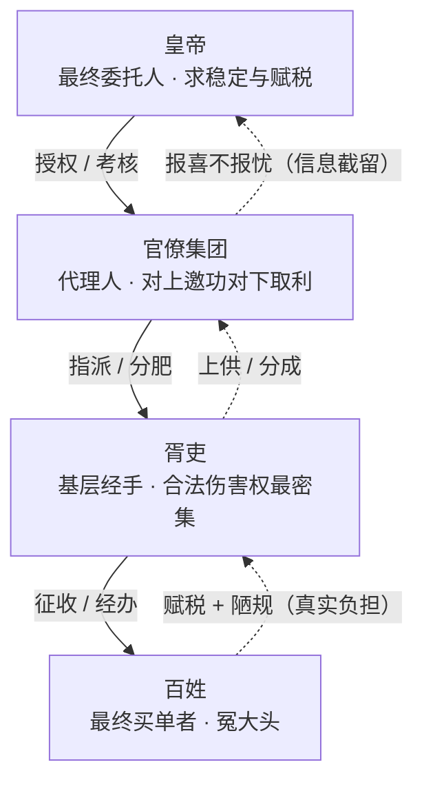
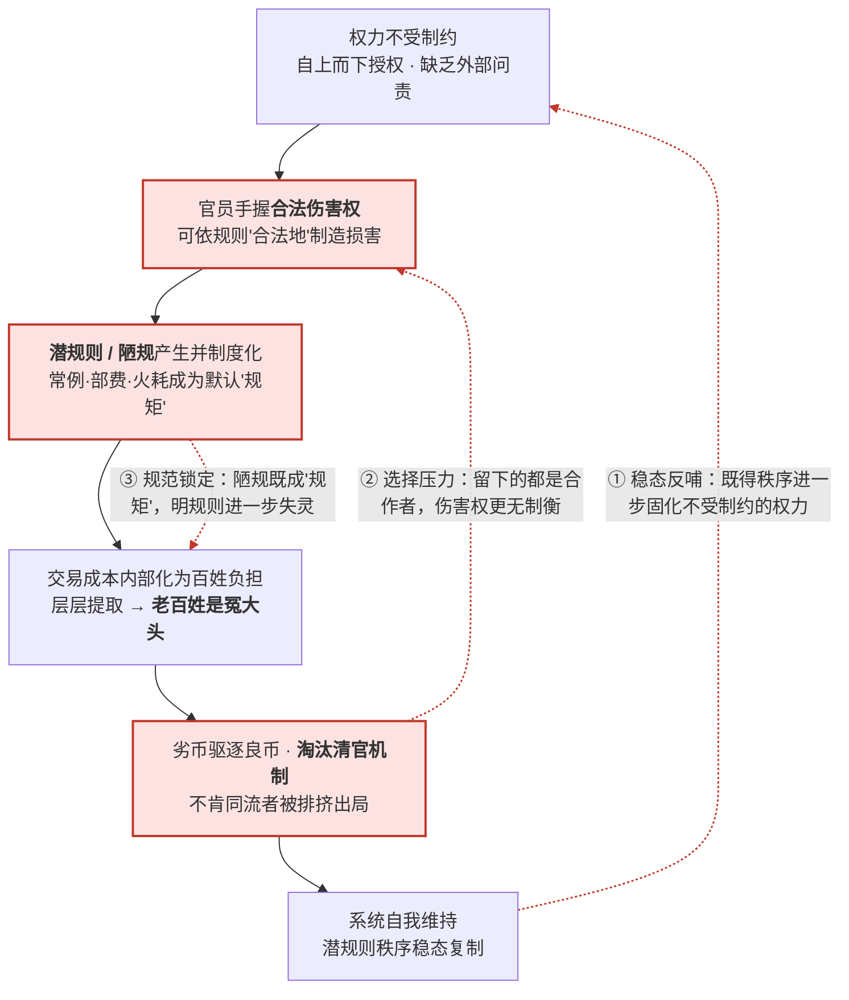
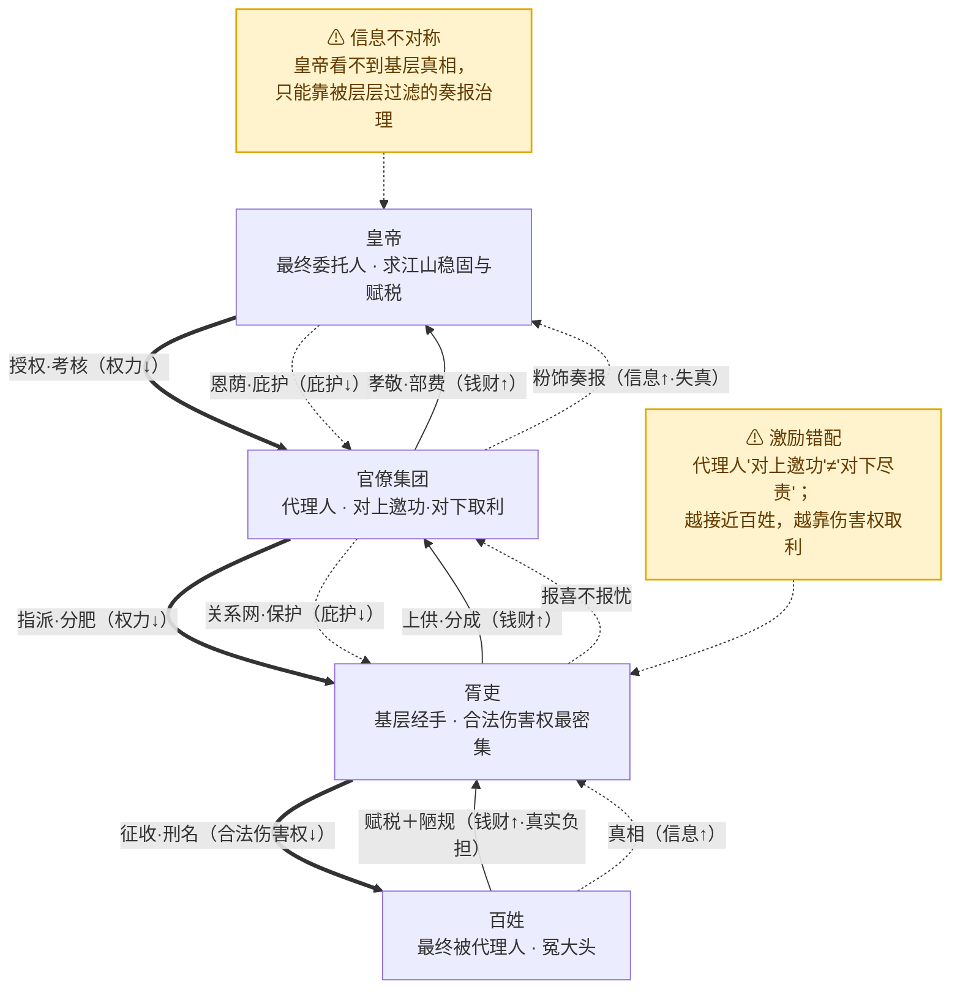
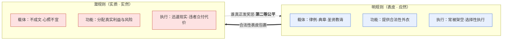

# 潜规则：中国历史中的真实游戏 — 分析文档

对吴思《潜规则：中国历史中的真实游戏》(2001) 的系统性梳理与再分析。本文档是整篇分析的
**主文档**，走标准文档管线渲染为网页。全篇计划分四步搭建：**本步 (第 1 步)** 只搭骨架
与核心概念——引言、核心定义、角色/委托代理链、术语表——**逻辑图与深度分析留给后续步骤**。

> **来源与时效**：底本为吴思《潜规则：中国历史中的真实游戏》，云南人民出版社 2001 年初版
> （后有多个修订与合集版本，如《潜规则》《血酬定律》并行流传）。本文档为读书分析，
> 引用的历史案例以吴思原书为准；成文于 2026-07-18，属第 1 步骨架稿，后续步骤会补充逻辑图、
> 案例考订与批判性讨论。

---

## 1. 引言：写作背景与问题意识

《潜规则》成书于世纪之交，吴思以记者与历史编辑的身份，长期浸泡在明清史料——尤其是
《明史》、官员笔记、奏折与判牍——之中。他关心的不是正史里写明的典章制度，而是一个更
朴素、也更尖锐的问题：

> 为什么白纸黑字的**正式规则**（王法、律例、圣贤教诲）常常不是真正起作用的规则？在
> 它们背后，是否存在另一套“不成文、不能明说、却被所有人默认遵守”的规则？

吴思把后者命名为**「潜规则」**。这个词由本书首创，此后进入汉语日常语汇。全书的方法论
特征是**从个案反推通则**：他不先立框架再找例证，而是从一桩桩具体的贪贿、陋规、清官
遭遇里，抽象出反复出现的行为模式，再给这些模式起名字（合法伤害权、陋规、血酬……）。

问题意识可概括为三层：

1. **描述层**——真实运转的规则到底是什么？（不是“应该怎样”，而是“实际怎样”）
2. **机制层**——这套潜规则靠什么力量维持自身、并淘汰不合作者？
3. **代价层**——谁为这套系统买单？收益与伤害如何在皇帝、官僚、胥吏、百姓之间分配？

本文档后续各步将分别沿这三层展开。

---

## 2. 核心定义：什么是「潜规则」

**潜规则**，指在正式规则之外、私下里实际支配着人们行为的**不成文规矩**。它不见于律条，
却被参与各方心照不宣地遵守；违反潜规则者，往往比违反明规则者受到更迅速、更现实的惩罚。

与**正式规则 / 明规则**的区别，可以从几个维度对照：

| 维度 | 正式规则（明规则） | 潜规则 |
| --- | --- | --- |
| 载体 | 律例、典章、公开的道德教诲 | 不成文、口耳相传、心照不宣 |
| 可言说性 | 可公开援引、写进文书 | 不能明说，一旦点破即失效或反噬 |
| 权威来源 | 名义上的合法权威（王法、圣旨） | 实际的利害权力（谁能伤害你、谁能给你好处） |
| 执行力 | 常被架空、选择性执行 | 执行迅速而现实，违者立刻付出代价 |
| 功能 | 提供合法性外衣、宣示“应然” | 分配真实的利益与风险、决定“实然” |

吴思的关键洞见是：**潜规则并非明规则的“腐败偏离”，而是一套自成体系、可自我维持的秩序。**
明规则提供合法性的**表皮**，潜规则处理利益的**实质**；两者长期并存，构成“官场的真实游戏”。
正因如此，单纯呼吁“遵守明规则”往往无效——因为真正给参与者发奖惩的是潜规则那一套。

---

## 3. 参与者与角色：皇帝—官僚—胥吏—百姓的委托代理链

潜规则运转在一条**层层委托、层层代理**的权力链条上。名义上，权力自上而下授予、责任
自下而上负责；实际上，每一层都对上“表演合规”、对下“提取利益”，信息与利害在层与层之间
被不断截留、扭曲。

四类核心角色：

- **皇帝（最终委托人 / 所有者）**——名义上拥有天下，追求江山稳固与赋税充盈，却受制于
  信息不对称：他看不到基层真相，只能通过官僚体系间接治理。
- **官僚集团（代理人 / 士大夫）**——受皇帝委托治理地方，一面向上考绩邀功，一面向下
  经营自己的利益网络；是明规则与潜规则的主要“翻译者”。
- **胥吏（基层执行者 / 经手人）**——不入品级却把持文书、征收、诉讼等具体经办环节，
  是“合法伤害权”最密集的一层，陋规多由此而生。
- **百姓（最终被代理人 / 买单者）**——链条最末端，既是赋税与秩序的名义受益者，又是
  各层提取利益的最终承担者，即所谓“冤大头”。

下面先给一张**简化示意图**建立直觉；完整的四种流向（信息 / 暴力 / 钱财 / 庇护）与
信息不对称、激励错配的标注版逻辑图，见下文 **[第 5 节「逻辑关系图」](#5-逻辑关系图把全书逻辑显性化)**。

> 说明：上图为**简化示意**，只画了权力下行、利益上行、信息截留三条主线。第 5 节会把
> 它扩展为标注四种流向与两处结构性缺陷（信息不对称、激励错配）的完整逻辑图。

---

## 4. 核心概念术语表

全书反复出现的几个“发明词”，是理解潜规则机制的钥匙。下表每个先给**一句话定义**，
后续步骤会对每一条展开机制分析与案例。

| 术语 | 一句话定义 |
| --- | --- |
| **合法伤害权** | 官吏手中可依据某条规则“合法地”给他人制造麻烦或损害的权力——正因合法，才最好用来敲诈与寻租。 |
| **陋规** | 长期沿袭、公开的秘密式的非正式收费与馈送（如常例、部费、火耗），虽无律条依据却被默认为“规矩”。 |
| **淘汰清官机制** | 系统会系统性地排挤、边缘化乃至毁掉不肯同流的清廉官员，因为他们威胁到整条食利链的稳定。 |
| **身怀利器** | 手握合法伤害权的人“身上带着刀”，即便本无恶意，环境也会诱使其动用权力换取好处——“身怀利器，杀心自起”。 |
| **老百姓是冤大头** | 层层提取的成本最终转嫁到最无议价能力的百姓身上，他们为整套潜规则系统买最后的单。 |
| **第二等公平** | 在无法得到（明规则许诺的）真正公平时，人们退而求其次、按潜规则行贿以换取“至少不被额外坑害”的相对公道。 |

> 术语表在后续步骤中可能增补（如“血酬 / 血酬定律”“潜流”“正式规则的失灵”等相邻概念），
> 并与逻辑图交叉引用。

---

## 5. 逻辑关系图：把全书逻辑显性化

本节用三张 Mermaid 图把《潜规则》的核心逻辑显性化：**（一）核心机制链**——潜规则如何
产生、制度化并自我维持；**（二）角色关系 / 委托代理图**——信息、暴力、钱财、庇护四种流向
及其结构性缺陷；**（三）明规则 vs 潜规则对照**——表皮与实质如何长期并存。图中节点尽量
对应第 4 节术语表中的概念，全部使用中文。

### 5.1 核心机制链：从权力失约到系统自维持

这是全书的**因果主链**。链条本身是单向推进的，但真正让它经久不衰的是三条**反馈回路**
（图中红色虚线）：稳态反哺权力、选择压力清洗队伍、陋规锁定使明规则进一步失灵。正因为
存在这些正反馈，单点整顿（换一个清官、发一道禁令）往往被系统迅速消化。

> 读法：黑色实箭头是**因果推进**，红色虚线是**反馈回路**。回路 ①②③ 叠加，使系统对
> 局部干预具有强韧性——这正是吴思所谓“潜规则是一套可自我维持的秩序”的图解。

### 5.2 角色关系 / 委托代理图：四种流向与结构性缺陷

沿 `皇帝—官僚集团—胥吏—百姓` 这条委托代理链，实际流动着四样东西，方向各不相同：

- **权力 / 暴力（下行）**——授权、指派、征收与刑名，越往下越接近**合法伤害权**的锋刃。
- **钱财（上行）**——赋税与**陋规**从百姓层层上供、分成、孝敬，真实负担压在最底层。
- **信息（上行但失真）**——真相自下而上传递时被逐层截留、粉饰，形成**信息不对称**。
- **庇护（下行）**——恩荫、关系网与保护自上而下分配，是维系合作、换取忠诚的黏合剂。

> 读法：**粗实线 = 权力/暴力下行，细实线 = 钱财上行，点线 = 信息与庇护**。两处黄色告警
> 标出系统的结构性病灶：`gap1` 信息不对称让皇帝无法核实代理人；`gap2` 激励错配让代理人的
> 私利与百姓福祉背道而驰。潜规则正是在这两个缺口里长出来的——它是委托代理失灵的**产物**，
> 也是其**放大器**。

### 5.3 明规则 vs 潜规则：表皮与实质的并存

最后一张对照子图，回应第 2 节的核心定义：两套规则并非“正统 vs 腐败”，而是**分工共生**——
明规则提供合法性表皮，潜规则处理利益实质，彼此长期咬合。

> 读法：粗箭头（明→潜）表示明规则为潜规则提供**合法性伪装**；回指的点线（潜→明）表示
> 真正的奖惩由潜规则发出，当事人只能退求**第二等公平**。二者互为里表，这正是“单纯呼吁
> 遵守明规则往往无效”的根源。

---

## 后续步骤（本文档规划）

- **第 2 步**（本步已完成）：绘制**核心机制链**、**委托代理四流向图**与**明/潜规则对照图**，
  见上文第 5 节。
- **第 3 步**：对术语表逐条展开**机制分析 + 明清案例**（合法伤害权、陋规、淘汰清官等）。
- **第 4 步**：批判性讨论与当代映射——潜规则框架的解释力、边界与争议。
