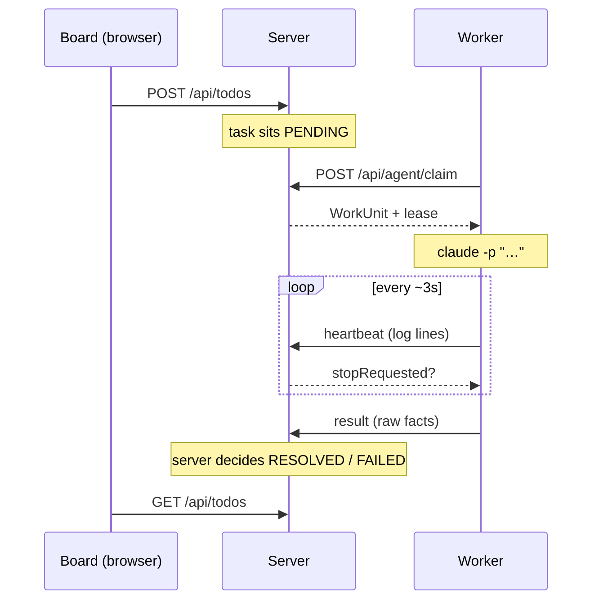

# How the board runs work

The Kanban is two programs. The **server** owns the board — tasks, stories, workflows,
executions, the database, the website — and decides what should run next and what a result
means. The **worker** owns a machine's ability to run `claude`, and does as it is told. They
talk over one small REST API.

It was one program until this split. Everything below is either a consequence of separating
them or a thing that had to be rebuilt because separating them broke it.

## The loop



The worker only ever dials out. That is what lets one run on a laptop behind NAT, on a home
connection, or anywhere else the server could not reach — and it is why everything the server
needs to say to a worker has to be the answer to a call the worker made.

## Four things worth knowing

### 1. The worker never decides what a result means

It reports facts: exit code, whether it timed out, whether the CLI killed background work,
what the session finally said. The server decides whether that is Done or Needs Attention.

This is not fastidiousness. The rules are genuinely non-obvious — a clean exit code means
nothing if the session's background work was killed, because what it said before that is a
promise to report back rather than an answer, and filing that as the result poisons every
workflow step downstream. And a worker jar on someone else's laptop is the one part of this
system a deploy cannot update. If it held opinions about results, an old worker would quietly
disagree with the board about what happened, and the board would be the one that was wrong.

### 2. Claiming is atomic, because it now has to be

While one thread did everything, "two workers took the same task" could not happen. HTTP
claims arrive on whatever threads are free, so the guarantee had to be made deliberately.

The first attempt used a Java lock. It does not work, and it looks like it should: the
transaction boundary sits outside the lock, so a second thread enters as soon as the first
releases — before it has committed — and still reads the task as PENDING. A test caught two
workers being handed the same task. The fix is a conditional `UPDATE ... WHERE status =
PENDING`, which makes the check and the write one operation.

### 3. A lease replaces "the process holding the row"

A server restart used to end every session, so anything left `IN_PROGRESS` was known to be
orphaned. A remote worker vanishes with nothing announcing it — a closed laptop, a dropped
connection — so "is this still being worked on?" became a question with a deadline. Hold the
lease by heartbeating; stop, and the reaper takes the work back.

The recovery policy is deliberately the one the old restart-recovery had:

| | If the worker goes silent |
| --- | --- |
| **Task** | Back to the queue, unless it has hit `worker.max-attempts` — then Needs Attention, because a run that was interrupted may already have done part of its work. |
| **Workflow node** | Failed, never re-run. It sits inside a graph; re-running it would duplicate side effects halfway through, with every step below building on whichever attempt landed. |

A pleasant side effect: restarting the server now interrupts nothing. Leases are in the
database and workers heartbeat straight through it.

### 4. Capabilities decide where work can go

Most work is portable. One kind is not: a task about improving this project edits the working
tree and runs `scripts/deploy.sh`, so it can only run on a machine that has the repo. A worker
declares `repo:Dashboard` to say it does; the server only offers such tasks to a worker that
did.

## What did not move

The server still shells out for three things, because they are properties of the box that owns
the repo and the database rather than units of board work: the story classifier, the docs git
committer, and the docs site generator.

## Splitting work across machines

Capabilities are what let one machine take a slice of the work rather than all of it. A
sensible split once you have two boxes:

| Machine | Capabilities | Why |
| --- | --- | --- |
| The one with the repo | `general`, `repo:Dashboard` | Board tasks, including the ones that edit this project and run the guarded deploy. |
| Anything else | `workflow` | Workflow nodes, which are portable and often long. Keeping them off the first box means a nine-minute step never sits in front of a task someone is waiting on. |

Narrow a machine in `scripts/local.env`, which is gitignored — **not** in `scripts/env.sh`,
which is tracked and would carry the narrowing to every machine that clones the repo. That is
precisely backwards for a split: the box meant to be doing the workflows would arrive
refusing them.

A machine that only runs workflow nodes does not need the repo, the database or the frontend.
It needs the jar, the token, and the server's URL:

```bash
java -jar kanban-worker-0.1.0.jar \
  --worker.server-url=https://youraikanban.com \
  --worker.token=<the server's agent.token> \
  --worker.name=workflow-box \
  --worker.capabilities=workflow
```

Some worker somewhere has to declare `workflow`, or runs stall — see below.

## Operating it

You need at least one worker running or nothing happens. `scripts/start.sh` launches one
alongside the server. `GET /api/worker/status` answers the question directly — it reports
whether the switch is on, whether the agent API has a token at all, and which workers are
currently holding work.

Set `worker.enabled=false` on the server to pause the whole board: it is read where work is
handed out, so it stops every worker, not just the local one.
